# Fearnleys Tanker Market Wrap-up May 2025

**Date:** 2025-05-30 | **Department:** TANK | **Publisher:** Fearnleys AS  
**Original PDF:** [Local PDF](../pdfs/2025/2025-05-30_fearnleys-tanker-market-wrap-up-may-2025.pdf) | [Cloud Backup](https://pbrkapp.blob.core.windows.net/report/ae155be6-f3c5-421c-8b77-4c0a0ae2b45b/report.pdf)  

---

## Summer, then higher

### Summary and outlook

Tanker rates have broadly weakened over the last month, mostly for Suez- and Aframax. Volumes remain flattish, but tonne-miles have dipped due to less West-East movement.

In coming months we expect downside risk vs. YTD rates and our forecast curve, but still that rising output from the OPEC+ and Brazil/Guyana will support rates relative to the normal summer season.

Relative oil pricing is likely to be a key trigger for when rates may recover.

While the outlook for the second half of this year remains strong, there are some more risks to the downside into 2026, although possibly more toward the second half.

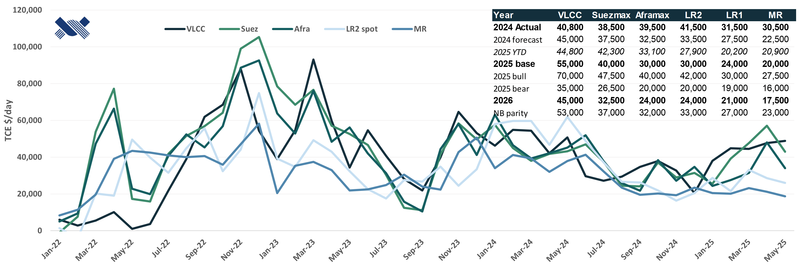
*Chart: Rates and forecast*

*Source: Fearnleys, Baltic Exchange*

Volumes and tonne-miles have tapered in May to date vs. the preceding two months and current fixing pace for June indicates only small changes. Crude tanker volumes are fairly in line with the same time last year, whilst products have declined slightly. OPEC+ cut unwind and eventually more South American volumes may in coming months offset (some of) the normal seasonal downside. Two out of five new Brazil/GuyanaFPSOs this year have started production, with a combined capacity of 405 kbpd. The remaining three will add another 650 kbpd. Once ramped up, that will be a key trigger for (big) tanker rates to recover again.

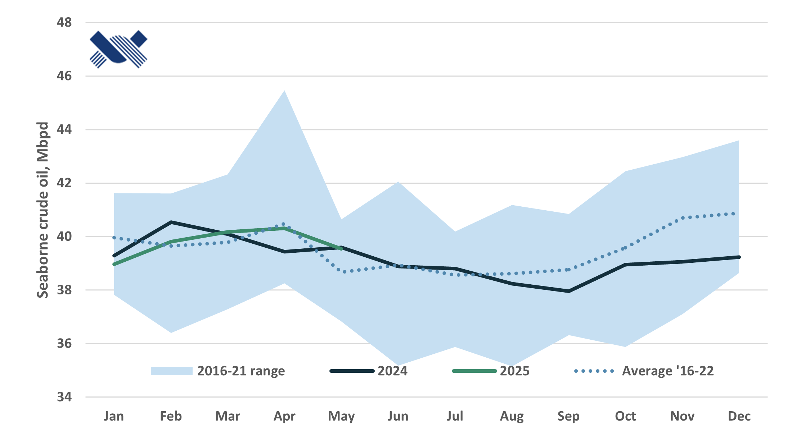
*Chart: Seaborne crude oil volumes, ex. Iran*

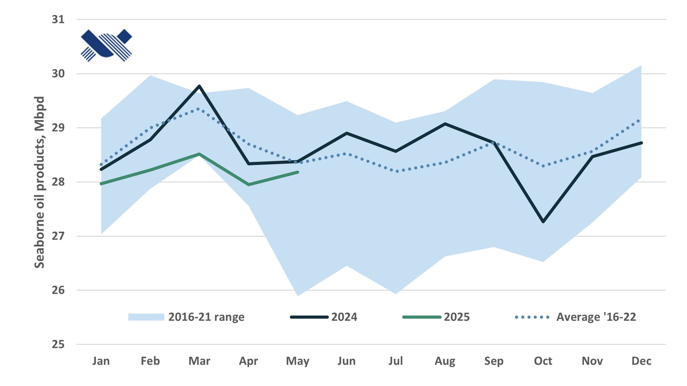
*Chart: Seaborne oil product volumes, ex. Iran*

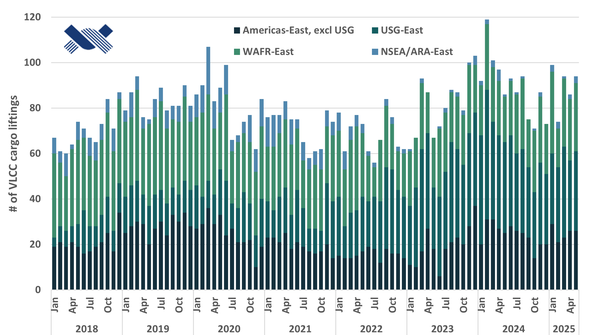
*Chart: Monthly Atlantic VLCC fixtures*

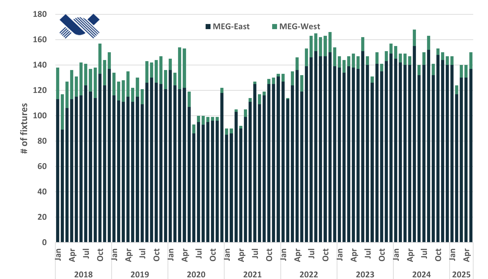
*Chart: Monthly MEG VLCC fixtures*

*Source: Vortexa, Fearnleys*

The main reason for a slightly weaker (crude) tanker market in recent weeks has been the lack of a West-East arbitrage and as a result lower tonne-miles due to shorter sailing distances. Asian buyers seem to find sufficient supply from the MEG for the time being, which may also be aided by the cut unwind from the OPEC+ near-term.

Once new production fully ramps up in Brazil and Guyana, however, that should support improved relative oil pricing for West-East movement. Look to the forward curve for clues, as this could very well coincide with a flip from backwardation to contango.

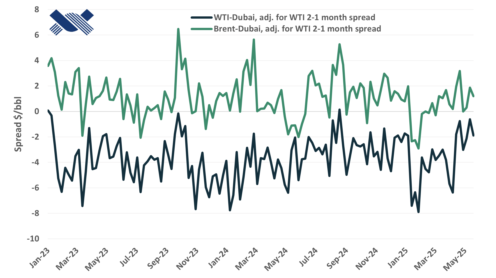
*Chart: WTI & Brent - Dubai, less 2-1 WTI forward spread*

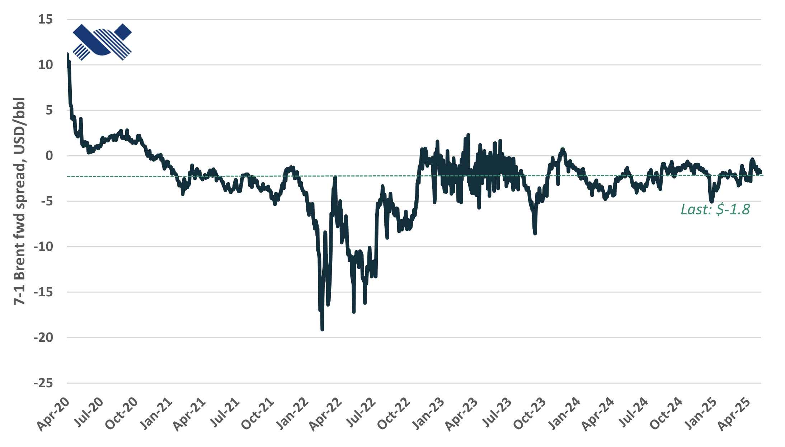
*Chart: Brent 7-1 month forward spread*

*Source: Bloomberg*

The IEA's oil market balance forecasts still point to meaningful inventory builds of 0.7 mbpd this year. In the most recent report, the latest OPEC+ production increase is 'magically' offset by a baseline demand revision for the Middle East and Africa of a combined 3-400 kbpd. This revision also explains why oil inventories have consistently built less than the IEA's estimates have pointed to the last year(s).

However, observed inventory movement still suggest a tighter market than the IEA has predicted, so further demand revisions may come. Judging from oil and forward prices, the oil market can so far absorb the announced OPEC+ cut unwinds, including another accelerated hike in July which is widely expected.

When peak summer demand has passed and volumes ramp up also in South America, it remains to be seen how well oil demand can absorb this - a flip of the forward curve into contango is highly possible.

Per the IEA's latest estimates, including the likely 411 kbpd OPEC 8 hike in July, global crude oil supply growth may be 1.7 mbpd this year, up from 0.7 mbpd in 2024. In 2026 growth is set to slow to 0.9 mbpd again, assuming flat OPEC+ production. That leaves a 1.2 mbpd oversupplied oil market in 2026 - so unless demand picks up more than the IEA's forecast (better hope tariffs are off the table then..), there is downside risk for tanker demand growth next year - especially in the second half of the year.

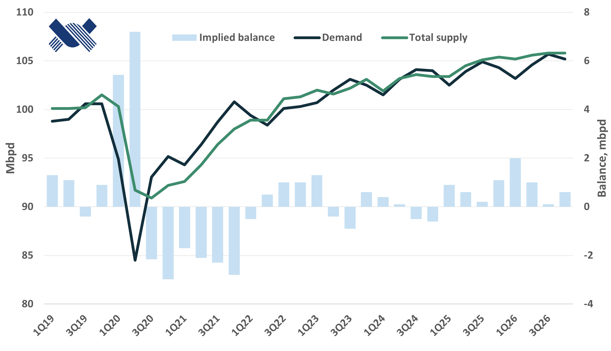
*Chart: IEA oil supply/demand and implied balance*

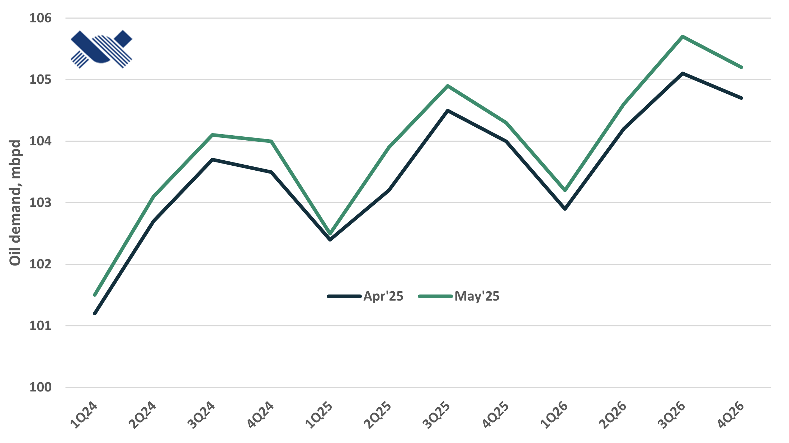
*Chart: IEA oil demand revision*

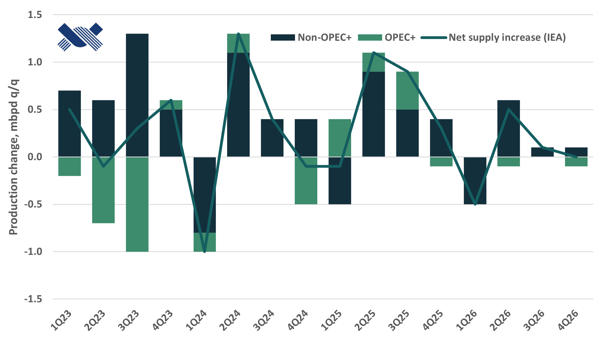
*Chart: IEA quarterly supply change by source*

*Source: IEA*

Some of what has been missing for tanker demand is USG crude oil exports, which are down 225 kbpd YTD vs. the same period last year - despite supposedly increasing U.S. shale production. The main reason for that is most likely the (re)shuffling of flows of Canadian crude through the TransMountain pipeline, where exports are up 370 kbpd y/y.

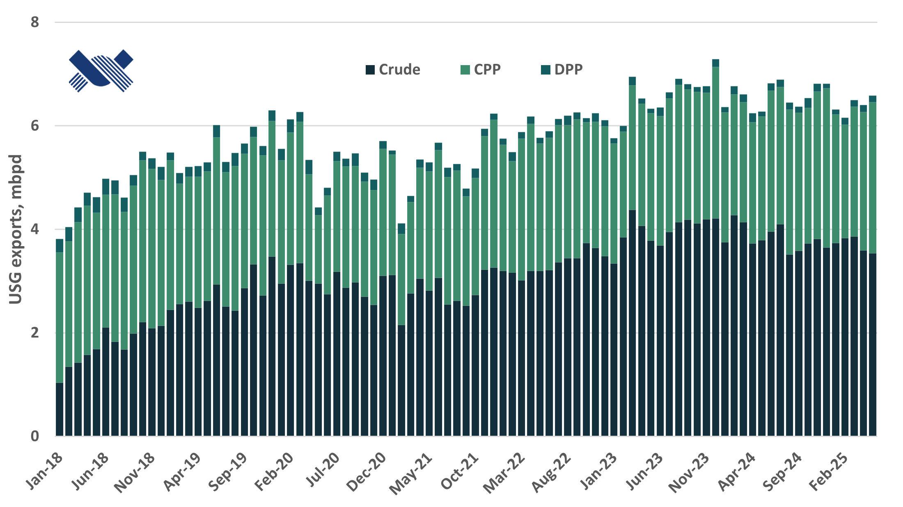
*Chart: USG exports*

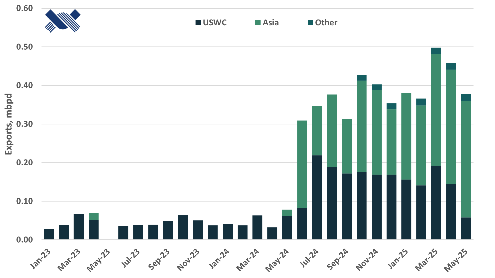
*Chart: Vancouver exports*

*Source: Vortexa*

Refinery margins have broadly strengthened recently, amid resilient demand and expectations for the summer, although are now at more normalised levels vs. the super profits seen over the past few years. A recent naphtha pull, partly on the back of the U.S./China trade spat as helped boost LR rates, although given the preliminary truce this may prove short-lived.

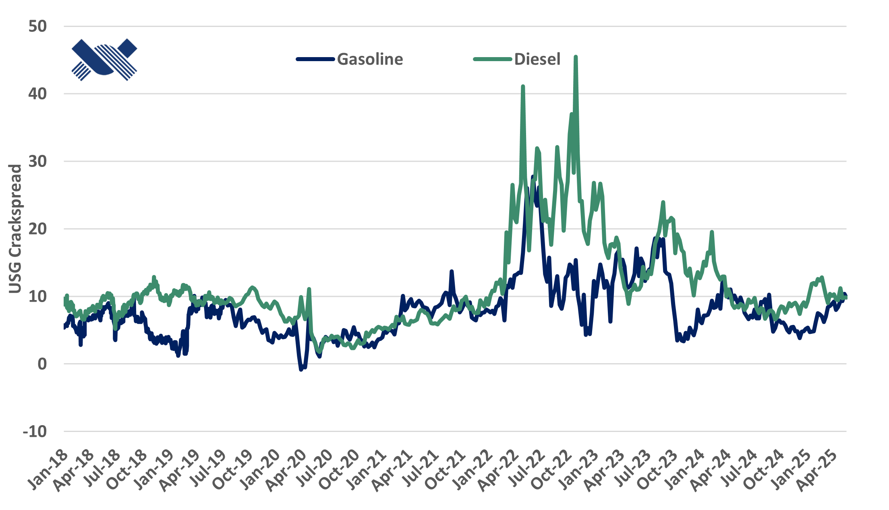
*Chart: U.S. Gulf Coast crack spreads*

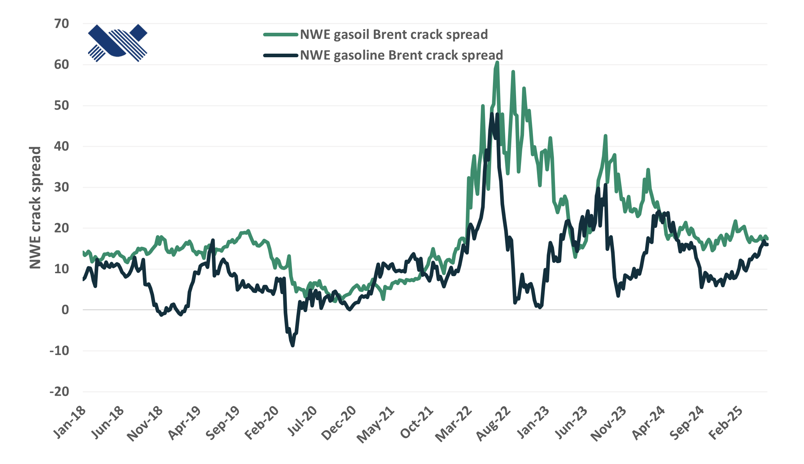
*Chart: NortWest Europe crack spreads*

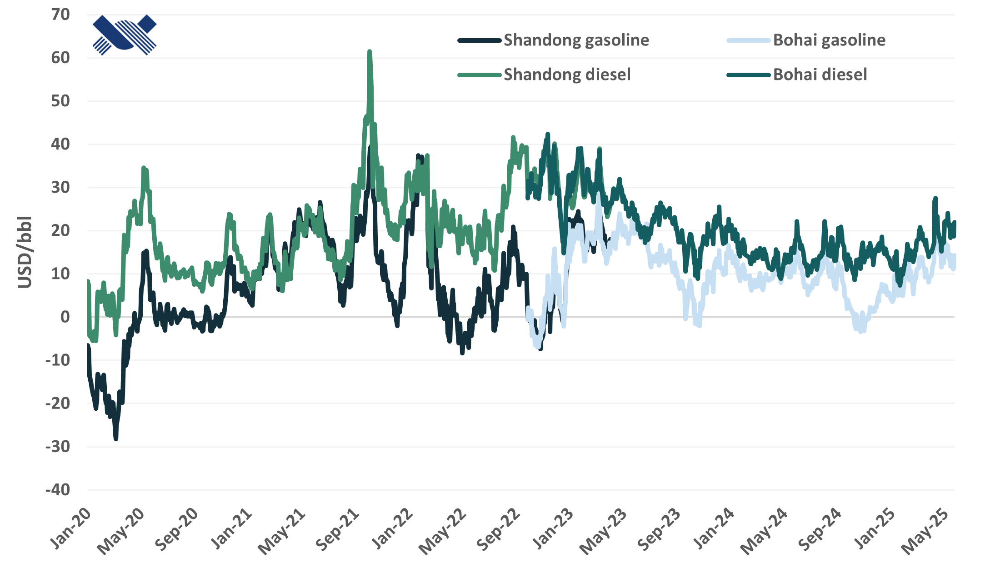
*Chart: Bohai crack spreads*

*Source: EIA, Bloomberg, Argus*

Still, margins are sufficient for refinery run expectations for the summer season to rise above last year's levels, to new records, where several refineres have lifted run-rate plans for coming months. While that may keep a lid on refinery margins and by extension the potential upside for product tanker rates, higher volumes should help support rate resilience near term - in line with our forecasts.

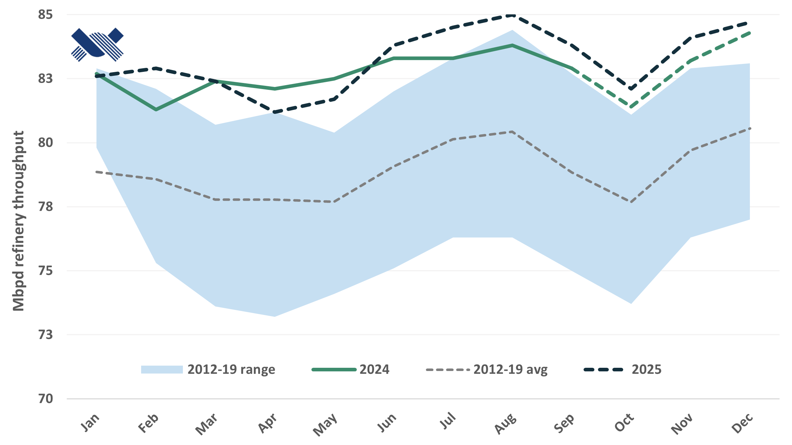
*Chart: Global refinery runs*

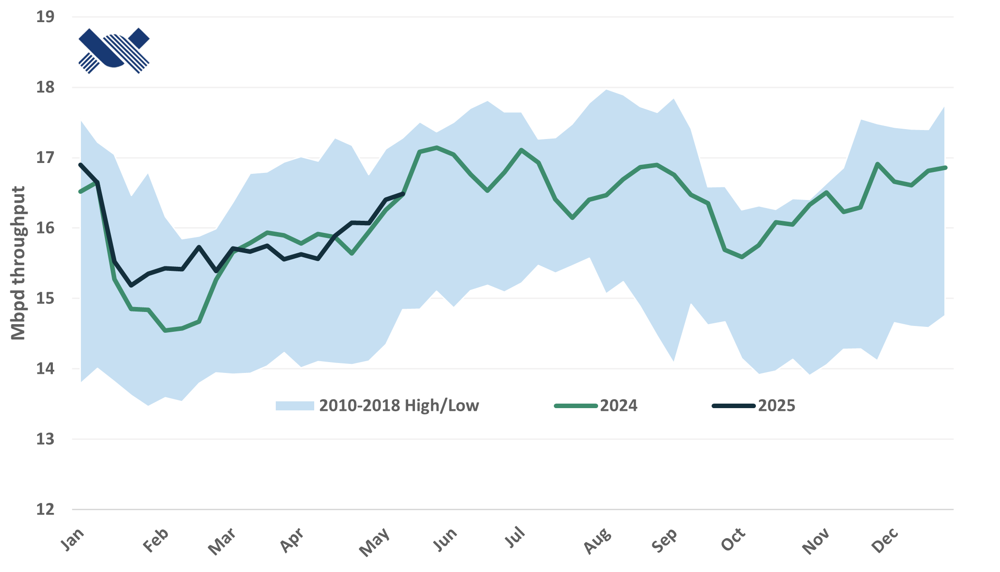
*Chart: U.S. refinery runs*

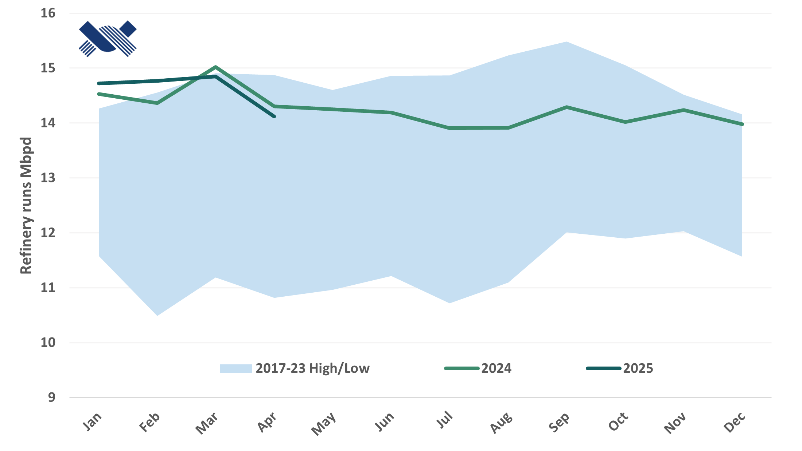
*Chart: China refinery runs*

*Source: IEA, EIA, Argus*

Fleet growth YTD has been relatively low at 0.6%, although the delivery pace has picked up somewhat vs. the historical lows of the last couple of years. Deliveries are set to pick up somewhat more in the second half of the year, especially for product tankers, although for the full year the scheduled deliveries are still relatively low in a historical context, at 2.9% gross growth.

There is more phase-out potential, although the majority of candidates are or have been engaged in shadow trades - many of them sanctioned too, which makes scrapping difficult.

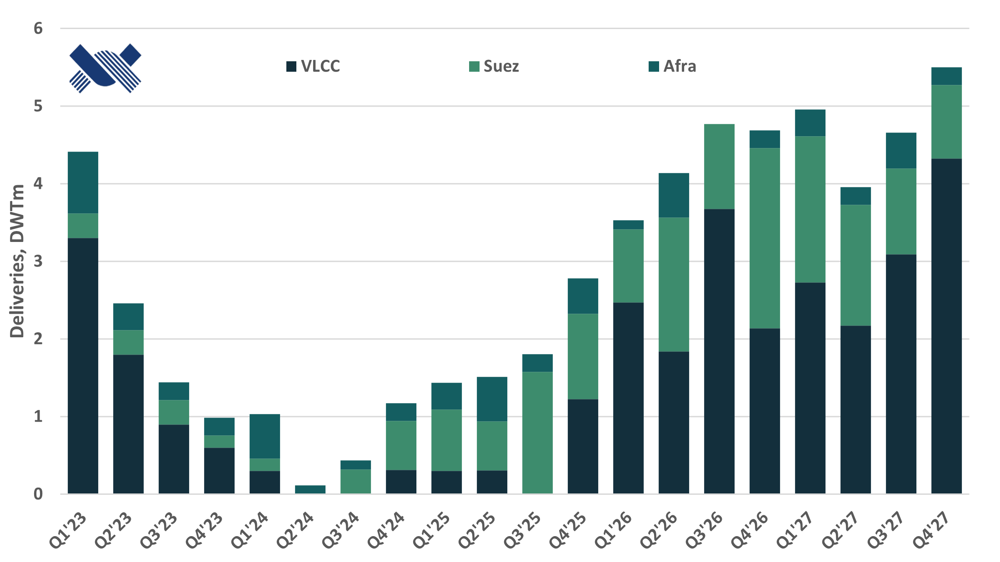
*Chart: Quarterly deliveries, crude tankers*

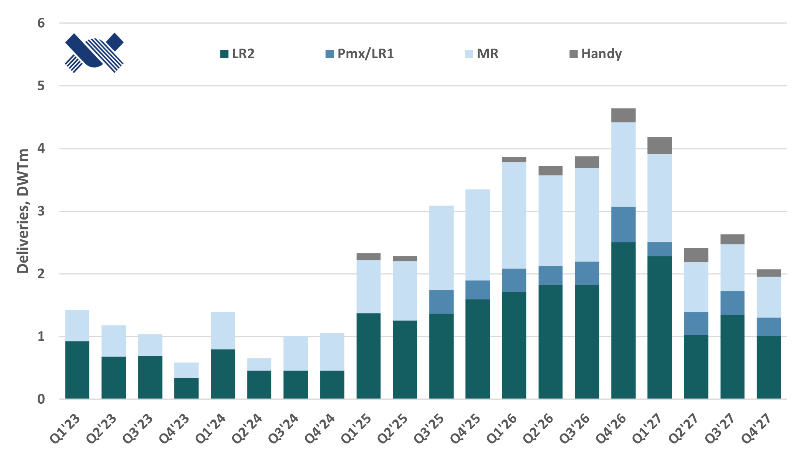
*Chart: Quarterly deliveries, product tankers*

*Source: Fearnleys*

While ordering has slowed this year compared to the last two years, scrapping has picked up somewhat. Already, nearly as much has been scrapped YTD as the two previous years combined, more vessels are reported for sale and some have been converted. That said, the absolute level remains low in a historical context as (some) older ladies find alternative employment in the shadow markets.

Ordering stands below the historical norm, and interest appears limited due to the uncertain geopolitical outlook, lower secondhand prices and somewhat lower rates. Unless rates and secondhand values pick up meaningfully, we expect ordering interest to remain relatively low for the remainder of the year too.

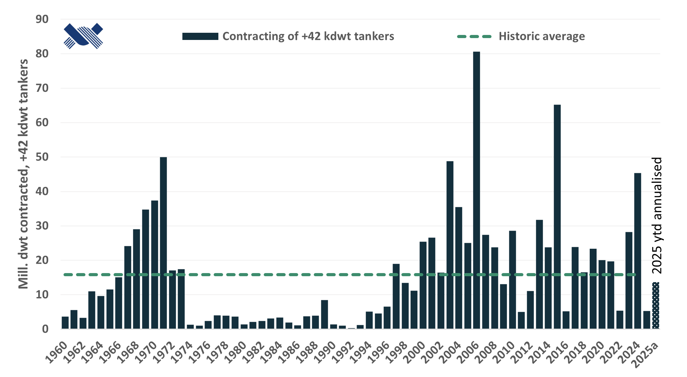
*Chart: Ordering, tankers +42k dwt*

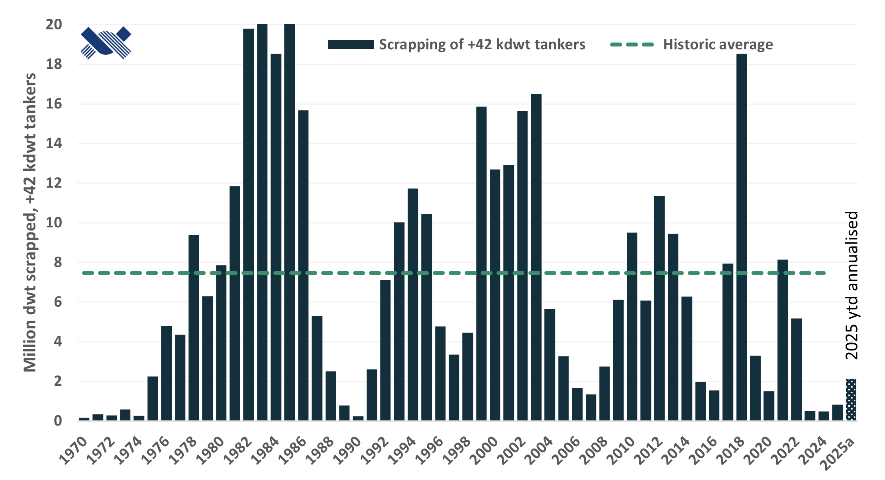
*Chart: Scrapping, tankers +42k dwt*

*Source: Fearnleys*

After the latest announcements, a total 14.5% of the tanker fleet is now sanctioned by either the OFAC, EU or UK. While the latter two do not carry the same weight as the OFAC, it does hamper trade opportunities and utilisation. Loadings on sanctioned tonnage, and especially the OFAC sanctioned vessels, have declined significantly YTD which indicates this does impact shipping - although there are still workarounds for exports.

A renewal of the shadow fleet seems to be ongoing. Over the last few months, since sanctions started ramping up, about 25 'new' VLCCs have been added to the shadow markets, mostly 2004-08 built. This likely relates to sanctions on Chinese teapots, traders, storage and port companies etc. which has made quite a few players more cautious about dealing with OFAC listed tonnage. If there were waivers for scrapping of OFAC listed tonnage, we probably could have seen more scrapping - nearly three quarters of the shadow/OFAC VLCCs is 20+ years old...

In any case, the compliant VLCC fleet is now shrinking.

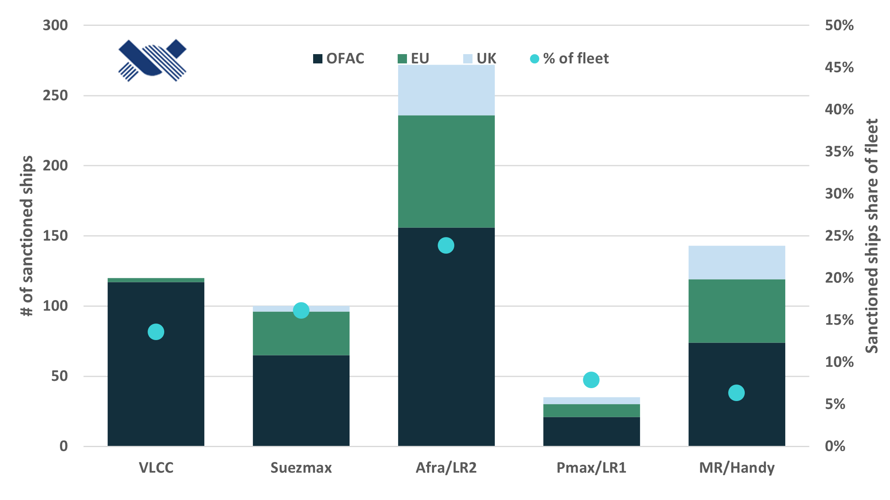
*Chart: Sanctioned fleet overview*

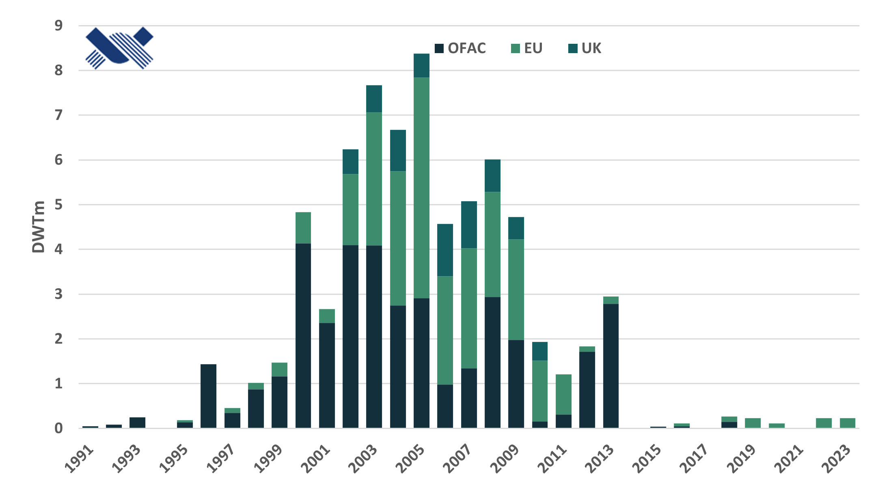
*Chart: Sanctioned fleet profile*

*Source: Fearnleys, OFAC, EU, UK*

Loadings on OFAC, EU and UK listed vessels have steadily declined over the last couple of years, with a steeper decline in recent months after additional vessels have been added to the lists.

*Chart: Loadings on OFAC listed tankers, by origin*

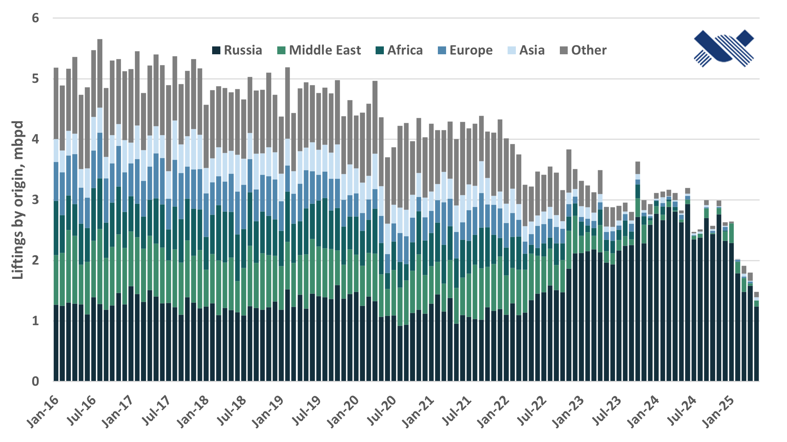
*Chart: Loadings on EU listed tankers, by origin*

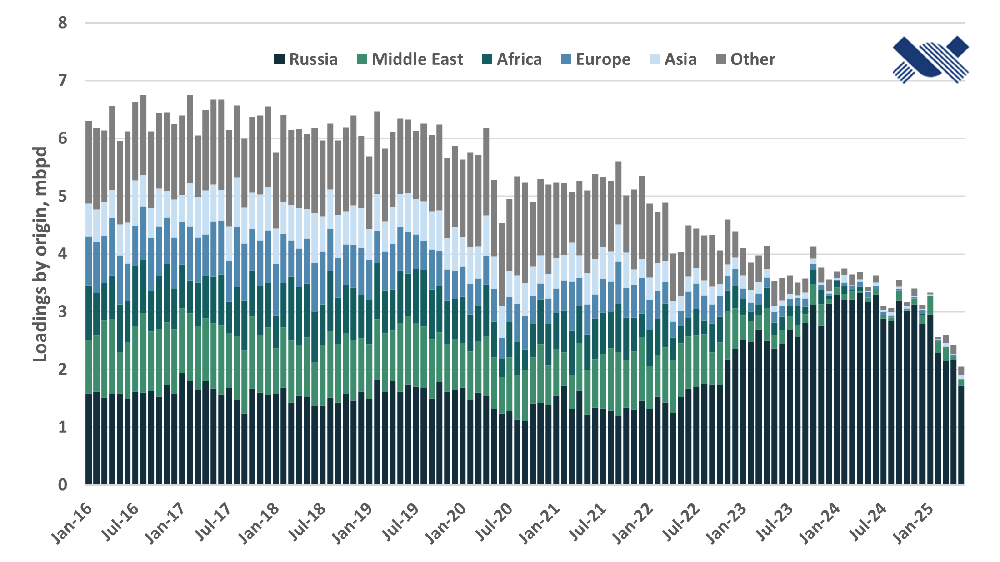
*Chart: Loadings on UK listed tankers, by origin*

*Source: Vortexa*

Meanwhile, exports of sanctioned oil has only marginally declined, while arrivals are slightly lower, and floating storage has picked up. Again this helps explain the firm prices paid for 15+ years old vessels lately, as Russia, Iran and Venezuela partly need to seek alternative tonnage in a shadow fleet renewal.

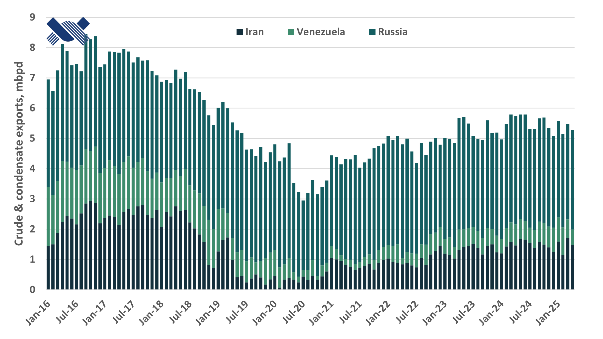
*Chart: Iran, Venezuela & Russia crude oil loading*

*Chart: Iran, Venezuela & Russia crude oil arrivals*

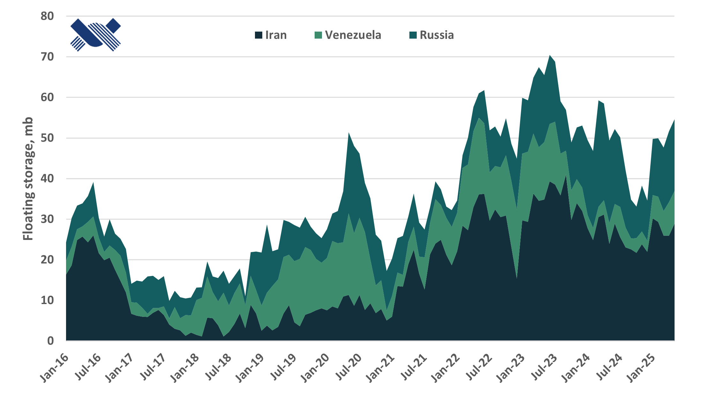
*Chart: Iran, Venezuela & Russia floating storage*

*Source: Vortexa*
