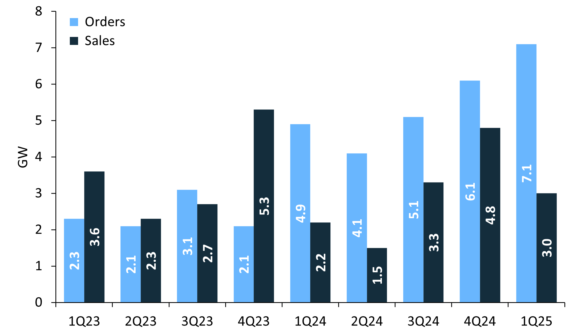
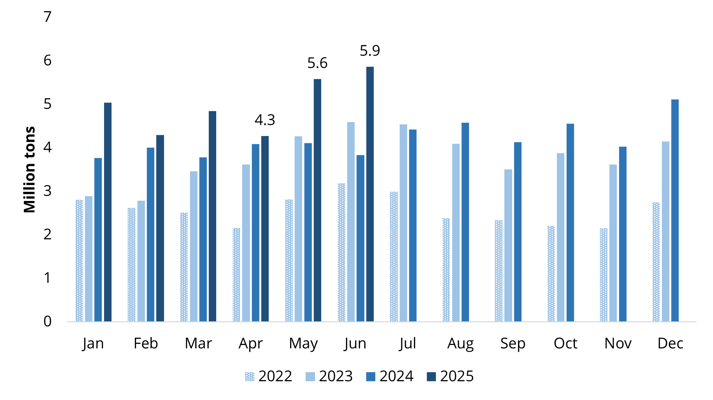
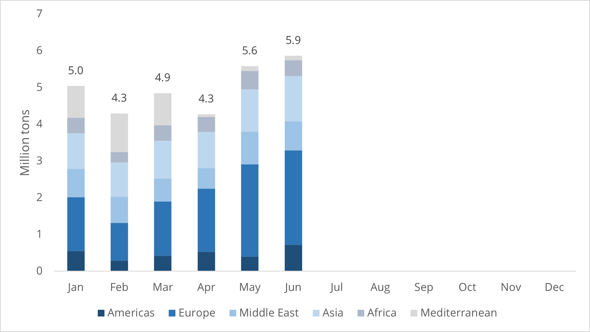
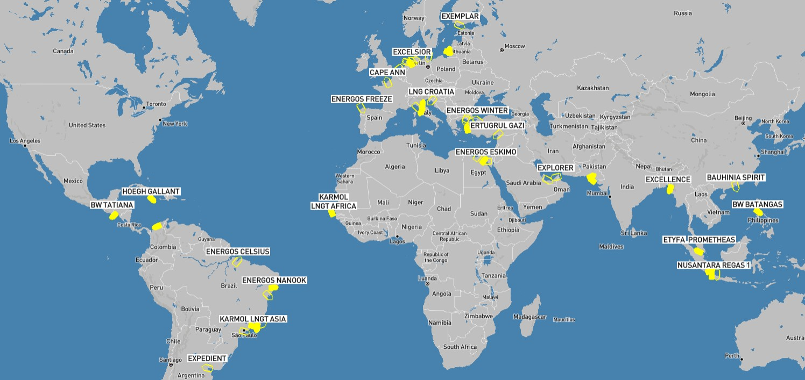
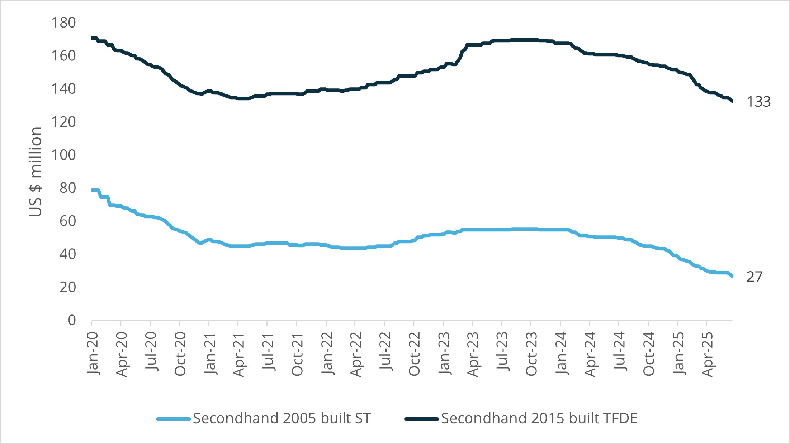
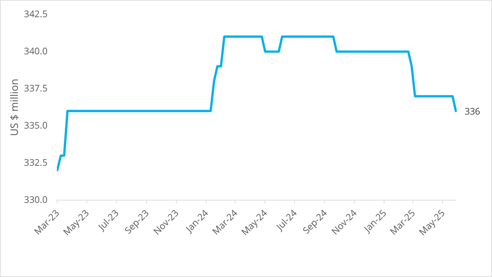

# FSRU Quarterly - Q2/25

**Date:** 2025-07-04 | **Department:** LNG | **Publisher:** Fearnleys AS  
**Original PDF:** [Local PDF](../pdfs/2025/2025-07-04_lng-fsru-report-q225.pdf) | [Cloud Backup](https://pbrkapp.blob.core.windows.net/report/93f12843-c398-404a-8b66-b2e4eb4201c5/report.pdf)  

---

## Market reflections: Running out of tonnage

The anticipation and run-up of prospective activity in the FSRU market during the first quarter came to fruition during the second quarter of the year with a flurry of fixtures (to the extent one can use such a characterization for the FSRU market). EGAS led the charge with two firm deals and one seasonal structure concluded at very solid rate levels which we consider a reflection of an end-user having scoured the market for months finally putting pen to paper; well-played to the involved Owners. However, what looked like a transformation of the market to focus on sublets and near-term availability now appears to be returning to somewhat more normalized project processes. The caveat being a further tightening of prompt-ish tonnage availability and those units left all coming with some form of baggage. The quarter also puts in perspective (and potentially in question) Germanys ambitions on the FSRU front with two out of five governmental units now relet for long/short periods.

While the FSRU market tends to act like chaotic pendulum at times (hard to tell what the next motion will be) our read is that we’re poised for high activity in the next 9-18 months – an activity level which should favor conversions over newbuilds over existing tonnage. We’ve revisited our bottom-up analysis during the quarter and continue to view 2-4 new projects annually as realistic with a form of wall-of-projects slated for 2028 start-up coming to market through H2/25 and in 2026. Thus far in 2025 we count three new projects (2 x Dominican Republic + 1 x Egypt) together with potentially three existing projects (1 x Egypt + 2 x Undisclosed) extending contracts or relocating.

## Key market developments during the quarter

APRIL

Viva Energy re-emerges with requirement for Geelong project following long hiatus. Requirement is for **160,000-180,000cbm with upto 750MMSCFD** capacity. FID is targeted towards end-2025 with Viva aiming for startup in 2028. Timing and sizing suggest TFDE-conversions will be offered primarily with those having larger (170+kcbm) units to offer likely in pole position.

Deutsche Regas announces capacity sold-out through 2025 with a total of 5BCM sold to shippers. The company also indicated further capacity bookings available through 2043 to be concluded by end of summer. Deutsche Regas redelivered the **ENERGOS POWER** in Feb-25, but has announced intentions to install a replacement FSRU in Mukran to work alongside **NEPTUNE** presently in operation.

Snam completes commissioning of **BW SINGAPORE** at Ravenna with commercial operations commencing in May. Capacity is expected to be limited until the facility has the new breakwater installed.

**EXCELSIOR** finally arrives at Wilhelmshaven 2 after a long holiday at Ferrol S.Y. The unit formally went on-hire in Q1/23 for a five-year charter and has cost the German taxpayers an estimated US$ 55m annually (in charter hire only). The unit was connected in May and is undergoing commissioning over summer with commercial operations expected in August.

**ALEXANDROUPOLIS** start-up pushed back to Aug-25 following a complete shutdown in Jan-25 due to technical issues and damages to booster pumps. While there has been limited news since mid-May, it remains uncertain as to whether the unit will resume full production in 2025.

MAY

After a lot of rumours, **ENERGOS POWER** reported chartered out for appx 8.3 years from BMWK (German government) to EGAS for around US$ 155k/day. Charter duration is back-to-back with remaining original period between Energos and BMWK. Charter to commence prompt and unit expected to be located at Sonker jetty in Ain Sokhna following compatibility modifications.

Hoegh EVI announces having secured a 10-year charter for **HOEGH GANDRIA** to EGAS with delivery in Q4/26 following conversion to FSRU at Seatrium. Rate is rumoured to be north of US$ 160k/day. The unit will replace **HOEGH GALLEON** which has been extended from its original charter ending Feb-26.

New Fortress Energy announces having secured a 3-year charter for **ENERGOS FREEZE** to Energia 2000 in Dominican Republic starting Sep-25. The rate is rumoured to be in the range of US$ 110l-120k/day. The unit is expected to be replaced by an FSRU+FSU configuration provided to Manzanillo Gas & Power in 2028 from a separate FSRU provider.

**ENERGOS WINTER** entered drydock in Besiktas S.Y., Turkey and is expected to be available for charter early-/mid-Q3/25. It is not clear whether unit will be returning to TGS in Brazil.

The low-pressure/low send-out FSRU **KARMOL LNGT POWERSHIP AFRICA** stationed in Dakar, Senegal received first cargo in four years as KPS powership in Dakar switches to LNG. Additional cargoes are potentially in the pipeline as supplier has reportedly put options on a strip of cargoes.

JUNE

**ENERGOS FORCE** rumoured to be chartered out for 6-9 months despite HEH/Stade confirming terminal will be ready for winter season. The unit is reportedly heading for Jordan to serve as an interim FSRU in Aqaba. While the saga continues between DET and HEH as to whether the FSRU will ever regasify in Germany, it highlights the need for existing infrastructure to take advantage of any short-term relet opportunities.

Excelerate rumoured as buyers of **METHANE ALISON VICTORIA** after talking about buying conversion candidate since 2023. While the price is rumoured in the mid-/low-20s it is a well-suited candidate for both conversion to FSRU and as a piece of supporting infrastructure to Excelerate’s Caribbean business.

**ENERGOS ESKIMO** completing 10 years of service in Aqaba, Jordan before departing early-June for next charter in Egypt. Unit currently alongside in Ain Sokhna for compatibility modifications before being stationed at Sumed #2 jetty. Jordan will receive **BW FSU (TBN)** in H2/26 as replacement (with onshore regas provided by AG&P) in a 10-year BOOT deal .

DET postpones 2026 auction for Brunsbuttel (**HOEGH GANNET**) scheduled for 26th-27th June due to “unresolved questions reqarding the approval of the new jetty”. If such issues remain in place it would be the second site where DET have encountered challenges as the facilities in Stade remains without an FSRU. Auctions for 2026 capacity in W’haven 1 (**HOEGH ESPERANZA**) and W’haven 2 (**EXCELSIOR**) are expected to proceed as planned.

In a subsequent event (July); **Torman I+II** is being marketed for charter or sale underpinning the tightness of the market as the particular FRU+FSU solution has proven challenging to put into operation for a few years. If it can't find a home now; will it ever?

## Quarterly focus: The gas turbine crunch?

It has been quiet on the corporate front during the quarter with public names such as Excelerate Energy seemingly digesting their newly acquired Jamaica business and New Fortress Energy continuing its fight to realigning the balance sheet and get into a more favorable financial situation.

However, using this quarterly to reflect on wider market-related topics there was one interesting piece of information emerging from the power sector; the steep rise in cost and lead time of CCGTs. Steep growth in demand for power related to data centers (effectively the continued surge in AI) has driven up costs for CCGTs in the US market from around US$ 1,000/kW in 2022 to just shy of US$ 2,500/kW in 2025 according to data from Rystad Energy (sourced from GE Vernova). Additionally, orders have surpassed sales for five straight quarters which has led to increased lead times. The combination of higher costs and longer lead times for CCGTs could be a risk to underlying gas demand and deferral of FSRU demand.

Our analysis and discussions with industry players on this topic suggests that the cost/time-issue is prevalent mainly for 60Hz markets and that 50Hz markets are not seeing the same trend. The vast majority of markets where FSRUs are required are 50Hz markets and as a consequence the working hypothesis on gas-to-power as both provider of base load and balancing against renewables remains intact for the time being.

*Chart: US CCGT cost index (by year of contract order)*

*Chart: GE reported CCGT sales vs orders (by year of contract order)*

*Source: Rystad Energy*

## FSRU activity and volumes

Q2 was a record quarter for FSRU imports on back of most FSRUs now employed and operating. Overall activity at operational FSRUs has been firm during Q2 with total quarterly imports at 15.7mt / 251 cargoes  (which is up 31% from 12.0mt / 211 cargoes in Q2/25). The Y-o-Y increase is driven primarily by Europe this quarter as volumes have shot up to 6.8mt for the quarter vs 4.6mt in Q2/24. The increase was predominantly in Mukran, but also Ravenna starting up together with W’haven 2. Global LNG imports in Q2/25 came in at 105mt; which means around 15% of global LNG volumes are delivered to FSRUs. Asian volumes also rose from 2.7mt to 3.4mt, primarily driven by the Summit FSRU back in operation and Hong Kong taking two cargoes per month compared to one cargo last year.

The busiest terminal during the quarter was Eemshaven with a total of 22 cargoes – or one cargo every ~4 days. Shoutout to the crews onboard **ENERGOS IGLOO** and **EEMSHAVEN LNG**. On the other side of the spectrum, Brazil has seen no cargoes to **EXCELERATE SEQUOIA**, **ENERGOS NANOOK**, **KARMOL LNGT POWERSHIP ASIA**, **HOEGH GIANT** and **ENERGOS WINTER** during the quarter with only **ENERGOS CELSIUS** receiving two cargoes for Barcarena.

From a fundamental perspective, we' re also encouraged to see the percentage of LNG going to FSRUs increasing - adding support to more FSRUs needed as global LNG supply enters the next growth spurt in the coming years.

*Chart: Global volumes imported through FSRUs (2022-2025YTD)*

*Chart: Monthly volumes imported through FSRUs by region (2025)*

*Source: S&P / Platts*

## Recent FSRU Project Developments

*Asia & Middle East*

**Petrovietnam** requirement for FSRU in Ba Ria, Vung Tau issued in Q1 moving slow. Initially targeted for the 2026-2029 period, the timing has slipped reportedly on back of lack of visibility for demand from EVN.

Requirement in **Iraq** remains real (3-5 years firm potentially with options), but lack of availability and geopolitical uncertainty is keeping a near-term solution from concluding. Our take is that Iraq should refocus efforts on a conversion for delivery in 27 instead of chasing its own tail.

Limited news from **Jordan** following RFQ for 12-15 month requirement to bridge departure of **ENERGOS ESKIMO** and arrival of **BW FSU TBN**. Rumours about BOTAS FSRU to be seasonally located remain unconfirmed.

**Malaysia** reviving import terminal projects as Petronas reported to be evaluating FSRU for project in Lumut (West Coast Peninsular) and E&H Energy signing MoU for regas terminal in Kemaman (East Coast Peninsular) with operations targeted for start-up in 2028.

*Europe & Mediterreanean*

Both projects in **Netherlands** seem to be moving slow with no sign of activity for open season for **Eemshaven Energy Terminal** and Vlissingen (**Zeeland Energy Terminal**) announcing start of permitting process in May. Eemshaven is still targeting to extend its operations beyond Q3/27 while the Zeeland timeline is now for “commence operations by 2028/2029.

**Egyptian** Minister of Petroleum and Mineral Resources, Karim Badawi, restated their intentions to have a fourth FSRU located at Damietta in August.

**Italian** FSRU activity may not be over with a new version of the energy decree suggesting an FSRU in Porto Torres and/or Oristano. However, the decree has gone through multiple iterations and challenges over the past years with local forces still not fully aligned.

*Americas & Caribbean*

**Colombia’s** Ecopetrol and the Ballena LNG project remains open with the requirement being an FSRU to be connected to an existing gas pipeline running from an offshore platform to landfall point in La Guajira.

Activity in **Brazil** has slowed down following the cancellation of a much anticipated power auction. Combining the cancellation with rising cost of greenfield plants, the #1 FSRU market in the world is currently in flux when it comes to additional units.

*Africa & Other*

**Morocco** issued its EOI for Nador West Med in April with deadline for interested parties in July. The project is structured in three separate elements; FSRU/terminal, natural gas pipeline and gas power plant. Bidders can express interest on an unbundled or bundled basis.

**Sierra Leone** announced late-June an MoU for an LNG terminal to be developed in Freetown. The project has been through many iterations over the year, but TCQ/Anergi have partnered with AG&P and BBE to develop a terminal.

*We encourage clients with deeper interest in ongoing project developments, tender activity and business development to contact Fearnleys directly; the above is merely scratching the surface of activity.*

### Notable FSRU movements

*Chart: Fleet_Map*

*Source: Fearnleys*

As the FSRU market is by and large sold out there are limited units moving around (which is in many ways good).

The most notable movements for FSRU during the quarter has been Energos Power reaching Egypt while the sister vessel Energos Force has over the past week sailed from Skaw to Gibraltar and expected to enter Med on her way to **Jordan**.

Excelsior departed Ferrol S.Y. and connected to her destination site in Wilhelmshaven with reports of gas now flowing. Excelsior finally connected in Wilhelmshaven with gas flowing.

Energos Winter reached Turkey after departing TGS in March.

ETYFA Prometheus remains in Malacca where works to complete the unit is ongoing still.

## Asset values: Conversions increasingly competitive, NBs trending lower

*Chart: FSRU conversion candidates: Secondhand values*

*Chart: FSRU Newbuild prices*

*Source: Fearnleys*

The FSRU market is tighter than it was at the end of Q1 and we reiterate our view that H2/25 and 2026 should be a busy 18-month period with a broad palette of projects in the pipeline. The only announced conversion unit (**HOEGH GANDRIA**) is now fixed and we expect to see more news on conversions over the next quarter based on both S&P discussions and conversations with equipment providers. Prices for donor vessels continue to drop – applicable for Steam Turbines and DFDE/TFDE alike – which is lowering the bar for prospective conversion players to take a position. However, the risk appetite amongst FSRU players appear to be in stark contrast to the rate levels as matching of project FID and vessel acquisitions remains an issue. We see a growing interest from projects for larger tonnage (moving out of the “cheap and cheerful” 138,000-145,000cbm range) as lower vessel prices and no need for new power module together with larger storage is attractive to end-users.

We see no material change to conversion costs/timelines with end-to-end delivery of a conversion being in the range of 30 months (from FID to COD) based on conversion at Asian yards. We note Hoegh’s decision to convert at Seatrium with engineering commencing in May-25 and completion in 18 months (Oct/Nov-26) which supports the “risk adjusted”-approach of placing orders for Long Lead Items as a more prudent balance sheet exercise than a fully-fledged speculative conversion. No cost has been announced, but our estimated conversion costs (excluding site team/project team, mobilization and commissioning) remains in the range of US$120-160 million for 500/750 SW/Glycol Open Loop.

The FSRU newbuild market has been relatively quiet over the quarter, but with LNGC price indications creeping lower and some project requirements being very specific we would not be surprised to see an uptick in activity towards 2026.
