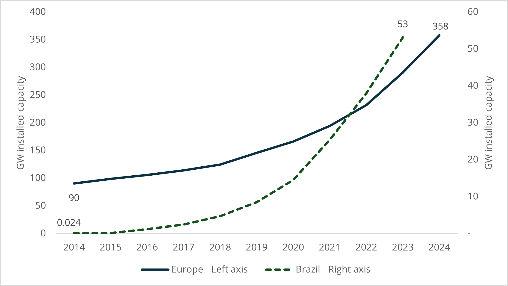
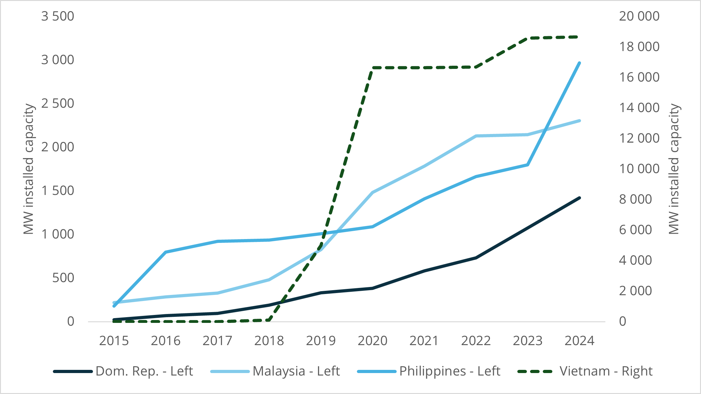
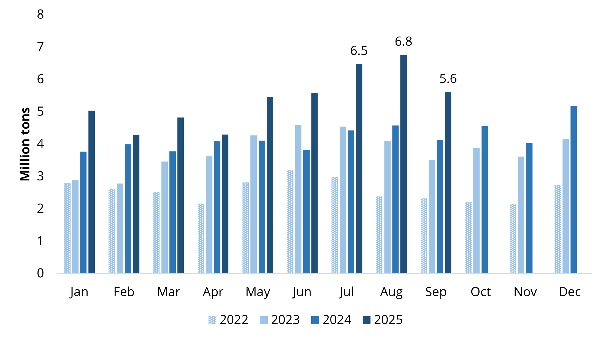
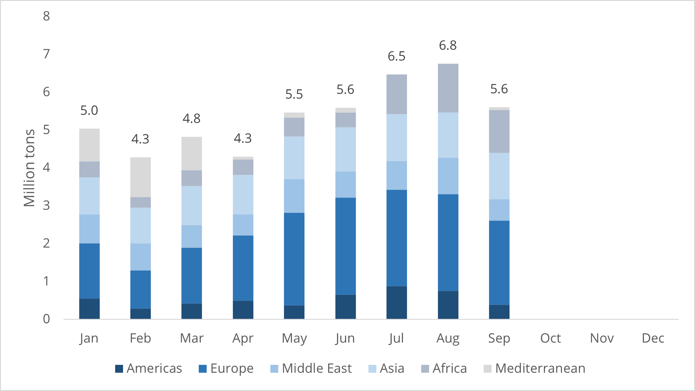
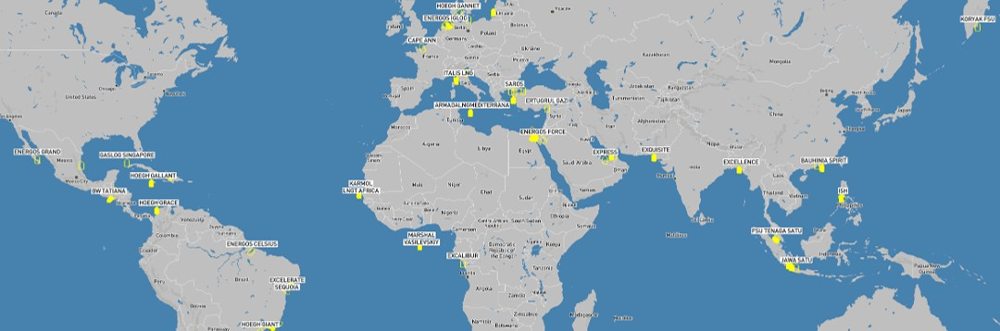
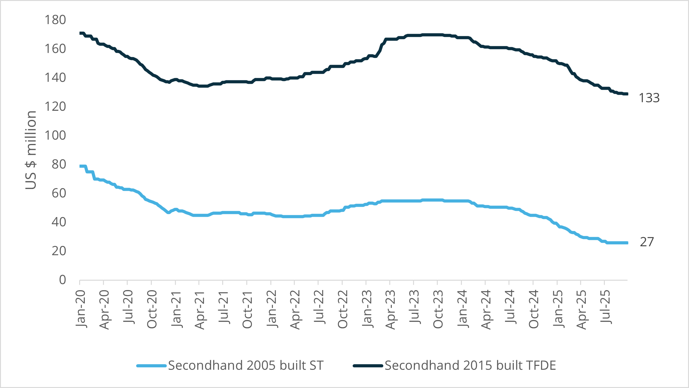
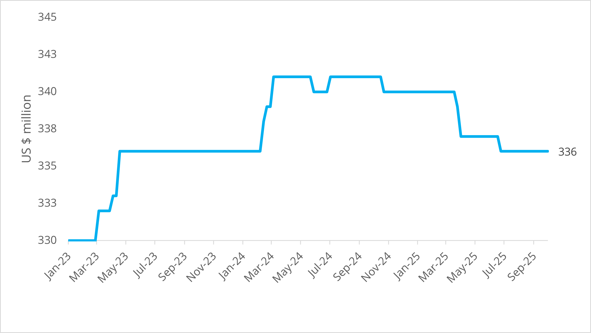

# FSRU Quarterly - Q3/25

**Date:** 2025-10-09 | **Department:** LNG | **Publisher:** Fearnleys AS  
**Original PDF:** [Local PDF](../pdfs/2025/2025-10-09_lng-fsru-report-q325.pdf) | [Cloud Backup](https://pbrkapp.blob.core.windows.net/report/70828f3a-f901-4d80-be14-16919023cbaf/report.pdf)  

---

## Market reflections

With an FSRU market that is all but sold out and only a handful units (maybe) available, the inevitable smell of “fast” profits is attracting people to the sector. The “Big 5” FSRU players are moving in cautious pace with our count of semi-speculative positions being 3-4 depending on how one counts. Those players long conversion tonnage appear to have taken position on regas modules while those short tonnage have secured/are working to secure tonnage before moving to long-lead items.

Based on our conversations running up to Gastech in September, the landscape seems to be widening with more (both known and unknown) names considering to throw their hat in the ring. Admittedly, a segment where 10yr deals can be done with payback of 5.5-7.5 years should generate attention in board rooms whether owning an LNGC or not. As always, capital may be perceived as a barrier to entry and not everyone can afford to take lottery tickets at US$ 250m a ticket. But history has clearly shown that capital will flow to segments of high return, irrespective of the understanding of the odds of the game. As we see more names positioning, we highlight the importance of operations in the world of FSRUs. While possible to use 3rd party managers, the real moat for FSRU players lies in knowing their assets and the needs of their clients (as the clients every now and then don’t understand it themselves).

It may perhaps be superfluous to say that we remain positive to the FSRU market, but underlying fundamentals continue to point in the right direction with limited firm orders/news of conversions. However, they are happening under the radar and we expect to see the news surface over the next 6 months. The demand side is still “on fire”…but as usual the fuse is a little longer. Based on our assessment, we see 4-8 new (credible-ish) projects likely to come to market in 2026 for tonnage – keeping the rate environment elevated.

### Key market developments during the quarter

JULY

DET sold capacity at **W’haven 1** (2026 slots) and **W’haven 2** (2025+2026 slots) in July with all slots sold. **W’haven 1** secured prices around EUR 0.26 for Obligation to Deliver (OTD) and EUR 0.40 for No-OTD (NOTD). W’haven 2 slots came in at EUR 0.29/EUR 0.36 (OTD/NOTD) for 2025 and a flat EUR 0.22 (OTD & NOTD) for 2026. The low-ish pricing seem to reflect DETs public subsidy package (~EUR 5bn) announed late-24 which effectively means they can give away capacity at the expense of German tax-payers. It is worth highlighting the prices does not include Gas-in-kind which is reported at around 1% during summer (0.7% / 1.3%) and 2.2% during winter.

DET confirmed **ENERGOS FORCE** on a short-term lease to EGAS with the FSRU to be berthed in Jordan at the Aqaba-terminal. The FSRU is expected to be back in Germany late-25/early-26 as the German government has urged DET and HEH to find a solution to the fallout around Stade. The FSRU will likely be in place until Stade onshore commences operations in late-27/early-28, leaving ~5 year of firm charter period.

EGAS concluded its FSRU chartering spree with **ENERGOS WINTER** heading for Damietta under a 5-yr charter. The TC rate is rumoured to be in the USD 115k-130k/day range – a very healthy rate considering the size and specifications of the unit.

TGS in Brazil is now a “plug-and-play” ready terminal after **ENERGOS WINTER** departed for planned drydock and subsequent charter to EGAS. We expect to see interest in TGS for the upcoming power auctions.

Squadron Energy confirms their intention to commence operations at Port Kembla with **HOEGH GALLEON** in 2027. While the demand picture in Australia remains murky at best, driven by political undercurrents – it would be good to see the FSRU head to her allocated destination after finishing intermediate operations in Egypt.

**Petronet** receives approval for a 5mtpa onshore terminal, replacing former plans of a 4mtpa FSRU. The project was on our list of likely to materialize with a project score of 62 (out of 100) and the decision to go onshore is another note to buy a big scissor when doing FSRU projects in India (to be able to cut through all the red tape).

AUGUST

**AG&P LNG** announces completion of the acquisition of Venice Energy’s Outer Harbour project and targets FID by end-25. While it remains unclear which until will be used, the storyline remains consistent with a 145,000cbm unit with ~250-300MMSCFD nominal capacity. Timing for startup is not entirely clear, but has been talks of 2028 which would make sense given nothing firm has been seen on the FSRU conversion.

Seatrium and **Karpowerships** cement their relationship following the latest FSRU conversion – adding three more FSRUs to the “todo”-list for Seatrium. While all Karadeniz FSRUs to-date are low pressure/low send-out there have been talks of adding one high pressure/high send-out unit for conversion. Seatrium and Karpower also agreed on Seatrium doing integration on 4+2 powerships, which is technically a bigger deal than three FSRU conversions in our view.

DETs latest addition to the FSRU front – W’haven 2 (**EXCELSIOR**) – commenced commercial operations late-Aug. Following an extensive delay to the project, the FSRU is the third operational unit in Germany which will only operate until 2028 as the original deal was 5 years (of which 2.5 has already passed with zero send-out).

**LNGCROATIA** went offline as she departed for Turkey for a planned 5-year drydock and installation of the fourth regas train (212MMSCFD) which will increase capacity to a peak of 596MMSCFD.

After a lot of back and forth which according to rumours had both **ENERGOS FORCE** and **ENERGOS WINTER** heading for Iraq, it was announced that there were two remaining players for the FSRU to be located at Khor Al-Zubair. The two remaining players were Breeze Investments (reportedly working with ADNOC) and Excelerate Energy. On 1st October, **Excelerate** announced having won the project and while it is not clear which FSRUs have been offered, we expect it to be a subset of Excelerate FSRUs, including the newbuild **EXCELERATE ACADIA**. In any case, the deal is expected to include supply of LNG and FSRU on what is likely a G-t-G initiative.

SEPTEMBER

Polish **Gaz-System** is testing interest for another FSRU in Gdansk Bay. The first FSRU is a newbuild currently under construction for MOL who won a tender reportedly in close contest with BW LNG. The **second FSRU** has no timing, but depending on market interest and open seasons we would expect startup in the early-2030s.

**BOTAS** effectively confirmed their demand for FSRUs for the next three years at least with a total of 4.5BCMA (3.25mtpa) of deals with **BP, ENI and Shell**. While BOTAS has a seasonal profile on their gas demand, the deals announced would suggest BOTAS will have a more steady send-out as they target to distribute gas to European markets in addition to serving domestic demand.

The **ALEXANDROUPOLIS** has had a rocky start since commencing commercial operations a year ago – and was expected to be at full capacity after a lengthy shut-down. In August, Gastrade stated the terminal would be at full capacity from start of the gas-year (October). However, mid-September it was announced that the terminal would be at 75% for some time before full capacity is reached. No cargo has been delivered since Jan-25.

**Excelerate** made local headlines when receiving a 30-yr license for FSRU at **Haldia, Kolkata (India)**. The license holds a capacity of 1.5mtpa expandable to 3.0mtpa and will according to plan start in H2/27. The project will connect to GAILs JHBDPL-pipeline which is close to finished. While it is not the first time we see projects in Kolkata, this could be a fresh start and maybe kick off natural gas from an FSRU to India.

**Seapeak and VOPAK** formalized the (well-known) tie up in Australia for the Port Philip Bay in Victoria, Australia. While no specifics of the selected FSRU have been announced, we lean towards the older **165,000cbm DFDE/TFDEs**. The project is targeted for start-up in 2029.

### Quarterly focus: Walking on sunshine – the impact of growth in solar PV generation on FSRU demand

There has been limited activity on the corporate front also in Q3/25 although Q4/25 may bring some interesting perspectives with interest payment due on NFEs bonds in November.

As with previous editions of this quarterly, we take the opportunity to reflect on topics that have underlying impact on the FSRU market. This time we scratch the surface of one of the FSRUs semi-distant cousins; the PV market. PV (Photo Voltaic) is one of the fastest growing parts of the global energy mix having recorded a growth of 720% in the past decade and 150% in the past five years according to BPs Statistical Energy Review – totalling 1.9TW of installed capacity at the end of 2024. The growth is staggering; 26% CAGR since 2015! This contrasts LNG, the most rapidly growing fossil fuel, at a measly 5.2%. The beauty of PV (and wind for that matter) is the need for large-scale, reliable, flexible, rapid ramp-up and cost efficient thermal power generation; natural-gas fired power plants. To manage the inherent shifts in peak demand driven by daytime PV generation to evenings (the duck curve for all the power market geeks out there); a large capacity reserve in the form of gas-turbine power generation is needed.

Brazil is a wonderful example of how FSRUs provide a solution to multiple challenges; starting out as a source of gas to balance reduced production from hydropower in the early part of the millennium (GOLAR SPIRIT, GOLAR WINTER and VT3) to enabling capacity reserve solutions today (ENERGOS NANOOK). Brazil had 53GW of PV installed in 2024, up from 8GW in 2020 – and the upcoming power auctions (to which numerous FSRU projects are being developed for) are by and large generation capacity to balance the market on back of PV growth. This is one of the key reasons for why we are long-term bullish on FSRUs in Brazil.

Now, one would be prone to look for alternative rapidly growing markets with similar characteristics on PV (or wind). Asian markets such as Vietnam, Malaysia and Philippines are earlier in the growth curve compared to Brazil, but they are coming – and the heavy dependence on coal-fired power generation mixes (no pun intended) badly with PV. While slow and bureaucratic these markets will eventually need FSRUs to unlock the relentless market forces of PV as one of the lowest cost sources of electricity on a levelized basis (LCOE – another one for the power geeks). Of course, efficient auctions, subsidies and other factors come into play, but PV is in fact one of the biggest supporters of FSRUs. So, while FSRU players may already feel like they are “walking on sunshine” given the current market environment; put on shades because the future is bright!

*Chart: Installed PV capacity: Europe and Brazil still feels "exponential"*

*Chart: Installed PV capacity: Latent demand from rapidly growing markets*

### FSRU activity and volumes

Q3 was another (consecutive) record-breaking quarter for FSRU imports as the announced charters earlier in the year are starting to operate. Overall activity at operational FSRUs reached a total of **18.8mt / 306 cargoes in Q3/25** (which is up 43% from 13.1mt / 223 cargoes in Q3/24 – and 22% from 15.4mt / 255 cargoes in Q2/25). The Y-o-Y increase is driven by-and-large by **Europe and Egypt**. Europe hit a high of 7.3mt during the quarter while Egypt racked up a whopping 3.5mt in Q3/25 (1.3mt in Q1/25). In Europe, the full quarter effect of W’haven 2 and Ravenna added together with a breakneck pace at Eemshaven. In Egypt, we see three FSRUs now fully operational after start of **ENERGOS ESKIMO** and **ENERGOS POWER** in July-25. Global LNG imports in Q3/25 came in at 108mt; which now means **FSRUs account for 16% of global LNG receipts**.

The prize for most busy terminal goes for the second quarter in a row to Eemshaven with a total of 26 cargoes (a cargo every 3.5 days which is extremely demanding operationally. We again give a BIG UP for the crews onboard **ENERGOS IGLOO** and **EEMSHAVEN LNG**. While the number of terminals not regasifying has dropped substantially the last year, there are a few crews that get a lot of R&R. **ENERGOS NANOOK**, **BW BATANGAS**, **CAPE ANN** and **SAROS** all counted doughnuts in Q3/25.

The pace at which FSRUs are gathering operational momentum may be lost on the general population, but it is without doubt underpinning the fact that FSRUs are both rapidly deployable and can quickly add to the energy mix for those in need. Put an FSRU up against a land-based terminal and the FSRU will outcompete on cost and time every time. In light of the wave of LNG supply the world will experience over the coming years we continue to stress the point that FSRUs offer the fastest way to open new markets – and expand existing ones.

*Chart: Global volumes imported through FSRUs (2022-2025YTD)*

*Chart: Monthly volumes imported through FSRUs by region (2025)*

*Source: S&P / Platts*

### Recent FSRU Project Developments

*Asia & Middle East*

**Petrovietnam** requirement for FSRU in Ba Ria, Vung Tau issued in Q1 continues to move slow. Initially targeted for the 2026-2029 period, the timing remains slippery as the end-user EVN appears to not know what it wants.

**Australia** is moving ahead on several fronts with VOPAK formally announcing Seapeak as their partner for the project in Victoria. Viva is also in parallel working to get Geelong off the ground.

*Europe & Mediterreanean*

**Ireland** continues to grind through its seemingly endless bureaucratic process of getting an FSRU in place. FSRU providers have been approached, but timing (and location) remains uncertain.

**Italian** FSRU activity may pick up with Snam having been mandated to set up an FSRU in Oristano (and potentially in Porto Torres) on Sardinia.

*Americas & Caribbean*

**Colombia’s Ecopetrol** and the Ballena LNG project is a hot potato as “everyone” has tried with limited luck. The lack of near-term availability is causing issues locally which we do not see resolved with anything but a reset of timelines and a conversion FSRU.

We see more activity in **Brazil** as the disappointment of the cancellation of power auction earlier in the year is starting to transition into positioning for the next auction. The long timelines for A-4 or A-5 fit well with development of conversion FSRUs.

**Guatemala** issued a 1.4GW tender earlier in the year with one (of many) alternatives is to do a LNG-to-Power project with a dedicated FSRU.

*Africa & Other*

**Morocco** has received feedback on its EOI with deadline in Jul-25. The initial EOI was in plain language a “tell me what you want to do or can do” and the feedback seems to be clear that it will be an unbundled process with FSRU being offered separately.

**Ivory Coast** is back on the FSRU-track with reports of an FSRU being sourced for Abidjan. The project would be the second or third project after CI-GNL failed some years back. Godspeed.

*We encourage clients with deeper interest in ongoing project developments, tender activity and business development to contact Fearnleys directly; the above is merely scratching the surface of activity.*

### Notable FSRU movements

*Chart: FSRU_GLOBAL_MAP_2*

*Source: Fearnleys*

As the FSRU market is by and large sold out there are limited units moving around (which is in many ways good).

The most notable movement for an FSRU during the quarter has been **ENERGOS FREEZE** reaching Dominican Republic late-Aug/early-Sep to start operations for Energia 2000 on a 3-year charter.

Additionally, the **ENERGOS WINTER** arrived at Damietta, Egypt late-Sep and is expected to add to Egypt’s already sky-rocketing regas capacity.

**LNG CROATIA** is currently undergoing periodic drydock and installation of its 4th regas train at Kuzey Star in Turkey.

**ETYFA PROMETHEUS** remains in Malacca where works to complete the unit is ongoing still.

**BAUHINIA SPIRIT** has according to her vessel movements departed station three times during the quarter – likely as a precaution for adverse weather conditions. She is at present back at site close to Hong Kong.

### Asset values: Newbuildings and conversion candidates

*Chart: FSRU conversion candidates: Secondhand values*

*Chart: FSRU Newbuild prices*

*Source: Fearnleys*

The FSRU market remains virtually sold out and we continue to see 2026 as a very active year for project developers and FSRU players alike. The width of type of projects (national security, private initiatives and a healthy mix of grid and power) suggests a decent part of the pipeline will materialize. The skepticism and conservativism of the FSRU providers appears to show a few slight cracks – benefitting the supply/demand balance. We hear a few speculative regas positions and pre-engineering in the works to shorten lead times. We also see more S&P transactions as conversion candidates needs to be secured. Prices for donor vessels have not stopped the drop and discussions on STs (138k-145k) are ranging between low-20s and high-30s while larger DFDE/TFDEs (160k-174k) are a much wider range. While some projects only need the “cheap and cheerful” FSRU, there has been a notable trend shift towards larger and more modern conversion candidates in our discussions.

Conversion costs/timelines remains relatively static with end-to-end delivery of a conversion being in the range of 27-30 months (from FID to COD) based on both in-house managed and lumpsum-turnkey conversions at Asian yards. We’ve seen one newcomer offering complete conversions in 18-20 months (ex-yard) which has definitely opened eyes, but the comfort level on this timeline is still limited. Costs remain in the range of US$130-170 million (excluding contingencies and commissioning) for 500/750 SW/Glycol Open Loop – the difference being primarily related to the type of donor vessel and installed power.

The FSRU newbuild market has been dead quiet over the quarter – and with high tendering activity for LNGCs and yard slots in that space now being marketed for Q3/28-deliveryes – we find newbuilds to be driven by project-specific situations rather than economic considerations.
