# Fearnleys Tanker Market Wrap-up Jan 2026

**Date:** 2026-01-29 | **Department:** TANK | **Publisher:** Fearnleys AS  
**Original PDF:** [Local PDF](../pdfs/2026/2026-01-29_fearnleys-tanker-market-wrap-up-jan-2026.pdf) | [Cloud Backup](https://pbrkapp.blob.core.windows.net/report/ce100923-6f8b-4644-bdcc-afa64d8c042f/report.pdf)  

---

## Between volatility and fragility

### Summary and outlook

It has been a volatile, but strong start to the year for tanker earnings, boosted again by geopolitics and consolidation. The latter could go far in explaining rate strength for the largest vessels, where tonne-mile demand has fared much worse than rates imply.

Basis oil supply growth vs. tanker fleet growth expectations, there is meaningful downside risk for rates from here as the tanker market balance should gradually soften. However, given the geopolitical set-up (and possibly one emerging strong force within the VLCC owning community) the earnings outlook has rather tilted toward the bull-case, although it is still too early to tell how everything will play out. Any day now the outlook could change dramatically should the Middle East situation escalate, for instance.

On the flipside, what happens when winter storms ease, deliveries ramp up, and all ships/owners start fixing regularly..?

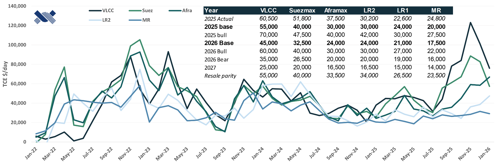
*Chart: Rates coming off a bit, but remain very volatile*

*Source: Baltic Exchange, Fearnleys*

### The basics - the map does not fit the terrain

Sticking to the fundamentals, it is challenging to explain the market strength recently, as it also was to explain the depth of the early-year plunge. While preliminary tonne-mile demand figures suggest a new seasonal all-time high for January, the numbers are well below last year's peaks.

For the total fleet, preliminary January tonne-mile demand is 5% below last year's peak, while for VLs it is 8.5% lower, driven by slightly lower volumes, and much less Atlantic-East fixture activity as the West-East arbitrage is closed. The latter, in combination with bad weather has contributed to significantly boost Suez- and Aframax earnings in the Atlantic.

For product tankers, meanwhile, demand holds up better and has grown slightly into the start of the new year, boosted by recovering volumes and better long-haul arbitrages.

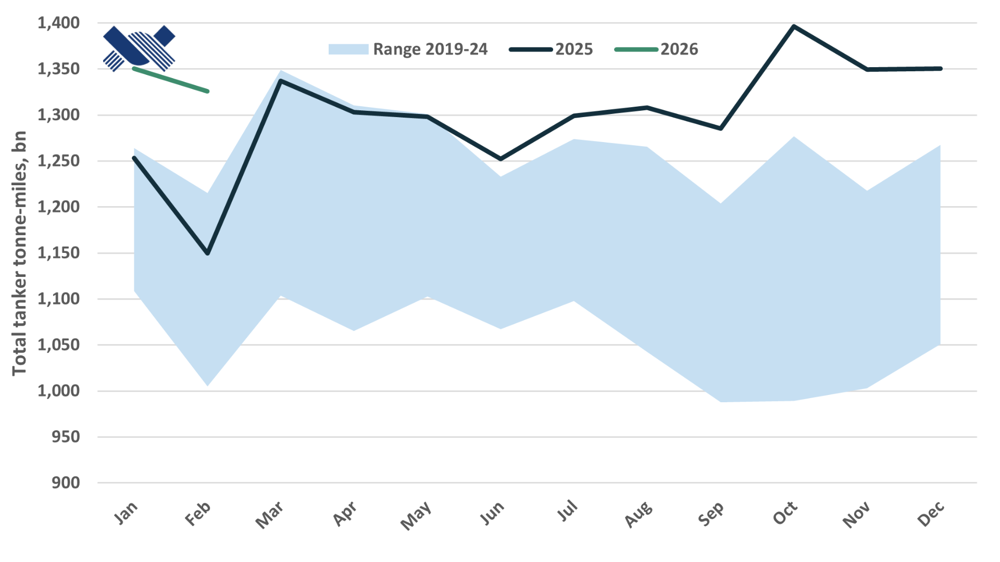
*Chart: Total tanker tonne-mile demand (excl. OFAC)*

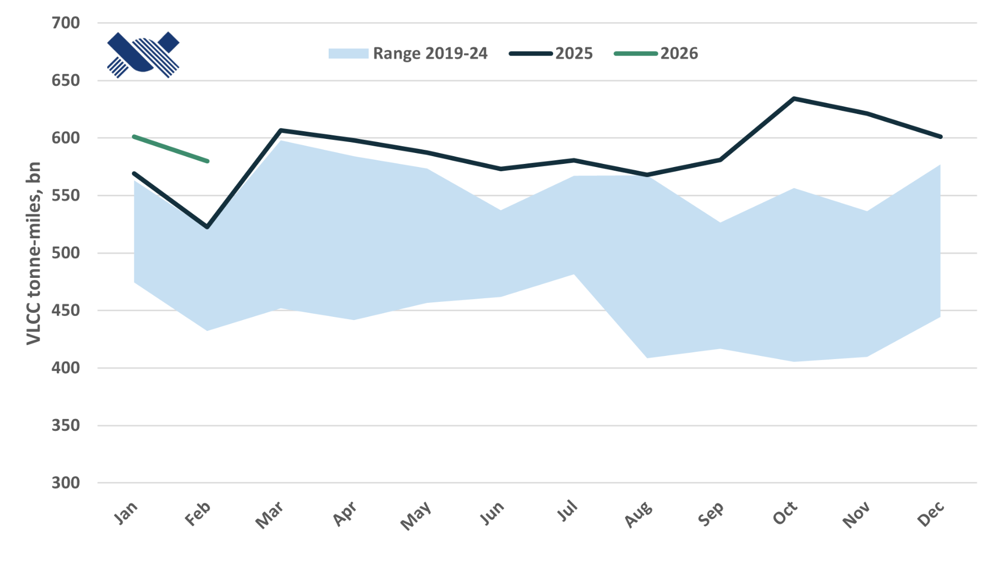
*Chart: VLCC tonne-mile demand (excl. OFAC)*

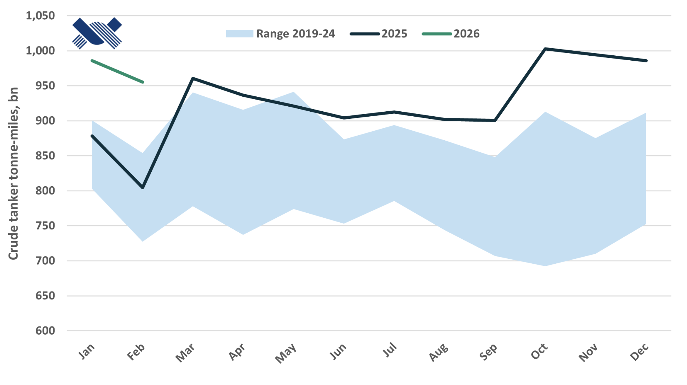
*Chart: Crude tanker tonne-mile demand (excl. OFAC)*

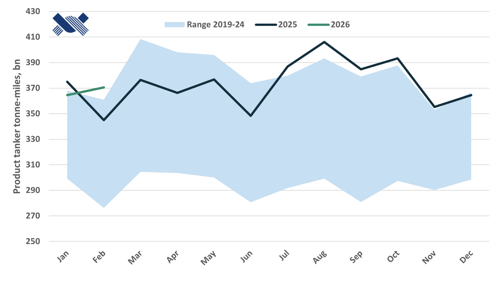
*Chart: Product tanker tonne-mile demand (excl. OFAC)*

*Source: Vortexa, Fearnleys*

Going forward there is not expected to be much growth in demand, apart from returning production from some areas where there have been recent outages. The main supply growth engine over the last decade, the Americas, is expected to see some seasonal downside, and new projects are not expected until the summer. Overall non-OPEC+ production is 'only' expected to increase by about 0.5 mbpd this year.

The OPEC+ plans to hold production flat through Q1, after which market conditions will decide whether the group may continue to unwind cuts. Global inventories have kept building in recent months, although not by as much as the energy agency balances imply as demand has been strong and supply in some areas curtailed. With that, and some geopolitical events, oil prices have remained resilient and the forward curve remains backwardated. These oil price conditions resemble the last instances the OPEC+ has decided to unwind production.

That is one upside scenario for tanker demand going forward. Others include Venezuela and Iran - and possibly Sinokor.

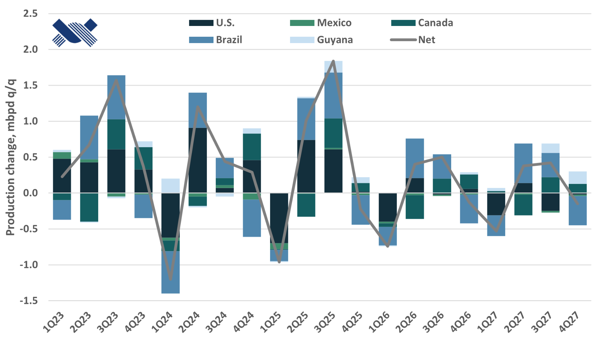
*Chart: Americas production growth q/q*

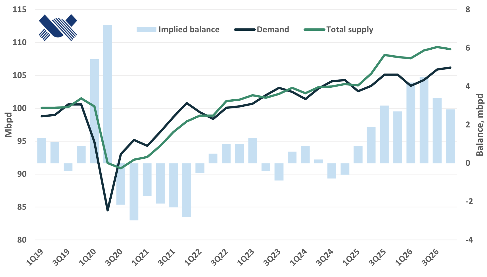
*Chart: IEA implied oil market balance*

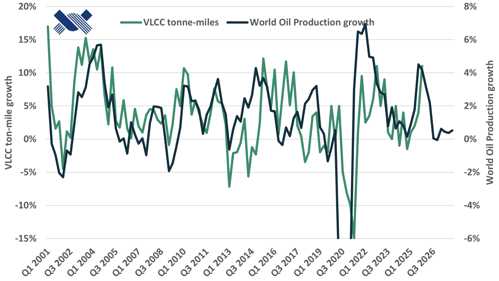
*Chart: Oil production vs. tanker demand growth*

*Source: EIA, IEA, Vortexa*

Fleet growth now starts to pick up meaningfully after a few low delivery years. This quarter alone, gross fleet growth is scheduled at 1.5%. That is the same as the yearly average net fleet growth the last three years. For both this and next year the delivery schedule is north of 6% which means some more headwinds for the tanker market balance.

Congestion has been more of a tailwind lately, with bottlenecks partly caused by sanctioned infrastructure in China, and plenty of bad weather. That has, however, now started to ease, although VLCC congestion in the Far East remains relatively elevated vs. the norm. Thus, some more pressure could emerge if and when discharge operations start to run more smoothly. Similarly, bad weather in the Atlantic has slowed down sailing speeds and hampered port operations.

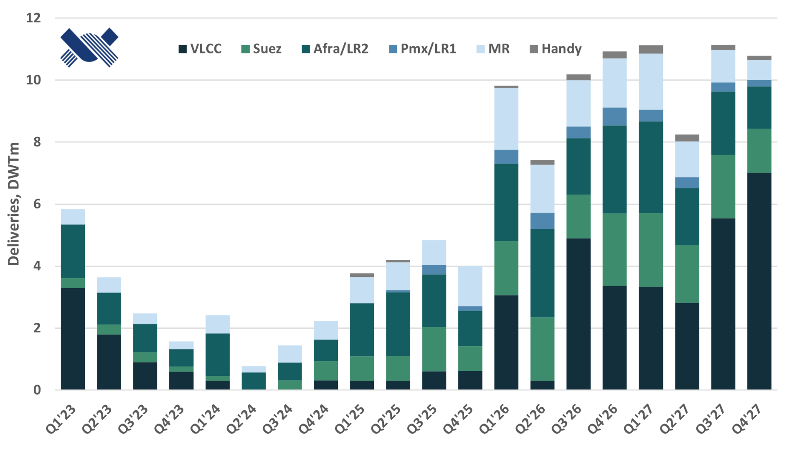
*Chart: Tanker deliveries by quarter*

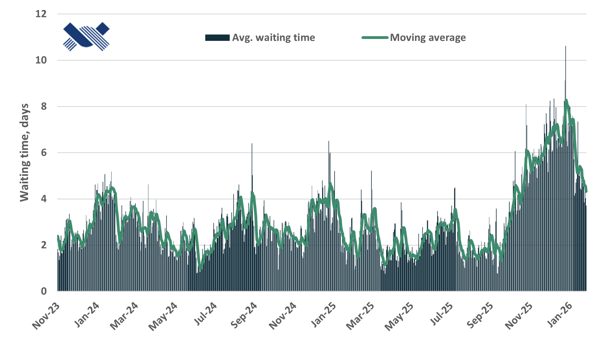
*Chart: Far East VLCC congestion*

*Source: Fearnleys, Vortexa*

### The known unknowns - what could drive market upside

The bullish sentiment YTD has been driven by consolidation and geopolitics. The first, in the form of Sinokor's (and MSC) buying and TC-in spree will further consolidate the VLCC fleet. Whether the recent tally is sufficient to obtain any real pricing power over time remains to be seen, but it is safe to say that so far Sinokor's holding back from open market fixing (an increasing number of ships being delivered) has contributed to driving spot rates higher. The big question then, is what happens when this player starts fixing more of these ships?

It is likely that a more consolidated fleet, with a much smaller portion now controlled by 'independent' owners, may contribute to increase volatility further this year. The rate development YTD could be an indication of precisely that. Position lists look very different with and without Sinokor's fleet on them.

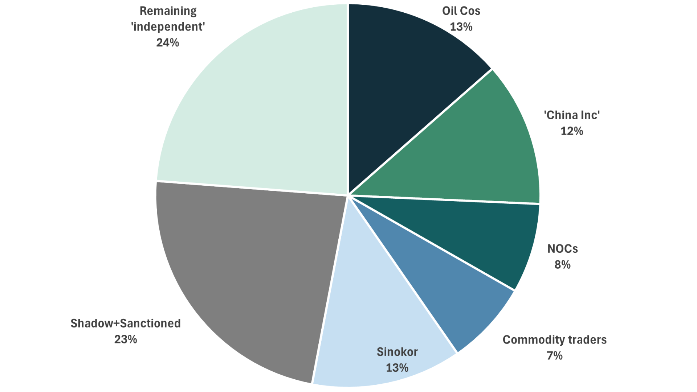
*Chart: VLCC fleet by controlling entity*

*Source: Fearnleys*

The U.S. intervention in Venezuela has also contributed to boosting market sentiment, in anticipation of a switch from shadow to compliant tankers. So far, there has been uncertainty how this trade will shape up, and little measurable impact on the tanker market, although a few fixtures to the U.S. and Europe now start to emerge. Chevron is now expected to lift exports to the U.S. to 300 kbpd in March.

Of Venezuela's nearly 800 kbpd 2025 exports, about 500 kbpd went to China on shadow tankers. The majority of this may now go to the U.S. and Europe on compliant Suez- and Aframaxes, and partly India on VLs. The latter portion, plus possibly some displacement of other heavy grades from the USGC, could contribute to higher tonne-mile demand: up toward 1% added to our base case demand assumption for this year. That is, provided that production and exports rebound from its recent slump, and unless more of that superfluous heavy crude go toward rebuilding the U.S. SPR. It is worth noting that in 2024, when there were waivers for Venezuelan exports to the same regions, this did not materially impact the overall tanker market balance.

The longer term upside potential from Venezuela could be bigger, if or when production upside can be eked out. That may take some time.

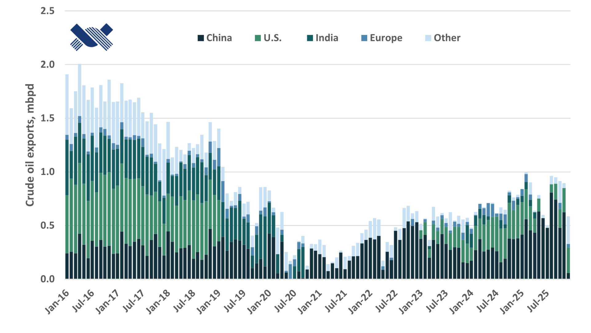
*Chart: Venezuela crude oil exports by destination*

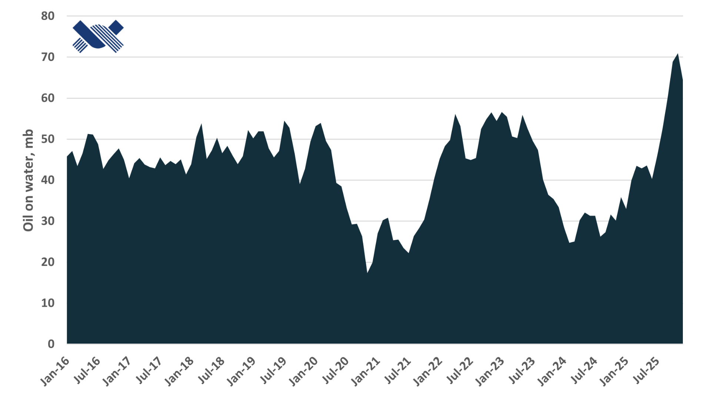
*Chart: Venezuelan crude oil on the water*

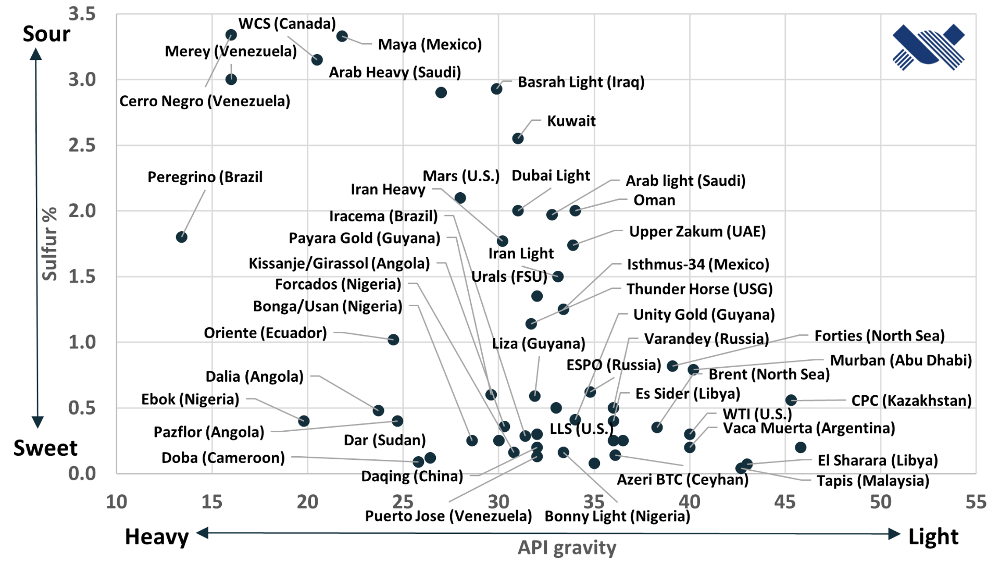
*Chart: Crude quality*

*Source: Vortexa, Fearnleys*

The potentially biggest supportive factor that may develop for tanker demand is if the U.S. lifts sanctions on Iran. That could give a shift of the 1.5-2 mbpd that currently goes on the shadow fleet onto the compliant fleet, and there could be 0.5-1 mbpd of upside to volumes within not too long.

There are some mitigating factors too, however. At least 22 of the NITC VLCCs should continue trading as they are still in normal trading age. Assuming that sanctions are also lifted on other Iran-linked vessels, there may be another 30+ VLCCs that can continue trading. Those 50+ vessels should be able to continue lifting at least 1.5 mbpd of crude from Iran, provided that receivers allow so. Hence, the upside potential for the tanker market is rather around 0.5-1 mbpd within a relatively short time-span.

Alternative scenarios are military conflicts in Iran, which may escalate to the broader region, and/or a U.S. embargo on Iranian exports. Both could lead to rate spikes through increased risk premiums for the MEG, and potentially higher pricing for MEG crudes which could support the West-East arbitrage.

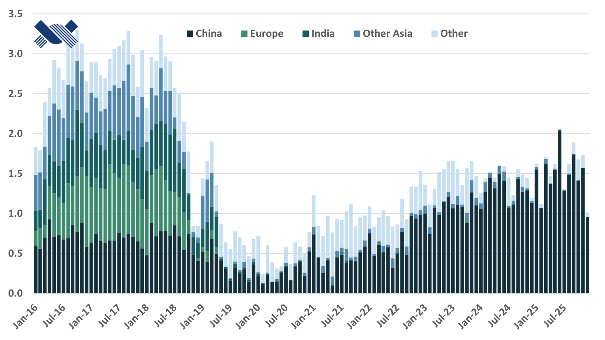
*Chart: Iran crude oil exports by destination*

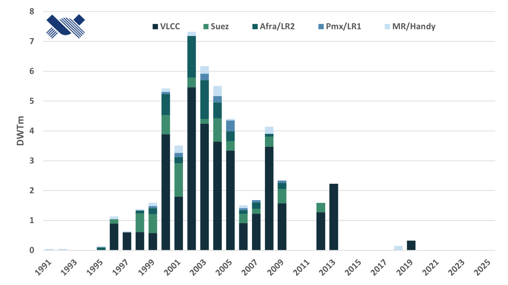
*Chart: Iran linked OFAC tankers (11.2% of the fleet) – age distribution*

*Source: Vortexa, OFAC, Fearnleys*

### A look at the oil market

The oil market appears well supplied, although not nearly as oversupplied as expected by energy agencies. Last year, global observed inventories built by an estimated 475 mb, or 1.3 mbpd. That is far from the IEA's expected 2 mbpd, but still significant. This year builds are expected to accelerate, but have so far been limited by outages in Kazakhstan and now the U.S. among others.

Meanwhile, the Brent forward curve remains backwardated which contrasts with the observed inventory builds. This is partly explained by strong refinery margins which incentivizes prompt crude injection, and low-ish OECD inventory builds.

A tighter oil market West of Suez, partly driven by recent outages, contributes to keeping the West-East arbitrage firmly shut, other than for some grades. Until or unless these constraints ease we may not see high Atlantic-East activity. If the OPEC+ continues to unwind cuts after Q1 this may also contribute to reduce West-East potential.

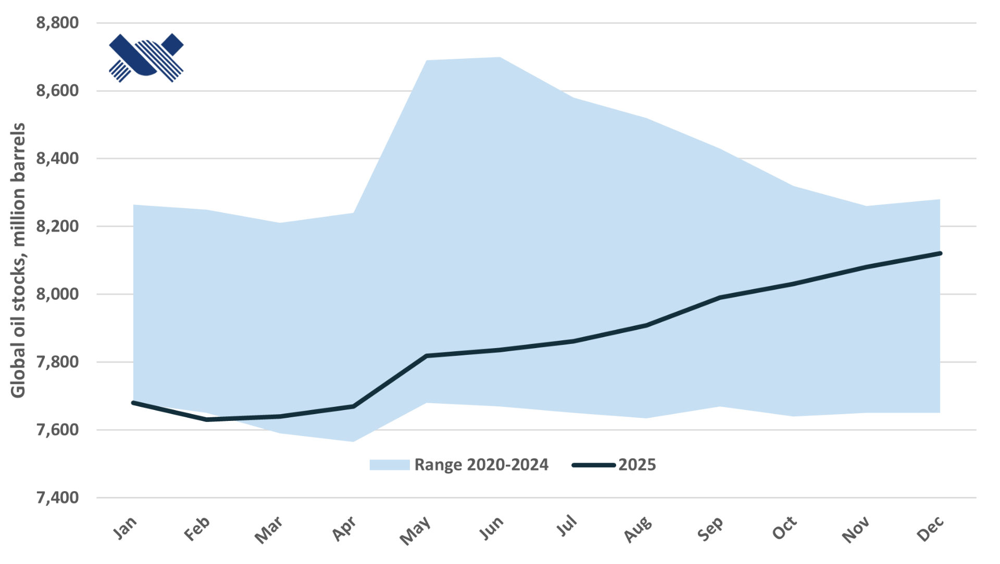
*Chart: Global observed oil stocks*

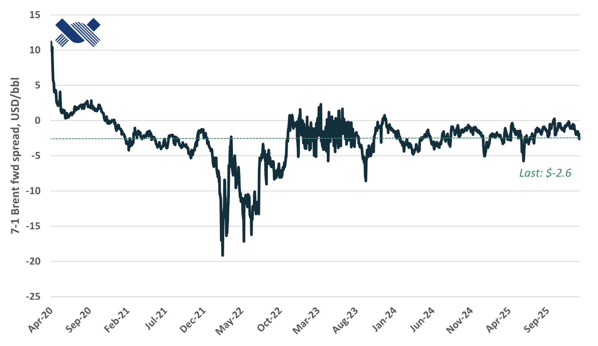
*Chart: Brent 7-1 month forward spread*

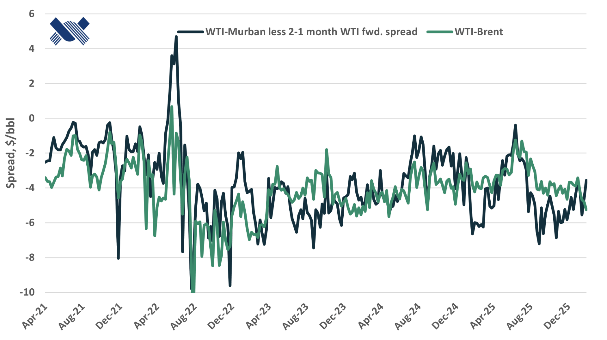
*Chart: WTI vs. Brent and Dubai*

*Source: IEA, Bloomberg*

Oil on the water also indicates plentiful supply globally. The build-up seen over the last few months of 2025 has persisted, although eased slightly into this year. The majority of this build-up has been driven by sanctioned barrels, which remain 130 mb above the average of the first half of 2025. For compliant crude the recent number is 'only' 40 mb above, having come down after a lot of the long-haul fixtures from Sep-Nov last year have discharged.

Floating storage of sanctioned barrels indicate that this oil struggles to clear. Iranian exports have been somewhat reduced in recent months, as has Venezuelan. Russian exports remain stubbornly high, despite reported discounts of Urals vs. Brent of closer to $30/bbl. How long this can be held up remains to be seen.

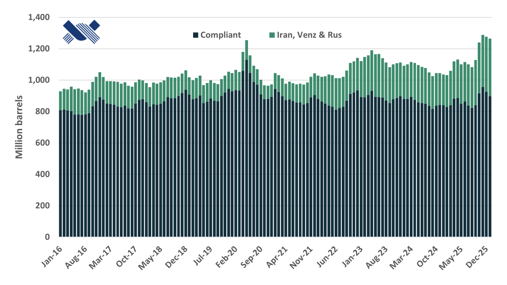
*Chart: Crude oil on the water*

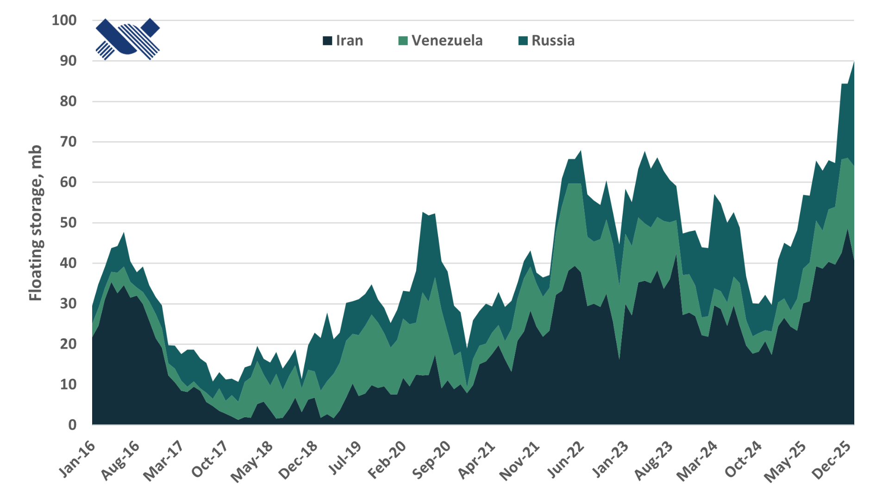
*Chart: Sanctioned barrels floating storage*

*Source: Vortexa*

Global refinery runs are expected to increase by 0.8 mbpd this year, slightly less than last year's 0.9 mbpd growth. Global capacity is expected to expand by slightly more, but a large portion of that in China were new capacity may replace older.

Global capacity could therefore remain a constraint this year, and remain supportive of refinery margins unless oil demand surprises negatively. Although margins have largely softened lately on more capacity coming back from maintenance and outages, they remain well above historical averages in the West. This has left a demand pull for gasoil and jet fuel into the region, with renewed demand from the MEG and India recently.

In China, meanwhile, there has been some softness, in line with sluggish reported numbers for implied products demand. This may cause some worry for continued demand for high crude oil imports if sustained.

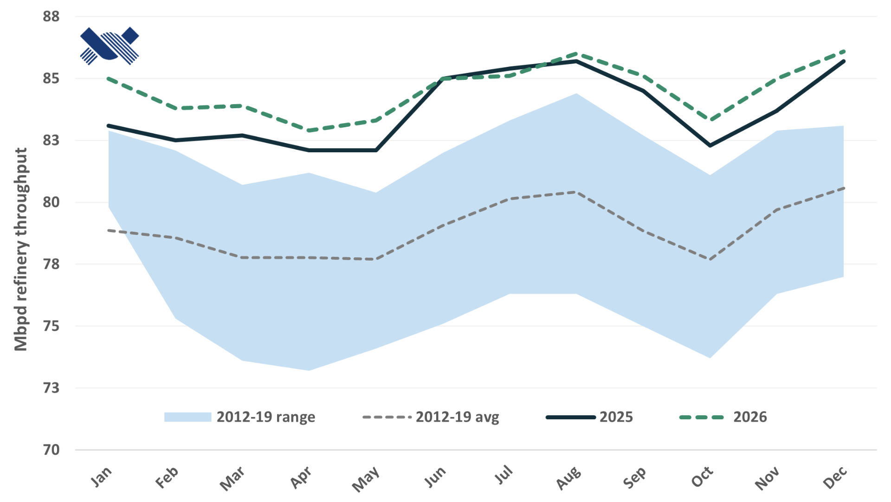
*Chart: Global refinery runs*

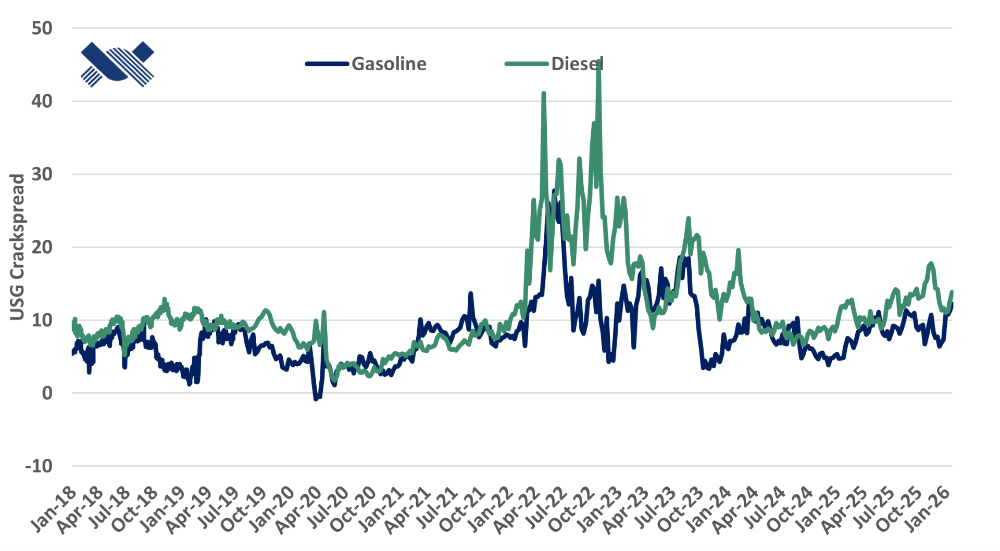
*Chart: U.S. Gulf Coast crack spreads*

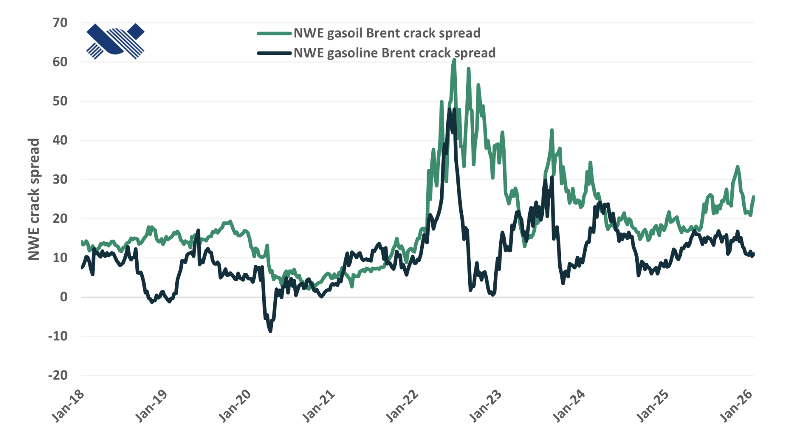
*Chart: Northwest Europe crack spreads*

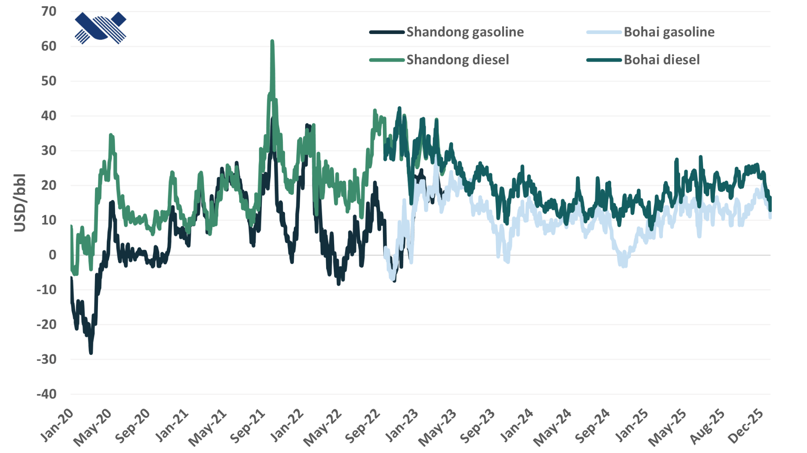
*Chart: Bohai Bay crack spreads*

*Source: IEA, EIA, Bloomberg, Argus*

### Newbuild orders are back in fashion

Ordering picked up markedly in the second half of last year, especially for the biggest vessels with 60 VLCCs confirmed and plenty more reported. With that, the orderbook to fleet has likely risen to closer to 19% when all is included - that is in line with the historical average. Based on recent reports, that figure may rise further too, although it could be offset by higher deliveries.

Phase-out, meanwhile, was still limited although picked up somewhat from recent years. 'Only' 0.5% of the fleet was scrapped, most of it shadow tankers. This is likely to remain the case also this year. High earnings, and most of the phase-out potential having already migrated to the shadows should prevent any meaningful phase-out from the compliant fleet.

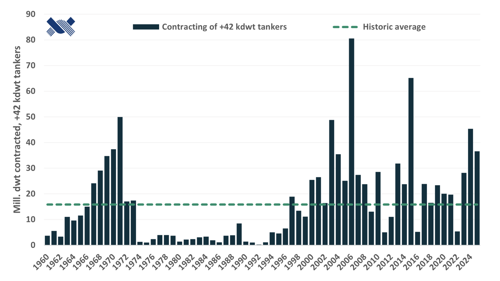
*Chart: Tanker ordering, +42k dwt*

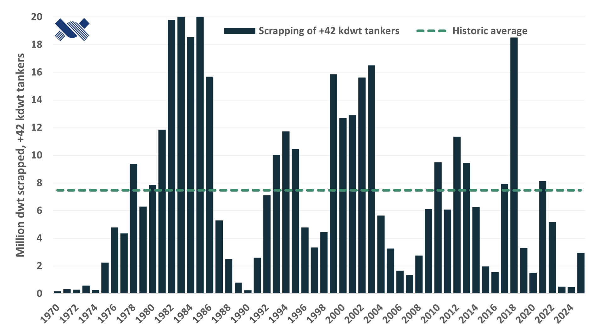
*Chart: Tanker demolition, +42k dwt*

*Source: Fearnleys*

Deliveries are now set to pick up, with 6% gross fleet growth scheduled for this year and slightly more next year. The highest growth comes for product tankers with 9% this year

Although a number of LR2s are expected to continue switching into the dirty market, we should also see Suez- and VLCC newbuilds doing CPP liftings on maiden voyages - correlations work both ways.

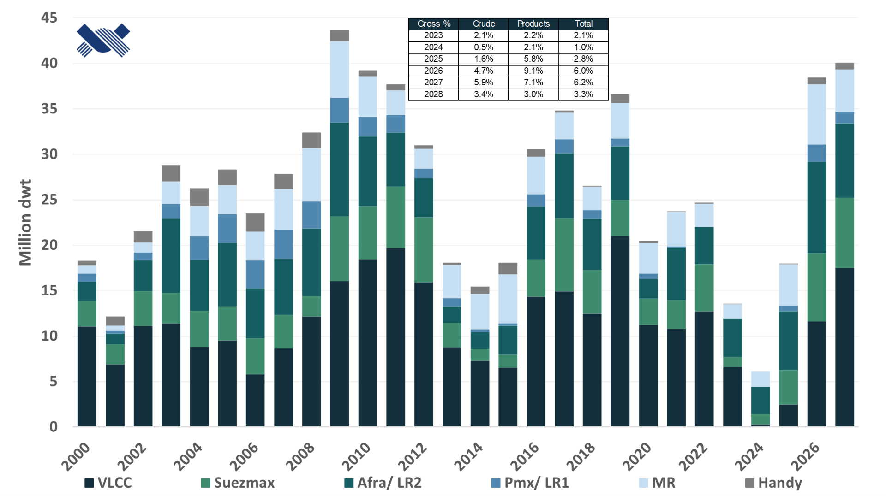
*Chart: Annual deliveries - rarely higher*

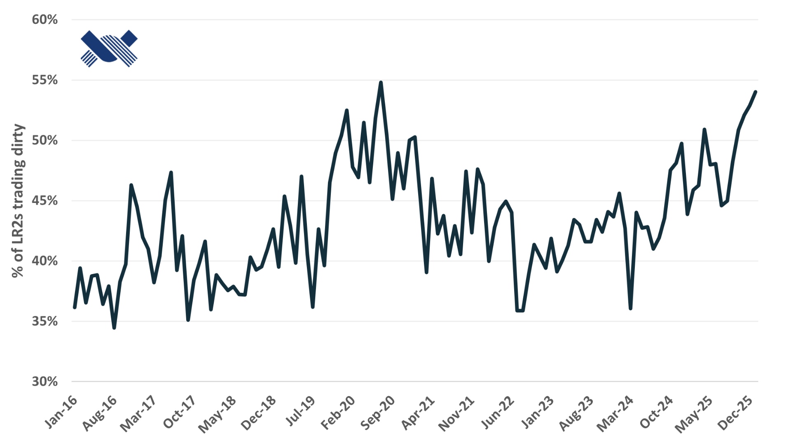
*Chart: Share of LR2s trading dirty*

*Source: Fearnleys*
