# Fearnleys Tanker Market Wrap-up Feb 2026

**Date:** 2026-02-27 | **Department:** TANK | **Publisher:** Fearnleys AS  
**Original PDF:** [Local PDF](../pdfs/2026/2026-02-27_fearnleys-tanker-market-wrap-up-feb-2026.pdf) | [Cloud Backup](https://pbrkapp.blob.core.windows.net/report/283fe971-4a1a-4bb4-8e2d-fec416f1f035/report.pdf)  

---

## Relentless strength

### Summary

Quite the start to the year! Demand is stronger than the same time last year, providing the underlying conditions, On top of that, market strength has been driven by the supply side and geopolitics.

Going forward, a return after oil production outages, some growth elsewhere, and a potential shift in Venezuela flows may give continued strong demand for tankers. With West-East arbs closed, demand is strongest for Suez- and Aframaxes, but there could eventually be some more switch toward the biggest vessels. Product tankers can benefit from open long-haul arbitrages and continued incentives to switch to dirty for LRs.

Oil price diffs could be some cause for concern, although are unlikely to affect the tanker market in the very near term.

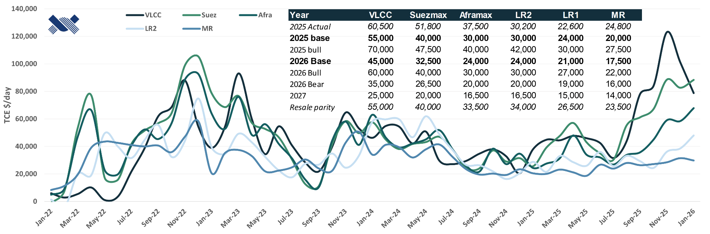
*Chart: Monthly spot rates*

*Source: Baltic Exchange, Fearnleys*

TC rates are reported at daily new highs, supported by pick-a-number-spot rates and a well bid FFA curve. The strength from VLCCs has spread to Suezmaxes where cargo splits are in several areas now more economical - as are TCs.

The most recent TC deals point to large implied upside potential for asset values too. That said, a 1-year VLCC TC rate which is now five standard deviations from the mean is rare, to say the least. Something to lock in..?

With demand tailwinds set to last and fleet consolidation in full force, it may take longer than we had initially thought before fleet growth may meaningfully eat into the market balance. Hence rates are likely to significantly outperform our bull case in the coming few months, which also means quite some outperformance also for the full year average.

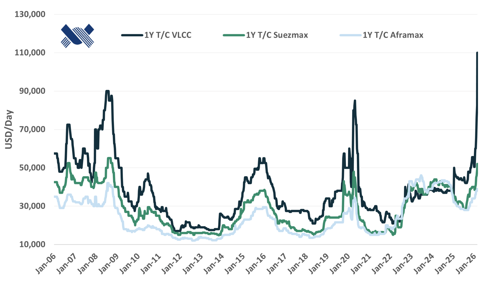
*Chart: Crude tanker 1-year TC rates*

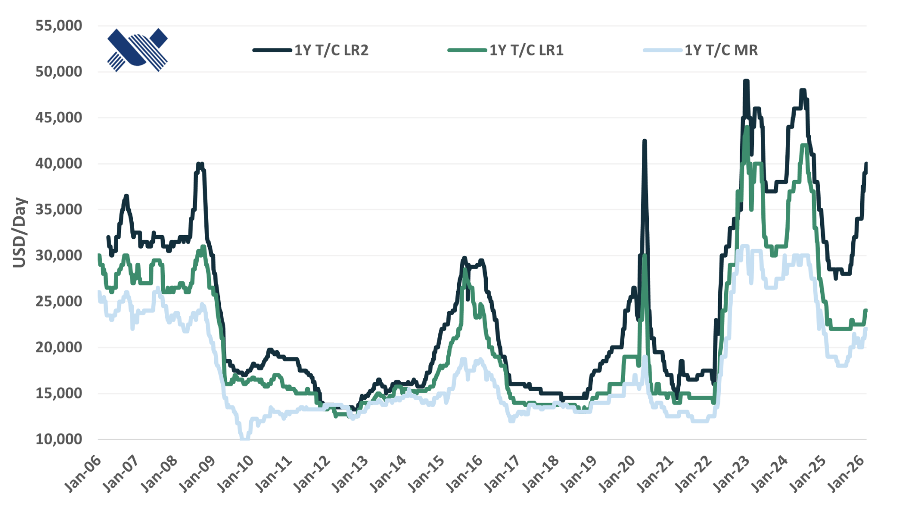
*Chart: Product tanker 1-year TC rates*

*Source: Fearnleys*

### Recent and near-term demand development

Crude tanker volumes have rebounded slightly in February vs. March, while product flow is a bit lower. Crude tanker volume gains have been led by the MEG and CPC, and there may be slightly more to come with the latter still ramping up after outages, and some suggestion that the OPEC+ may continue to ease production cuts from April (although the real m/m change may be rather small). There are also some signs of Saudi Arabia exporting mo

From the Americas exports have slid recently, most of which is seasonal. Here too, then, there may be some upside in coming months. This can also in part be driven by a ramp-up of Venezuelan exports as flows normalise and find new buyers.

Most of these volume gains near-term may benefit Suez- and Aframaxes still, unless the West-East arbitrage reopens.

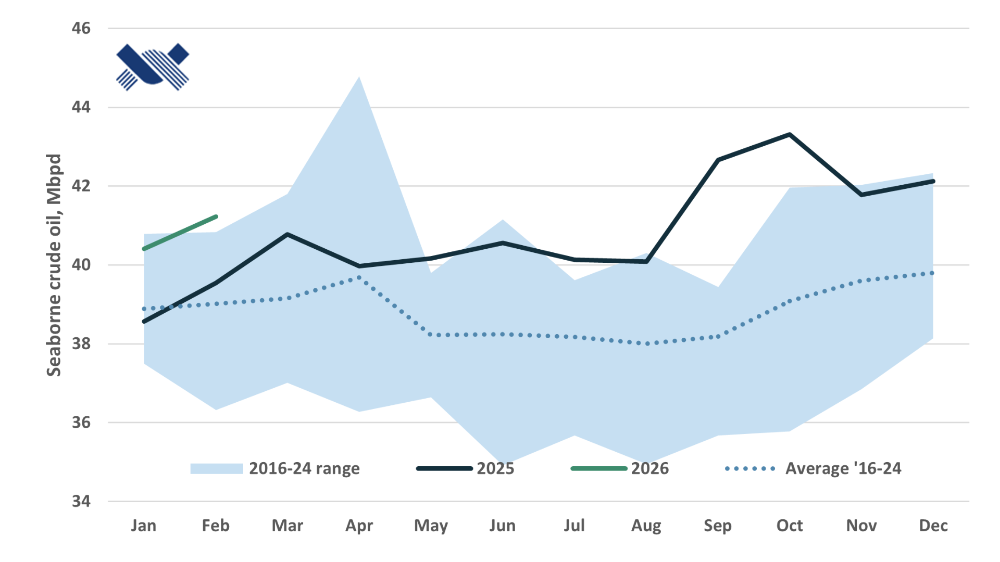
*Chart: Seaborne crude oil volumes*

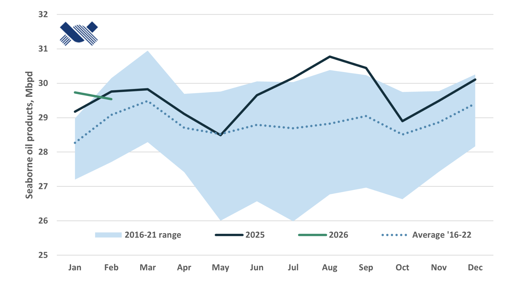
*Chart: Seaborne oil product volumes*

*Source: Vortexa*

Tonne-miles are also up, overall nearly 5% vs. the same period last year, although for VLCCs and product tankers the development is not so strong due to less long-haul flows. Suez- and Aframax tonne-miles have strengthened the most, to a large extent driven by high Americas exports, a lot of which has remained in the Atlantic basin due to a closed arbitrage to the East.

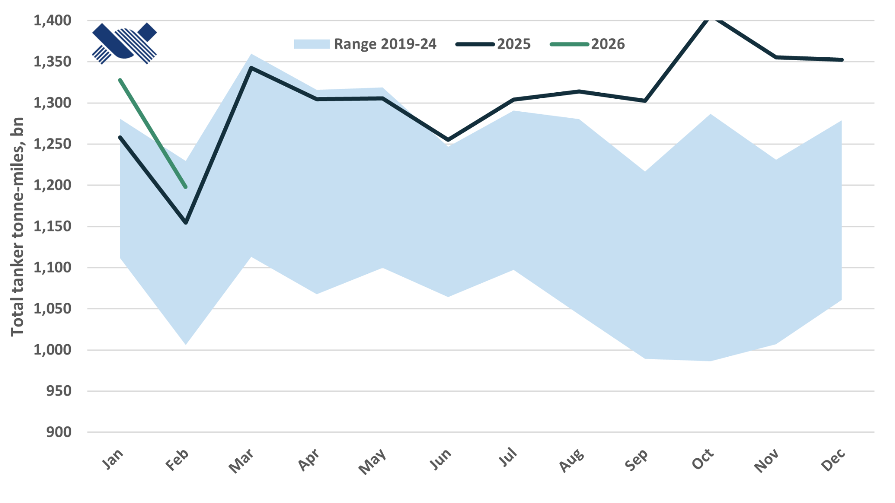
*Chart: Total tanker tonne-miles (+4.7% YTD)*

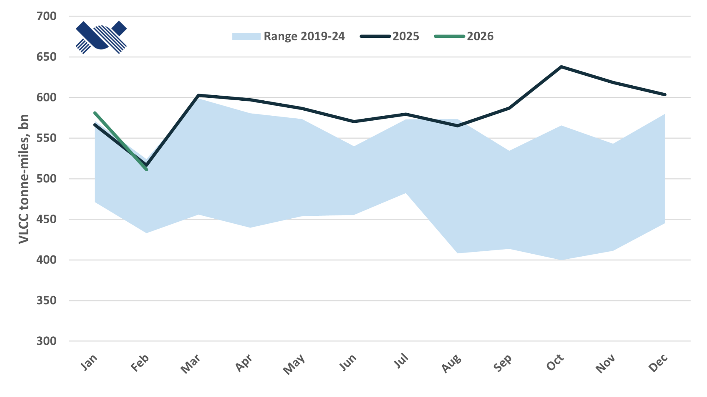
*Chart: VLCC tonne-miles (+0.8% YTD)*

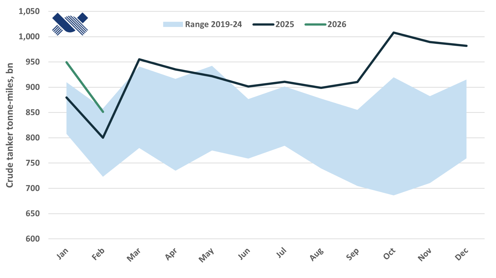
*Chart: Crude tanker tonne-miles (+7.2% YTD)*

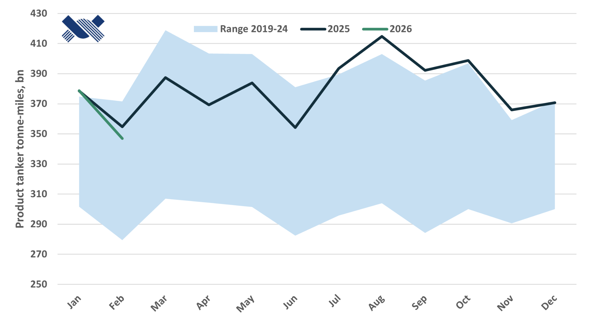
*Chart: Product tanker tonne-miles (-1.0% YTD)*

*Source: Vortexa*

For the remainder of the year, tonne-mile demand may strengthen due to increased volumes, and partly geopolitics. Added volumes per energy agency expectations could give around 1% tonne-mile growth, with OPEC+ unwind potentially adding up to another percentage point gradually.

Beyond that, Venezuela stand-alone may add 1-2 percentage points if a meaningful portion of volumes goes East. This could benefit VLCCs the most, whereas it may slightly negatively impact Suez/Afra demand if any corresponding downside to Russia-India volumes (on compliant tankers) shifts to China (on shadow/sanctioned tankers). That said, with Trump's latest tariff setback, could there be a rebound in Indian buying of Russian oil..?

Global refinery runs are expected to rise by 0.8 mbpd this year, mostly in the Middle East and Asia. That may contribute to product tanker tonne-mile growth of 2-3%, depending on how much goes long-haul. Currently, relative pricing suggests some boost.

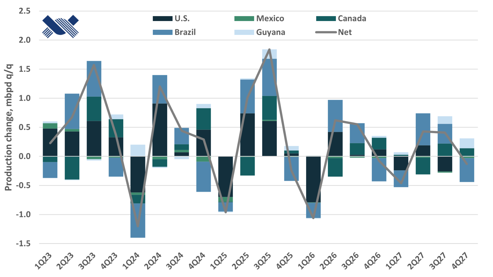
*Chart: Americas production growth*

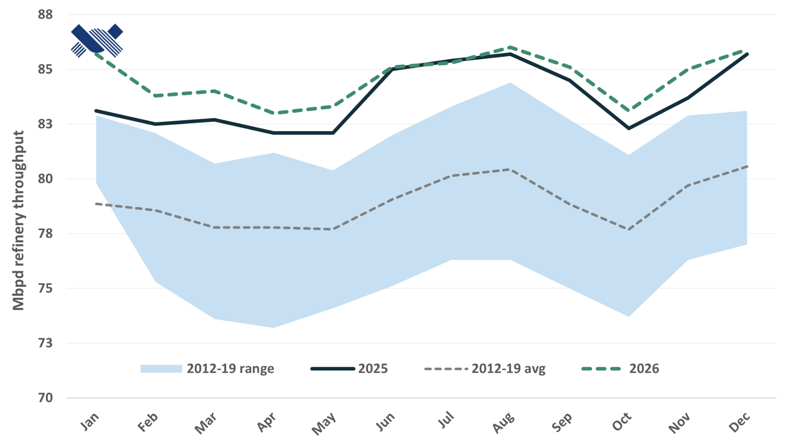
*Chart: Global refinery runs*

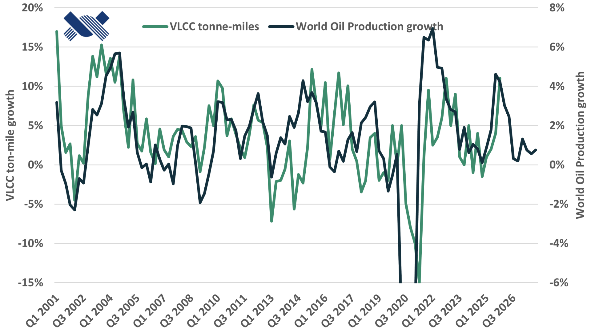
*Chart: Crude tanker tonne-mile vs. oil production growth*

*EIA, IEA, Fearnleys, Vortexa*

### It is all about supply...

...And not really the way we thought it would be going into this year. While fleet growth is set to accelerate, it has been all about consolidation and delays so far. Sinokor's buying spree and traders' taking in TC ships has significantly tightened vessel availability, especially the number of owners with ships in fixing position in the open market, and as Sinokor (and possibly others) hold back tonnage. Sinokor now controls about 20% of the compliant VLCC fleet, more if you strip out NOCs and others which are to an extent committed to program barrels.

How many ships will continue to be held back, and for how long has a huge impact on the rate trajectory the next few months.

Congestion and weather has also had a large impact on the market over the last few months, the former mostly for VLCCs in the Far East, and the latter mostly for Suez/Afra in the Atlantic basin.

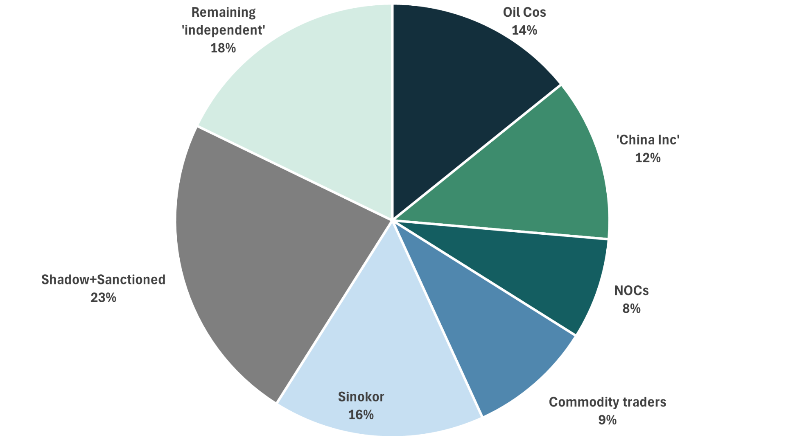
*Chart: VLCC fleet composition by controlling entity*

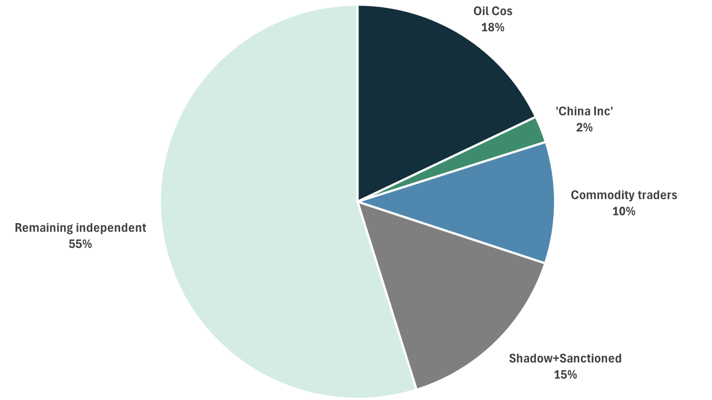
*Chart: Suez fleet composition by controlling entity*

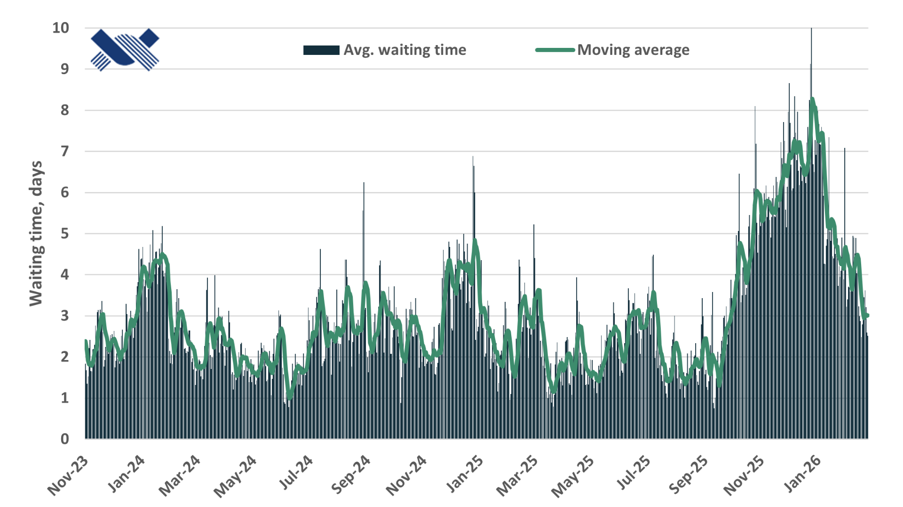
*Chart: VLCC Far East congestion*

Eventually, fleet growth should start to ease the tight market balance, with 6% gross fleet growth scheduled for this year and more the next two years. With a plethora of newbuild orders in recent months, the orderbook to fleet is now back to the historical average at 20%, with more to come. Newbuild prices are significantly lower than 2nd hand, which likely means orders are going to keep trickling in, which in turn should eventually lift newbuild prices too.

There is, however, also plenty of phase-out potential, although more likely in the slightly longer term as scrapping (especially of compliant tonnage) will be miniscule near-term at these rate levels.

*Source: Fearnleys*

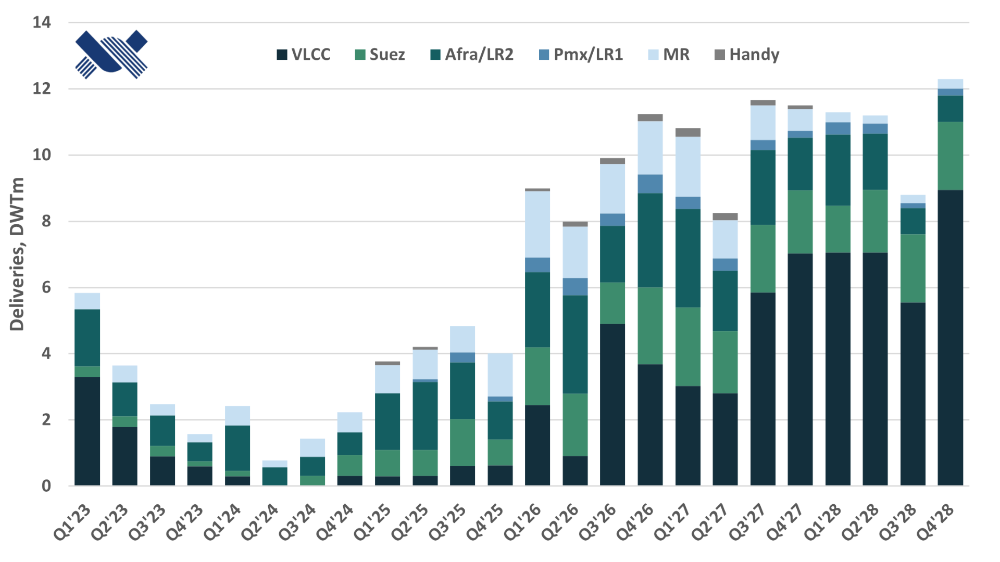
*Chart: Quarterly tanker deliveriess*

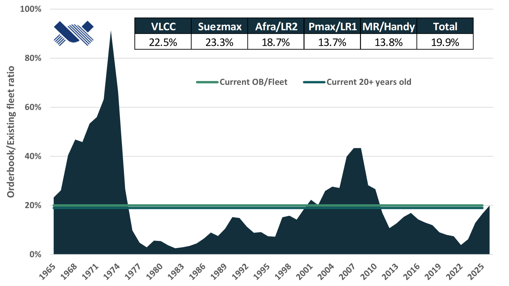
*Chart: Orderbook to fleet ratio*

In the biggest tanker segments, what would normally be phase-out candidates by now is already semi-phased out by migration to the shadows. Hence, the gross will be very close to the net fleet growth figure this and possibly next year. For the smaller segments, meanwhile, there is a more balanced picture between deliveries and real phase-out potential, which may soften the neet fleet growth outlook somewhat.

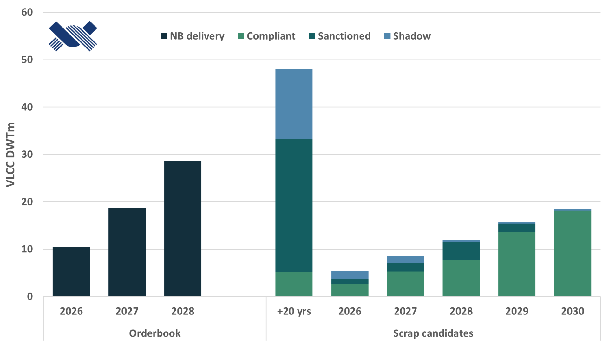
*Chart: VLCC deliveries vs. phase-out (potential)*

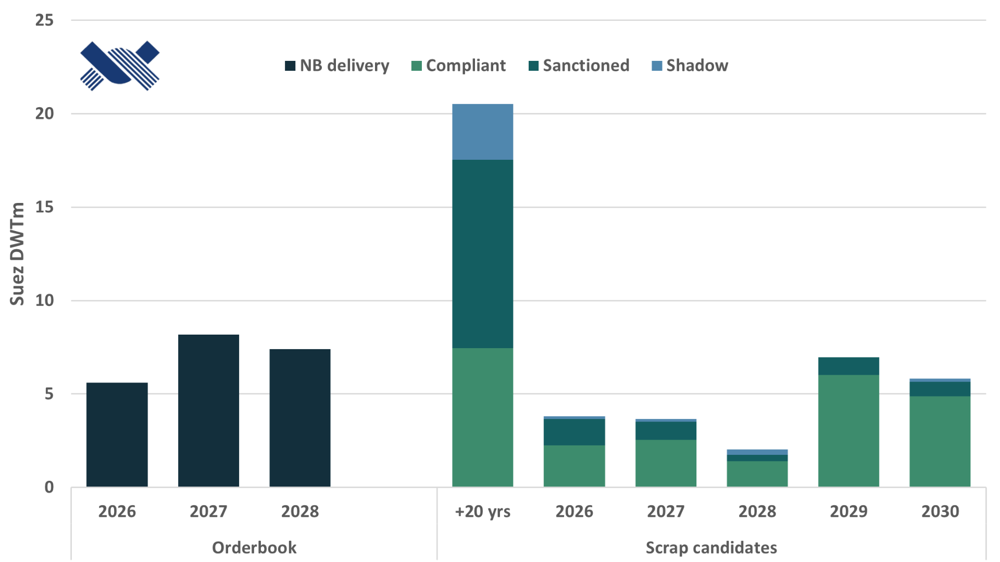
*Chart: Suezmax deliveries vs. phase-out (potential)*

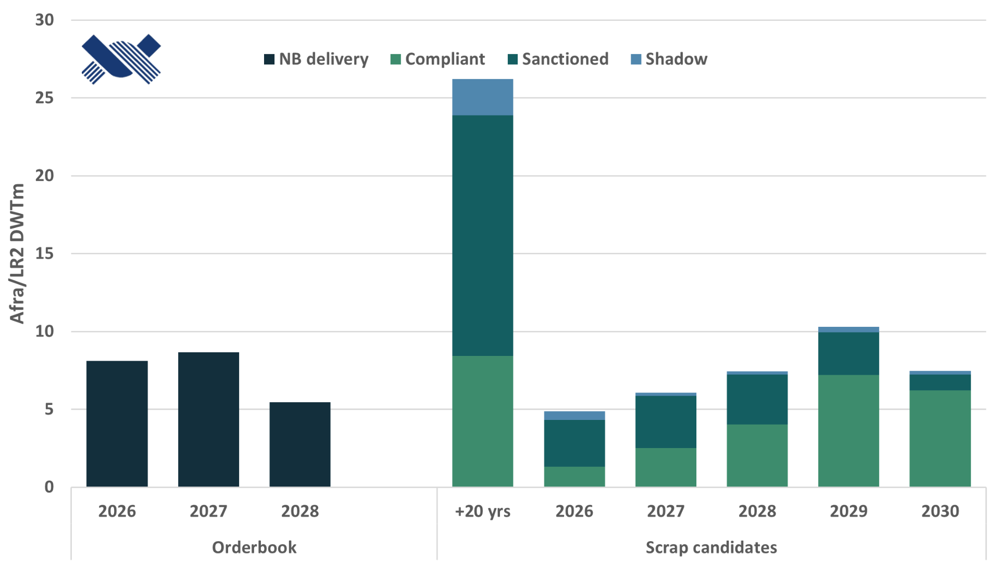
*Chart: Afra/LR2 deliveries vs. phase-out (potential)*

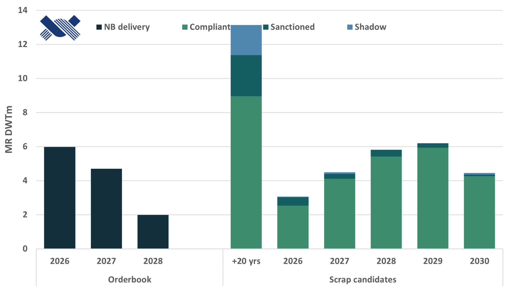
*Chart: MR deliveries vs. phase-out (potential)*

*Source: Fearnleys*

### Oil may point to some downside risks

Supported by a softer Dollar, strong demand, production outages and geopolitics, oil prices have strengthened YTD. The forward curve remains backwardated too - in contrast with energy agency forecasts which imply significant stock builds.

These pricing conditions mirror the last few instances where the OPEC+ has unwound production cuts, and it is now widely expected that this unwind may resume from April again into the normally stronger demand season.

This may be supported by relatively flat development for OECD inventories over the last year. These arguably hold more sway over pricing than does Asian inventories, which have built substantially more - especially China's and offshore storage of sanctioned barrels. If oil prices remain high(er) these inventories can also be drawn..

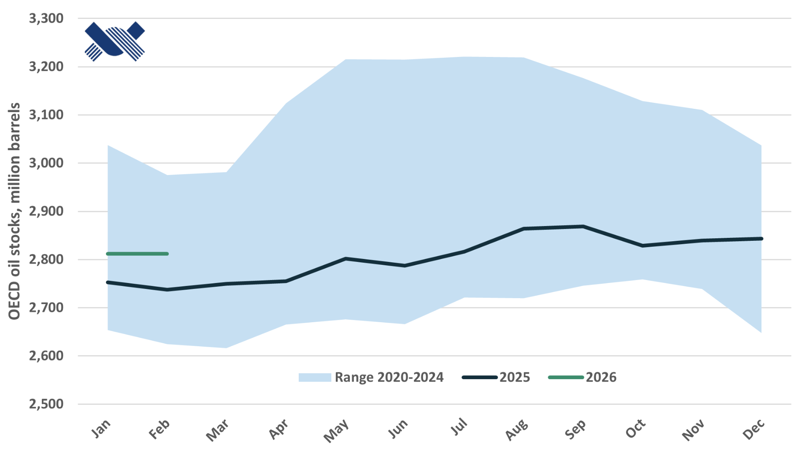
*Chart: OECD industry stocks*

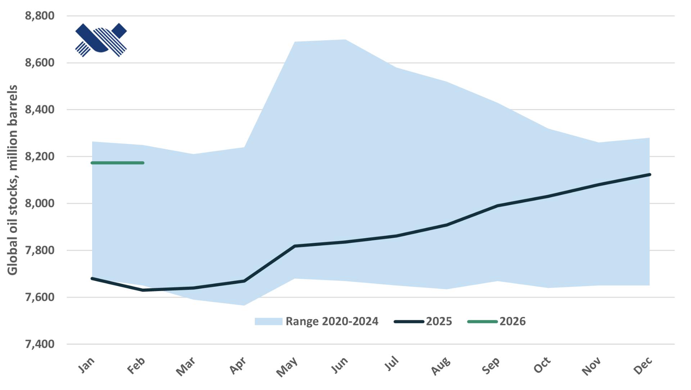
*Chart: Global observed inventories*

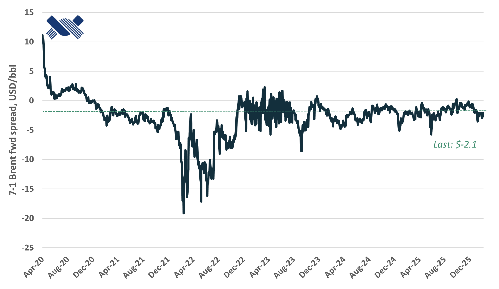
*Chart: Brent 7-1 month forward spread*

*Source: IEA, Bloomberg*

A challenge the OPEC+ may face is that differentials and crack spreads tell a slightly different story about oil market strength. There are reports of West African crude being offered at sizeable discounts to Brent, still without being lifted. Similarly, a largely closed West-East arb. suggests plentiful supply for Asian buyers. Another production hike from the OPEC+ and more market share into Asia may exacerbate this 'problem' which may eventually lead to bigger OECD inventory builds. High freight does not help in this equation either, so something may at some point have to give - oil prices, refinery margins, pump prices and/or freight.

That said, refinery margins are still (at least in the West) fairly close to the historical average, which should be supportive of decent run growth this year, benefiting product tanker demand. A slightly weaker price picture in the East is now supportive for more West-East gasoil and jet fuel movement, whereas another change in sailing patterns due to Russia/Venezuela dynamics support longer-haul demand, partly for gasoil from Russia to Brazil, and partly for global Naphtha flows.

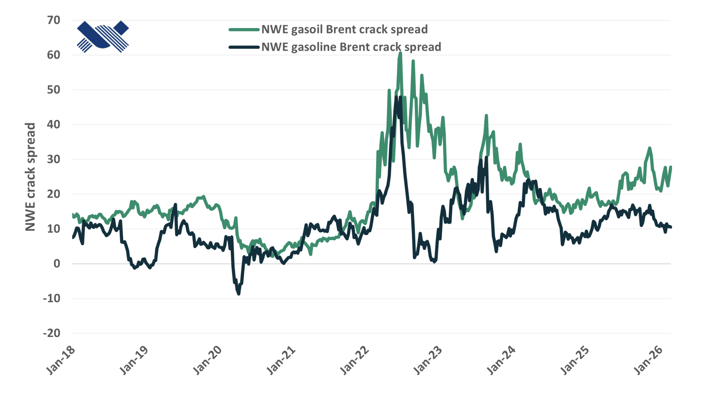
*Chart: Northwest Europe crack spreads*

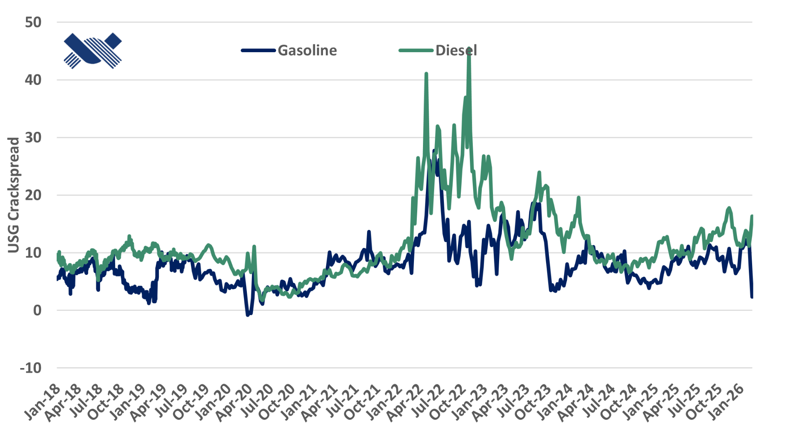
*Chart: U.S. Gulf Coast crack spreads*

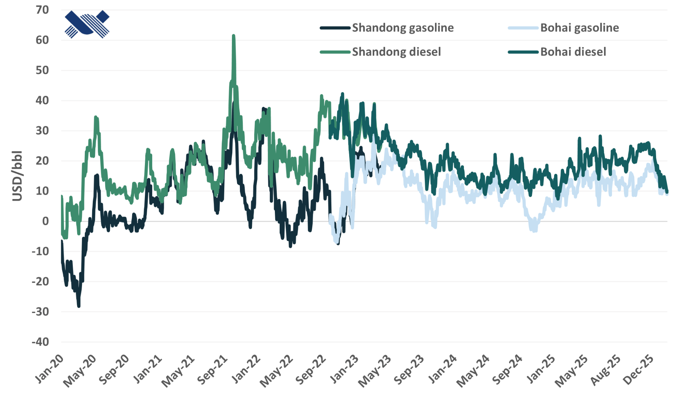
*Chart: Bohai Bay crack spreads*

*Source: Bloomberg, EIA, Argus*
