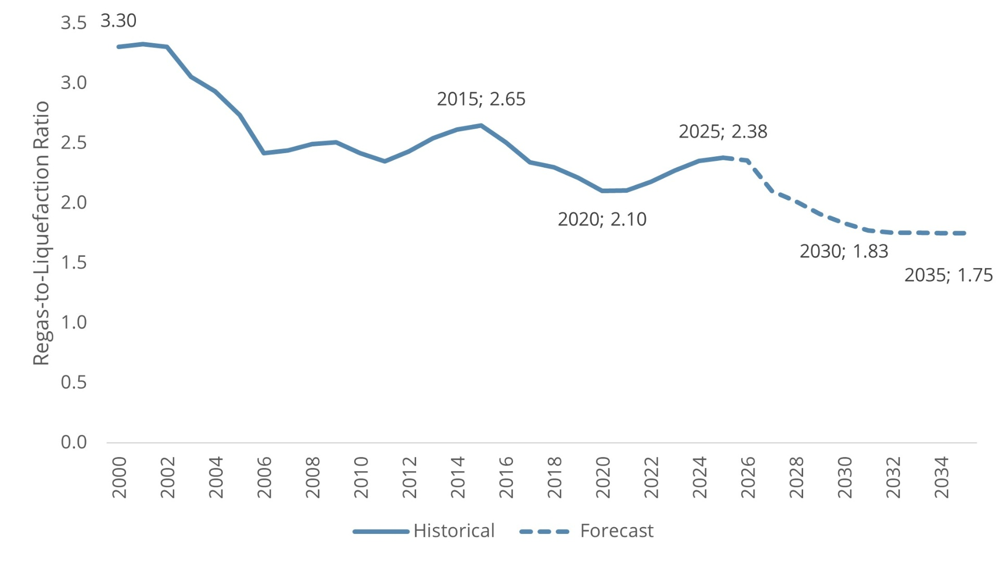
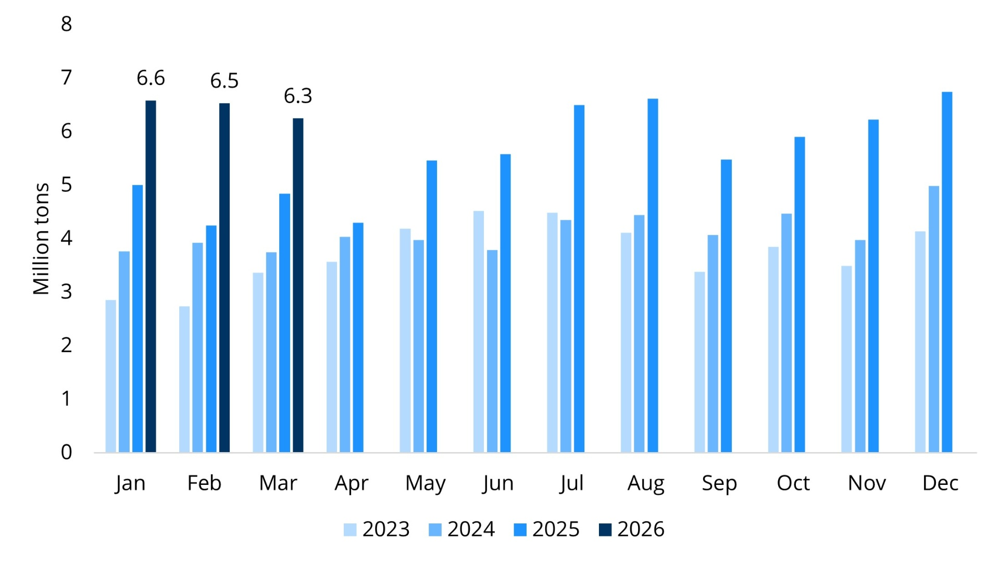
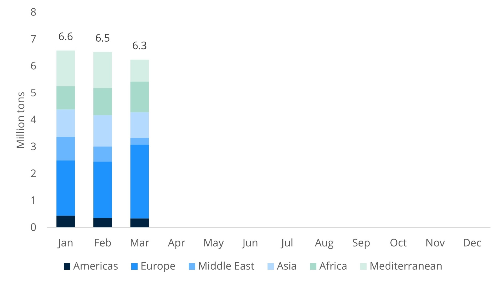
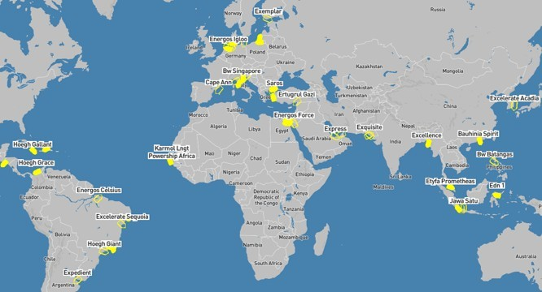
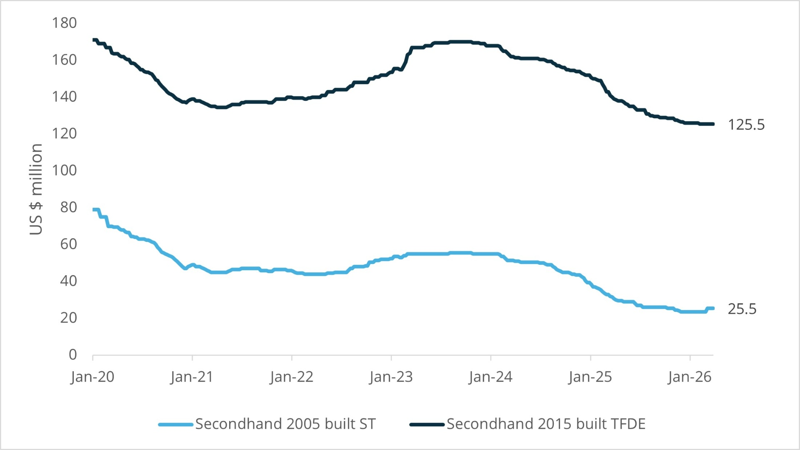
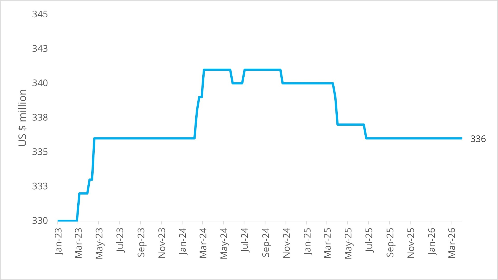

# FSRU Quarterly - Q1/26

**Date:** 2026-04-07 | **Department:** LNG | **Publisher:** Fearnleys AS  
**Original PDF:** [Local PDF](../pdfs/2026/2026-04-07_lng-fsru-quarterly-q126.pdf) | [Cloud Backup](https://pbrkapp.blob.core.windows.net/report/9bb07133-4895-4c32-9f0f-726e381c7837/report.pdf)  

---

## Market reflections: TIMEOUT!

The FSRU market is a long-term market which usually has its eyes on the horizon – requiring long lead times for both projects to develop and assets to be constructed. One may therefore draw the conclusion that long-term fundamentals for LNG and downstream infrastructure remain intact, but it would be **naïve to not recognize the ongoing change** in fundamentals. With the risk of becoming too shortsighted in the face of availability bias it seems clear that the market is pricing in higher cost of energy in general – but for LNG the entire curve towards 2030 has moved up substantially suggesting a far shorter market than previously priced. We only need to rewind towards the end of 2025 to reminisce over a time where *plat do jour* was the impending supply glut that would force shut-ins and LNG into the low single-digits. However, this was considered to be a boon for unlocking LNG demand in both new and developing markets. Now – we have to rethink.

Higher energy costs will translate into lower growth in the short-/medium term – which alone suggests that energy demand may turn out to be subdued. That doesn’t necessarily mean that LNG or natural gas becomes completely uneconomical (although the steep cost inflation on gas turbines has not aided the relative competitiveness of gas-fired power generation). But, we do see it as plausible that the near-term will face a pause in decision-making processes for downstream infrastructure (be it M&A, tenders, security of supply or other) as project developers and governmental agencies go back to their drawing boards/spreadsheets.

That said, turning the script upside down; having access to regas capacity remains a critical element if/when other source of energy becomes unavailable. The only challenge we face is that LNG is the energy source with the largest disappearance at present. So perhaps the *combo order* of FOB supply, a few LNGCs for flexibility and an FSRU should be the set menu for up and coming (and existing for that matter) consumers of LNG?

Regional activity appears to be high across LatAm, Africa and Far East with also Europe running at high revs. A somewhat refreshing perspective is the number of projects requesting to own/operate (usually one) FSRU themselves. The reasoning being high charter rates and desire to have full control of the asset – which we try to balance out against experience of operation and the inherent additional risks absorbed through direct ownership. Even so, we expect several projects to end up owning the FSRU directly with support from 3rd party to operate.

While the FSRU charter rate environment has not shown any signs of buckling, there have been fewer deals to benchmark off in Q1. What we are seeing is generally FSRUs developed against firm-ish projects (typically with lots of subjects and flexibility) that does not lead to firm FSRU conversion/orders, but a handful of speculative approaches by some. What is interesting is that *a few market participants are starting to ask questions about “when” we’ll see oversupply – **not “if”***.  While the demand side may be the biggest unknown under current circumstances, we do ***not*** see that the combination of assets coming off charter in 2028-2030 coupled with a handful of speculative FSRUs may be sufficient to tip the balance into the favor of charterers just yet.

### Key market developments during the quarter

JANUARY

Adverse weather conditions disrupt operations at both the **Ravenna** and **Brunsbüttel** terminals, leaving them without FSRUs for several days. At the same time, construction of the breakwater in Ravenna experiences delays, *reinforcing the case for weather-vaning solutions in more challenging metocean environments*—where feasible.

**Jordan** issues a tender for an FSRU (135,000–160,000 cbm, minimum 480 MMSCFD) covering the period from Q2 2026 to Q4 2026, with an extension option to the end of Q1 2027. This points to delays on the onshore side, and based on market intelligence, further postponements appear likely. At the same time, vessel availability for this window is крайне limited, with **few—if any—suitable units expected to be open**.

Deutsche ReGas (**DRG**) files a lawsuit against Deutsche Energy Terminal (DET), challenging the EUR 4.96 billion grant awarded to DET at the end of 2024, which effectively covers all costs (charter, fuel, and terminal) until the FSRUs roll off charter. This development precedes DRG’s termination of the **ENERGOS POWER**. Based on how the process has unfolded since 2022, Germany’s *implementation of FSRUs appears fundamentally flawed*. While Brunsbüttel and Wilhelmshaven 1 progress on schedule, Wilhelmshaven 2 and Stade emerge as highly problematic projects, representing significant inefficiencies and, at this stage, a questionable use of public funds—partly subsidized by the Egyptian government, which is unlikely to have been the original intention.

**KN Energies** offers additional regasification capacity at Klaipėda for the period **2033–2044**, following limited interest in the September 2023 market test. The proposed fixed tariff is approximately EUR 2.0–2.2/MWh (USD 0.68–0.75/MMBtu). In parallel, the company is exploring an expansion of capacity from the current 240 MMSCFD to 360 MMSCFD.

**Snam** seeks to **extend operations at Piombino** beyond June 2026, as local stakeholders gradually shift their position. The alternative—relocating the vessel offshore to Vado Ligure—would likely reduce overall availability and entail significant additional costs, including the installation of a turret mooring system and modifications to the **ITALIS LNG**.

**Ecopetrol** approves the development of an FSRU at **La Guajira**, effectively the same location as Ballena. This aligns with existing infrastructure, where **HEVI** has secured an agreement with **TGI**, the owner and operator of the critical pipeline connecting Ballena with Barrancabermeja. Internal tensions between TGI and Ecopetrol have been a key factor behind delays in Ecopetrol’s 2025 FSRU tender. The indicated capacity of **250 MMSCFD** suggests a likely deployment of one of Höegh’s Moss-type vessels, configured with either 3 × 100 or 3 × 125 MMSCFD regasification units.

FEBRUARY

**Morocco** postpones its FSRU tender, citing *“new parameters and assumptions.”* These reportedly relate to uncertainty over who will bear the cost of the FSRU and associated infrastructure, as neither the Moroccan equivalent of the Ministry of Finance nor the Ministry of Energy appears willing to take full responsibility. This development serves as a warning signal for what had been one of the most anticipated projects for 2026. The **outlook now remains uncertain**, and FSRU providers are likely to reconsider their appetite for participation in a renewed tender process.

**Ecopetrol** teams up with **Frontera** to develop an FSRU project at Puerto Bahía, near Cartagena. The planned unit is reportedly sized at **126 MMSCFD**, targeting start-up by Q3 2026. Given these specifications and timeline, the pool of suitable candidates is extremely limited, with only one of **Kinetics’ units** likely fitting the requirement—most plausibly either **TÜRKIYE** or **OCEANIA**, both currently undergoing conversion at Seatrium.

**Excelerate** announces in its Q4 2025 results that **EXCELERATE ACADIA** is scheduled to commence operations at Khor Al-Zubair, Iraq, in **Q3 2026**. While demand for both the FSRU and gas supply is not in question, the project’s execution remains uncertain given ongoing geopolitical instability. The vessel is currently set to be deployed to Pakistan, temporarily covering for **EXQUISITE**, which is due for dry docking. Notably, Excelerate remains *one of the few FSRU operators still requiring dry docking during contract periods*, as most modern FSRUs are designed to operate up to 20 years without such interruptions.

**Excelerate** indicates that it expects to secure a higher charter rate for **EXPRESS** compared to its current contract with ADNOC. While this may hold true for shorter-term fixtures, *longer-term charter rates are likely to trend lower on a like-for-like basis*, given the vessel’s specifications relative to newer, larger, and more efficient FSRUs.

**Energos** actively markets up to three available FSRUs: **ENERGOS IGLOO**, **ENERGOS FREEZE**, and **NUSANTARA REGAS SATU**. While IGLOO stands out as a solid and competitive unit with strong operational performance, we have limited expectations regarding the long-term competitiveness of FREEZE and NRS.

Both Excelerate and Energos continue to explore conversion opportunities. Excelerate has acquired **EXCELERATE SHENANDOAH** with conversion in mind, while Energos is rumored to be progressing with a **160,000 cbm ST** vessel earmarked for conversion.

**Hanseatic Energy Hub** (HEH) indicates in early February that its onshore terminal is now expected to be operational in **2029**, representing a delay from the original timeline of 2027—albeit one that had largely been anticipated. This extension allows the long-awaited FSRU from DET to remain in operation for a longer period. The unit is currently scheduled to start up in **Q2 2026**, although this timeline remains uncertain, as **ENERGOS FORCE** is still located in **Aqaba, Jordan** at the time of writing.

MARCH

The long-awaited **Brazil power auction** yields a strong outcome for gas-fired projects, totaling 15.2 GW. As a consequence, it implies an estimated demand for *three FSRUs* (Ceará/Pecém for ENEVA and Suape + TGS for other successful bidders). It remains unclear who will supply ENEVA with the FSRU, but Energos is tipped for the Suape project, while TGS will reportedly be handled by **AMBAR** following the NFE restructuring.

**Delta Offshore Energy** re-emerges with the same plan under a new name, branding its Vietnamese LNG terminal in Bac Lieu the **“Trump LNG Terminal”.** While the project has been delayed for more than five years, it demonstrates solid credentials on the onshore side. The *main challenge lies offshore*, where metocean conditions are less than ideal for a floating solution. However, Vietnam is in urgent need of additional gas-fired power generation, suggesting that DOE’s project may be regaining momentum.

**PGN** plans to invest **USD 220 million in 2026** for the development of gas infrastructure in Indonesia. Activity in the **Indonesian gas market** can be characterized as *highly dynamic*, with several local players acquiring LNGCs in the secondhand market at a rapid pace, targeting participation in tenders from PGN, PLN, and others.

**Turkey’s** energy minister, Alparslan Bayraktar, reiterates the country’s commitment to developing **two new FSRU terminals**. One is reportedly planned between **Gazipaşa and Anamur**, and the other near **Dörtyol** (where BOTAS already operates the **ERTUGRUL GAZI**). It remains unclear how and by whom these FSRUs will be provided, though the responsibility will likely be assigned to local entities.

**Poland’s second FSRU** project moves higher on the agenda as Gaz-System announces in mid-March that it is targeting a final investment decision (**FID**) no later than the **end of July 2026**. Based on the *outlined requirements*, it appears likely that this will involve a *newbuild unit form South Korea*.

**Gas Malaysia** receives approval from the national energy commission to develop an LNG terminal of up to **6 mtpa on the west coast of Peninsular Malaysia**. The indicated cost is USD 770 million, with no confirmed commercial operation date. This development adds to the pipeline of FSRU projects in Malaysia, where a requirement for two to three FSRUs in the medium term is anticipated.

### Quarterly corporate highlights: Noteholders Formally Empowered

New Fortress Energy provided the **long-anticipated restructuring plan** in late-March and as largely anticipated the company will be split into two entities; **BrazilCo** and **New NFE**. Most restructurings tend to have a *“good bank/bad bank”* situation, but in the case of NFE it is *not as clear cut in our view*. While the documents (more specifically Exhibit 10.1 and 99.2 of NFEs 8-K issued 17th March 2026) outlines a vast amount of very interesting information; from historical events to operational aspects and incentives to management staying on, there are a few interesting elements from an industrial/FSRU perspective.

BrazilCo (which effectively is owned by its former creditors including Capital Group, Blackrock and mainly US-based funds) includes Barcarena assets, TGS and some legacy Suape opportunities. TGS will eventually get an FSRU, but through Ambar who according to Brazilian press have taken the terminal on long-term lease. Ambar secured a substantial amount of capacity in the recent power auction and will be interesting to follow.

New NFE (of which largely the same creditors in BrazilCo will own around 65% of the new equity) includes Puerto Rico, La Paz (Mexico) and Puerto Sandino (Nicaragua) with an additional 10 x TM2500s generating around ~300MW (in single cycle). PR and La Paz are spoken for in terms of regas, but **Nicaragua** will require an FSRU in the near-term if the **Oct-26** target is to be reached. We struggle to see this timeline being achieved based on current available assets in the market. However, *considering the current LNG market dynamics the most valuable part of New NFE today may ultimately be its gas supply which includes a 2.5mtpa/20yr contract with Venture Global commencing in the period 2027-2029*.

The restructuring process is expected to be completed in mid-26, but we would expect some delays given dates are already being pushed out in time. In our view, it seems likely that there will be more transactions going forward, mainly driven by the new majority holders of both New NFE and BrazilCo being very large funds (who originally owned credit) wanting to recover as much as possible of their capital sooner rather than later. *When the restructuring lawyers are done, the M&A bankers come knocking.*

Elsewhere there has been limited corporate action apart from an amuse-bouche for the special-interest section; **Snam** has retained 100% control over **OLT** after acquiring **Golar LNGs** 2.7% stake for a US$ 3.1m. Snam now own three FSRUs including **ITALIS LNG**, **BW SINGAPORE** and **FSRU TOSCANA** and are the largest Owner as end-user of FSRUs.

### Quarterly focus: Is the world investing sufficiently in LNG downstream?

The common market perception has long been that *"global regasification capacity has never been a bottleneck."* The data tells a more nuanced — and increasingly concerning — story.

Three facts worth noting:

The **regas-to-liquefaction capacity ratio** been declining for a decade, falling from **2.7 in 2015** to **2.1 in 2020** before inching higher to 2.4 in 2025. This compression has been driven by a surge in US liquefaction capacity coming onstream alongside limited investment in regasification outside of China.

**Global LNG trade** is simultaneously becoming "**shorter dated**." Long-term offtake contracts are giving way to spot and short-term trading, with LNG increasingly functioning as a swing factor in national energy mixes. This *structural shift* puts additional pressure on **flexible, available regasification capacity**.

With the **base case** being (subject to change considering the ongoing conflict in the Middle East) that **steep growth in liquefaction is locked in through 2031–2032**, with projects already under construction or in commissioning across multiple continents we see the continued compression in liq-to-regas ratio.

Three observations that follow:

By **2035**, the regas-to-liquefaction ratio is on track to reach its **lowest level in recorded history** — approximately 1.75 — eliminating much of the system redundancy that has historically provided a buffer. This excludes proposed/speculative projects on both sides of the equation.

Meanwhile, **investment in regasification outside China** and a handful of other markets **remains minimal**. China, interestingly, may itself be building toward one of the largest regas overcapacities globally, positioning it as a potential LNG re-exporter on back of lower industrial demand and increased access to Russian gas.

*Capital continues to flow into LNG upstream development and shipping* — the world is long ships through at least 2028 – additional non-Middle East supply may get another wind. Yet **downstream investment**, particularly import terminals and regasification, **appears to be a relative blind spot**.

The geopolitical wildcard:

The ongoing conflict in the Middle East introduces significant uncertainty over the future trajectory of global liquefaction. Shipping route disruptions, energy security responses, and shifting geopolitical alignments all have the potential to alter both the pace and geography of new LNG supply additions — and by extension, the future demand for regasification capacity. In a world where energy supply chains are increasingly fragile, the asymmetry between upstream investment and downstream infrastructure deserves serious scrutiny.

*(Avid readers of Fearnley LNG LinkedIn posts may have read this point of view already from our weekly post on 31st March 2026.)*

*Chart: Global regasification & liquefaction capacity (2000-2035)*

*Chart: Global regas-to-liquefaction capacity ratio (2000-2035)*

*Source: S&P Platts / Fearnleys*

### FSRU activity and volumes

Q1 clocked in as the *third consecutive quarter* with record-breaking volumes imported through FSRUs. Although a nice all-time high it also shows that *interruptions to FSRUs in March on back of Middle East were limited*. It will be very interesting to see how this changes in Q2 for countries like Bangladesh and Pakistan. A total of **19.4mt / 304 cargoes** (up 37% Y-o-Y from 14.1mt / 232 cargoes in Q1/25 and 2.6% Q-o-Q from 18.9mt / 300 cargoes in Q4/25). Activity across the regions is surprisingly steady except for **Mediterranean** which experienced a continued steep jump to **3.5mt (from 2.3mt in Q4/25)**, solely driven by **Turkey** which really sprung into life with Saros and Dortyol each taking 1.56 and 1.08mt each while Etki was somewhat lower at 0.84mt. Across the *three terminals this accounts for 49 cargoes which is on average a cargo every 5.5 day*. Turkey has a very seasonal demand profile and with the targeted two additional FSRUs we would expect this seasonality to be even more pronounced in the years to come. Another FSRU hotspot is Egypt which saw volumes drop slightly due to **ENERGOS ESKIMO** performing a long-overdue drydock in Jan. Nevertheless, Egypt continues to run at around 3mt per quarter and it will be interesting to see how that changes in April.

There were no new additions to the FSRU fleet in terms of new operational terminals during the quarter, but we count a total of **42 FSRUs receiving cargoes during the quarter**. The busiest terminals in Q1/26 were Dortyol (Turkey) **ERTUGRUL GAZI** with 22 cargoes, followed by Saros (Turkey) **SAROS** and Ain Sokhna Sumed (Egypt) **HOEGH GALLEON** with 16 cargoes each. We continue to monitor cargo sizes and note that the *average cargo size in Q1/26 was just shy of 137,000cbm* with Americas seeing cargoes of around 127,000cbm (which suggest partial cargoes) and Europe receiving cargoes of around 142,000cbm. What is interesting to note is that cargo sizes generally are lower than cargo capacities which suggests that the many discussions around storage/demurrage are lost in the averaging out when reviewing on a regional basis.

For the quarter we only counted *a handful of FSRUs not receiving any cargoes*; **EXPRESS** (Dubai), **EXPEDIENT** (Escobar, Argentina), **KARMOL ASIA** (Sepetiba, Brazil) and **BW BATANGAS** (Batangas, Philippines). Additionally, no cargoes were seen at **TGS** (Brazil), but driven by the lack of FSRU which is expected to change with the recent announcement of AMBAR reportedly taking capacity at the terminal from NFE Brazil following the Mar-26 power auctions.

On a global scale **FSRUs delivered 16.4% of all LNG volumes imported in Q1/26** – keeping steady over the last couple of quarters. It is also worth nothing that **global LNG imports reached a new record high** in Q1/26 at **117.9mt**. Although we do not foresee the percentage of volumes on FSRUs to change materially in 2026 (or 2027 for that matter) *there is not much excess capacity in the FSRU system globally when accounting for seasonality and maintenance schedules*. It also further underpins our view on underinvestment in regasification capacity as FSRUs should be able to trend towards 20% of global LNG imports.

*Chart: Global volumes imported through FSRUs (2023-2026YTD)*

*Chart: Monthly volumes imported through FSRUs by region (2026YTD)*

*Source: S&P / Platts*

### Recent FSRU Project Developments

*Asia & Middle East*

**New Zealand** remains in progress with limited news flow since the deadline in late-25. Seems politics, seasonality, feasibility and cost has led to another round of internal deliberations amongst the Kiwis. However, three players have reportedly been shortlisted.

**Malaysia** and **Indonesia** remains relatively active with **PLN** issuing their **Bali FSRU** requirement to no less than 30+ pre-qualified players (we didn’t know there were 30 qualified FSRU players globally…) at a yet to be agreed location. There are also other projects in the motion, but some of the more well-progressed mining-linked projects appear to have hit a snag. We would likely focus more on the projects in Malaysia in the near-term.

*Europe & Mediterranean*

**Poland** is out with a tender for its 2nd FSRU to be located at the same site as the first one which is currently under construction and to be delivered by MOL. Winterization, combined loop, light ice reinforcement and strict age requirements strongly suggest this will be a newbuild – but it is contingent on a successful Open Season which may potentially slow the project down.

**Greece** appears to be moving a bit faster again with a few projects gaining momentum (or at least able to revamp) on the back of US-Greece link and the fact that Greece offers (like Poland) a very interesting access to old Gazprom consumers who are not left high and dry.

*Americas & Caribbean*

The playbook for **Colombia** is not entirely scripted yet it seems and we do see activity on a few projects that continue to push forward despite two announced FSRUs and one FSU.

**Brazil** will see demand for FSRUs on back of the power auction, but these are largely accounted for as players had lined up ahead of the auction.

*Africa & Other*

Activity in **Sierra Leone** may pick up with **World Bank** close to dotting the I’s and crossing the t’s on a local power plant development. SL is notoriously tricky both from a demand and operational stability perspective, but with WB backing it may see some traction.

*We encourage clients with deeper interest in ongoing project developments, tender activity and business development to contact Fearnleys directly; the above is merely to give our readers something to think about.*

### Notable FSRU movements

*Chart: FSRU_MAP*

*Source: Fearnleys*

**ENERGOS ESKIMO** departed Ain Sokhna on 13th Jan 2026 for drydock in Turkey. The unit was off station for 61 days, but spent only ~28 days in the yard in Turkey.

**CAPE ANN** left Le Havre at the end of 2025, but has been idling in the Mediterranean in anticipation for new business. She recently did a cargo from Fos to Rotterdam and currently signalling to Bonny so appear to be surfing in the spot market for the time being.

**EXPEDIENT** left the terminal in Escobar, Argentina on 02nd April and has yet to return – sitting idle outside Buenos Aires. However, with recent news of high demand we expect her to return to her seasonal duties in Argentina shortly.

**EXPLORER** did a short stint away from DUSUPs berth in Dubai, but now back after completing drydock and seemingly a short voyage out early March which could have been a precautionary measure.

**EXPRESS** also on some “internal business” following the swap to support **EXPLORER** drydock and a cargo at Das Island before returning to Ruwais.

**ETYFA PROMETHEAS** remains idle in Malacca and for orders although the visibility on her next project remains opaque at best.

**EXCELERATE ACADIA** remains alongside in the yard in Ulsan, but should be heading either to Pakistan (short-term) or Iraq. Admittedly, it feels unlikely to see her in Khor Al-Zubair, Iraq in 2026 and maybe Excelerate repositions **EXPRESS** once she comes off charter in Sep-26.

### Asset values: Newbuildings and conversion candidates

*Chart: FSRU conversion candidates: Secondhand values*

*Chart: FSRU Newbuild prices*

*Source: Fearnleys*

During the quarter, we’ve seen **movement from testing waters to firming up plans on the conversion front**. There are still a number of semi-speculative positions doing engineering to shave off 2-3 months, but we currently count **five LNGCs firmly contracted for conversion** – of which *three are linked to projects* and *two seemingly speculative*. This adds to two MOL newbuilds already on order – leaving the full **orderbook at 7 units**. The project pipeline and conversion projects *with subjects attached* (subjects ranging from winning auctions to obtaining permits to concluding associated transactions) remains relatively long with a **realistic potential for 3-4 additional firm conversions emerging through the year**. Overall, the *real speculative plays are not coming through yet* – which gives us some confidence in an impending oversupply in 2030 seems less likely.

For the first time in several quarters we’ve seen a flattening out on asset values with a **small uptick on 145k+ STs to high-20s compared to mid-20s in Q4/25** on prompt basis. However, the **TFDE/DFDEs** in the 155k-160k range **appear to be under slight pressure** with 2010-2015 built tonnage anywhere from **mid-70s to 120s** depending on size, age and specifications. Admittedly, the *majority of projects have limited regard for age as focus is on storage capacity*. We see **substantial pricing differentials** on a 137k ST (very limited interest for FSRU conversions) to a 153k ST (the apex of cost/benefit) and even a 160k STs (do they even exist) as the **value of storage directly plays into project economics**. Moreover, the desire from Sellers, who are in growing numbers, to *entertain deferred/forward delivery is limited* and hence **prompt transactions appears more tangible at this point** – leaving Buyers with any cost of layup until conversion.

Following our engagement with the main EPC contractors/conversion yards, we note **conversion timelines and costs remain largely unchanged**. Timelines are in the range of **23-28 months (from FID to ex-yard redelivery on LSTK basis)** with an additional 2-3 months for mobilization, installation and commissioning leaving the **“end-to-end” timeline at 25-31 months**. Capex is still in the range of **US$ 110-140m (DFDE/TFDE)** and **US$ 140-180m (ST)** excluding contingencies, mobilization and commissioning) for 500/750 SW-Glycol Open Loop. Adding project-specific equipment (usually MSO or Reliq for projects with intermittent send-out or flexible dispatch situations) pushes the costs higher.

The **FSRU newbuild market** remains relatively subdued on the back of **very high ordering activity of LNGCs in Q1 (our tally is at 32)** – and while the newbuild yards do provide indications their interest for LNGCs over slightly more bespoke assets appears clear. However, we would not be surprised to see a newbuild against Poland #2 FSRU and a few other situations where a newbuild emerges as the preferred solution. Our **current quote** for a “standard” newbuild (174,000, 3 x 250 SW-Glycol Open Loop) is in the range of **US$ 335m** – which allows us to reiterate that conversions still give more bang for the BTU.
