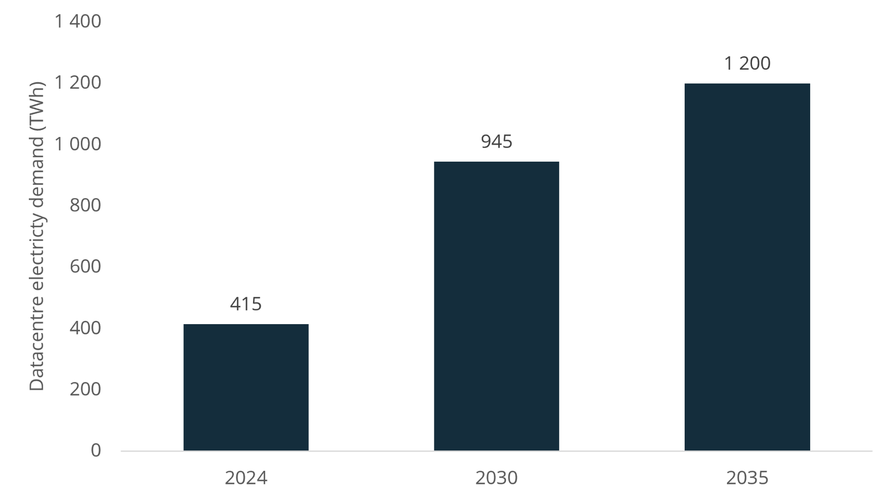
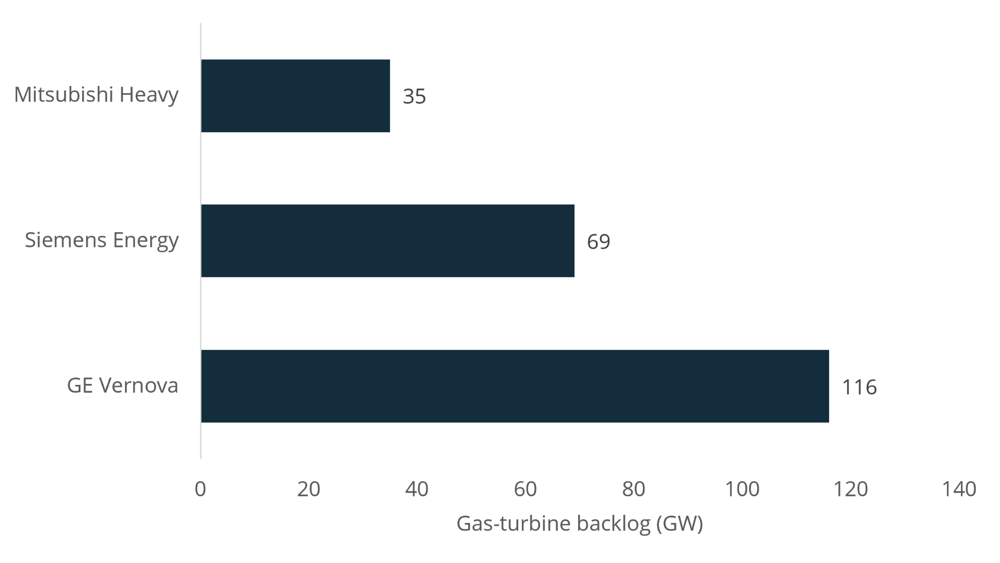
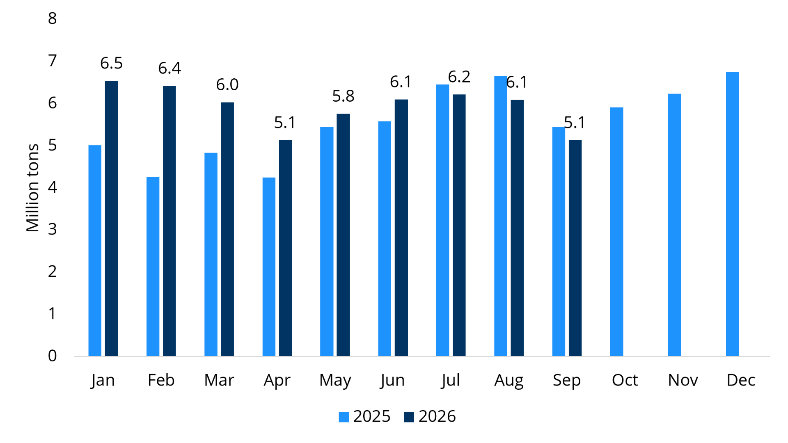
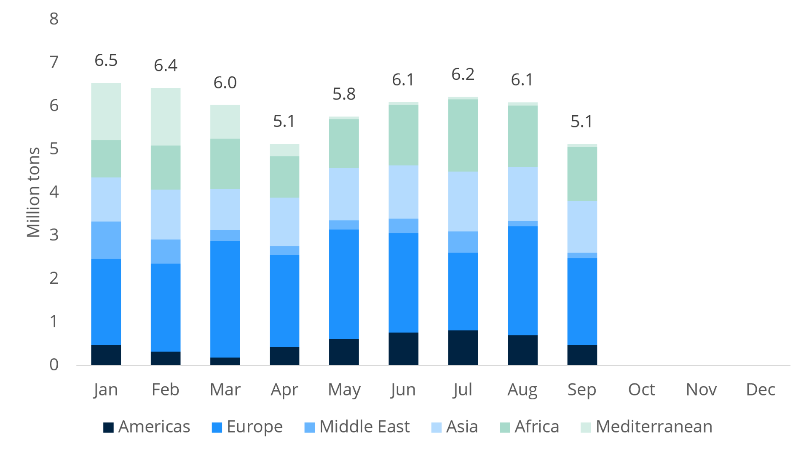
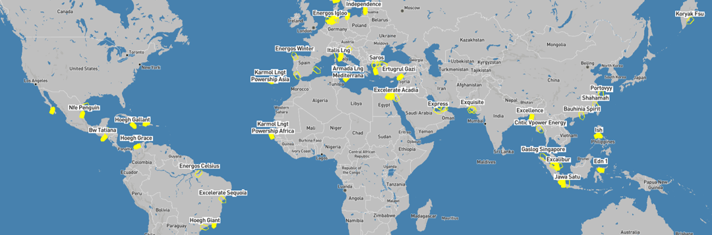
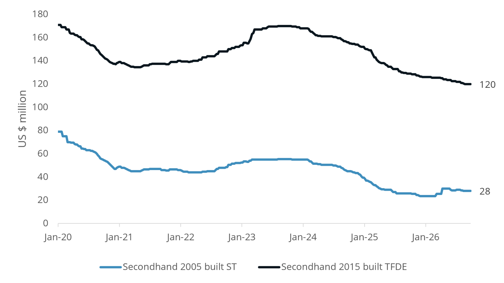
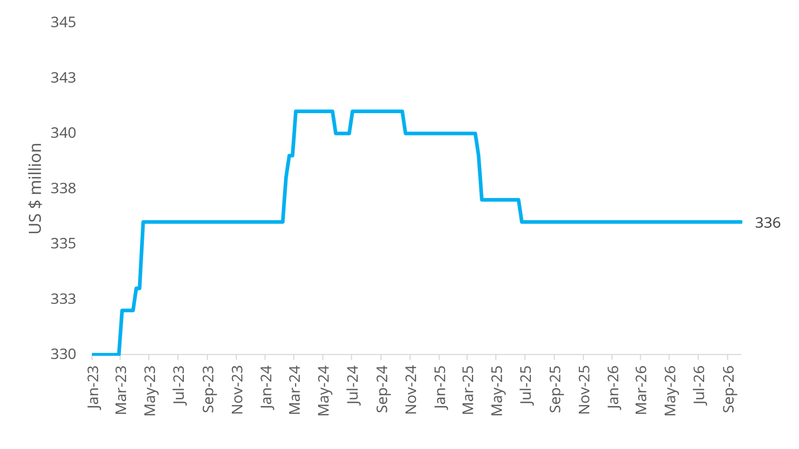

# FSRU Quarterly - Q3/26

**Date:** 2026-10-05 | **Department:** LNG | **Publisher:** Fearnleys AS  
**Original PDF:** [Local PDF](../pdfs/2026/2026-10-05_lng-fsru-quarterly-q326.pdf) | [Cloud Backup](https://pbrkapp.blob.core.windows.net/report/391aa6f8-c4c0-4e59-9323-95b9e43c4ce2/report.pdf)  

---

## Market reflections: Gastech confirms bullish FSRU outlook

The **wall of FSRU projects** we saw building up in 2024 and 2025 has **continued to materialize through Q3/26**. LNG supply concerns are not considered to be deal breakers for 2029-2031 CODs and for the more near-term requirements the snowball is too far down the hillside to shy away from an FSRU solution. We count another **three deals concluded through the quarter** bringing **2026-to-date to nine**; which is the busiest year since 2022. With another three months left of the year and the pipeline we see **we would not be surprised to hit an all-time high in terms of activity in 2026**. Specifications and durations of the concluded transactions vary which is reflected in commercial terms **leaving the market guessing what is reasonable “benchmark rate”**, but suffice to say that returns remain healthy for FSRU providers with 170,000cbm / 750MMSCFD units **still fetching north of US$ 125,000/day TC for 10+yrs**.

For the LNG world (including those passionate about FSRUs), **Gastech** 2026 in Bangkok was the main event of the quarter with more than 50,000 attendees congregating to discuss anything from billion-dollar liquefaction projects to gaskets at a few cents apiece. With **LNG prices at elevated levels** and the forward curve also lofty, the **mood** (which seems to mainly be set by suppliers based on presence and size of booths/receptions/availability of free coffee) **was by our interpretation bullish**. What was **previously an overhanging concern** on when the LNG market would revert to “normal” and opening of SoH/Qatari exports has been replaced with “the **market has changed fundamentally for the long term**”. This is made visible by increased interest in diversification of supply away from Middle East which includes potentially **another leg of US FIDs**, an **expansion of the FLNG scene** and new liquefaction frontiers. While we accept the shift in near-term mentality, we continue to **be amazed over how quick consensus adapts**. Qatar will eventually be producing 140+mtpa of LNG out of a global production of 700+mtpa by 2035; **20% of global supply can’t just be dismissed forever because Trumpty Dumpty tries to (failingly) rearrange the global energy order**.

Our recap of Gastech can be summarized in **four key themes**. Firstly, **demand remains broad-based** across Americas, Europe, Middle East and Latin America amongst both private and public players. Both **greenfield** (new opportunities) and **brownfield** (replacement of existing units) are on the cards. Undoubtedly, there will be plenty of chartering needed in the coming years. Secondly, **power demand from AI and datacenters is spilling into the FSRU market**. FSRUs are not the critical path item and a fraction of the value chain cost allowing Owners to dictate solid charter rates. Thirdly, **most discussions gravitate around conversions**. Time to market combined with capex results in newbuilds only being for “special needs” projects. Lastly, the **FSRU landscape is set to change** with M&A on the cards and emerging players trying to break in – creating a more competitive environment that we see creating tension which Charterers will take advantage of.

**Near-term supply of FSRUs is dwindling further** with only a handful of units now effectively available until H2/28 when the potential redeliveries may accelerate unless the temporary-to-permanent nature of FSRU projects manifests. Irrespective of existing units, the supply side is becoming elevated with **effectively 10 units on order and another 8-10 potentially in the works**. Most of these are **ordered against projects**, but as in the past; units may be ordered and arrive while projects tend to be more erratic of nature. As such, **we struggle to see another leg up on rates** and material improvement in FSRU economics but **rather maintaining current levels** as any “cracks” have yet to appear.

To summarize: Our **working hypothesis** going into Gastech (*The world needs more FSRUs faster than what can be made available*) has been **largely proven** by virtue of our conversations and follow-up actions. **Demand is coming in relatively defined terms with many well-developed projects**, not just unbankable pipedreams, which enable FSRU players to engage in serious discussions. In fear of famous last words, **supply may appear elevated but is in fact well-balanced** allowing the high charter rate levels to be maintained over the next 12 months.

### Key market developments during the quarter

**JULY**

Seatrium confirmed the conversion of **Karadeniz first first high send-out/high pressure** unit (**KARADENIZ**). The unit will have a peak capacity of 600MMSCFD in a combination of low (150MMSCFD) and high pressure (450MMSCFD) which is a novelty that enables use both for Karpowerships (low pressure) and conventional high pressure 3rd parties.  The current schedule indicates the FSRU will **complete conversion by end-27**.

**Aktor** and **Motor Oil Hellas** announced a framework agreement where Aktor intends to take 50% of **Dioriga Gas**, MOHs FSRU project located close to Corinth, Greece. The deal comes on the back of Mercuria in May-26 announcing having taken capacity at the FSRU. Aktor also has a LNG SPA with Venture Global through the DEPA J/V Atlantic-See LNG Trade. We see the **emergence of Aktor/MOH as a positive for the development** of a project that has been long time in the making.

Poland’s Gaz-Systems continued their process to secure the **2nd FSRU** for Gdansk after committing ~75% or 6.1BCMA (~600MMSCFD) of nominal capacity (which is 690MMSCFD) ahead of summer. The intention was to select the preferred bidder by end of Q3/26, but as we understand the process is delayed with a number of FSRU players still in the running and working to offer for the newbuild requirement. We also understand that the infrastructure for FSRU #1 may be delayed which could result in a delayed startup of **MOLs FSRU** towards the end of 2028.

Following the announcement of Fronterra Energy providing an FSRU through Excelerate Energy (**EXPRESS**) Colombia's **Ecopetrol** has made several moves to secure LNG for the unit. The most recent requirement on the Atlantic side is for appx 85MMSCFD in 2027 then ramping up gradually to around 170MMSCFD in 2029 before declining to 95MMSCFD in 2033 – covering the firm 7-year period consistent with the FSRU charter. At the time of writing, no results have come out, but **reports of a change in personnel inside Ecopetrol suggests further delays may be warranted**. Interestingly, Ecopetrol expects to start imports potentially as early in Dec-26 which feels optimistic given **EXPRESS** still located in Middle East. Excelerate has said they have alternative plans and are known to juggle their FSRUs – but we’d put our money on a “sometime in ‘27” startup and unlikely with EXPRESS.

Petrobangla’s **EXCELLENCE** suffered an extended outage between 21st July and 6th August due to a fire that led to two boilers out of service. Once back in partial operation the unit was faced to shut down due to lack of LNG onboard in the period 19th-22nd August. The outage highlights the risk of older FSRUs in operation despite first-class operations (**EXCELLENCE** is the first of purpose-built FSRUs in Excelerate’s fleet, delivered in 2005), but also the swift response of less than three weeks on what was reported as a serious outage. Moreover, it has driven EMRD, Petrobangla and RPCGL to engage in “knee-jerk” activities to secure a third FSRU.

Energos Infrastructure’s **ENERGOS WINTER** was **hit by a drone** during an attack while on station in Damietta, Egypt. The unit caught fire and has reportedly sustained damage to the suction drum which renders its regasification system unable to operate. The unit was sitting offshore until 1st September before heading to Ferrol for repairs. For readers interested in our take on FSRUs, geopolitics and returns we suggest our LinkedIn post published early-Sep. **EGAS is reportedly already in discussions with FSRU providers for a replacement FSRU** – but with prompt availability thin on the ground it is likely to take some time for clarity whether the **ENERGOS WINTER** returns or is replaced.

**AUGUST**

Following the outage on the **EXCELLENCE** Bangladesh’s Cabinet Committee on Economic Affairs decided to fast-track approval for the country’s 3rd FSRU to be delivered by the well-known FSRU player China National Energy Engineering & Construction Co (**CNEEC**). The unit is expected to be provided through a Chinese entity (**SeaCon**) and the vessel is rumoured to be a **2016-built, 174,000cbm Maran Gas LNGC**. The G-t-G proposal highlights delivery of the 600/750MMSCFD FSRU by Sep/Oct-28 (assuming TUA and IA signed by Sep-26). The project structure is similar to the two existing FSRUs where the FSRU provider is responsible for FSRU, Fixed Infrastructure, Terminal Services and Port Services on a BOOT basis. Duration is not defined, but expected to be a minimum of 15 years with a maximum of 24 years. However, the indicated tariff is appx US$ 0.75/MMBtu which compares to US$ 0.53-0.55/MMBtu for the two current FSRUs. What is also interesting to note is **Excelerate**’s separate proposal to Bangladesh for the delivery of their newly acquired **METHANE PATRICIA CAMILLA** within 18 months of a firm contract on similar structure as for CNEEC, but at a tariff not exceeding US$ 0.55/MMBtu. Add **AG&P LNG**/**Energos** J/V to the mix and we’re set for a lack of decision-making by the local entities. While it is clear that Bangladesh will eventually get their 3rd FSRU we see many twists and turns ahead – ultimately only hurting the Bangladeshis long-term.

Gaz-System confirmed that **Orlen, PGE, Grupa Enea and UNIMOT** have signed an agreement to share regasification capacity at the planned 2nd FSRU in Gdansk. The slot-sharing deal is interesting as it allows the four firms to pool delivery slots within single shipments which provides each holder with year-round access regardless of individual delivery schedules. This will increase the importance of commercial and operational processes at the FSRU which has been awarded to **KN Energies**.

DET reaffirmed that its long-delayed Stade terminal is still slated to receive **ENERGOS FORCE** to start commissioning in September (the FSRU arrived on 16th Sep). However, DET has indicated material works to be completed before commissioning can commence which suggests the unit is unlikely to be operational until end of the year. With the **commissioning cargo confirmed for Nov-26 delivery** this view is further substantiated. The delayed arrival after sitting weeks idle in Egypt is to us a conundrum and yet another proof of German tax payers money potentially being wasted. At present HEHs onshore terminal is expected to start operations in late-28 or H1/29 which suggests **2.5 years operation at most** for an FSRU that was supposed to be operational more than three years ago.

The **Kinetics** deal to provide an FSRU together with a powership on the Yucatan peninsula has reportedly failed due to what is reported as unresolved site-related matters at the end-client level. To our understanding this suggests a lack of ability to secure the relevant real-estate originally intended for the project. The consequence being that **LNGT POWERSHIP EUROPE** remains open.

**Exmar** announced delivery of the **SIMAISMA** to be modified and utilized as a Floating Transhipment Unit (**FTU**) under a 7-year charter. The vessel will serve as a transshipment/storage unit for LNG bunkering activities. No charterer has been confirmed or the location to which the FTU will be located, but in light of the storage capacity it would be reasonable to consider Singapore/Malaysia-range or Europe where the bunkering market is deep enough to handle break-bulk that is of an economically attractive scale.

**SEPTEMBER**

The plot thickens for Alaska’s first LNG import terminal with three separate proposal currently on the table. From an FSRU perspective, **Cook Inlet LNGs FSRU** to be located at the decommissioned Osprey offshore platform has been the focus for some time, but recent announcement of **Harvest Midstream** to repurpose and upgrade the decommissioned **Kenai LNG** terminal adds to the uncertainty of an FSRU in Alaska. Additionally, **Enstar** (Alaska’s largest gas utility) and **Glenfarne** working together have proposed a larger, new LNG import terminal to cover the expected long-term growth in Alaskan gas demand. Glenfarne also has the Alaska LNG export project in Nikiski which will have a capacity of upto 20mtpa. Each proposal carries their own subjective rationales of using existing infrastructure (**cost**), rapid start-up of FSRU (**time**) or long-term economics (**scale**). While no decision has been taken so far it represents a challenging situation for local authorities to evaluate three vastly different tracks which to us suggests a firm decision will likely be delayed.

**GasEntec** announced new ownership structure with **Groupe Mimran** (owned by the family of Mr. Jean-Claude Mimran aka The Sugar King of Africa) taking a majority stage with prior shareholders having exited in full. While not clearly stated, we assume this refers to AG&Ps previous ownership in the company. The intention is to **expand GasEntec’s portfolio to accelerate commercialization of its solutions** while pursuing new infrastructure solutions. This folds in nicely with the company’s Approval-in-Principle (AiP) from Lloyd’s for a 1,000MMSCFD FSRU design able to operate in open, closed and combined-loop mode. Together the two announcements entails a **new FSRU contender is formally emerging** and we expect to see GasEntec increasingly active in the FSRU market going forward.

**Exmar delivered a Kinder Egg to the FSRU/FSU world** in September also; first issuing a US$ 150m bond at a fixed coupon of 7.75% in the Nordic market before the **TURA** departed China for its 5-year charter to Regasificadora del Pacifico in Buenaventura, Colombia and subsequently announcing having secured a 10-year deal in Ivory Coast. The FSRU is expected to be a conversion with ~152,000cbm storage and 250MMSCFD with a capex element of US$ 58,400/day suggesting a TC rate of ~US$ 80,000/day. The rate level is in the low-end of what we see in the FSRU market which is partly explained by the smaller regas capacity and likely also other project-specific elements reducing overall cost.

**Senegal** has announced the **intention to stop importing LNG** as it will start to **receive cargoes from the GTA project** under the GTA-projects domestic market obligation (**DMO**). While the DMO, which is appx ~0.5mtpa, was originally expected to be served through a new pipeline together with the construction of a 285MW CCGT in Saint-Louis, it appears an interim solution will be to shuttle LNG from GTA down to Dakar. **We have our doubts of any pipeline being completed** and as such see the **need for LNG import infrastructure in Senegal to be critical** for the long-term demand. While Karpowership currently operates a powership and a low-spec FSRU in Dakar, local fuel distributor Elton is working with AG&P LNG and GasEntec to develop an FSU (**SHAHAMAH**) and onshore regas which could in theory receive the DMO volumes. However, **as always in Africa – seeing is believing…**

The **Australian** import project in Adelaide, **Outer Harbor LNG**, is back to square one with AG&P reportedly out of the project after entering into negotiations in 2024 and signing the SPA in Aug-25. The project was reported at one point to be targeting **GRACE DAHLIA** (aka the world’s most talked about FSRU/FLNG conversion candidate), but failures to meet FID dates means the **developers in Venice Energy has decided to restart the sales process**. Venice has indicated a value of around US$ 250m, but with **Port Kembla** ready to run and no clients, **VIVA** reportedly struggling with permits in Geelong and **VOPAKs** Port Philips moving slow we would be interested to see who will take a punt at Adelaide; being far from the areas where the potential gas shortage will materialize.

### Quarterly corporate highlights: Energos M&A talks confirmed

A decent amount of corporate activity through the past quarter with NFE restructuring entering the last innings, quarterly earnings from Excelerate and the emergence of Energos Infrastructure being in play.

**NFE** announced in September that their long-awaited restructuring was completed with **debt reduced to US$ 700m from the pre-restructuring US$ 5.7bn** and operations focused on terminal operations in Mexico (La Paz) and Puerto Rico as well as the FastLNG unit close to Altamira, Mexico. While the company is now on level footing in respect of capitalization, we see **limited growth potential in the near-term** and also potentially some “branding issues”. The recent announcements from **Norsk Hydro (NHY)** in Aug-26 where NHY first **announced a reduction in alumina production due to disruption in gas supply from CELBA** (owned by NFE) and **subsequently announcing becoming a self-importer of gas** suggests the supply agreement with NFE is no longer in effect. Adding one and one suggests lawyers may be involved.

**Excelerate** reported Q2/26 in early-Aug with the biggest news item being acquisition of **METHANE PATRICIA CAMILLA** (170,000cbm, 2010-blt, TFDE, Partial Reliq) at US$ 79m. The company expects an **all-in conversion cost of around US$ 230-250m** which would suggest US$ 150-170m conversion capex. It is not clear whether this includes contingencies, mobilization costs, interest during construction or other elements. However, Excelerate are working with Seatrium on the conversion and while Seatrium has an unparallelled track record on conversions they appear to be pricing their services at a premium compared to other contractors in the FSRU conversion space. Excelerate also **provided an update on the Iraq project** which is delayed, not only due to the geopolitical situation, but **also due to local constraints**. The current **targeted start-up of the terminal is Q2/27, but appears to be a moving target** which is subject to clarity on SoH and US/Israel-Iran conflict. Lastly, Excelerate alluded to steep cost of newbuilds during the conference call which we’d be prone to agree and further supports a conversion track unless project owners require newbuilds.

The **potential sale of Energos** emerged in earnest in mid-September with an article by Reuters stating owner Apollo were exploring strategic options in a deal that **could value Energos north of US$ 3bn.** The article also mentioned **XRG** is one of the potential bidders with an offer that could see it take a stake of upto 50% of Energos. While the **potential divestment** of part or all of Energos by Apollo (who made the investment in Jun-22 in what can only be seen as an expensive sale-leaseback transaction by NFE) **has been rumoured** for some time it folds nicely with the restructuring of NFE and **removal of most of the NFE-risk in Energos’ portfolio**. Call in or reach out to discuss Energos portfolio and value in greater detail.

### Quarterly focus: AI <3 FSRU

*Hyperscalers, speed-to-power, rack density and interconnection queue* were all words that were thrown around in our conversations during Gastech this year. FSRUs have historically (and still are) a **fast-track and flexible way of providing large volumes of gas**, whether the need is a shortfall of domestic gas (Egypt), security of supply (Europe) or balancing renewable build-out (Brazil). For this quarter’s focus we take a look at **how AI and its power consumption from datacenters** are shaping up to become an additional driver for FSRU demand.

Going back to our Q2/25 report we wrote about the **gas-turbine crunch** and how cost and lead time for large turbines for use in CCGT power plants may delay the demand for FSRUs. Since then **the situation has worsened** with costs now in the range of **US$ 3-4 million/MW installed** and lead time of **4-5 years from the major OEMs**. The vast majority of demand for turbines comes from players seeking electrons for data centers. This creates a **paradox for FSRUs**: the same data centers that add to the gas demand are also slowing down the power plants that would burn the imported gas.

While **local energy mix is an important differentiator** that impacts need for LNG import infrastructure. In the **US**, new gas-fired power for data centres runs on **domestic pipeline gas**, while **China** is likely to lean on **coal**, so neither need any LNG. **Asia outside JKTC looks different** and is proving to be a region where **LNG demand can be materially supported by the AI infrastructure build-out**. Malaysia and Singapore are the clearest examples. Singapore LNG (SLNG) has chartered an FSRU for its second terminal, and in Malaysia the most recent RGT3(and upcoming RGT4) will provide gas to new large-scale CCGTs.

Data centers require **24/7** supply of power which **raises the bar for availability** at both the power plant and the FSRU that feeds it. FSRUs driving focus on **smaller maintenance windows and five-year drydocks are going to be out of the question** for the players still adhering to what is now an archaic maintenance philosophy in FSRU-world.

In most of these markets **the FSRU is not the bottleneck; the gas turbine is.** Given the rapid expansion, time is of the essence and FSRUs are in this case not the critical path item due to gas turbine shortage, but this is **driving the larger consumers to look at alternative solutions.** The “standard” solution is to wait for grid connected power plants which are generally seen to take 5+ years. The alternative is **behind-the-meter (captive power generation)** solutions with 1GW+ data center running on gas needs approx. 1.2 mtpa of LNG, around a third of a large FSRU’s nominal send-out. Turbines are also no longer the only route to gas-fired power. Gas engines and **Solid Oxide Fuel Cells (SOFC)** are increasingly used to avoid the turbine “queue”. the likes of **Bloom Energy** which delivers (SOFC) are seeing rampant demand (and a corresponding **share price development being up ~1000% since start of 2025**). Hence, the demand for FSRUs to serve data centers is not solely dependent on the CCGTs to deliver.

Historically, the **cost of power generation has been a driver for FSRU demand**; CCGTs delivering low enough electricity per MWh to move down the merit curve. With turbine costs having doubled one may be led to think that this is a constraint, but in fact power is the cheap part of the value chain. Based on our research (partly conducted with the use of AI), the **data center shells are in the range of US$ 9-13 million/MW** installed and **chips (think NVIDIA, SK HYNIX, TSMC) run at US$ 30-40 million/MW** installed. Hence, power is a mere 7.5% of the total capex. **And FSRU?** With US$ 250 million for a unit having nominal capacity to feed 3,000-3,500MW of power plants the implied price is US$ 0.07-0.09 million/MW installed. And even with a 500MW plant (which in data center-world is quite sizeable) the cost is US$ 0.5 million/MW installed – **a mere 1% of total capex.** For a hyperscaler, **speed-to-power matters far more than the cost of the import terminal.**

So, as one client said it:

*The world is long molecules and short electrons – we’re going to capitalize on this!*

*Chart: Global electricy demand by datacentres expected to grow by 200% in a decade*

*Chart: Top 3 OEMs gas-turbine backlog*

*Source: BNEF, IEA, GE, Siemens, MH*

### FSRU activity and volumes

The combination of **outages, higher prices and low Middle Eastern LNG exports** led to LNG volumes delivered to FSRUs in Q3/26 coming in at **17.4mt / 294 cargoes** (down 6% Y-o-Y from 18.6mt / 304 cargoes and up 3% Q-o-Q from 17mt / 284 cargoes). Imports in **Americas, Asia and Africa (which includes Egypt) were individually higher** Q-o-Q on back of what we consider less price-sensitive buyers whereas **Europe dropped the most** (which has been visible through the weak storage build). Despite the outage on **ENERGOS WINTER** Egyptian imports surged to 4.2mt / 62 cargoes during the quarter which is the highest level seen since their FSRU chartering spree started in 2025. Other notable increases were seen in Italy (2.2mt vs 1.8mt Q-o-Q), Indonesia (1.7mt vs 1.4mt Q-o-Q) while Germany (1.8mt vs 2.2mt Q-o-Q) and Bangladesh (1.6mt vs 1.8mt Q-o-Q) saw the biggest declines.

There was **one new addition** to the FSRU/FSU fleet in terms of new operational terminals during the quarter; **BILBAO KNUTSEN** taking a whopping 12,000 tons (appx 27,000cbm) in mini-parcels. We counted **41 FSRUs receiving cargoes** during the quarter, **down from 45 in Q2**. The “dropouts” were Bahia, Kaliningrad, Sepetiba, Saros and Santos while Alexandroupolis took 3 cargoes in Q3. The busiest terminals were Ain Sokhna (Sumed 1+2 / Sonker) at 20, 19 and 19 cargoes each (keeping **HOEGH GALLEON**, **ENERGOS ESKIMO** and **ENERGOS POWER** very busy) with a cargo appx every 4 days. A noteworthy observation is the seemingly busy **Cartagena** terminal (**HOEGH GRACE**) which received 20 cargoes, but only 0.67mt which suggests a **“partial cargo galore”** at around 75-80,000cbm per drop.

In terms of cargo sizes, the **average cargo in Q3 was 129,700 cbm** which underpins our (reiterated) view that storage capacity is important, but not everything. The general pattern remains in effect with Europe taking larger lots at around 155,000-160,000cbm whereas Americas is the partial-drop destination with all FSRUs receiving cargoes during Q3/26 at least taking one partial cargo each. Asian cargoes are on average around 120,000cbm, but a wide range of FSRU sizes in the region leads to variation. The terminal with the **largest average cargo in Q3** was Wilhelmshaven 1 (**HOEGH ESPERANZA**) at **167,900 cbm** followed by Ravenna (**BW SINGAPORE**) at 160,400cbm.

Most of the global FSRU fleet is now in operation and none acting as straight “insurance-FSRUs” apart from **EXPRESS** in Ruwais (which is on overtime for her positioning to Colombia). However, **5 FSRUs took only one cargo** during the quarter which leaves crew with ample time for maintenance. In terms of terminals that are plug-and-play (available, but no FSRU in place) we only count two with TGS in Brazil and Jaigarh in India.

From a global perspective, **FSRUs delivered 17.1% of all LNG volumes imported in Q3/26**. This is marginally down from the 17.4% seen in Q2, but the trend is generally increasing still. Global LNG imports rose to 101.9mt in Q3 vs 98.4mt in Q2, but still well below the current record 117.1mt in Q1. FSRUs remain a backbone in the global LNG infrastructure and with the number of FSRUs on order compared to onshore regas developments it is **inevitable that the relative importance of FSRUs will grow in the coming years**. As such, we continue to see FSRUs receiving **beyond 20% of global LNG imports within 2030.**

*Chart: Global volumes imported through FSRUs (2023-2026YTD)*

*Chart: Monthly volumes imported through FSRUs by region (2026YTD)*

*Source: S&P / Platts*

### Recent FSRU Project Developments

**Asia & Middle East**

**Gas Malaysia** (where also Petronas, VTTI and Tokyo Gas are invested) is nearing release of its **ITB/RFP** to FSRU providers with what is expected to be a relatively detailed documentation which will allow qualified bidders to offer both newbuild and/or conversion.

**Indonesia** remains a hotspot of activity with AKR/bp securing a newbuild with BW earlier in the year. **PLN-EPI** has their West Java project (potentially a replacement of the existing FSRU in Jakarta Bay) while other entities such as Pertamina, PTNR and PGN also working. Add Bali and Sarawak to the mix and Indonesia will be worth the attention, but maybe mainly for the local players.

**Iraq** is impatiently waiting for Excelerate’s FSRU and seems to be looking at pursuing parallel projects to cover the expected gas shortages. No formal process is in place, but we expect bilateral initiatives to be considered.

**Europe & Mediterranean**

**Ireland’s** GNI is gathering pace to come to the market with an old-school steam/glycol FSRU requirement. Additionally, the FSRU will require massive (too large?) reliq and other environmentally protective features which suggests a newbuild is likely.

**Albania** has received renewed interest for LNG with **Argent LNG** targeting an onshore terminal with 5mtpa capacity. We expect a revival of the FSRU plants to emerge as a more flexible and faster solution, limiting need for even larger pipeline capacity to be built.

**Americas & Caribbean**

**Ecuador’s** state-owned **Petroecuador** is seeking information from providers of “innovative, transfer, storage, transportation and regasification schemes” to support 60-100MMSCFD of imported LNG. This is better known as opening the flood gates for PowerPoint solutions, but a mid-scale FSRU could potentially do the trick.

The activity in **Colombia** may have settled somewhat, but we expect renewed project activity should the Ecopetrol LNG supply tender fail as this will to our understanding “reset” some of the projects currently seem to be moving forward.

**Africa & Other**

**Mozambique** is back in the market with both **Matola** and **Inhassoro** being discussed as potential locations – albeit with different motives. However, both projects are linked to development of South African gas balances which means we would not put our money on either of the two.

**New Zealand** has delayed a decision on its project in Port Taranaki until after elections in Nov-26. That doesn’t mean the door is open to new entrants at this point, but political change could change the direction of the project. At present we understand there are two candidates left of which one is the slightly odd Anthony Veder (mainly small-scale LNG) /Gasfin (one-trick FSRU barge in unknown condition)-tieup.

### Notable FSRU movements

*Chart: FSRU_MAP*

*Source: Fearnleys*

The vast majority of FSRUs have been on station or operating without issues in Q3 – which underpins the operational stability that all FSRU projects should be seeing. However, there were a few notable movements.

**ENERGOS WINTER** held its position outside Damietta for an extended period before finally setting course for a shipyard on 4th September. She is currently in El Ferrol where repairs are to be undertaken.

**ENERGOS FORCE** also floated around in East Med for a good month in August before heading towards Stade on 31st August – arriving 15th Sep and now appears to be moored alongside HEHs jetty in Stade.

**MARSHAL VASILEVSKIY** moved from Kaliningrad early-Jul to Portovaya, most likely to act as additional storage for the liquefaction plant at Portovaya where the **PORTOVYY** FSU is also located.

**EXQUISITE** remains on station in Port Qasim, but should have been moving as drydocks is reportedly overdue and was highlighted as a stop-over for **EXCELERATE ACADIA** upon delivery from yard back in Q1.

### Supply side: Orderbook, asset values, capex and lead times

*Chart: FSRU conversion candidates: Secondhand values*

*Chart: FSRU Newbuild prices*

*Source: Fearnleys*

Since last quarter the FSRU orderbook has swelled further and we now count 4 (+1 during quarter) newbuilds and 5.5 conversions (+2.5 during the quarter). We could add another 6-7 units conversion units with high likelihood of materializing within a 6-12 month period and another 2-3 newbuilds which would potentially drive the FSRU orderbook close to 20 units within a short period of time. However, five of the units in the orderbook will deliver in the next 12 months including **HOEGH GANDRIA**, **BW’s Dom. Rep. FSRU**, **MOLs Poland NB**, **MOLs Conversion** and **Exmar Ivory Coast FSRU**.

The relatively lofty number of vessels coming into the market would for an outsider be considered a market facing oversupply. We disagree **as of the 20 odd units we only count 2 or 3 as speculative**. Looking at the demand side of the equation, we continue to **count 8-10 projects with tangible line of sight for FID** over the same time frame if they are to hit required CODs. That said, we remain of the (long and admittedly opaque) view that **2032-2034 could represent the start of a slightly softer part of the bull-run.** *Call in to discuss the orderbook and supply side in detail.*

**Asset values** have continued to creep lower during the quarter despite Sellers holding back as much as they can. The **METHANE PATRICIA CAMILLA** (170,000cbm / 2010-blt / partial reliq) sale at US$ 79m to **EXCELERATE** appears to us to be more of a **one-off than a benchmark transaction** as few other Sellers are willing to transact similar tonnage anywhere lower than high-90s or north of the triple-digit mark. Noteworthy though is that even though not a benchmark transaction **the “Pat-Cam” deal shows that gravity is inevitable.** **Indonesian local players** continue to absorb older LNGCs and it seems just a matter of time before **some will move one or more LNGCs into the FSRU space.**

**Project Buyers remain focused on cargo capacity** and we hardly have conversations for sub-145,000cbm tonnage as more and more focus on **“as large as possible within a reasonable budget”** as one Buyer put it. In terms of price levels we see STs around 20yrs generally pricing at scrap plus optionality premium totalling **US$ 20-25m** and DF-vessels 12-14 years priced around the **US$ 100m-mark**. Of course, there are wide variations here – **which is why you should call Fearnleys to discuss your S&P requirements!** In terms of containment system, membrane remains a preference driven largely by availability as **larger Moss-vessels without charter are becoming unicorns.** In fact, we are seeing competition from the **FLNG space** with sometimes **irrational Buyers** dead afraid to be left short of donor vessels which **results in an aberration in price.**

We remain firmly of the view that the long list of **well-progressed and well-structured projects/processes requiring FSRUs** currently seen in the market represents a **unique opportunity for Sellers**. Keeping in mind that we still have around **130 STs** (adjusted for 145,000cbm+ only) and around **140 DFs** which in the next 3-5 years will face **stark competition as trading LNGCs.** Even with an optimistic view on the FSRU market the vast majority of these vessels will generate subpar earnings for their Owners. Hence, **we reiterate our call to Sellers of concluding a sale with delivery once the vessel comes off long-term charter to remove any residual risk.**

**Engines and regas modules remain critical path items for conversions.** The constraint on engines is more related to slots than the lead time while **regas has 16-21 months lead time** depending on provider. On the **engine slots** it is first-come-first-serve which means **new conversions face the risk of 3-4 months delay**. This continues to **favor DF-vessels over STs** as gensets are not part of the conversion package for a DF. The total conversion time from FID to redelivery quoted by EPC contractors is marginally higher at 24-28 months (we saw 22-23 months earlier in the year). This means that **a fresh conversion today (assuming FID 31st Oct 26) is possible to deliver between Oct-28 and Feb-29.**

**Conversion capex** is not much changed, but through our discussions we see a gap between what FSRU players quote and what EPC contractors indicate. Basis a 3 x 250 MMSCFD, SW/Glycol Open Loop without BOG handling **contractors still quote around US$ 140-160 million for STs while the DF-figure is around US$ 120-140 million.** FSRU players tend to quote **US$ 20-40 million higher** which likely justifies a sharper number (with less exclusions) from EPC contractors and a contingency.

Rounding it off, the **FSRU newbuild market is a bit more active** with two units ordered in quick succession during summer and **another two potentially for Poland and Ireland** (both representing cases of bespoke/project-specific needs) which drives price up. We currently quote a **170-174,000 cbm newbuild (basis same FSRU spec as for the conversions above) of around US$ 335m.** Delivery time is now pushed into 2030 (in line with LNGC newbuilds) which continues to give conversion a timing advantage of appx 12 months; an advantage that a large number of projects is expected to execute on the back of.
