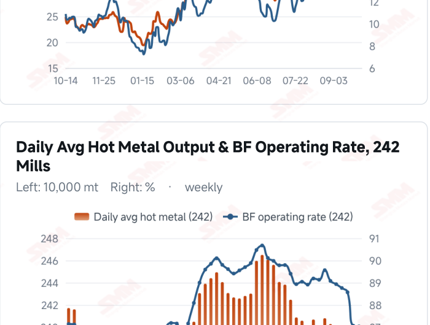
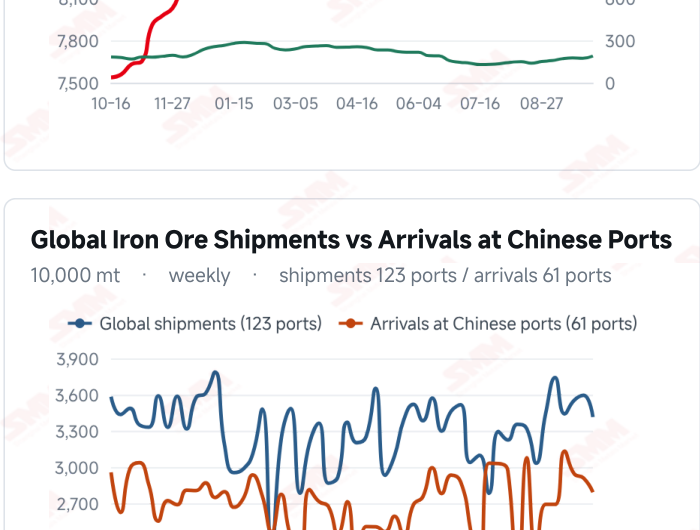
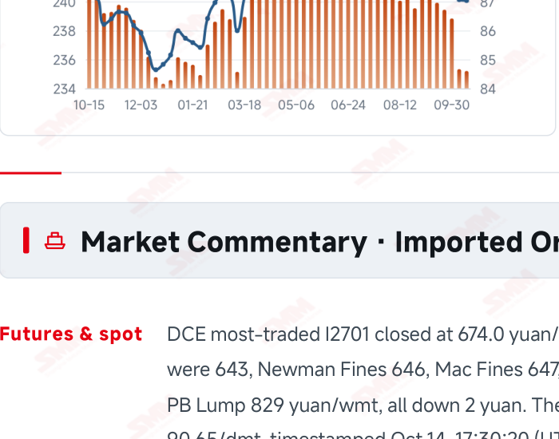
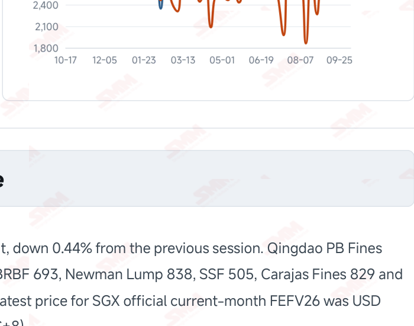

# SMM Iron Ore Daily — 2026-10-14 (Wednesday)

**Source:** SMM Data-pro · Shanghai Metals Market (SMM)

---

## Futures Contracts

| Exchange | Contract | Price | Unit | Daily Change | Daily Change % | MTD Avg |
|:---|:---|:---:|:---:|:---:|:---:|:---:|
| DCE | DCE Iron Ore Most-traded I2701 | 674.00 | yuan/mt | -3.0 | -0.44% | 679.80 |

## SMM Iron Ore Price Index (Physical & Benchmark Indices)

| Index Name | Market Type | Fe % | Price | Unit | Daily Change | Daily Change % | MTD Avg |
|:---|:---|:---:|:---:|:---:|:---:|:---:|:---:|
| MMi 61% Port Spot | port_spot | 61.0% | 656.00 | yuan/wmt | -1.0 | -0.15% | 660.00 |
| MMi 58% Port Spot | port_spot | 58.0% | 617.00 | yuan/wmt | -2.0 | -0.32% | 622.00 |
| MMi 65% Port Spot | port_spot | 65.0% | 820.00 | yuan/wmt | -1.0 | -0.12% | 824.00 |
| MMi 61% Seaborne Index | seaborne | 61.0% | 89.50 | USD/dmt | 0.0 | 0.00% | 90.86 |
| MMi 65% Seaborne Index | seaborne | 65.0% | 108.35 | USD/dmt | -0.35 | -0.32% | 109.88 |
| SMM Domestic Ore Composite Index | domestic_composite | 66.0% | 821.58 | yuan/mt | -3.22 | -0.39% | 823.19 |

## Key View

### Port prices remain soft as seaborne brands stabilise; demand recovery still needs trading support

Domestic prices remained under pressure while some seaborne brand quotations stabilised. DCE most- traded closed at 674.0 yuan/mt, down 0.44%, and all eight Qingdao products fell 2 yuan/wmt. The 61%, 58% and 65% port indices eased to 656, 617 and 820 yuan/wmt. The seaborne 61% index held at USD 89.50/dmt and the 65% fell to 108.35. Meanwhile, nine of the 12 brand quotations rose and three were unchanged, showing that composite indices and individual brands do not always move together in the short term. Marginal changes in demand warrant attention. Surveyed daily hot metal output was 2.3520 million mt on Oct 14, down 1,200 mt from Oct 7: the decline narrowed but output had not recovered. The second coke cut and lower freight may ease costs, yet additional mill buying still depends on orders and margin repair. Average import trading margins narrowed to 8.40 yuan/mt, also showing that lower costs may not fully offset selling-price pressure. Firmer offers should be distinguished from a recovery in physical demand. Without sustained improvement in port transactions and mill restocking, strength in some seaborne brands may struggle to lift the broader market. Stabilising hot metal and stronger buying could improve downside support. A soft, range-bound outlook remains appropriate while watching for aligned improvement in trading, production and inventories.

## Today's Highlights

- Domestic futures and port prices eased further. DCE most-traded I2701 closed at 674.0 yuan/mt, down 3.0 yuan (-0.44%) from Oct 13. All eight Qingdao spot products fell 2 yuan/wmt, with PB Fines at 643, Newman Fines 646, Mac Fines 647 and Carajas Fines 829.
- The seaborne 61% index held steady while the 65% eased. The MMi 61% index was unchanged at USD 89.50/dmt; the 65% was 108.35, down 0.35 (-0.32%). Their spread narrowed to USD 18.85/dmt.
- Brand quotations stabilised while port indices still fell. Against the Oct 13 report, nine of the 12 seaborne brands rose and three were unchanged. PB Fines at USD 89.80/dmt, Newman Fines at 88.90 and Mac Fines at 89.25 were flat. The 61%, 58% and 65% port indices were 656, 617 and 820 yuan/wmt, down 1, 2 and 1 yuan.
- The hot metal decline narrowed, but demand recovery remains in focus. SMM’s surveyed daily hot metal output was 2.3520 million mt on Oct 14, down 1,200 mt from Oct 7. The blast furnace operating rate fell 0.03 percentage point to 87.03%. Output continued to ease, leaving the purchasing response to cost relief important.

## Key Price Drivers (12-Month Charts & Operational Metrics)

### Charts: Freight & Port Inventory

### Charts: Hot Metal Output & Shipments vs Arrivals

### Operational Fundamentals Snapshot

| Fundamental Indicator | Value | Unit |
|:---|:---:|:---:|
| C3 Freight (Brazil to China) | 32.88 | USD/mt |
| C5 Freight (Australia to China) | 13.19 | USD/mt |
| Daily Avg Hot Metal Output (242 Mills) | 2.352 | Million MT |
| Iron Ore Port Inventory (10 Major Ports) | 103.0165 | Million MT |
| Global Iron Ore Shipments (Weekly) | 34.1393 | Million MT |
| Chinese Port Arrivals (Weekly) | 27.9147 | Million MT |

## Market Commentary · Imported Ore

### Futures & Spot

DCE most-traded I2701 closed at 674.0 yuan/mt, down 0.44% from the previous session. Qingdao PB Fines were 643, Newman Fines 646, Mac Fines 647, BRBF 693, Newman Lump 838, SSF 505, Carajas Fines 829 and PB Lump 829 yuan/wmt, all down 2 yuan. The latest price for SGX official current-month FEFV26 was USD 90.65/dmt, timestamped Oct 14, 17:30:20 (UTC+8).

### Driver

Domestic futures and composite port indices declined while seaborne brand quotations were mostly slightly higher or unchanged, showing continued short-term differences across markets. Firmer brand offers may reflect resource availability and buying schedules but do not establish a broad demand recovery. The spread between the composite seaborne 61% and 65% indices narrowed to USD 18.85/dmt; mill blending choices and actual transaction support remain important.

### Demand

SMM’s 242-mill survey showed daily hot metal output of 2.3520 million mt on Oct 14, down 1,200 mt from 2.3532 million mt on Oct 7. The blast furnace operating rate fell 0.03 percentage point from 87.06% to 87.03%. The output decline narrowed from the previous period but had not turned into growth. Estimated maintenance- related losses of 1.9011 million mt for Oct 10–16 measure a different quantity from daily hot metal output. Limited improvement in end-user orders may keep mill purchases focused on immediate needs.

### Inventory & Supply

In the week to Oct 9, global shipments were 34.1393 million mt, down 5.02% WoW, while arrivals in China were 27.9147 million mt, down 4.05%. Brazil shipped 7.0226 million mt and Australia 19.5081 million mt. Lower supply flows may ease subsequent arrival pressure, but existing port stocks and mill collection schedules also matter. The latest available 10-port inventory was 103.0165 million mt as of Sep 30; shipment changes should not be equated directly with realised port destocking.

### Cost & Margin

SMM’s Oct 14 imported ore cost-and-margin assessment put the period’s average import margin at 8.40 yuan/mt, down 1.20 yuan from 9.60. This reflects import trading rather than steelmaking or coking profitability. Oct 13 freight was USD 32.88/mt for C3 and 13.19/mt for C5, down 1.14% and 5.24% from the previous reading. Lower transport costs may partly cushion weaker selling prices. The second coke cut has taken effect, while a third round remains under negotiation rather than providing realised cost relief.

## Market Commentary · Domestic Ore

### Prices

SMM’s Oct 14 Liaodong brief described weekly quotations of 650–660 yuan/mt for 65% concentrates on a wet- basis, tax-exclusive ex-works basis. Some sellers reduced prices by 10 yuan/mt under mill pressure. The latest national Domestic Ore Composite Price Index was 821.58 yuan/mt on Oct 9; region, grade and pricing terms distinguish these measures.

### Supply & Demand

Insufficient run-of-mine ore constrained efficiency at some Liaodong operations, while some sellers without funding or stock pressure preferred to hold material, offering price support. However, softer imported ore and mills’ cost-control priorities kept bargaining pressure strong. Regional supply constraints coexist with cautious buying, making actual trading conditions more informative than individual quotations alone.

### Outlook

SMM expects near-term Liaodong prices to remain range-bound. Conservative mill buying could limit a recovery, while continued local supply tightness may cushion declines. Domestic ore should be assessed by region and pricing basis rather than treating concessions by some sellers as a nationwide decline.

## Market Factors

### Supportive Factors

- Nine seaborne brand quotations rose and three were unchanged, with mainstream mid grades steady.
- The weekly hot metal decline narrowed to 1,200 mt.
- Latest shipments and arrivals both fell, potentially easing subsequent supply pressure.
- Freight declined further, cushioning costs for some cargoes.

### Bearish Factors

- DCE closed 0.44% lower and all eight port products fell 2 yuan.
- All three port indices declined and the seaborne 65% index fell 0.32%.
- Mill purchasing remains constrained by profitability and end-user demand.
- Average import margins narrowed to 8.40 yuan/mt, pressuring trading profitability.

---
*(c) 2026 Shanghai Metals Market (SMM) · Iron Ore Value-Chain Data & Research*
