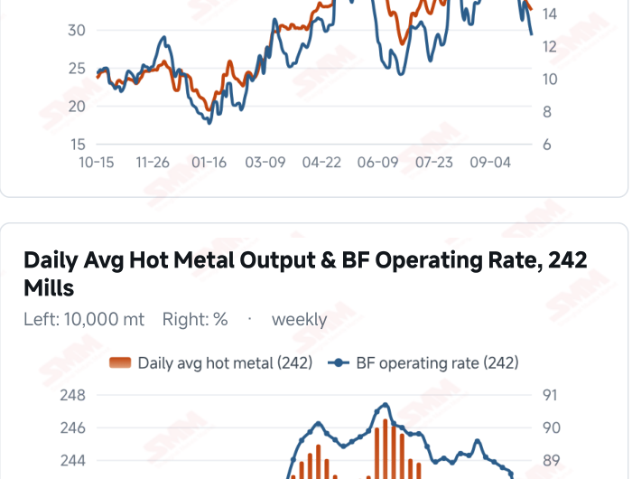
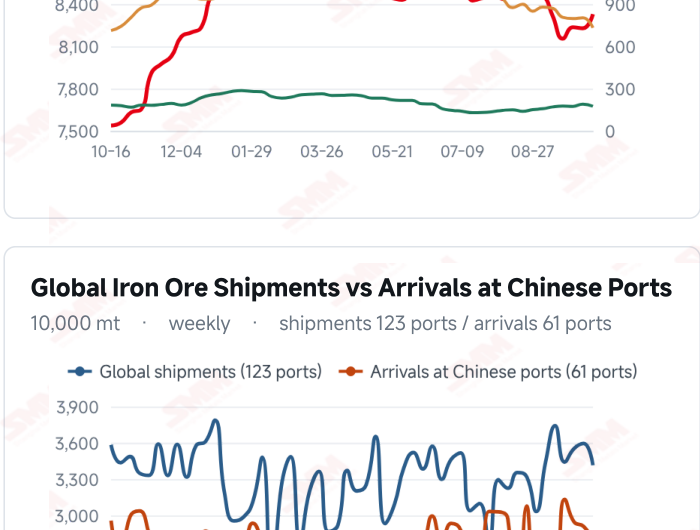
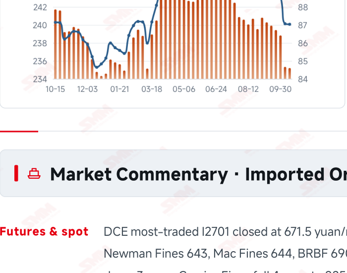
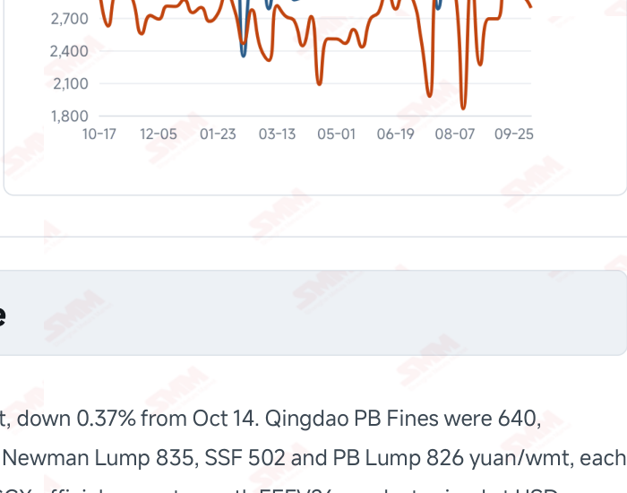

# SMM Iron Ore Daily — 2026-10-15 (Thursday)

**Source:** SMM Data-pro · Shanghai Metals Market (SMM)

---

## Futures Contracts

| Exchange | Contract | Price | Unit | Daily Change | Daily Change % | MTD Avg |
|:---|:---|:---:|:---:|:---:|:---:|:---:|
| DCE | DCE Iron Ore Most-traded I2701 | 671.50 | yuan/mt | -2.5 | -0.37% | 678.40 |

## SMM Iron Ore Price Index (Physical & Benchmark Indices)

| Index Name | Market Type | Fe % | Price | Unit | Daily Change | Daily Change % | MTD Avg |
|:---|:---|:---:|:---:|:---:|:---:|:---:|:---:|
| MMi 61% Port Spot | port_spot | 61.0% | 654.00 | yuan/wmt | -2.0 | -0.30% | 659.00 |
| MMi 58% Port Spot | port_spot | 58.0% | 615.00 | yuan/wmt | -2.0 | -0.32% | 621.00 |
| MMi 65% Port Spot | port_spot | 65.0% | 813.00 | yuan/wmt | -7.0 | -0.85% | 822.00 |
| MMi 61% Seaborne Index | seaborne | 61.0% | 88.80 | USD/dmt | -0.7 | -0.78% | 90.67 |
| MMi 65% Seaborne Index | seaborne | 65.0% | 107.50 | USD/dmt | -0.85 | -0.78% | 109.66 |
| SMM Domestic Ore Composite Index | domestic_composite | 66.0% | 821.58 | yuan/mt | -3.22 | -0.39% | 823.19 |

## Key View

### Futures and spot prices weaken as port stocks rise; purchasing support remains key

Prices softened broadly again, with yesterday’s recovery in some seaborne brands failing to continue. DCE most-traded fell to 671.5 yuan/mt, while the 61%, 58% and 65% port indices were 654, 615 and 813 yuan/wmt. The seaborne 61% index was USD 88.80/dmt and the 65% was 107.50, with all 12 brands declining. The port high- low spread narrowed to 198 yuan/wmt as the composite high-grade index came under greater pressure this period. Inventories offer another perspective. Ten-port stocks rose 1.0047 million mt from Sep 30 to Oct 15, with increases in fines and lump and declines in concentrates and pellets. The mix may reflect both cargo arrivals and mill collection or blending schedules, so the figures alone do not establish a change in demand. The latest hot metal decline narrowed but had not turned into growth, leaving prices dependent on physical buying support. Cost relief and demand support remain in tension in the near term. Lower coke prices and freight ease some costs, but end-user orders and finished-steel margins determine whether mills can restock persistently. Needs-based buying could leave rising stocks constraining a recovery; stronger trading supported by margin improvement would offer a firmer floor. A soft, range-bound outlook remains appropriate while watching the persistence of transactions.

## Today's Highlights

- Futures and port spot prices declined further. DCE most-traded I2701 closed at 671.5 yuan/mt, down 2.5 yuan (-0.37%). Qingdao PB Fines were 640, Newman Fines 643 and Mac Fines 644 yuan/wmt, each down 3 yuan; Carajas Fines fell 4 yuan to 825.
- Both seaborne indices and all 12 brands moved lower. The 61% index was USD 88.80/dmt, down 0.70 (-0.78%), and the 65% was 107.50, down 0.85 (-0.78%). All 12 brand quotations fell from the Oct 14 report, with PB Fines at 89.15, Newman Fines 88.20 and Mac Fines 88.55 USD/dmt.
- The port high-low grade spread narrowed. The 61%, 58% and 65% port indices were 654, 615 and 813 yuan/wmt, down 2, 2 and 7 yuan. The 65%-58% spread narrowed from 203 to 198 yuan/wmt as the high-grade index fell more sharply.
- Ten-port stocks increased from pre-holiday levels, with a mixed product profile. Total inventory reached 104.0212 million mt on Oct 15, up 1.0047 million mt from Sep 30. Fines rose 1.0128 million mt and lump 848,400 mt, while concentrates fell 708,500 mt and pellets 148,000 mt.

## Key Price Drivers (12-Month Charts & Operational Metrics)

### Charts: Freight & Port Inventory

### Charts: Hot Metal Output & Shipments vs Arrivals

### Operational Fundamentals Snapshot

| Fundamental Indicator | Value | Unit |
|:---|:---:|:---:|
| C3 Freight (Brazil to China) | 32.53 | USD/mt |
| C5 Freight (Australia to China) | 12.64 | USD/mt |

## Market Commentary · Imported Ore

### Futures & Spot

DCE most-traded I2701 closed at 671.5 yuan/mt, down 0.37% from Oct 14. Qingdao PB Fines were 640, Newman Fines 643, Mac Fines 644, BRBF 690, Newman Lump 835, SSF 502 and PB Lump 826 yuan/wmt, each down 3 yuan; Carajas Fines fell 4 yuan to 825. SGX official current-month FEFV26 was last priced at USD 90.30/dmt, timestamped Oct 15, 17:40:00 (UTC+8).

### Driver

After some seaborne brands stabilised yesterday, all 12 quotations declined today, highlighting limited persistence in the price recovery. The port 65% index fell 7 yuan, more than the 61% and 58%, showing differences in short-term pricing across grades. Cost relief may offer a cushion, but price stabilisation still requires sustained mill buying and transactions.

### Demand

SMM’s latest 242-mill survey showed daily hot metal output of 2.3520 million mt on Oct 14, down 1,200 mt from Oct 7. The blast furnace operating rate fell 0.03 percentage point to 87.03%. A narrower decline does not mean output has recovered. Production and buying appetite remain tied to finished-steel orders, profitability and maintenance schedules; the key is whether cost improvements generate sustained restocking.

### Inventory & Supply

Ten-port stocks were 104.0212 million mt on Oct 15, up 1.0047 million mt (+0.98%) from Sep 30. Fines at 83.2878 million mt and lump at 11.6747 million mt increased by 1.0128 million and 848,400 mt, respectively; concentrates at 7.3173 million mt and pellets at 1.7414 million mt fell by 708,500 and 148,000 mt. Rising total stocks alongside different product trends may reflect both arrivals and mill collection schedules, rather than demand alone. The latest global shipments and Chinese arrivals, for the week to Oct 9, were 34.1393 and 27.9147 million mt.

### Cost & Margin

Oct 14 freight was USD 32.53/mt for C3, down 1.06% from the previous reading, and 12.64 for C5, down 4.17%. Lower freight reduces transport costs for some cargoes, but weaker port selling prices may offset part of the benefit. Import trading, coking and steelmaking margins refer to different stages of the value chain and should not be treated interchangeably when assessing buying capacity. SMM’s current imported ore cost-and-margin report put the average import margin at 1.10 yuan/mt, down 7.30 yuan from 8.40; whether it turns negative depends on subsequent procurement costs and spot selling prices.

## Market Commentary · Domestic Ore

### Prices

SMM’s Oct 15 Tangshan brief quoted 66% concentrate at 885–890 yuan/mt on a dry-basis, tax-inclusive ex- works basis, relatively stable recently. The latest national Domestic Ore Composite Price Index was 821.58 yuan/mt on Oct 9; the regional quotation and national index measure different markets.

### Supply & Demand

Mills lowered tender purchase prices while miners and concentrators sold in line with the market. Earlier declines improved the relative value of some domestic concentrates, but mill losses and softer imported ore kept pressure on bids strong. Stabilisation still depends on regional supply, actual trading and mill purchasing intensity.

### Outlook

SMM expects Tangshan concentrate prices to remain soft and range-bound near term. Limited margin improvement and needs-based buying could constrain a recovery, while stronger finished-steel orders and persistent restocking could improve support for some resources.

## Market Factors

### Supportive Factors

- The second coke cut offers some relief to mill costs.
- C3 and C5 freight declined further.
- The latest hot metal decline narrowed, although output has not recovered.
- The latest global shipments and Chinese arrivals both fell WoW.

### Bearish Factors

- DCE, port indices and both seaborne indices declined together.
- All 12 seaborne brands fell, indicating limited persistence in the earlier recovery.
- Ten-port stocks rose 1.0047 million mt from Sep 30.
- Stronger mill buying still needs support from orders and profitability.

---
*(c) 2026 Shanghai Metals Market (SMM) · Iron Ore Value-Chain Data & Research*
