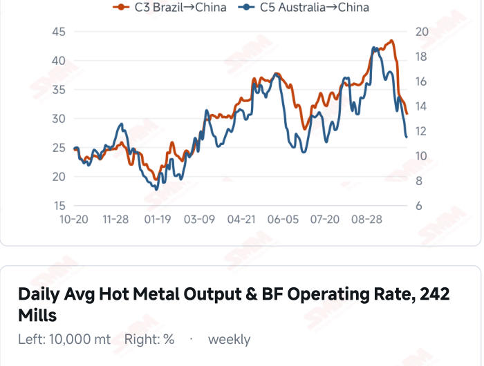
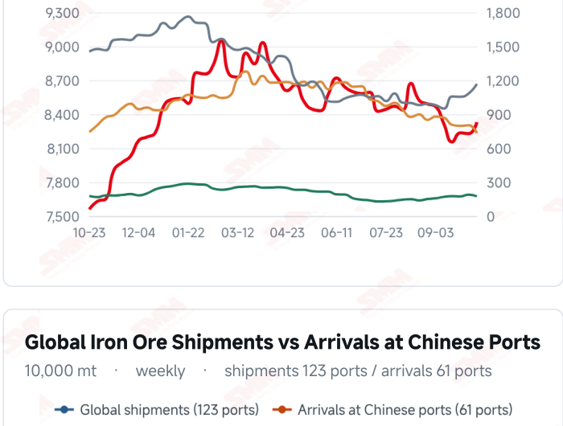
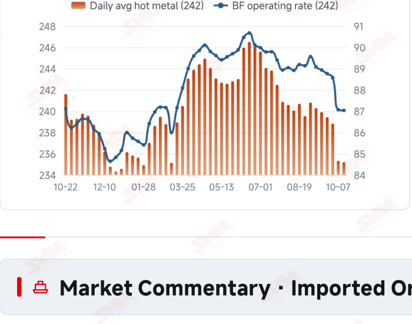
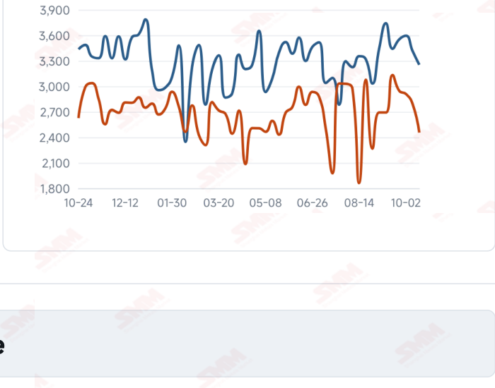

# SMM Iron Ore Daily — 2026-10-19 (Monday)

**Source:** SMM Data-pro · Shanghai Metals Market (SMM)

---

## Futures Contracts

| Exchange | Contract | Price | Unit | Daily Change | Daily Change % | MTD Avg |
|:---|:---|:---:|:---:|:---:|:---:|:---:|
| SGX | SGX Iron Ore Current-month FEFV26 | 91.05 | USD/dmt | — | — | — |
| DCE | DCE Iron Ore Most-traded I2701 | 682.50 | yuan/mt | +10.0 | +1.49% | 678.20 |

## SMM Iron Ore Price Index (Physical & Benchmark Indices)

| Index Name | Market Type | Fe % | Price | Unit | Daily Change | Daily Change % | MTD Avg |
|:---|:---|:---:|:---:|:---:|:---:|:---:|:---:|
| MMi 61% Port Spot | port_spot | 61.0% | 661.00 | yuan/wmt | +5.0 | +0.76% | 659.00 |
| MMi 58% Port Spot | port_spot | 58.0% | 617.00 | yuan/wmt | +3.0 | +0.49% | 620.00 |
| MMi 65% Port Spot | port_spot | 65.0% | 820.00 | yuan/wmt | +5.0 | +0.61% | 821.00 |
| MMi 61% Seaborne Index | seaborne | 61.0% | 90.90 | USD/dmt | +1.5 | +1.68% | 90.59 |
| MMi 65% Seaborne Index | seaborne | 65.0% | 107.95 | USD/dmt | +0.2 | +0.19% | 109.38 |
| SMM Domestic Ore Composite Index | domestic_composite | 66.0% | 796.81 | yuan/mt | -24.77 | -3.01% | 818.50 |

## Key View

### Futures and quotations recover together, but sustained trading will determine the rebound’s scope

Today’s recovery extended across futures, port spot and seaborne markets, but better prices should still be distinguished from stronger demand. DCE most-traded closed at 682.5 yuan/mt, up 1.49%; all three port indices rose, the seaborne 61% index reached USD 90.90/dmt and the 65% reached 107.95, with all 12 brands higher. Price moves were broadly aligned, yet SMM reported needs-based buying and subdued trading, leaving the rebound in need of more persistent transaction support. Supply flows and costs offer a cushion. In the week to Oct 16, arrivals in China fell 12.07% WoW and global shipments fell 4.72%; freight eased further and average import margins expanded modestly. Lower arrivals do not immediately absorb existing port stocks, while recovering Brazilian shipments show differing supply schedules across origins. Tight regional concentrate resources and improved local purchases may support some domestic markets without establishing a nationwide demand recovery. The immediate test is whether restocking moves beyond purchases for immediate needs. Stronger orders and mill profitability could provide a firmer basis for the recovery; continued thin trading could leave existing stocks constraining upside. Coke producers’ proposed increases from Oct 21 still require market acceptance and may influence cost expectations. A range-bound view remains appropriate while watching transactions, production and inventories for confirmation.

## Today's Highlights

- Domestic futures and spot prices recovered. DCE most-traded I2701 closed at 682.5 yuan/mt, up 10.0 yuan (+1.49%) from Oct 16. Qingdao PB Fines were 648, Newman Fines 651 and Mac Fines 653 yuan/wmt, each up 6 yuan from SMM’s preceding quotation; BRBF at 703 and Carajas Fines at 823 each rose 11 yuan.
- Seaborne indices and brand quotations rose together. The 61% index was USD 90.90/dmt, up 1.50 (+1.68%), and the 65% was 107.95, up 0.20 (+0.19%). All 12 brands increased against the Oct 16 report, with PB Fines at 91.25, Newman Fines 90.35 and Mac Fines 90.65 USD/dmt.
- Port indices rose while the seaborne grade spread narrowed. The 61%, 58% and 65% port indices were 661, 617 and 820 yuan/wmt, changing by +5, +3 and +5 yuan. The seaborne 65%-61% spread narrowed from USD 18.35 to 17.05/dmt.
- Latest arrivals declined while mill buying remained needs-based. Arrivals in China were 24.5464 million mt in the week to Oct 16, down 12.07% WoW; global shipments fell 4.72% to 32.5276 million mt. SMM’s daily review described needs-based mill purchases and subdued overall trading, leaving the durability of the price recovery dependent on transactions.

## Qingdao Port Imported Ore Spot Prices (yuan/wet mt, tax incl.)

| Product | Fe % | Type | Price (yuan/wmt) | Daily Change | Daily Change % | MTD Avg |
|:---|:---:|:---:|:---:|:---:|:---:|:---:|
| PB Fines 60.8% | 60.8% | Fines | 648.0 | +6.0 | +0.93% | 646.0 |
| Newman Fines 61.2% | 61.2% | Fines | 651.0 | +6.0 | +0.93% | 649.0 |
| Mac Fines 60.8% | 60.8% | Fines | 653.0 | +6.0 | +0.93% | 649.0 |
| BRBF 62.5% | 62.5% | Fines | 703.0 | +11.0 | +1.59% | 697.0 |
| Newman Lump 63% | 63.0% | Lump | 838.0 | +1.0 | +0.12% | 841.0 |
| Super Special Fines (SSF) 56.5% | 56.5% | Fines | 510.0 | +6.0 | +1.19% | 508.0 |
| Carajas Fines (IOCJ) 65% | 65.0% | Fines | 823.0 | +11.0 | +1.35% | 826.0 |
| PB Lump 61.5% | 61.5% | Lump | 833.0 | +7.0 | +0.85% | 835.0 |

## Seaborne Brand Prices in USD (CFR Qingdao, USD/dry mt, as of 2026-10-19)

| Product | Price (USD/dmt) | Daily Change | Daily Change % | Previous |
|:---|:---:|:---:|:---:|:---:|
| Roy Hill Fines 62% | 87.75 | +1.55 | +1.80% | 86.20 |
| SIMEC Fines 61% | 89.45 | +1.55 | +1.76% | 87.90 |
| PB Fines 62% | 91.25 | +1.5 | +1.67% | 89.75 |
| Newman Fines 60.7% | 90.35 | +1.5 | +1.69% | 88.85 |
| Mac Fines 60.5% | 90.65 | +1.5 | +1.68% | 89.15 |
| Jimblebar Fines 60.30% | 87.55 | +1.75 | +2.04% | 85.80 |
| Carajas Fines (IOCJ) 65% | 107.40 | +1.8 | +1.70% | 105.60 |
| SSFT / SSFG 60% | 97.80 | +1.85 | +1.93% | 95.95 |
| Brazilian Blend Fines (BRBF) 64% | 97.50 | +1.75 | +1.83% | 95.75 |
| RTX Fines 61% | 86.45 | +1.65 | +1.95% | 84.80 |
| West Pilbara Fines (WPF) 60% | 90.85 | +1.55 | +1.74% | 89.30 |
| SP10 Fines 59%-60% | 80.30 | +1.85 | +2.36% | 78.45 |

## SMM Iron Ore Price Index — Weekly / Monthly Statistics

| Index Name | Month-to-date Avg | MoM % | YTD % | Unit |
|:---|:---:|:---:|:---:|:---:|
| SMM MMi 61% Iron Ore Seaborne Index | 90.59 | -6.13% | -14.2% | USD/dmt |
| SMM MMi 65% Iron Ore Seaborne Index | 109.38 | -4.41% | -11.0% | USD/dmt |
| SMM MMi 61% Iron Ore Port Spot Index | 659.00 | -4.78% | -18.7% | yuan/wmt |
| SMM MMi 65% Iron Ore Port Spot Index | 821.00 | -2.20% | -8.8% | yuan/wmt |
| SMM MMi 58% Iron Ore Port Spot Index | 620.00 | -4.27% | -14.1% | yuan/wmt |
| SMM China Domestic Ore Composite Price Index | 818.50 | -2.39% | -10.1% | yuan/mt |

## Key Price Drivers (12-Month Charts & Operational Metrics)

### Charts: Freight & Port Inventory

### Charts: Hot Metal Output & Shipments vs Arrivals

### Operational Fundamentals Snapshot

| Fundamental Indicator | Value | Unit |
|:---|:---:|:---:|
| C3 Freight (Brazil to China) | 30.6 | USD/mt |
| C5 Freight (Australia to China) | 11.42 | USD/mt |
| Blast Furnace Operating Rate (242 Mills) | 87.03 | % |
| Global Iron Ore Shipments (Weekly) | 32.5276 | Million MT |
| Chinese Port Arrivals (Weekly) | 24.5464 | Million MT |

## Market Commentary · Imported Ore

### Futures & Spot

DCE most-traded I2701 closed at 682.5 yuan/mt, up 1.49% from the previous session. Qingdao PB Fines were 648, Newman Fines 651, Mac Fines 653 and SSF 510 yuan/wmt, each up 6 yuan; BRBF at 703 and Carajas Fines at 823 each rose 11 yuan. Newman Lump was 838 (+1) and PB Lump 833 (+7). SMM reported needs-based mill buying and subdued trading. SGX official current-month FEFV26 was last priced at USD 91.05/dmt, timestamped Oct 19, 17:45:33 (UTC+8).

### Driver

Domestic futures, port spot and seaborne quotations recovered together, suggesting some improvement in short-term pricing. Lower arrivals may ease pressure on parts of the spot market, but subdued trading is insufficient to establish a broad recovery in buying. The 61% seaborne index rose more than the 65%, narrowing their spread. Brand availability, blending needs and purchasing schedules may all influence this pattern; a single session does not establish a trend reversal.

### Demand

SMM’s daily review indicated that mills continued buying to immediate needs, with end-user demand and profitability constraints still present. The latest available 242-mill survey showed daily hot metal output of 2.3520 million mt on Oct 14, down 1,200 mt from Oct 7, and a blast furnace operating rate of 87.03%. A narrower decline may ease concerns about further contraction, but output has not turned higher; sustained buying still needs support from margins and orders.

### Inventory & Supply

Global shipments were 32.5276 million mt in the week to Oct 16, down 1.6117 million mt (-4.72%) WoW. Australia shipped 18.6396 million mt (-4.45%) and Brazil 7.9581 million mt (+13.32%). Arrivals in China fell 3.3683 million mt (-12.07%) to 24.5464 million mt. The latest ten-port stock reading was 104.0212 million mt on Oct 15, up 1.0047 million mt from Sep 30. Lower arrival flows do not imply that existing stocks have already declined; subsequent absorption depends on mill collections and trading.

### Cost & Margin

SMM’s Oct 19 assessment put the period’s average imported ore margin at 6.38 yuan/mt, up 0.37 yuan from 6.01; this measures import trading rather than steelmaking profitability. Oct 16 freight was USD 30.60/mt for C3 (-2.52%) and 11.42 for C5 (-1.55%). The day’s coke briefing reported that leading producers proposed increases of 50 yuan/mt for wet-quenched and 55 yuan/mt for dry-quenched coke, intended to take effect at midnight on Oct 21. This proposal should not be treated as a broadly implemented cost increase on Oct 19.

## Market Commentary · Domestic Ore

### Prices

The latest Domestic Ore Composite Price Index was 796.81 yuan/mt on Oct 16. SMM’s Oct 19 Shandong brief quoted 64% basic concentrate at 755 yuan/mt, down 4 yuan, on a dry-basis, pre-tax ex-mine quotation payable by acceptance bill. Region, grade and payment terms distinguish it from the national index.

### Supply & Demand

SMM’s Shandong brief described normal mine operations, tight local resources, improved mill purchasing appetite and no stocks at local miners. Separately, a production and sales survey published Oct 19 reported sampled mine utilisation of 58.2%, up 0.9 percentage point WoW, concentrate output of 900,000 mt, up 30,000 mt, and stocks of about 243,000 mt, down 20,000 mt. National survey results and regional descriptions should be considered separately.

### Outlook

SMM expects prices at Shandong mines and beneficiation plants may edge up, an outlook rather than evidence that today’s quotation has risen. Persistent buying improvement and tight regional supply could strengthen sellers’ bargaining power, while pressure on mill margins and demand could limit increases.

## Market Factors

### Supportive Factors

- DCE, port spot and seaborne quotations recovered together.
- All 12 seaborne brands rose against the previous report.
- Latest Chinese arrivals fell 12.07% WoW and global shipments 4.72%.
- Freight eased further and average import margins improved modestly.

### Bearish Factors

- SMM reported needs-based mill buying and subdued overall trading.
- The latest ten-port stock reading was higher than before the holiday, requiring time for absorption.
- The latest hot metal reading had not turned higher, leaving the demand trend in focus.
- Acceptance of proposed coke increases could renew cost pressure in some operations.

## Flash News Briefs

- Port stocks build despite lower arrivals; iron ore upside limited [SMM Daily Iron Ore Brief] (2026-10-19)
- [Brief Comment on Chinese Iron Ore] Prices at mines and beneficiation plants in Shandong may edge up slightly (2026-10-19)
- [SMM Coking Coal and Coke Daily Brief] 20261019 (2026-10-19)
- [SMM Steel] European HRC: Weak Demand Limits Upside Momentum as Supply Curtailments Support Range-Bound Trading (2026-10-19)
- [SMM Steel] Turkish Flat Steel: Domestic and Foreign Trade Stalemate Deepens as TRQs and CBAM Reshape Export Routes (2026-10-19)
- [SMM Steel] Indian HRC and Billet Prices Hold Flat as Festive Season Slows Trading (2026-10-19)

---
*(c) 2026 Shanghai Metals Market (SMM) · Iron Ore Value-Chain Data & Research*
