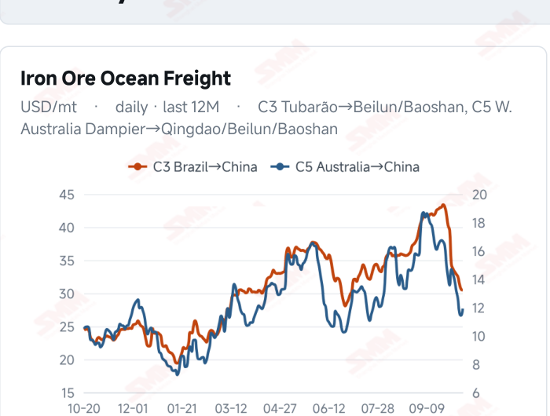
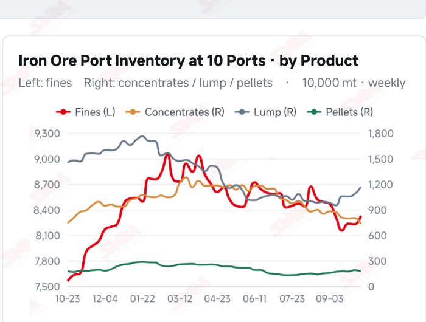
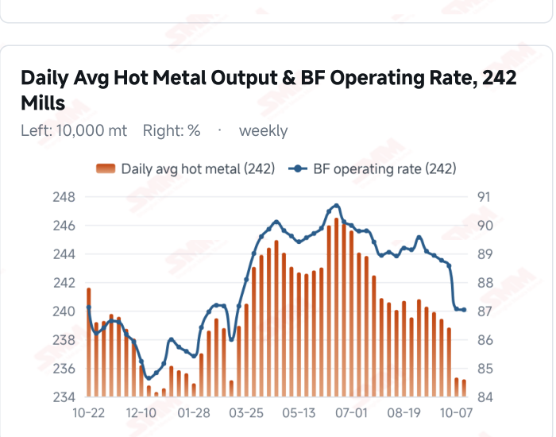
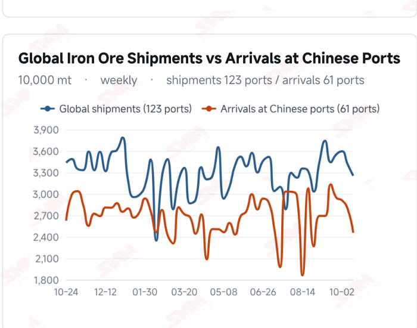

# SMM Iron Ore Daily — 2026-10-20 (Tuesday)

**Source:** SMM Data-pro · Shanghai Metals Market (SMM)

---

## Futures Contracts

| Exchange | Contract | Price | Unit | Daily Change | Daily Change % | MTD Avg |
|:---|:---|:---:|:---:|:---:|:---:|:---:|
| DCE | DCE Iron Ore Most-traded I2701 | 681.50 | yuan/mt | -1.0 | -0.15% | 678.60 |

## SMM Iron Ore Price Index (Physical & Benchmark Indices)

| Index Name | Market Type | Fe % | Price | Unit | Daily Change | Daily Change % | MTD Avg |
|:---|:---|:---:|:---:|:---:|:---:|:---:|:---:|
| MMi 61% Port Spot | port_spot | 61.0% | 660.00 | yuan/wmt | -1.0 | -0.15% | 659.00 |
| MMi 58% Port Spot | port_spot | 58.0% | 616.00 | yuan/wmt | -1.0 | -0.16% | 619.00 |
| MMi 65% Port Spot | port_spot | 65.0% | 819.00 | yuan/wmt | -1.0 | -0.12% | 821.00 |

## Key View

### Rebound momentum eases as port and seaborne prices pull back; demand support still needs to strengthen

After the previous broad gains, prices pulled back modestly, highlighting the fragility of the recovery. DCE most-traded closed at 681.5 yuan/mt, down 0.15%. The 61%, 58% and 65% port indices were 660, 616 and 819 yuan/wmt, each down 1 yuan. The seaborne 61% index eased to USD 90.50/dmt and the 65% to 107.75, with 11 brands lower and one unchanged. Trader activity was reasonable, but mills continued restocking mainly for immediate needs, leaving price recovery without sustained transaction support. Supply and cost conditions still offer some cushion. Latest arrivals in China declined, some Tangshan concentrates remained tight and the period’s import margins improved. However, lower flows do not immediately absorb port stocks, and profitability in import trading is not a substitute for steelmaking margins. Divergent C3 and C5 freight movements also show that cost improvements are not uniform across resources. The key near-term question is whether buying moves beyond immediate requirements into sustained restocking. Limited improvement in end-user orders and finished-steel margins could leave inventories constraining upside; stronger transactions and mill production would provide a firmer basis for recovery. A range- bound view remains appropriate, with attention on how trading, collections and profitability develop together rather than on a single session’s price move.

## Today's Highlights

- Futures eased as the previous recovery lost momentum. DCE most-traded I2701 closed at 681.5 yuan/mt, down 1.0 yuan (-0.15%) from Oct 19. Qingdao PB Fines were 647 yuan/wmt (-1), Newman Fines 647 (-4) and Mac Fines 654 (+1), showing mixed spot performance.
- Seaborne indices pulled back and most brands softened. The 61% index was USD 90.50/dmt, down 0.40 (-0.44%), and the 65% was 107.75, down 0.20 (-0.19%). Eleven of the 12 brands declined against the Oct 19 report and one was unchanged; PB Fines were 90.85, Newman Fines 89.95 and Mac Fines 90.25 USD/dmt.
- All three port indices fell by 1 yuan. The 61%, 58% and 65% port spot indices were 660, 616 and 819 yuan/wmt. The 65%-58% port spread held at 203 yuan/wmt, while the seaborne 65%-61% spread widened from USD 17.05 to 17.25/dmt.
- Purchases remained needs-based, with the demand response still in focus. SMM reported reasonable trader activity, needs-based mill restocking and limited overall transactions. The imported ore margin assessment published Oct 20 put the period’s average at 11.52 yuan/mt, above 6.38 previously, but better trading margins do not establish that mills have returned to profit.

## Key Price Drivers (12-Month Charts & Operational Metrics)

### Charts: Freight & Port Inventory

### Charts: Hot Metal Output & Shipments vs Arrivals

### Operational Fundamentals Snapshot

| Fundamental Indicator | Value | Unit |
|:---|:---:|:---:|
| C3 Freight (Brazil to China) | 30.46 | USD/mt |
| C5 Freight (Australia to China) | 11.91 | USD/mt |
| Blast Furnace Operating Rate (242 Mills) | 87.03 | % |
| Global Iron Ore Shipments (Weekly) | 32.5276 | Million MT |
| Chinese Port Arrivals (Weekly) | 24.5464 | Million MT |

## Market Commentary · Imported Ore

### Futures & Spot

DCE most-traded I2701 closed at 681.5 yuan/mt, down 0.15% from Oct 19. Qingdao PB Fines were 647, BRBF 702, Newman Lump 837, SSF 509, Carajas Fines 822 and PB Lump 832 yuan/wmt, each down 1 yuan. Newman Fines fell 4 yuan to 647, while Mac Fines rose 1 yuan to 654. SMM reported needs-based restocking and limited transactions. SGX official current-month FEFV26 was last priced at USD 91.05/dmt, timestamped Oct 20, 17:38:06 (UTC+8).

### Driver

Following the previous session’s broad gains, the rebound lost some momentum. Both seaborne indices eased and all three port indices edged lower, indicating that demand support still requires more persistent transactions. Differences between brand prices may reflect available material and blending choices rather than a change in aggregate demand. Continued control of raw-material stocks by mills could limit the scope for a recovery.

### Demand

SMM’s current coke briefing described needs-based mill purchases, with neither concentrated restocking nor large-scale production cuts. The latest available 242-mill survey showed daily hot metal output of 2.3520 million mt on Oct 14 and a blast furnace operating rate of 87.03%. Cost relief may improve operating conditions at some mills, but sustained ore purchases still depend on end-user orders, finished-steel selling prices and the extent of margin repair.

### Inventory & Supply

Global shipments were 32.5276 million mt in the week to Oct 16, down 4.72% WoW, while arrivals in China were 24.5464 million mt, down 12.07%. Australia shipped 18.6396 million mt and Brazil 7.9581 million mt, with differing trends across origins. The latest ten-port inventory was 104.0212 million mt on Oct 15, up 1.0047 million mt from Sep 30. Lower arrivals coexist with substantial existing stocks, so mill collection rates remain important; falling flows alone do not establish tighter spot availability.

### Cost & Margin

SMM’s imported ore cost-and-margin table published Oct 20 put the period’s average margin at 11.52 yuan/mt, up 5.14 yuan from 6.38. This measures import trading, not mill profitability after the current session’s close. Oct 19 freight was USD 30.46/mt for C3, down 0.46% from the previous reading, and 11.91 for C5, up 4.29%. Route- specific costs moved differently, and actual returns also depend on contracts, selling prices and exchange rates. Losses at coke producers coexist with controlled mill buying, leaving subsequent coke pricing dependent on negotiations.

## Market Commentary · Domestic Ore

### Prices

SMM’s Oct 20 Tangshan brief quoted 66% concentrate at 880–885 yuan/mt on a dry-basis, tax-inclusive ex- works basis, with prices relatively stable. The latest Domestic Ore Composite Price Index was 796.81 yuan/mt on Oct 16; grade and pricing terms distinguish the regional quotation from the national measure.

### Supply & Demand

Resources at Tangshan miners and beneficiation plants remained tight, and earlier price declines improved the relative value of some concentrates, potentially supporting offers. However, clear mill losses continued to sustain pressure on bids. The persistence of purchasing recovery needs to be assessed against actual transactions and profitability.

### Outlook

SMM expects limited room for a modest recovery in Tangshan concentrate prices. This is an outlook rather than evidence of a price increase today; continued needs-based mill buying could constrain the extent of any rise.

## Market Factors

### Supportive Factors

- Latest arrivals in China fell 12.07% WoW.
- Some domestic concentrate resources remained tight, with relative value improving from earlier levels.
- The period’s average import margin expanded to 11.52 yuan/mt.
- Needs-based mill purchases continued to provide a baseline of demand.

### Bearish Factors

- DCE and all five MMi indices eased this period.
- Eleven of the 12 seaborne brands declined, reversing the previous upward pattern.
- Overall transactions remained limited without concentrated restocking.
- Substantial port stocks and constraints on mill profitability may limit upside.

---
*(c) 2026 Shanghai Metals Market (SMM) · Iron Ore Value-Chain Data & Research*
