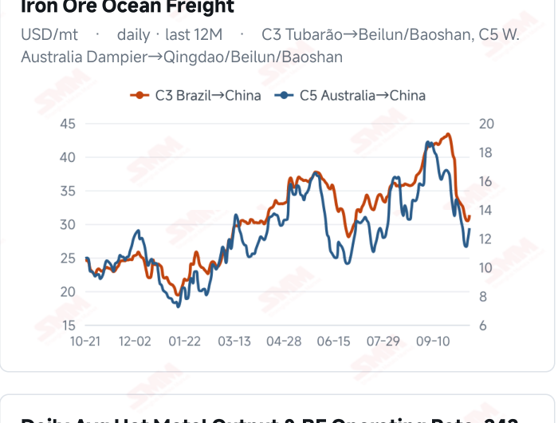
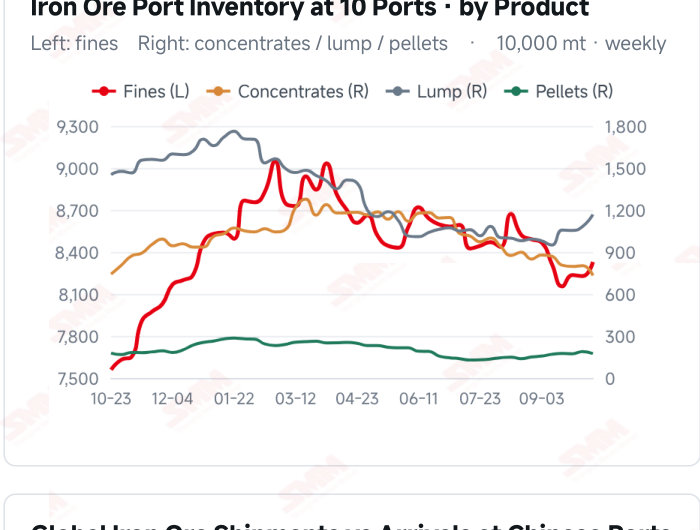
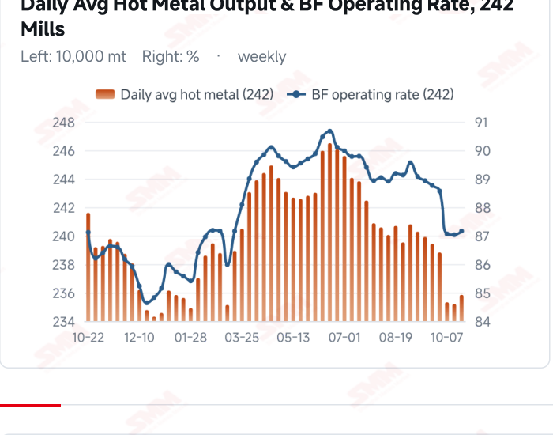
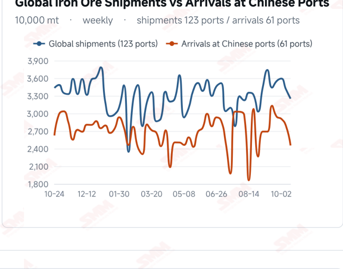

# SMM Iron Ore Daily — 2026-10-21 (Wednesday)

**Source:** SMM Data-pro · Shanghai Metals Market (SMM)

---

## Futures Contracts

| Exchange | Contract | Price | Unit | Daily Change | Daily Change % | MTD Avg |
|:---|:---|:---:|:---:|:---:|:---:|:---:|
| DCE | DCE Iron Ore Most-traded I2701 | 681.50 | yuan/mt | 0.0 | 0.00% | 678.90 |

## SMM Iron Ore Price Index (Physical & Benchmark Indices)

| Index Name | Market Type | Fe % | Price | Unit | Daily Change | Daily Change % | MTD Avg |
|:---|:---|:---:|:---:|:---:|:---:|:---:|:---:|
| MMi 61% Port Spot | port_spot | 61.0% | 661.00 | yuan/wmt | +1.0 | +0.15% | 659.00 |
| MMi 58% Port Spot | port_spot | 58.0% | 617.00 | yuan/wmt | +1.0 | +0.16% | 619.00 |
| MMi 65% Port Spot | port_spot | 65.0% | 820.00 | yuan/wmt | +1.0 | +0.12% | 821.00 |

## Key View

### Hot metal edges higher as port and seaborne prices diverge; sustained buying remains key

Demand showed marginal improvement, but prices did not move consistently higher. Surveyed daily hot metal output rose to 2.3584 million mt on Oct 21, up 6,400 mt, and the blast furnace operating rate increased to 87.16%. The 61%, 58% and 65% port indices each rose 1 yuan and DCE most-traded held at 681.5 yuan/mt. In contrast, the seaborne 61% and 65% indices eased to USD 90.40 and 107.40/dmt, with all 12 brands lower, reflecting different assessments of demand and resource availability across markets. Higher hot metal may increase baseline consumption, but sustained restocking still depends on raw-material stocks, finished-steel orders and mill profitability. Lower recent arrivals help ease pressure from incoming flows, while existing port stocks require actual collections for absorption. Meanwhile, higher C3 and C5 freight may alter cost conditions for some cargoes; ore prices and transport costs do not always move together. The near-term focus is whether improved production translates into persistent transactions. Buying that merely follows current consumption could leave prices range-bound, while stronger restocking and orders would provide firmer downside support. A single increase in hot metal does not establish a trend reversal; trading, production and inventories should be assessed together.

## Today's Highlights

- Port indices edged higher while futures closed flat. DCE most-traded I2701 closed at 681.5 yuan/mt, unchanged from Oct 20. The 61%, 58% and 65% port indices rose 1 yuan each to 661, 617 and 820 yuan/wmt. Most Qingdao spot quotations edged up, while BRBF and PB Lump declined.
- Seaborne indices and brand quotations remained soft. The 61% index was USD 90.40/dmt, down 0.10 (-0.11%), and the 65% was 107.40, down 0.35 (-0.32%). All 12 brands fell against the Oct 20 report; PB Fines were 90.70, Newman Fines 89.85 and Mac Fines 90.15 USD/dmt.
- Hot metal output recovered modestly. SMM surveyed daily hot metal output was 2.3584 million mt on Oct 21, up 6,400 mt (+0.27%) from Oct 14. The blast furnace operating rate rose 0.13 percentage point to 87.16%. Whether this marginal production improvement generates sustained restocking still needs confirmation from transactions.
- Freight rebounded, lifting route-specific costs. On Oct 20, C3 on the Brazil route was USD 31.32/mt (+2.82%) and C5 on the Australia route was 12.71 (+6.72%). With freight and seaborne ore quotations moving in different directions, landed costs and trading margins need to be assessed alongside contracts and exchange rates.

## Key Price Drivers (12-Month Charts & Operational Metrics)

### Charts: Freight & Port Inventory

### Charts: Hot Metal Output & Shipments vs Arrivals

### Operational Fundamentals Snapshot

| Fundamental Indicator | Value | Unit |
|:---|:---:|:---:|
| Daily Avg Hot Metal Output (242 Mills) | 2.3584 | Million MT |
| Global Iron Ore Shipments (Weekly) | 32.5276 | Million MT |
| Chinese Port Arrivals (Weekly) | 32.5276 | Million MT |

## Market Commentary · Imported Ore

### Futures & Spot

DCE most-traded I2701 closed at 681.5 yuan/mt, unchanged from the previous session. Qingdao PB Fines were 648, Newman Fines 648, Mac Fines 655, Newman Lump 838, SSF 510 and Carajas Fines 823 yuan/wmt, each up 1 yuan. BRBF fell 1 yuan to 701 and PB Lump fell 4 yuan to 828. SGX official current-month FEFV26 was last priced at USD 90.90/dmt, timestamped Oct 21, 17:40:05 (UTC+8).

### Driver

Composite port indices and most spot brands edged higher while seaborne indices and brand quotations continued to ease, showing short-term divergence across markets. Higher hot metal output may improve raw- material demand expectations, but additional production need not immediately generate discretionary restocking. The seaborne 65%-61% spread narrowed from USD 17.25 to 17.00/dmt; grade preferences still need to be assessed against actual blending requirements.

### Demand

SMM’s 242-mill survey showed daily hot metal output of 2.3584 million mt on Oct 21, up 6,400 mt from 2.3520 million mt on Oct 14. The blast furnace operating rate rose from 87.03% to 87.16%. Higher output may support baseline raw-material demand, although purchasing intensity also depends on mills’ existing stocks, finished- steel orders and margins. Restocking limited to current consumption could offer only modest price support; sustained transaction growth would make the improvement more durable.

### Inventory & Supply

Global shipments and arrivals in China were 32.5276 million mt and 24.5464 million mt in the week to Oct 16, down 4.72% and 12.07% WoW, respectively. The latest ten-port inventory was 104.0212 million mt on Oct 15, up 1.0047 million mt from Sep 30. Lower arrivals coexist with substantial stocks, leaving inventory absorption dependent on mill collections. Changes in transport flows alone do not establish tighter spot availability.

### Cost & Margin

C3 freight rose to USD 31.32/mt on Oct 20, up USD 0.86 (+2.82%) from the previous reading, while C5 increased USD 0.80 (+6.72%) to 12.71. Higher freight may reduce cost advantages for some cargoes, but landed costs also depend on purchase prices, settlement timing and exchange rates. Trading margins and steelmaking profitability should be assessed separately rather than inferring purchasing capacity from a single cost movement. SMM’s assessment published Oct 21 put the period’s average import margin at 9.62 yuan/mt, down 1.90 yuan from 11.52. Coke producers initiated a first-round price increase, but mills had not accepted it, so it should not be treated as an implemented increase in purchase costs.

## Market Commentary · Domestic Ore

### Prices

The latest Domestic Ore Composite Price Index was 796.81 yuan/mt on Oct 16. SMM’s Oct 21 Liaodong brief described a stable but subdued local market. The earlier Oct 20 Tangshan quotation for 66% concentrate was 880–885 yuan/mt on a dry-basis, tax-inclusive ex-works basis; regional and pricing differences prevent direct substitution.

### Supply & Demand

SMM’s Liaodong brief described intermittent production and low stocks at miners and concentrators constrained by ore feedstock and insufficient margins. Loss-making mills continued pressing bids lower. The modest rise in hot metal may improve baseline demand, but stronger regional trading still depends on actual purchases and contract execution.

### Outlook

Persistent purchasing growth alongside production recovery could improve support in some resource- constrained regions. Continued margin pressure could limit the recovery. Transactions should be watched rather than equating a small rise in national surveyed hot metal with higher ore prices in every regional market.

## Market Factors

### Supportive Factors

- Daily hot metal output rose 6,400 mt and the blast furnace operating rate edged higher.
- All three composite port indices increased 1 yuan/wmt.
- Latest arrivals in China and global shipments both declined WoW.
- Some domestic concentrate regions continue to face resource constraints.

### Bearish Factors

- Both seaborne indices and all 12 brand quotations declined further.
- DCE closed flat, with limited evidence of sustained price momentum.
- Port stock absorption still requires collections and transactions.
- Higher C3 and C5 freight may increase landed costs for some cargoes.

---
*(c) 2026 Shanghai Metals Market (SMM) · Iron Ore Value-Chain Data & Research*
