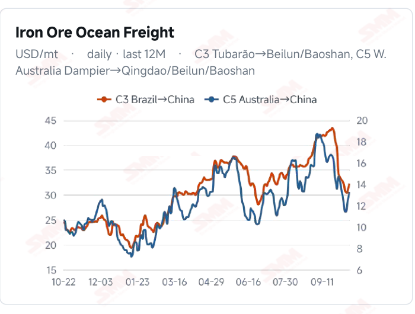
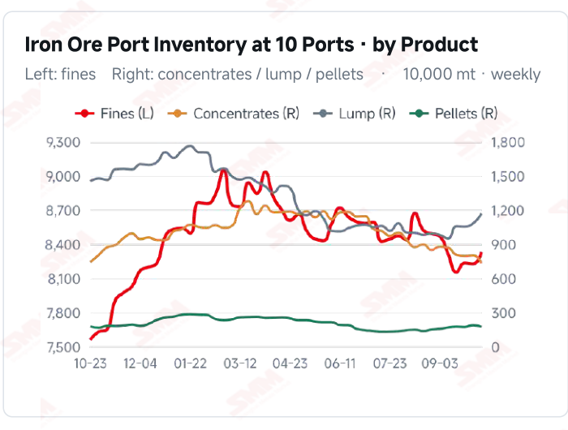
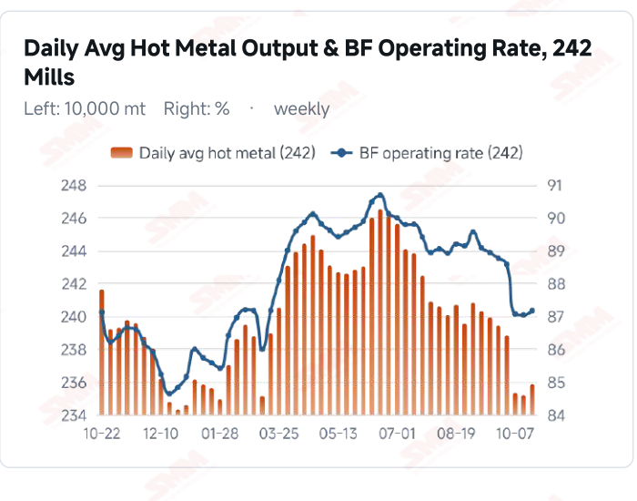
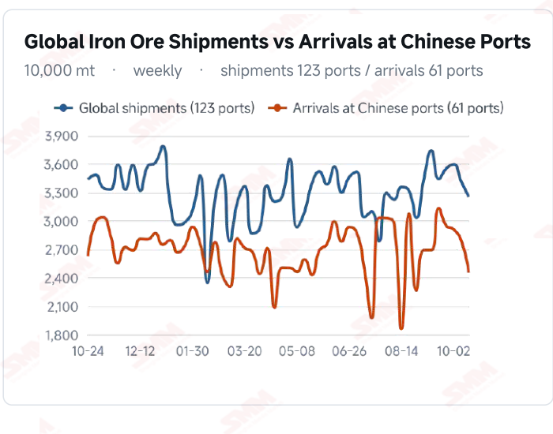

# SMM Iron Ore Daily — 2026-10-22 (Thursday)

**Source:** SMM Data-pro · Shanghai Metals Market (SMM)

---

## Futures Contracts

| Exchange | Contract | Price | Unit | Daily Change | Daily Change % | MTD Avg |
|:---|:---|:---:|:---:|:---:|:---:|:---:|
| DCE | DCE Iron Ore Most-traded I2701 | 669.00 | yuan/mt | -12.5 | -1.83% | 678.00 |

## SMM Iron Ore Price Index (Physical & Benchmark Indices)

| Index Name | Market Type | Fe % | Price | Unit | Daily Change | Daily Change % | MTD Avg |
|:---|:---|:---:|:---:|:---:|:---:|:---:|:---:|
| MMi 61% Port Spot | port_spot | 61.0% | 656.00 | yuan/wmt | -5.0 | -0.76% | 659.00 |
| MMi 58% Port Spot | port_spot | 58.0% | 611.00 | yuan/wmt | -6.0 | -0.97% | 618.00 |
| MMi 65% Port Spot | port_spot | 65.0% | 815.00 | yuan/wmt | -5.0 | -0.61% | 820.00 |

## Key View

### Futures and spot prices weaken together; higher hot metal still needs sustained trading support

Today’s decline extended across domestic futures, port spot and seaborne markets, testing the earlier recovery again. DCE most-traded closed at 669.0 yuan/mt, down 1.83%, and all eight Qingdao products fell 9 yuan/wmt. The seaborne 61% index eased to USD 88.60/dmt and the 65% to 106.25, with all 12 brands lower. The aligned price moves indicate that isolated improvements in offers have not generated durable upward momentum. Production has nevertheless improved at the margin. Surveyed daily hot metal output was 2.3584 million mt on Oct 21, up 6,400 mt from the previous period, alongside a modest increase in the blast furnace operating rate. Higher output is not the same as discretionary restocking: mill stocks, end-user orders and margins still shape purchasing schedules. Lower arrival flows may ease future supply pressure, but existing inventory still requires transactions and collections for absorption. The near-term question is whether lower prices generate persistent demand. Buying restricted to current consumption could leave prices soft and range-bound, while sustained trading and restocking would help translate production improvement into price support. Higher freight adds a cost variable, making selling prices, procurement contracts and exchange rates important to margin assessment rather than extrapolating one day’s production or price move into a trend reversal.

## Today's Highlights

- Domestic futures and port spot prices fell together. DCE most-traded I2701 closed at 669.0 yuan/mt, down 12.5 yuan (-1.83%) from Oct 21. All eight Qingdao products fell 9 yuan/wmt, with PB Fines at 639, Newman Fines 639, Mac Fines 646 and Carajas Fines 814.
- Seaborne index declines widened and all brand quotations fell. The 61% index was USD 88.60/dmt, down 1.80 (-1.99%), and the 65% was 106.25, down 1.15 (-1.07%). All 12 brands declined against the Oct 21 report; PB Fines were 88.90, Newman Fines 88.05 and Mac Fines 88.35 USD/dmt.
- Port indices declined as the grade spread widened slightly. The 61%, 58% and 65% port indices were 656, 611 and 815 yuan/wmt, down 5, 6 and 5 yuan. The 65%-58% spread widened from 203 to 204 yuan/wmt.
- Improved production coexists with softer prices. Surveyed daily hot metal output was 2.3584 million mt on Oct 21, up 6,400 mt from the previous period; the blast furnace operating rate rose 0.13 percentage point to 87.16%. Stronger baseline consumption did not prevent today’s quotation declines, keeping sustained purchases and stock absorption in focus.

## Key Price Drivers (12-Month Charts & Operational Metrics)

### Charts: Freight & Port Inventory

### Charts: Hot Metal Output & Shipments vs Arrivals

### Operational Fundamentals Snapshot

| Fundamental Indicator | Value | Unit |
|:---|:---:|:---:|
| C3 Freight (Brazil to China) | 32.28 | USD/mt |
| Daily Avg Hot Metal Output (242 Mills) | 2.3584 | Million MT |
| Global Iron Ore Shipments (Weekly) | 32.5276 | Million MT |
| Chinese Port Arrivals (Weekly) | 24.5464 | Million MT |

## Market Commentary · Imported Ore

### Futures & Spot

DCE most-traded I2701 closed at 669.0 yuan/mt, down 1.83% from the previous session. Qingdao PB Fines were 639, Newman Fines 639, Mac Fines 646, BRBF 692, Newman Lump 829, SSF 501, Carajas Fines 814 and PB Lump 819 yuan/wmt, all down 9 yuan. SGX official current-month FEFV26 was last priced at USD 90.55/dmt, timestamped Oct 22, 17:43:50 (UTC+8). SMM’s daily review described limited trader willingness to quote, reasonable mill enquiries and needs-based buying with strong pressure on bids.

### Driver

Futures, port spot and seaborne brand quotations moved lower together, showing that earlier pockets of recovery still lack durable support. The seaborne 61% index fell more than the 65%, widening their spread from USD 17.00 to 17.65/dmt. Relative grade performance may reflect supply composition and blending choices, but a one-day spread move does not establish stronger high-grade demand. The next test is whether lower prices generate additional physical transactions.

### Demand

SMM’s 242-mill survey showed daily hot metal output of 2.3584 million mt on Oct 21, up 6,400 mt from Oct 14; the blast furnace operating rate rose 0.13 percentage point to 87.16%. Higher output supports baseline raw- material consumption, but purchases also depend on mill stocks, finished-steel orders and margins. Restocking limited to current consumption may offer only modest price support; persistent growth in transactions and collections would better confirm demand recovery.

### Inventory & Supply

Global shipments were 32.5276 million mt in the week to Oct 16, down 4.72% WoW, and arrivals in China were 24.5464 million mt, down 12.07%. The latest ten-port inventory was 104.0212 million mt on Oct 15, up 1.0047 million mt from Sep 30. Lower arrival flows may ease subsequent pressure, but existing stocks still require physical collections for absorption; weaker supply flows should not be equated with realised destocking.

### Cost & Margin

C3 freight was USD 32.28/mt on Oct 21, up 0.96 (+3.07%) from the previous reading; C5 rose 0.57 (+4.48%) to 13.28. Higher transport costs coexist with lower seaborne quotations, leaving landed costs dependent on contracts and settlement timing. Weaker port selling prices may pressure trading profitability, but the direction of daily ore prices and freight alone cannot establish a specific margin. SMM’s assessment published on the morning of Oct 22 put the period’s average import margin at 9.79 yuan/mt, up 0.17 yuan from 9.62; this measures import trading, not mill profitability or a post-close calculation for the current session. The first proposed coke increase continued to face mill resistance and should not be treated as a realised cost increase.

## Market Commentary · Domestic Ore

### Prices

SMM’s Oct 22 Tangshan brief quoted 66% concentrate at 885–890 yuan/mt on a dry-basis, tax-inclusive ex- works basis, up 5 yuan. The latest Domestic Ore Composite Price Index was 796.81 yuan/mt on Oct 16; the regional quotation and national index are not directly comparable.

### Supply & Demand

Tight resources at Tangshan miners and concentrators supported offers, but clear mill losses kept pressure on bids strong. Weaker imported ore could also intensify blending-cost comparisons. A small rise in regional quotations does not establish a broad improvement in domestic ore demand.

### Outlook

SMM expects Tangshan concentrate prices to remain soft and range-bound near term. Needs-based mill buying could limit upside, while continued regional resource constraints and stronger collections could make some offers more resilient.

## Market Factors

### Supportive Factors

- Latest hot metal output increased 6,400 mt and the blast furnace operating rate edged higher.
- Latest arrivals in China and global shipments both declined WoW.
- Resource constraints in some domestic ore regions may support offers.
- Lower prices could improve demand support if they attract sustained transactions.

### Bearish Factors

- DCE fell 1.83% and all eight port products declined 9 yuan.
- Both seaborne indices and all 12 brand quotations weakened.
- Existing port stocks still require persistent collections for absorption.
- Higher freight may reduce cost advantages for some cargoes.

---
*(c) 2026 Shanghai Metals Market (SMM) · Iron Ore Value-Chain Data & Research*
