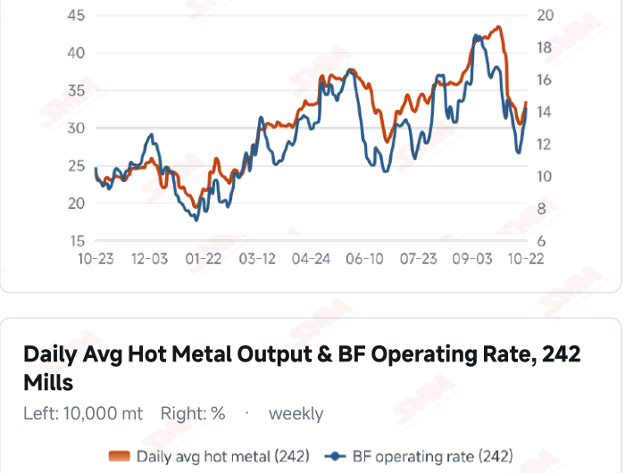
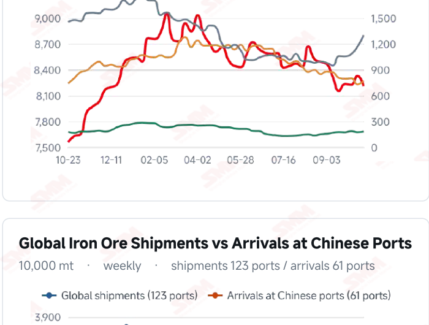
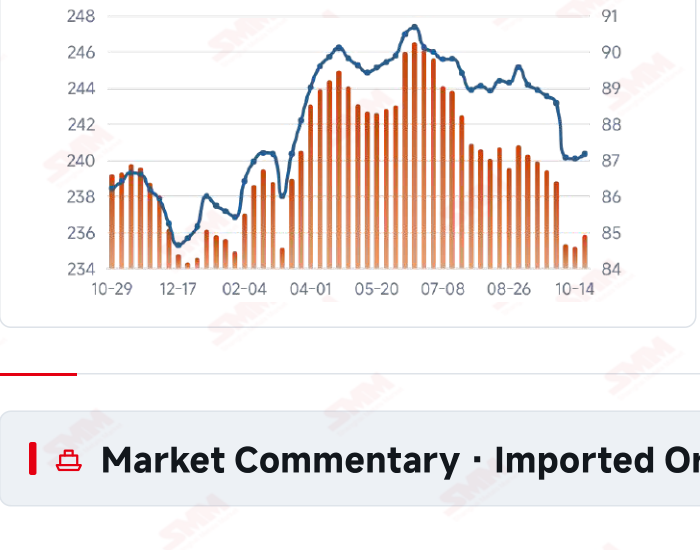
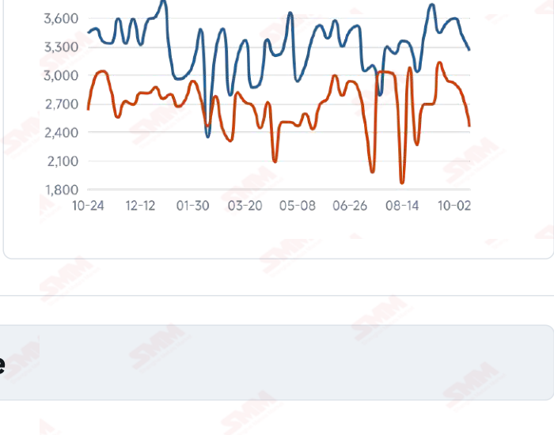

# SMM Iron Ore Daily — 2026-10-23 (Friday)

**Source:** SMM Data-pro · Shanghai Metals Market (SMM)

---

## Futures Contracts

| Exchange | Contract | Price | Unit | Daily Change | Daily Change % | MTD Avg |
|:---|:---|:---:|:---:|:---:|:---:|:---:|
| SGX | SGX Iron Ore Current-month FEFV26 | 90.75 | USD/dmt | — | — | — |
| DCE | DCE Iron Ore Most-traded I2701 | 675.00 | yuan/mt | +6.0 | +0.90% | 677.70 |

## SMM Iron Ore Price Index (Physical & Benchmark Indices)

| Index Name | Market Type | Fe % | Price | Unit | Daily Change | Daily Change % | MTD Avg |
|:---|:---|:---:|:---:|:---:|:---:|:---:|:---:|
| MMi 61% Port Spot | port_spot | 61.0% | 658.00 | yuan/wmt | +2.0 | +0.30% | 659.00 |
| MMi 58% Port Spot | port_spot | 58.0% | 616.00 | yuan/wmt | +5.0 | +0.82% | 618.00 |
| MMi 65% Port Spot | port_spot | 65.0% | 817.00 | yuan/wmt | +2.0 | +0.25% | 820.00 |
| MMi 61% Seaborne Index | seaborne | 61.0% | 89.20 | USD/dmt | +0.6 | +0.68% | 90.38 |
| MMi 65% Seaborne Index | seaborne | 65.0% | 106.80 | USD/dmt | +0.55 | +0.52% | 108.84 |
| SMM Domestic Ore Composite Index | domestic_composite | 66.0% | 797.36 | yuan/mt | +1.03 | +0.13% | 809.35 |

## Key View

### Futures and spot prices recover together; sustained transactions remain key

Prices recovered together today, easing the previous session’s broad weakness. DCE most-traded rose 0.90% to 675.0 yuan/mt; the 61%, 58% and 65% port indices increased to 658, 616 and 817 yuan/wmt. The seaborne 61% and 65% indices were USD 89.20 and 106.80/dmt, with all 12 brands higher. Direction was broadly aligned, but a one-day rebound still needs persistent buying support. Marginal production improvement supports baseline consumption. Latest surveyed daily hot metal output was 2.3584 million mt, up 6,400 mt, while the latest shipments and arrivals both declined. Nevertheless, raw-material stocks, finished-steel margins and orders determine whether mills restock actively; weaker transport flows do not substitute for evidence of stock absorption. The near-term focus is whether firmer prices and transactions reinforce each other. Persistent buying alongside better profitability could strengthen downside support, while a recovery confined to offers could limit further gains. Higher freight adds a cost variable, making contracts and exchange rates important to actual margins. A range-bound view remains appropriate.

## Today's Highlights

- Futures and spot prices recovered. DCE most-traded I2701 closed at 675.0 yuan/mt, up 6.0 yuan (+0.90%). Qingdao PB and Newman Fines were both 643 yuan/wmt, up 4 yuan; Mac Fines rose 3 yuan to 649, while the other listed products each gained 4 yuan.
- Seaborne indices and brand quotations recovered together. The 61% index was USD 89.20/dmt, up 0.60 (+0.68%), and the 65% was 106.80, up 0.55 (+0.52%). All 12 brands increased against the Oct 22 report; PB Fines were 89.55, Newman Fines 88.65 and Mac Fines 88.95 USD/dmt.
- The low-grade port index rose more strongly. The 61%, 58% and 65% port indices were 658, 616 and 817 yuan/wmt, up 2, 5 and 2 yuan. The 65%-58% spread narrowed from 204 to 201 yuan/wmt.
- The domestic ore composite index edged higher. The Oct 23 index was 797.36 yuan/mt, up 1.03 yuan (+0.13%) from 796.33 previously. Regional transactions and mill purchasing intensity remain important to the durability of the recovery.

## Qingdao Port Imported Ore Spot Prices (yuan/wet mt, tax incl.)

| Product | Fe % | Type | Price (yuan/wmt) | Daily Change | Daily Change % | MTD Avg |
|:---|:---:|:---:|:---:|:---:|:---:|:---:|
| PB Fines 60.8% | 60.8% | Fines | 643.0 | +4.0 | +0.63% | 646.0 |
| Newman Fines 61.2% | 61.2% | Fines | 643.0 | +4.0 | +0.63% | 648.0 |
| Mac Fines 60.8% | 60.8% | Fines | 649.0 | +3.0 | +0.46% | 650.0 |
| BRBF 62.5% | 62.5% | Fines | 696.0 | +4.0 | +0.58% | 697.0 |
| Newman Lump 63% | 63.0% | Lump | 833.0 | +4.0 | +0.48% | 839.0 |
| Super Special Fines (SSF) 56.5% | 56.5% | Fines | 505.0 | +4.0 | +0.80% | 508.0 |
| Carajas Fines (IOCJ) 65% | 65.0% | Fines | 818.0 | +4.0 | +0.49% | 824.0 |
| PB Lump 61.5% | 61.5% | Lump | 823.0 | +4.0 | +0.49% | 832.0 |

## Seaborne Brand Prices in USD (CFR Qingdao, USD/dry mt, as of 2026-10-23)

| Product | Price (USD/dmt) | Daily Change | Daily Change % | Previous |
|:---|:---:|:---:|:---:|:---:|
| Roy Hill Fines 62% | 86.10 | +0.6 | +0.70% | 85.50 |
| SIMEC Fines 61% | 87.80 | +0.6 | +0.69% | 87.20 |
| PB Fines 62% | 89.55 | +0.65 | +0.73% | 88.90 |
| Newman Fines 60.7% | 88.65 | +0.6 | +0.68% | 88.05 |
| Mac Fines 60.5% | 88.95 | +0.6 | +0.68% | 88.35 |
| Jimblebar Fines 60.30% | 86.45 | +0.85 | +0.99% | 85.60 |
| Carajas Fines (IOCJ) 65% | 105.50 | +0.6 | +0.57% | 104.90 |
| SSFT / SSFG 60% | 96.50 | +0.6 | +0.63% | 95.90 |
| Brazilian Blend Fines (BRBF) 64% | 96.05 | +0.6 | +0.63% | 95.45 |
| RTX Fines 61% | 85.30 | +0.75 | +0.89% | 84.55 |
| West Pilbara Fines (WPF) 60% | 89.20 | +0.6 | +0.68% | 88.60 |
| SP10 Fines 59%-60% | 79.30 | +0.95 | +1.21% | 78.35 |

## SMM Iron Ore Price Index — Weekly / Monthly Statistics

| Index Name | Month-to-date Avg | MoM % | YTD % | Unit |
|:---|:---:|:---:|:---:|:---:|
| SMM MMi 61% Iron Ore Seaborne Index | 90.38 | -6.35% | -15.8% | USD/dmt |
| SMM MMi 65% Iron Ore Seaborne Index | 108.84 | -4.89% | -12.0% | USD/dmt |
| SMM MMi 61% Iron Ore Port Spot Index | 659.00 | -4.79% | -19.1% | yuan/wmt |
| SMM MMi 65% Iron Ore Port Spot Index | 820.00 | -2.34% | -9.1% | yuan/wmt |
| SMM MMi 58% Iron Ore Port Spot Index | 618.00 | -4.51% | -14.2% | yuan/wmt |
| SMM China Domestic Ore Composite Price Index | 809.35 | -3.48% | -10.1% | yuan/mt |

## Key Price Drivers (12-Month Charts & Operational Metrics)

### Charts: Freight & Port Inventory

### Charts: Hot Metal Output & Shipments vs Arrivals

### Operational Fundamentals Snapshot

| Fundamental Indicator | Value | Unit |
|:---|:---:|:---:|
| C3 Freight (Brazil to China) | 33.5 | USD/mt |
| C5 Freight (Australia to China) | 14.2 | USD/mt |
| Daily Avg Hot Metal Output (242 Mills) | 2.3584 | Million MT |
| Blast Furnace Operating Rate (242 Mills) | 87.16 | % |
| Iron Ore Port Inventory (10 Major Ports) | 104.6534 | Million MT |
| Global Iron Ore Shipments (Weekly) | 32.5276 | Million MT |
| Chinese Port Arrivals (Weekly) | 24.5464 | Million MT |

## Market Commentary · Imported Ore

### Futures & Spot

DCE most-traded I2701 closed at 675.0 yuan/mt, up 0.90% from the previous session. Qingdao PB Fines were 643, Newman Fines 643, BRBF 696, Newman Lump 833, SSF 505, Carajas Fines 818 and PB Lump 823 yuan/wmt, each up 4 yuan; Mac Fines rose 3 yuan to 649. SGX official current-month FEFV26 was last priced at USD 90.75/dmt, timestamped Oct 23, 17:54:19 (UTC+8).

### Driver

Following the previous broad decline, domestic futures, port spot and seaborne quotations recovered together. The seaborne 61%-65% price differential narrowed slightly from USD 17.65 to 17.60/dmt, while the low-grade port index posted a relatively larger gain. Higher prices may encourage buying, but durability still requires transactions and restocking; a one-day rebound does not establish a trend reversal.

### Demand

The latest 242-mill survey showed daily hot metal output of 2.3584 million mt on Oct 21, up 6,400 mt from Oct 14, and a blast furnace operating rate of 87.16%. Improved production supports baseline consumption, but mill stocks, end-user orders and margins still determine purchasing intensity. Persistent buying could improve downside support, while purchases limited to immediate needs could constrain the recovery.

### Inventory & Supply

Ten-port stocks were 104.6534 million mt on Oct 22, up 632,200 mt (+0.61%) from Oct 15. Fines fell 1.2085 million mt to 82.0793 million mt; concentrates, lump and pellets reached 7.7342, 13.0109 and 1.8290 million mt, increasing by 416,900, 1.3362 million and 87,600 mt, respectively. Different product trends may reflect both arrival composition and collection schedules. Global shipments and Chinese arrivals in the week to Oct 16 were 32.5276 and 24.5464 million mt, down 4.72% and 12.07% WoW.

### Cost & Margin

Oct 22 freight was USD 33.50/mt for C3, up 3.78% from the previous reading, and 14.20 for C5, up 6.93%. Higher freight may increase costs for some cargoes, while firmer spot selling prices support receipts. Actual trading margins still depend on contracts, settlement timing and exchange rates; import trading, steelmaking and coking profitability should be assessed separately. SMM’s assessment published on the morning of Oct 23 put the period’s average import margin at 1.03 yuan/mt, down 8.76 yuan from 9.79. This is an import trading assessment, not post-close mill profitability.

## Market Commentary · Domestic Ore

### Prices

The Domestic Ore Composite Price Index was 797.36 yuan/mt on Oct 23, up 0.13% from Oct 22. SMM’s current west Liaoning brief quoted concentrate at 640–650 yuan/mt on a wet-basis, tax-exclusive ex-works basis, distinct from the national index in region and pricing terms.

### Supply & Demand

SMM described subdued trading in west Liaoning. Earlier environmental checks constrained some mining and beneficiation operations, and independent concentrators struggled to source ore, leaving buyers and sellers at an impasse. Supply constraints may support some offers, but actual buying still depends on mill margins and orders.

### Outlook

SMM expects west Liaoning concentrate prices to remain range-bound near term. Persistent buying improvement could strengthen sellers’ bargaining power amid resource constraints, while limited trading could restrain recovery. Regional moves should be assessed against transactions rather than extrapolated into nationwide gains.

## Market Factors

### Supportive Factors

- DCE, all five MMi indices and all 12 seaborne brands recovered.
- Latest daily hot metal output increased 6,400 mt WoW.
- Latest global shipments and Chinese arrivals both declined.
- The domestic ore composite index rose 0.13%.

### Bearish Factors

- The rebound still needs confirmation from transactions and restocking.
- Port stock absorption depends on collection and unloading schedules.
- Higher C3 and C5 freight may increase some landed costs.
- Mill profitability and end-user orders still constrain buying intensity.

## Flash News Briefs

- [Brief Comment on Domestic Iron Ore] Iron ore concentrate prices in west Liaoning may consolidate (2026-10-23)
- [Fortescue warns it may cut Pilbara iron ore output if talks with China's buying agency remain unresolved] (2026-10-23)
- [India's Steel Ministry to Hold Open House on Steel Import Issues on Oct 28] (2026-10-23)
- [Canada industry minister gives Cleveland-Cliffs 15 days to reverse Stelco layoffs or face court] (2026-10-23)
- [SMM Steel] India Steel Prices Edge Lower as Buyers Remain Cautious (2026-10-23)
- [SMM Steel] Turkish Rebar: Weak Domestic Intake Drives Prices Down, Export FOB Holds Flat (2026-10-23)

---
*(c) 2026 Shanghai Metals Market (SMM) · Iron Ore Value-Chain Data & Research*
