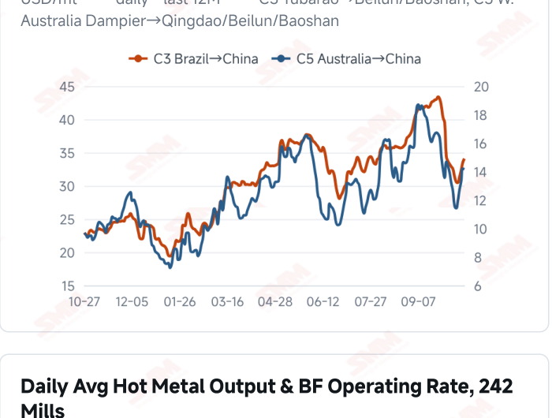
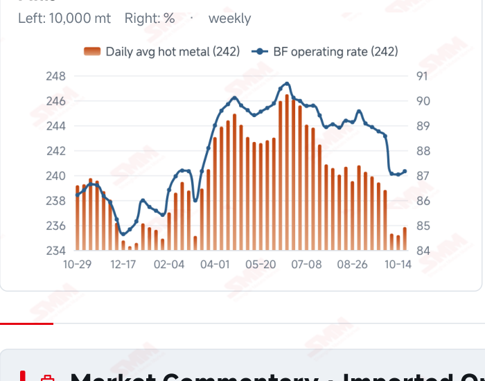
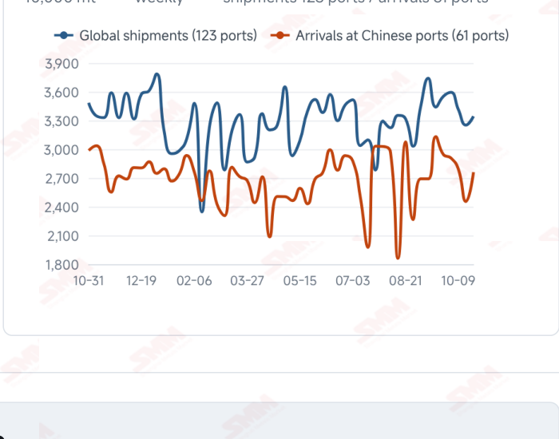

# SMM Iron Ore Daily — 2026-10-26 (Monday)

**Source:** SMM Data-pro · Shanghai Metals Market (SMM)

---

## Futures Contracts

| Exchange | Contract | Price | Unit | Daily Change | Daily Change % | MTD Avg |
|:---|:---|:---:|:---:|:---:|:---:|:---:|
| SGX | SGX Iron Ore Current-month FEFV26 | 90.70 | USD/dmt | — | — | — |
| DCE | DCE Iron Ore Most-traded I2701 | 671.50 | yuan/mt | -3.5 | -0.52% | 677.20 |

## SMM Iron Ore Price Index (Physical & Benchmark Indices)

| Index Name | Market Type | Fe % | Price | Unit | Daily Change | Daily Change % | MTD Avg |
|:---|:---|:---:|:---:|:---:|:---:|:---:|:---:|
| MMi 61% Port Spot | port_spot | 61.0% | 654.00 | yuan/wmt | -4.0 | -0.61% | 659.00 |
| MMi 58% Port Spot | port_spot | 58.0% | 608.00 | yuan/wmt | -8.0 | -1.30% | 617.00 |
| MMi 65% Port Spot | port_spot | 65.0% | 813.00 | yuan/wmt | -4.0 | -0.49% | 819.00 |
| MMi 61% Seaborne Index | seaborne | 61.0% | 89.20 | USD/dmt | 0.0 | 0.00% | 90.31 |
| MMi 65% Seaborne Index | seaborne | 65.0% | 106.75 | USD/dmt | -0.05 | -0.05% | 108.72 |
| SMM Domestic Ore Composite Index | domestic_composite | 66.0% | 797.36 | yuan/mt | +1.03 | +0.13% | 809.35 |

## Key View

### Port prices soften while seaborne quotations hold; buying remains key as arrivals recover

Domestic futures and port prices weakened while seaborne quotations were relatively stable. DCE most-traded closed at 671.5 yuan/mt, down 0.52%; the 61%, 58% and 65% port indices fell to 654, 608 and 813 yuan/wmt. The seaborne 61% index held at USD 89.20/dmt, the 65% eased to 106.75, and all 12 brand quotations were unchanged from the previous report. Divergent performance indicates that price support still differs across markets. Supply flows are recovering. In the week to Oct 23, arrivals in China rose 12.47% WoW and global shipments increased 2.83%. Higher arrivals may add to available spot material, but inventory changes also depend on unloading and mill collections. The latest modest increase in hot metal supports baseline consumption without necessarily implying discretionary restocking. Sustained transactions remain the key test of near-term direction. Needs-based buying could leave higher arrivals and existing stocks constraining upside; improved orders and margins followed by stronger collections would support the market. Supply flows, port trading and mill profitability should be assessed together rather than treating a single day of flat seaborne quotations as a broad trend improvement.

## Today's Highlights

- Domestic futures and port prices weakened. DCE most-traded I2701 closed at 671.5 yuan/mt, down 3.5 yuan (-0.52%) from Oct 23. Qingdao PB and Newman Fines were both 640 yuan/wmt and Mac Fines were 646, each down 3 yuan; BRBF was 690 (-6), Newman Lump 820 (-13) and PB Lump 815 (-8).
- Seaborne indices changed little and brand quotations held steady. The 61% index was unchanged at USD 89.20/dmt; the 65% was 106.75, down 0.05 (-0.05%). All 12 brands were unchanged from the Oct 23 report, with PB Fines at 89.55, Newman Fines 88.65 and Mac Fines 88.95 USD/dmt.
- The low-grade port index fell more sharply. The 61%, 58% and 65% port indices were 654, 608 and 813 yuan/wmt, down 4, 8 and 4 yuan. The 65%-58% spread widened from 201 to 205 yuan/wmt.
- Latest arrivals and shipments recovered. Arrivals in China were 27.6076 million mt in the week to Oct 23, up 3.0612 million mt (+12.47%) WoW; global shipments rose 921,800 mt (+2.83%) to 33.4494 million mt. The impact of higher flows still depends on mill collection schedules.

## Qingdao Port Imported Ore Spot Prices (yuan/wet mt, tax incl.)

| Product | Fe % | Type | Price (yuan/wmt) | Daily Change | Daily Change % | MTD Avg |
|:---|:---:|:---:|:---:|:---:|:---:|:---:|
| PB Fines 60.8% | 60.8% | Fines | 640.0 | -3.0 | -0.47% | 645.0 |
| Newman Fines 61.2% | 61.2% | Fines | 640.0 | -3.0 | -0.47% | 647.0 |
| Mac Fines 60.8% | 60.8% | Fines | 646.0 | -3.0 | -0.46% | 650.0 |
| BRBF 62.5% | 62.5% | Fines | 690.0 | -6.0 | -0.86% | 697.0 |
| Newman Lump 63% | 63.0% | Lump | 820.0 | -13.0 | -1.56% | 837.0 |
| Super Special Fines (SSF) 56.5% | 56.5% | Fines | 502.0 | -3.0 | -0.59% | 507.0 |
| Carajas Fines (IOCJ) 65% | 65.0% | Fines | 815.0 | -3.0 | -0.37% | 824.0 |
| PB Lump 61.5% | 61.5% | Lump | 815.0 | -8.0 | -0.97% | 831.0 |

## Seaborne Brand Prices in USD (CFR Qingdao, USD/dry mt, as of 2026-10-26)

| Product | Price (USD/dmt) | Daily Change | Daily Change % | Previous |
|:---|:---:|:---:|:---:|:---:|
| Roy Hill Fines 62% | 86.10 | 0.0 | 0.00% | 86.10 |
| SIMEC Fines 61% | 87.80 | 0.0 | 0.00% | 87.80 |
| PB Fines 62% | 89.55 | 0.0 | 0.00% | 89.55 |
| Newman Fines 60.7% | 88.65 | 0.0 | 0.00% | 88.65 |
| Mac Fines 60.5% | 88.95 | 0.0 | 0.00% | 88.95 |
| Jimblebar Fines 60.30% | 86.45 | 0.0 | 0.00% | 86.45 |
| Carajas Fines (IOCJ) 65% | 105.50 | 0.0 | 0.00% | 105.50 |
| SSFT / SSFG 60% | 96.50 | 0.0 | 0.00% | 96.50 |
| Brazilian Blend Fines (BRBF) 64% | 96.05 | 0.0 | 0.00% | 96.05 |
| RTX Fines 61% | 85.30 | 0.0 | 0.00% | 85.30 |
| West Pilbara Fines (WPF) 60% | 89.20 | 0.0 | 0.00% | 89.20 |
| SP10 Fines 59%-60% | 79.30 | 0.0 | 0.00% | 79.30 |

## SMM Iron Ore Price Index — Weekly / Monthly Statistics

| Index Name | Month-to-date Avg | MoM % | YTD % | Unit |
|:---|:---:|:---:|:---:|:---:|
| SMM MMi 61% Iron Ore Seaborne Index | 90.31 | -6.42% | -15.8% | USD/dmt |
| SMM MMi 65% Iron Ore Seaborne Index | 108.72 | -4.99% | -12.0% | USD/dmt |
| SMM MMi 61% Iron Ore Port Spot Index | 659.00 | -4.85% | -19.6% | yuan/wmt |
| SMM MMi 65% Iron Ore Port Spot Index | 819.00 | -2.40% | -9.6% | yuan/wmt |
| SMM MMi 58% Iron Ore Port Spot Index | 617.00 | -4.63% | -15.3% | yuan/wmt |
| SMM China Domestic Ore Composite Price Index | 809.35 | -3.48% | -10.1% | yuan/mt |

## Key Price Drivers (12-Month Charts & Operational Metrics)

### Charts: Freight & Port Inventory

### Charts: Hot Metal Output & Shipments vs Arrivals

### Operational Fundamentals Snapshot

| Fundamental Indicator | Value | Unit |
|:---|:---:|:---:|
| C3 Freight (Brazil to China) | 34.09 | USD/mt |
| C5 Freight (Australia to China) | 14.16 | USD/mt |
| Blast Furnace Operating Rate (242 Mills) | 87.16 | % |
| Iron Ore Port Inventory (10 Major Ports) | 104.6534 | Million MT |
| Global Iron Ore Shipments (Weekly) | 33.4494 | Million MT |
| Chinese Port Arrivals (Weekly) | 27.6076 | Million MT |

## Market Commentary · Imported Ore

### Futures & Spot

DCE most-traded I2701 closed at 671.5 yuan/mt, down 0.52% from Oct 23. Qingdao PB Fines were 640, Newman Fines 640, Mac Fines 646, SSF 502 and Carajas Fines 815 yuan/wmt, each down 3 yuan. BRBF fell 6 yuan to 690, Newman Lump fell 13 yuan to 820 and PB Lump fell 8 yuan to 815. SGX official current-month FEFV26 was last priced at USD 90.70/dmt, timestamped Oct 26, 17:54:57 (UTC+8). SMM’s daily review described needs-based mill purchases and limited spot transactions.

### Driver

Domestic futures and port quotations fell while the seaborne 61% index and brand quotations were broadly steady, showing short-term differences across markets. The larger decline in the low-grade port index may influence blending economics, but a spread change alone does not establish a sustained shift in demand structure. Price support still needs confirmation from transactions and mill buying.

### Demand

structure. Price support still needs confirmation from transactions and mill buying. Demand The latest SMM survey of 242 mills showed daily hot metal output of 2.3584 million mt on Oct 21, up 6,400 mt from Oct 14, with a blast furnace operating rate of 87.16%. Improved production may support baseline consumption, but restocking also depends on mill stocks, finished-steel orders and margins. If purchases mainly cover immediate needs, the modest output increase may offer limited support for ore prices.

### Inventory & Supply

Global shipments were 33.4494 million mt in the week to Oct 23, up 2.83% WoW. Australia shipped 19.7148 million mt (+5.77%) and Brazil 8.2370 million mt (+3.50%). Arrivals in China rose 12.47% to 27.6076 million mt. The latest ten-port stocks were 104.6534 million mt on Oct 22, up 632,200 mt from Oct 15. Higher arrivals may increase available material, but further inventory pressure also depends on unloading and mill collections.

### Cost & Margin

Oct 23 freight was USD 34.09/mt for C3, up 1.76% from the previous reading, and 14.16 for C5, down 0.28%. Route-specific costs differed, while actual landed costs also depend on quotations, contracts and exchange rates. Lower port selling prices may squeeze returns on some trades, but price direction alone cannot establish a margin; import trading and steelmaking profitability should be assessed separately. SMM’s assessment published on the morning of Oct 26 put the period’s average import margin at 4.57 yuan/mt, up 3.54 yuan from 1.03; this does not represent mill profitability after the current session’s close.

## Market Commentary · Domestic Ore

### Prices

The latest Domestic Ore Composite Price Index was 797.36 yuan/mt on Oct 23, up 0.13% from the previous reading. SMM’s Oct 26 Shandong brief quoted 64% basic concentrate at 757 yuan/mt, up 2 yuan, on a dry- basis, pre-tax ex-works basis. This regional quotation is not directly comparable with the national index.

### Supply & Demand

SMM reported mostly normal mine operations in Shandong, virtually no stocks at miners and nearby traders, and scheduled shipments at smaller plants and traders. Local resources and contract execution may support prices, but mill purchasing still depends on margins and orders; the regional description does not represent national inventory conditions.

### Outlook

SMM expects Shandong concentrate prices to remain relatively stable near term. Tight regional supply and sustained collections could support offers, while continued mill cost control and cautious buying may limit upside.

## Market Factors

### Supportive Factors

- The seaborne 61% index and all 12 brand quotations held steady.
- Latest surveyed daily hot metal output increased 6,400 mt WoW.
- Resource constraints in some domestic regions may support offers.
- C5 freight edged lower, cushioning some transport costs.

### Bearish Factors

- DCE fell 0.52% and all eight port quotations declined.
- The port 58% index fell 1.30%, keeping composite prices under pressure.
- Arrivals in China rose 12.47% WoW as supply flows recovered.
- Sustained purchasing improvement still depends on orders and profitability.

## Flash News Briefs

- [SMM Iron Ore] Arrivals rebound 12.5%, ending port draw; iron ore seen softer (2026-10-26)
- [Domestic Iron Ore Brief] Iron ore concentrate prices in the Shandong region are likely to remain relatively stable (2026-10-26)
- [SMM Coking Coal and Coke Daily Brief] 20261026 (2026-10-26)
- [SMM Iron Ore] Imported iron ore margin widens to 4.57 yuan/mt on firmer spot prices (2026-10-26)
- [SMM Steel] Vietnam HRC Import Trading Improves as Indonesian Cargoes Attract Buyers (2026-10-26)
- [SMM Steel] India Steel and Scrap Prices edge down Amid Slow Buying (2026-10-26)

---
*(c) 2026 Shanghai Metals Market (SMM) · Iron Ore Value-Chain Data & Research*
