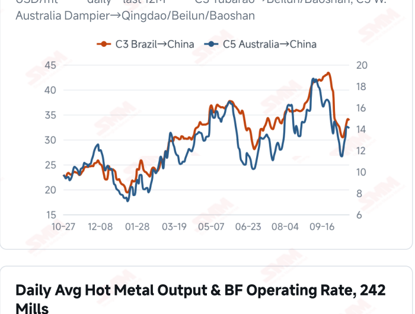
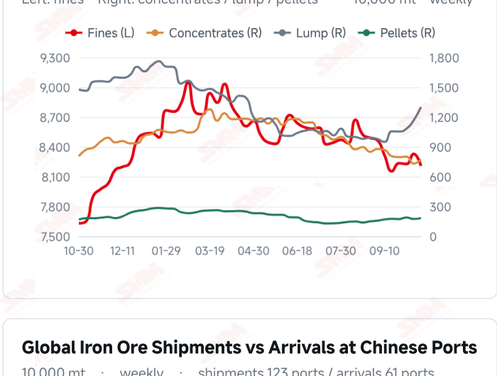
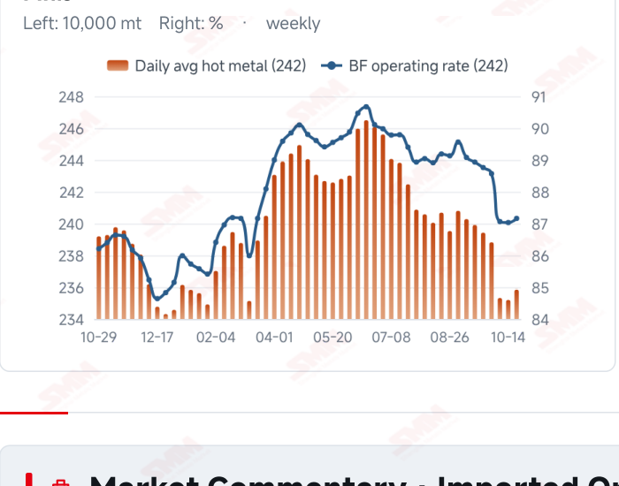

# SMM Iron Ore Daily — 2026-10-27 (Tuesday)

**Source:** SMM Data-pro · Shanghai Metals Market (SMM)

---

## Futures Contracts

| Exchange | Contract | Price | Unit | Daily Change | Daily Change % | MTD Avg |
|:---|:---|:---:|:---:|:---:|:---:|:---:|
| SGX | SGX Iron Ore Current-month FEFV26 | 90.60 | USD/dmt | — | — | — |
| DCE | DCE Iron Ore Most-traded I2701 | 664.00 | yuan/mt | -7.5 | -1.12% | 676.30 |

## SMM Iron Ore Price Index (Physical & Benchmark Indices)

| Index Name | Market Type | Fe % | Price | Unit | Daily Change | Daily Change % | MTD Avg |
|:---|:---|:---:|:---:|:---:|:---:|:---:|:---:|
| MMi 61% Port Spot | port_spot | 61.0% | 650.00 | yuan/wmt | -4.0 | -0.61% | 658.00 |
| MMi 58% Port Spot | port_spot | 58.0% | 604.00 | yuan/wmt | -4.0 | -0.66% | 616.00 |
| MMi 65% Port Spot | port_spot | 65.0% | 810.00 | yuan/wmt | -3.0 | -0.37% | 819.00 |
| MMi 61% Seaborne Index | seaborne | 61.0% | 88.70 | USD/dmt | -0.5 | -0.56% | 90.23 |
| MMi 65% Seaborne Index | seaborne | 65.0% | 106.15 | USD/dmt | -0.6 | -0.56% | 108.58 |
| SMM Domestic Ore Composite Index | domestic_composite | 66.0% | 797.36 | yuan/mt | +1.03 | +0.13% | 809.35 |

## Key View

### Futures and spot remain under pressure; persistent buying matters as supply recovers

Today’s weakness extended across futures, port prices and seaborne composite indices. DCE most- traded closed at 664.0 yuan/mt, down 1.12%, while the 61%, 58% and 65% port indices fell to 650, 604 and 810 yuan/wmt. The seaborne 61% and 65% indices were USD 88.70 and 106.15/dmt, both down about 0.56%. Most mainstream fines weakened, and relative strength in an individual product is insufficient to establish stronger support overall. Supply flows and purchasing schedules remain important to the balance. Arrivals in China rose 12.47% WoW and global shipments increased 2.83% in the week to Oct 23, potentially adding to available resources. The latest modest rise in hot metal supports baseline consumption, but mill stocks, finished-steel margins and orders determine whether restocking becomes discretionary. Slightly lower freight cushions some costs without necessarily offsetting weaker selling prices. Actual transactions remain the near-term test of stabilisation. Needs-based buying could leave higher arrivals and existing stocks constraining a rebound. Improved mill margins followed by persistent collections and restocking would provide a firmer basis for support. A soft, range-bound outlook remains appropriate, distinguishing individual brand divergence from the broader demand trend.

## Today's Highlights

- Domestic futures and port spot prices weakened further. DCE most-traded I2701 closed at 664.0 yuan/mt, down 7.5 yuan (-1.12%) from Oct 26. Qingdao PB and Newman Fines were both 635 yuan/wmt and Mac Fines were 641, each down 5 yuan; Newman Lump fell 10 yuan to 810.
- Both seaborne indices declined. The 61% index was USD 88.70/dmt, down 0.50 (-0.56%), and the 65% was 106.15, down 0.60 (-0.56%). Their spread narrowed from USD 17.55 to 17.45/dmt.
- The low-grade port index fell slightly more in percentage terms. The 61%, 58% and 65% port indices were 650, 604 and 810 yuan/wmt, down 4, 4 and 3 yuan. The 65%-58% spread widened from 205 to 206 yuan/wmt.
- Most seaborne brands fell, with some divergence. Against the Oct 26 report, PB Fines were USD 89.05/dmt, Newman Fines 88.15 and Mac Fines 88.45, each down USD 0.50. SP10 rose USD 0.85 to 80.15 (+1.07%). This describes current pricing rather than establishing a broad improvement in demand.

## Qingdao Port Imported Ore Spot Prices (yuan/wet mt, tax incl.)

| Product | Fe % | Type | Price (yuan/wmt) | Daily Change | Daily Change % | MTD Avg |
|:---|:---:|:---:|:---:|:---:|:---:|:---:|
| PB Fines 60.8% | 60.8% | Fines | 635.0 | -5.0 | -0.78% | 645.0 |
| Newman Fines 61.2% | 61.2% | Fines | 635.0 | -5.0 | -0.78% | 646.0 |
| Mac Fines 60.8% | 60.8% | Fines | 641.0 | -5.0 | -0.77% | 649.0 |
| BRBF 62.5% | 62.5% | Fines | 685.0 | -5.0 | -0.72% | 696.0 |
| Newman Lump 63% | 63.0% | Lump | 810.0 | -10.0 | -1.22% | 836.0 |
| Super Special Fines (SSF) 56.5% | 56.5% | Fines | 497.0 | -5.0 | -1.00% | 507.0 |
| Carajas Fines (IOCJ) 65% | 65.0% | Fines | 810.0 | -5.0 | -0.61% | 823.0 |
| PB Lump 61.5% | 61.5% | Lump | 810.0 | -5.0 | -0.61% | 829.0 |

## Seaborne Brand Prices in USD (CFR Qingdao, USD/dry mt, as of 2026-10-27)

| Product | Price (USD/dmt) | Daily Change | Daily Change % | Previous |
|:---|:---:|:---:|:---:|:---:|
| Roy Hill Fines 62% | 85.60 | -0.5 | -0.58% | 86.10 |
| SIMEC Fines 61% | 87.30 | -0.5 | -0.57% | 87.80 |
| PB Fines 62% | 89.05 | -0.5 | -0.56% | 89.55 |
| Newman Fines 60.7% | 88.15 | -0.5 | -0.56% | 88.65 |
| Mac Fines 60.5% | 88.45 | -0.5 | -0.56% | 88.95 |
| Jimblebar Fines 60.30% | 86.10 | -0.35 | -0.40% | 86.45 |
| Carajas Fines (IOCJ) 65% | 105.00 | -0.5 | -0.47% | 105.50 |
| SSFT / SSFG 60% | 96.00 | -0.5 | -0.52% | 96.50 |
| Brazilian Blend Fines (BRBF) 64% | 95.55 | -0.5 | -0.52% | 96.05 |
| RTX Fines 61% | 85.30 | 0.0 | 0.00% | 85.30 |
| West Pilbara Fines (WPF) 60% | 88.70 | -0.5 | -0.56% | 89.20 |
| SP10 Fines 59%-60% | 80.15 | +0.85 | +1.07% | 79.30 |

## SMM Iron Ore Price Index — Weekly / Monthly Statistics

| Index Name | Month-to-date Avg | MoM % | YTD % | Unit |
|:---|:---:|:---:|:---:|:---:|
| SMM MMi 61% Iron Ore Seaborne Index | 90.23 | -6.51% | -16.3% | USD/dmt |
| SMM MMi 65% Iron Ore Seaborne Index | 108.58 | -5.11% | -12.5% | USD/dmt |
| SMM MMi 61% Iron Ore Port Spot Index | 658.00 | -4.94% | -20.0% | yuan/wmt |
| SMM MMi 65% Iron Ore Port Spot Index | 819.00 | -2.48% | -9.9% | yuan/wmt |
| SMM MMi 58% Iron Ore Port Spot Index | 616.00 | -4.78% | -15.9% | yuan/wmt |
| SMM China Domestic Ore Composite Price Index | 809.35 | -3.48% | -10.1% | yuan/mt |

## Key Price Drivers (12-Month Charts & Operational Metrics)

### Charts: Freight & Port Inventory

### Charts: Hot Metal Output & Shipments vs Arrivals

### Operational Fundamentals Snapshot

| Fundamental Indicator | Value | Unit |
|:---|:---:|:---:|
| C3 Freight (Brazil to China) | 33.83 | USD/mt |
| C5 Freight (Australia to China) | 14.05 | USD/mt |
| Blast Furnace Operating Rate (242 Mills) | 87.16 | % |
| Iron Ore Port Inventory (10 Major Ports) | 104.6534 | Million MT |
| Global Iron Ore Shipments (Weekly) | 33.4494 | Million MT |
| Chinese Port Arrivals (Weekly) | 27.6076 | Million MT |

## Market Commentary · Imported Ore

### Futures & Spot

DCE most-traded I2701 closed at 664.0 yuan/mt, down 1.12% from Oct 26. Qingdao PB Fines were 635, Newman Fines 635, Mac Fines 641, BRBF 685, SSF 497, Carajas Fines 810 and PB Lump 810 yuan/wmt, each down 5 yuan; Newman Lump fell 10 yuan to 810. SGX official current-month FEFV26 was last priced at USD 90.60/dmt, timestamped Oct 27, 17:37:00 (UTC+8). SMM’s current daily review described needs-based mill purchases and moderate overall trading.

### Driver

Domestic futures, port indices and both seaborne composite indices declined together, indicating continued pressure on price support. Most seaborne brands weakened, and gains in an individual product did not change the broader soft pattern. Availability, purchasing schedules and blending economics may influence relative prices, but transactions are needed to validate explanations rather than attributing an isolated move to a specific supply or demand event.

### Demand

The latest 242-mill survey showed daily hot metal output of 2.3584 million mt on Oct 21, up 6,400 mt WoW, with a blast furnace operating rate of 87.16%. Modest production improvement supports baseline consumption, but raw-material stocks, end-user orders and margins still constrain purchasing. Restocking restricted to current production needs could limit an ore rebound; sustained growth in transactions and collections would better confirm recovery.

### Inventory & Supply

Global shipments were 33.4494 million mt in the week to Oct 23, up 2.83% WoW, and arrivals in China were 27.6076 million mt, up 12.47%. Latest ten-port stocks were 104.6534 million mt on Oct 22, up 632,200 mt from Oct 15. Higher arrivals may add to available spot resources, while further inventory pressure depends on unloading schedules and mill collections.

### Cost & Margin

Oct 26 freight was USD 33.83/mt for C3, down 0.76% from the previous reading, and 14.05 for C5, down 0.78%. Lower transport costs may provide a cushion, but softer port selling prices could squeeze returns. Contract procurement prices, settlement timing and exchange rates jointly determine margins, so a daily price direction alone does not establish a specific profit. SMM’s Oct 27 cost-and-margin assessment put the period’s average import margin at 0.12 yuan/mt, down 4.45 yuan from 4.57; this measures import trading rather than steelmaking or coking profitability.

## Market Commentary · Domestic Ore

### Prices

SMM’s Oct 27 Tangshan brief quoted 66% concentrate at 890–895 yuan/mt on a dry-basis, tax-inclusive delivered-to-mill basis, with prices relatively stable. The latest Domestic Ore Composite Price Index was 797.36 yuan/mt on Oct 23; region, grade and delivery terms distinguish the two measures.

### Supply & Demand

Low mining and beneficiation activity and relatively tight resources around Tangshan supported some quotations. However, mill losses and strong pressure on bids persisted, with no clear improvement in trading. Resource constraints coexist with cautious buying, leaving sales dependent on actual orders and collection schedules.

### Outlook

SMM expects Tangshan concentrate prices to remain soft and range-bound near term. Further transmission of imported ore weakness may intensify bargaining pressure, while tight regional resources and recovering trading could keep some quotations relatively stable.

## Market Factors

### Supportive Factors

- Latest hot metal output rose 6,400 mt WoW, improving baseline consumption.
- C3 and C5 freight eased slightly, cushioning some transport costs.
- Resource constraints in some domestic regions may support offers.
- Lower prices could improve trading support if they attract sustained restocking.

### Bearish Factors

- DCE fell 1.12% and all eight port products weakened.
- Both seaborne indices declined by about 0.56%.
- Latest arrivals in China rose 12.47% WoW as supply flows recovered.
- Orders, margins and stock management still constrain discretionary mill buying.

## Flash News Briefs

- [SMM Iron Ore] Iron ore weakens as rising arrivals add to port stock pressure (2026-10-27)
- [Domestic Iron Ore Brief] Market transactions were average. Iron ore concentrate prices in the Tangshan area may consolidate on a subdued note. (2026-10-27)
- [SMM Coking Coal and Coke Daily Brief] 20261027 (2026-10-27)
- [Severstal targets 2026 launch for Cherepovets pellet plant] (2026-10-27)
- [SMM Steel] Indonesian HRC Holds at USD 515-520/mt FOB as Weak Demand Pressures Export Prices (2026-10-27)
- [SMM Steel] India Domestic Steel Market Sees Weak Demand Ahead of festive holidays (2026-10-27)

---
*(c) 2026 Shanghai Metals Market (SMM) · Iron Ore Value-Chain Data & Research*
