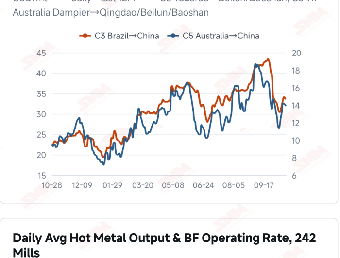
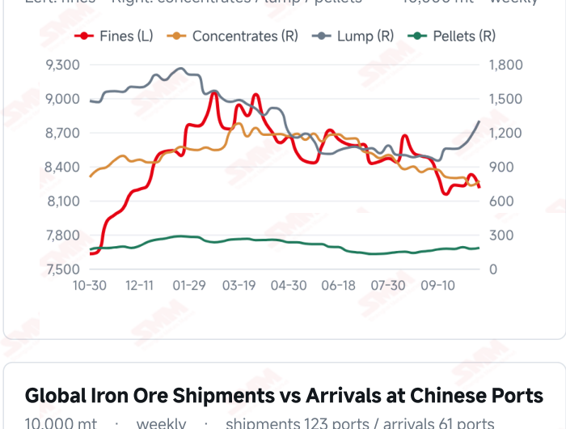
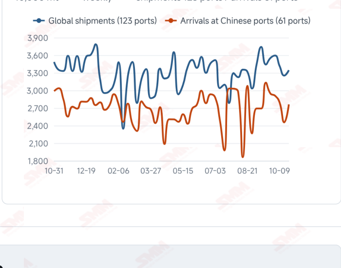

# SMM Iron Ore Daily — 2026-10-28 (Wednesday)

**Source:** SMM Data-pro · Shanghai Metals Market (SMM)

---

## Futures Contracts

| Exchange | Contract | Price | Unit | Daily Change | Daily Change % | MTD Avg |
|:---|:---|:---:|:---:|:---:|:---:|:---:|
| SGX | SGX Iron Ore Current-month FEFV26 | 90.60 | USD/dmt | — | — | — |
| DCE | DCE Iron Ore Most-traded I2701 | 672.00 | yuan/mt | +8.0 | +1.20% | 676.00 |

## SMM Iron Ore Price Index (Physical & Benchmark Indices)

| Index Name | Market Type | Fe % | Price | Unit | Daily Change | Daily Change % | MTD Avg |
|:---|:---|:---:|:---:|:---:|:---:|:---:|:---:|
| MMi 61% Port Spot | port_spot | 61.0% | 650.00 | yuan/wmt | 0.0 | 0.00% | 657.00 |
| MMi 58% Port Spot | port_spot | 58.0% | 603.00 | yuan/wmt | -1.0 | -0.17% | 616.00 |
| MMi 65% Port Spot | port_spot | 65.0% | 811.00 | yuan/wmt | +1.0 | +0.12% | 818.00 |
| MMi 61% Seaborne Index | seaborne | 61.0% | 89.65 | USD/dmt | +0.95 | +1.07% | 90.20 |
| MMi 65% Seaborne Index | seaborne | 65.0% | 106.50 | USD/dmt | +0.35 | +0.33% | 108.48 |
| SMM Domestic Ore Composite Index | domestic_composite | 66.0% | 797.36 | yuan/mt | +1.03 | +0.13% | 809.35 |

## Key View

### Futures and seaborne prices rebound as hot metal improves; sustained restocking still needs trading confirmation

Prices recovered today alongside marginal improvement in production. DCE most-traded closed at 672.0 yuan/mt, up 1.20%, and mainstream Qingdao brands rose 5–6 yuan/wmt. The seaborne 61% and 65% indices increased to USD 89.65 and 106.50/dmt, with all 12 brands higher. Composite port indices remained mixed, showing that brand quotations and composite grade pricing do not always move together. Surveyed daily hot metal output reached 2.3621 million mt on Oct 28, up 3,700 mt and rising for a second period, supporting baseline raw-material consumption. However, purchases also depend on mill stocks, end-user orders and profitability; production growth does not automatically translate into discretionary restocking. Latest arrivals increased 12.47% WoW, so the effect of recovering supply should be assessed alongside port collections. The near-term test is whether the rebound attracts sustained transactions. Steadily stronger buying alongside production recovery could improve price support, while purchases restricted to immediate needs could leave available supply and margin constraints limiting upside. A range-bound view remains appropriate, distinguishing a one-day price recovery from a change in the demand trend.

## Today's Highlights

- Futures and port spot prices recovered. DCE most-traded I2701 closed at 672.0 yuan/mt, up 8.0 yuan (+1.20%) from Oct 27. Qingdao PB and Newman Fines were both 640 yuan/wmt, up 5 yuan; Mac Fines rose 6 yuan to 647, while the other listed products each gained 5 yuan.
- Seaborne indices and brand quotations recovered together. The 61% index was USD 89.65/dmt, up 0.95 (+1.07%), and the 65% was 106.50, up 0.35 (+0.33%). All 12 brands rose against the Oct 27 report; PB Fines were 90.00, Newman Fines 89.10 and Mac Fines 89.25 USD/dmt.
- Composite port indices remained mixed. The 61%, 58% and 65% indices were 650, 603 and 811 yuan/wmt, changing by 0, -1 and +1 yuan. The 65%-58% spread widened from 206 to 208 yuan/wmt; individual brand quotations and composite grade indices measure different baskets.
- Hot metal output edged higher for a second period. Surveyed daily output was 2.3621 million mt on Oct 28, up 3,700 mt (+0.16%) from Oct 21. The blast furnace operating rate rose 0.14 percentage point to 87.30%. Improved production supports baseline consumption, while sustained restocking still depends on margins and orders.

## Qingdao Port Imported Ore Spot Prices (yuan/wet mt, tax incl.)

| Product | Fe % | Type | Price (yuan/wmt) | Daily Change | Daily Change % | MTD Avg |
|:---|:---:|:---:|:---:|:---:|:---:|:---:|
| PB Fines 60.8% | 60.8% | Fines | 640.0 | +5.0 | +0.79% | 644.0 |
| Newman Fines 61.2% | 61.2% | Fines | 640.0 | +5.0 | +0.79% | 646.0 |
| Mac Fines 60.8% | 60.8% | Fines | 647.0 | +6.0 | +0.94% | 649.0 |
| BRBF 62.5% | 62.5% | Fines | 690.0 | +5.0 | +0.73% | 696.0 |
| Newman Lump 63% | 63.0% | Lump | 815.0 | +5.0 | +0.62% | 834.0 |
| Super Special Fines (SSF) 56.5% | 56.5% | Fines | 502.0 | +5.0 | +1.01% | 506.0 |
| Carajas Fines (IOCJ) 65% | 65.0% | Fines | 815.0 | +5.0 | +0.62% | 822.0 |
| PB Lump 61.5% | 61.5% | Lump | 815.0 | +5.0 | +0.62% | 828.0 |

## Seaborne Brand Prices in USD (CFR Qingdao, USD/dry mt, as of 2026-10-28)

| Product | Price (USD/dmt) | Daily Change | Daily Change % | Previous |
|:---|:---:|:---:|:---:|:---:|
| Roy Hill Fines 62% | 86.45 | +0.85 | +0.99% | 85.60 |
| SIMEC Fines 61% | 88.00 | +0.7 | +0.80% | 87.30 |
| PB Fines 62% | 90.00 | +0.95 | +1.07% | 89.05 |
| Newman Fines 60.7% | 89.10 | +0.95 | +1.08% | 88.15 |
| Mac Fines 60.5% | 89.25 | +0.8 | +0.90% | 88.45 |
| Jimblebar Fines 60.30% | 86.85 | +0.75 | +0.87% | 86.10 |
| Carajas Fines (IOCJ) 65% | 105.95 | +0.95 | +0.90% | 105.00 |
| SSFT / SSFG 60% | 96.90 | +0.9 | +0.94% | 96.00 |
| Brazilian Blend Fines (BRBF) 64% | 96.50 | +0.95 | +0.99% | 95.55 |
| RTX Fines 61% | 86.25 | +0.95 | +1.11% | 85.30 |
| West Pilbara Fines (WPF) 60% | 89.40 | +0.7 | +0.79% | 88.70 |
| SP10 Fines 59%-60% | 80.60 | +0.45 | +0.56% | 80.15 |

## SMM Iron Ore Price Index — Weekly / Monthly Statistics

| Index Name | Month-to-date Avg | MoM % | YTD % | Unit |
|:---|:---:|:---:|:---:|:---:|
| SMM MMi 61% Iron Ore Seaborne Index | 90.20 | -6.54% | -15.4% | USD/dmt |
| SMM MMi 65% Iron Ore Seaborne Index | 108.48 | -5.20% | -12.2% | USD/dmt |
| SMM MMi 61% Iron Ore Port Spot Index | 657.00 | -5.02% | -20.0% | yuan/wmt |
| SMM MMi 65% Iron Ore Port Spot Index | 818.00 | -2.54% | -9.8% | yuan/wmt |
| SMM MMi 58% Iron Ore Port Spot Index | 616.00 | -4.92% | -16.0% | yuan/wmt |
| SMM China Domestic Ore Composite Price Index | 809.35 | -3.48% | -10.1% | yuan/mt |

## Key Price Drivers (12-Month Charts & Operational Metrics)

### Charts: Freight & Port Inventory

### Charts: Hot Metal Output & Shipments vs Arrivals

### Operational Fundamentals Snapshot

| Fundamental Indicator | Value | Unit |
|:---|:---:|:---:|
| C3 Freight (Brazil to China) | 33.67 | USD/mt |
| C5 Freight (Australia to China) | 13.93 | USD/mt |
| Iron Ore Port Inventory (10 Major Ports) | 104.6534 | Million MT |
| Global Iron Ore Shipments (Weekly) | 33.4494 | Million MT |
| Chinese Port Arrivals (Weekly) | 27.6076 | Million MT |

## Market Commentary · Imported Ore

### Futures & Spot

DCE most-traded I2701 closed at 672.0 yuan/mt, up 1.20% from the previous session. Qingdao PB Fines were 640, Newman Fines 640, BRBF 690, Newman Lump 815, SSF 502, Carajas Fines 815 and PB Lump 815 yuan/wmt, each up 5 yuan; Mac Fines rose 6 yuan to 647. SGX official current-month FEFV26 was last priced at USD 90.60/dmt, timestamped Oct 28, 17:49:04 (UTC+8). SMM’s evening review described more needs-based mill restocking but continued caution and moderate overall transactions.

### Driver

After the previous decline, futures, mainstream port brands and seaborne quotations recovered together. Composite port grade indices did not all rise, reflecting different resource baskets and purchasing preferences. The seaborne 61% index gained more than the 65%, narrowing their spread from USD 17.45 to 16.85/dmt. A one-day structural move still needs confirmation from trading rather than establishing sustained improvement in aggregate demand.

### Demand

SMM’s 242-mill survey showed daily hot metal output of 2.3621 million mt on Oct 28, up 3,700 mt from 2.3584 million mt on Oct 21. The blast furnace operating rate rose 0.14 percentage point from 87.16% to 87.30%. Output has increased for two consecutive periods, improving baseline consumption. However, raw-material stocks, finished-steel prices and orders still shape purchasing; buying limited to current production needs could offer only modest price support. SMM’s afternoon survey also noted emerging effects from environmental production restrictions in Handan and possible pressure on Tangshan and next week’s overall hot metal. This prospective risk does not change the current survey’s realised increase.

### Inventory & Supply

Global shipments were 33.4494 million mt in the week to Oct 23, up 2.83% WoW, while arrivals in China were 27.6076 million mt, up 12.47%. The latest ten-port stocks were 104.6534 million mt on Oct 22, up 632,200 mt from Oct 15. Improving hot metal and recovering arrivals coexist, leaving subsequent inventories dependent on unloading and mill collection schedules rather than any single flow measure.

### Cost & Margin

Oct 27 freight was USD 33.67/mt for C3, down 0.47% from the previous reading, and 13.93 for C5, down 0.85%. Lower freight may reduce landed costs for some cargoes and firmer spot prices support selling receipts, but actual profitability depends on contracts, exchange rates and cost settlement timing. Trading and steelmaking margins should be assessed separately rather than inferring a broad return to profit from higher prices alone. SMM’s import margin assessment published on the morning of Oct 28 moved from +0.12 to -4.89 yuan/mt. This import trading measure is not a post-close margin for the current session and does not represent steelmaking or coking profitability.

## Market Commentary · Domestic Ore

### Prices

The latest Domestic Ore Composite Price Index was 797.36 yuan/mt on Oct 23. SMM’s Oct 27 Tangshan brief quoted 66% concentrate at 890–895 yuan/mt on a dry-basis, tax-inclusive delivered-to-mill basis, a regional quotation not directly comparable with the national index.

### Supply & Demand

Earlier Tangshan commentary described low mining and beneficiation activity, relatively tight resources and strong mill pressure on bids amid losses. Higher hot metal may improve baseline raw-material demand, but concentrate purchases also depend on regional resources, contracts and blending costs rather than national production alone.

### Outlook

Persistent buying improvement alongside higher production could support some resource-constrained regions, while pressure on finished-steel margins could limit price recovery. Regional trading and collections remain more informative than a single futures rebound.

## Market Factors

### Supportive Factors

- DCE, seaborne indices and all 12 brand quotations recovered together.
- Daily hot metal rose for a second period, increasing 3,700 mt this time.
- C3 and C5 freight eased slightly.
- Resource constraints may support some regional domestic ore offers.

### Bearish Factors

- Composite port indices did not all follow the rebound.
- Latest Chinese arrivals rose 12.47% WoW, keeping incoming supply in focus.
- Port stock absorption still requires sustained collections.
- Orders, margins and stock management continue to shape discretionary buying.

## Flash News Briefs

- [SMM Iron Ore] Hebei output curbs may weigh on hot metal, capping iron ore rebound (2026-10-28)
- [SMM Coking Coal and Coke Daily Brief] 20261028 (2026-10-28)
- [SMM Iron Ore] Iron ore weakens as rising arrivals add to port stock pressure (2026-10-27)
- [SMM Steel] Indian HRC FOB Prices Hold Flat; Europe CFR Levels Ease as Billet Offers Remain Absent (2026-10-28)
- [SMM Steel] Indonesian Billet Holds at USD 470/mt FOB as Pressure to Cut Grows (2026-10-28)
- [SMM Steel] India Domestic Steel Prices Remains Weak (2026-10-28)

---
*(c) 2026 Shanghai Metals Market (SMM) · Iron Ore Value-Chain Data & Research*
