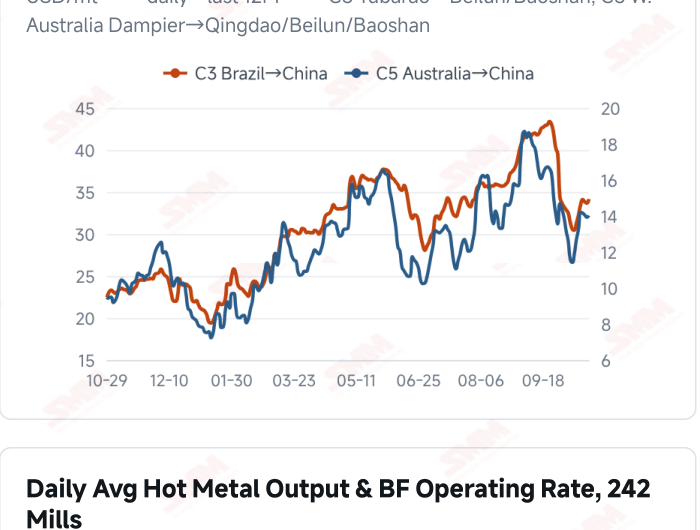
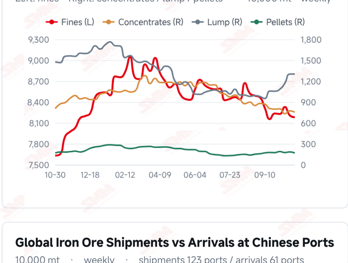
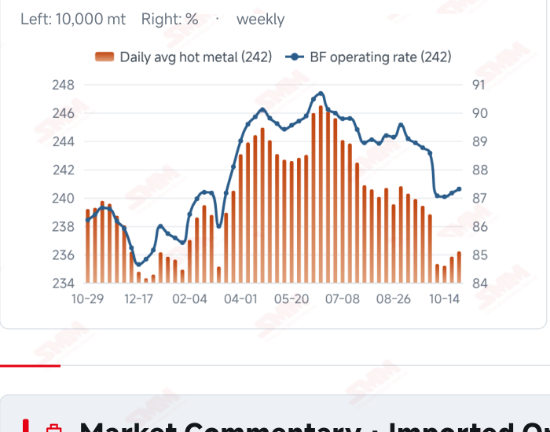

# SMM Iron Ore Daily — 2026-10-29 (Thursday)

**Source:** SMM Data-pro · Shanghai Metals Market (SMM)

---

## Futures Contracts

| Exchange | Contract | Price | Unit | Daily Change | Daily Change % | MTD Avg |
|:---|:---|:---:|:---:|:---:|:---:|:---:|
| SGX | SGX Iron Ore Current-month FEFV26 | 90.75 | USD/dmt | — | — | — |
| DCE | DCE Iron Ore Most-traded I2701 | 682.00 | yuan/mt | +10.0 | +1.49% | 676.40 |

## SMM Iron Ore Price Index (Physical & Benchmark Indices)

| Index Name | Market Type | Fe % | Price | Unit | Daily Change | Daily Change % | MTD Avg |
|:---|:---|:---:|:---:|:---:|:---:|:---:|:---:|
| MMi 61% Port Spot | port_spot | 61.0% | 654.00 | yuan/wmt | +4.0 | +0.62% | 657.00 |
| MMi 58% Port Spot | port_spot | 58.0% | 608.00 | yuan/wmt | +5.0 | +0.83% | 615.00 |
| MMi 65% Port Spot | port_spot | 65.0% | 817.00 | yuan/wmt | +6.0 | +0.74% | 818.00 |
| MMi 61% Seaborne Index | seaborne | 61.0% | 90.90 | USD/dmt | +1.25 | +1.39% | 90.23 |
| MMi 65% Seaborne Index | seaborne | 65.0% | 107.05 | USD/dmt | +0.55 | +0.52% | 108.41 |
| SMM Domestic Ore Composite Index | domestic_composite | 66.0% | 797.44 | yuan/mt | 0.0 | 0.00% | 806.37 |

## Key View

### Futures and spot extend their recovery as port stocks ease; sustained buying remains essential

The price recovery continued today alongside a modest improvement in port inventories. DCE most- traded closed at 682.0 yuan/mt, up 1.49%; the 61%, 58% and 65% port indices rose to 654, 608 and 817 yuan/wmt. The seaborne indices reached USD 90.90/dmt for the 61% and 107.05 for the 65%, with all 12 brands higher. Mainstream port quotations also broadly increased, producing relatively aligned price direction. Ten-port stocks fell 618,100 mt on Oct 29 from the preceding survey, with declines in fines, concentrates and pellets and a small rise in lump. Stock absorption may reflect both arrivals and collections rather than demand alone. Two consecutive increases in hot metal support baseline consumption, while raw-material stock management, finished-steel margins and environmental measures still influence purchasing schedules. The near-term test is whether stronger prices attract and sustain physical transactions. Buying that improves alongside orders could provide a firmer basis for the rebound. If the move mainly reflects offers while restocking remains limited, high supply flows and profitability constraints could restrict upside. Higher freight also calls for assessing costs against contracts and settlement conditions, favouring a cautious, range-bound view.

## Today's Highlights

- Futures and spot prices extended their recovery. DCE most-traded I2701 closed at 682.0 yuan/mt, up 10.0 yuan (+1.49%) from Oct 28. Qingdao PB and Newman Fines were both 650 yuan/wmt and Mac Fines were 657, each up 10 yuan; Carajas Fines rose 7 yuan to 822 and PB Lump rose 5 yuan to 820.
- Seaborne indices and all 12 brand quotations rose. The 61% index was USD 90.90/dmt, up 1.25 (+1.39%), and the 65% was 107.05, up 0.55 (+0.52%). All brands increased against the Oct 28 report, with PB Fines at 91.20, Newman Fines 90.35 and Mac Fines 90.40 USD/dmt.
- All three port indices increased. The 61%, 58% and 65% indices were 654, 608 and 817 yuan/wmt, up 4, 5 and 6 yuan. The 65%-58% spread widened from 208 to 209 yuan/wmt, while the seaborne grade spread narrowed from USD 16.85 to 16.15/dmt.
- Ten-port stocks declined modestly. Total inventory was 104.0353 million mt on Oct 29, down 618,100 mt (-0.59%) from Oct 22. Fines, concentrates and pellets fell by 261,100, 203,800 and 157,500 mt, respectively, while lump edged up 4,300 mt.

## Qingdao Port Imported Ore Spot Prices (yuan/wet mt, tax incl.)

| Product | Fe % | Type | Price (yuan/wmt) | Daily Change | Daily Change % | MTD Avg |
|:---|:---:|:---:|:---:|:---:|:---:|:---:|
| PB Fines 60.8% | 60.8% | Fines | 650.0 | +10.0 | +1.56% | 645.0 |
| Newman Fines 61.2% | 61.2% | Fines | 650.0 | +10.0 | +1.56% | 646.0 |
| Mac Fines 60.8% | 60.8% | Fines | 657.0 | +10.0 | +1.55% | 649.0 |
| BRBF 62.5% | 62.5% | Fines | 700.0 | +10.0 | +1.45% | 696.0 |
| Newman Lump 63% | 63.0% | Lump | 825.0 | +10.0 | +1.23% | 834.0 |
| Super Special Fines (SSF) 56.5% | 56.5% | Fines | 512.0 | +10.0 | +1.99% | 507.0 |
| Carajas Fines (IOCJ) 65% | 65.0% | Fines | 822.0 | +7.0 | +0.86% | 822.0 |
| PB Lump 61.5% | 61.5% | Lump | 820.0 | +5.0 | +0.61% | 828.0 |

## Seaborne Brand Prices in USD (CFR Qingdao, USD/dry mt, as of 2026-10-29)

| Product | Price (USD/dmt) | Daily Change | Daily Change % | Previous |
|:---|:---:|:---:|:---:|:---:|
| Roy Hill Fines 62% | 87.65 | +1.2 | +1.39% | 86.45 |
| SIMEC Fines 61% | 89.00 | +1.0 | +1.14% | 88.00 |
| PB Fines 62% | 91.20 | +1.2 | +1.33% | 90.00 |
| Newman Fines 60.7% | 90.35 | +1.25 | +1.40% | 89.10 |
| Mac Fines 60.5% | 90.40 | +1.15 | +1.29% | 89.25 |
| Jimblebar Fines 60.30% | 87.70 | +0.85 | +0.98% | 86.85 |
| Carajas Fines (IOCJ) 65% | 107.20 | +1.25 | +1.18% | 105.95 |
| SSFT / SSFG 60% | 98.20 | +1.3 | +1.34% | 96.90 |
| Brazilian Blend Fines (BRBF) 64% | 97.75 | +1.25 | +1.30% | 96.50 |
| RTX Fines 61% | 87.35 | +1.1 | +1.28% | 86.25 |
| West Pilbara Fines (WPF) 60% | 90.45 | +1.05 | +1.17% | 89.40 |
| SP10 Fines 59%-60% | 81.05 | +0.45 | +0.56% | 80.60 |

## SMM Iron Ore Price Index — Weekly / Monthly Statistics

| Index Name | Month-to-date Avg | MoM % | YTD % | Unit |
|:---|:---:|:---:|:---:|:---:|
| SMM MMi 61% Iron Ore Seaborne Index | 90.23 | -6.50% | -14.2% | USD/dmt |
| SMM MMi 65% Iron Ore Seaborne Index | 108.41 | -5.26% | -11.8% | USD/dmt |
| SMM MMi 61% Iron Ore Port Spot Index | 657.00 | -5.05% | -19.6% | yuan/wmt |
| SMM MMi 65% Iron Ore Port Spot Index | 818.00 | -2.55% | -9.1% | yuan/wmt |
| SMM MMi 58% Iron Ore Port Spot Index | 615.00 | -4.99% | -15.3% | yuan/wmt |
| SMM China Domestic Ore Composite Price Index | 806.37 | -3.84% | -10.1% | yuan/mt |

## Key Price Drivers (12-Month Charts & Operational Metrics)

### Charts: Freight & Port Inventory

### Charts: Hot Metal Output & Shipments vs Arrivals

### Operational Fundamentals Snapshot

| Fundamental Indicator | Value | Unit |
|:---|:---:|:---:|
| C3 Freight (Brazil to China) | 34.17 | USD/mt |
| C5 Freight (Australia to China) | 14.03 | USD/mt |
| Blast Furnace Operating Rate (242 Mills) | 87.3 | % |
| Iron Ore Port Inventory (10 Major Ports) | 104.0353 | Million MT |

## Market Commentary · Imported Ore

### Futures & Spot

DCE most-traded I2701 closed at 682.0 yuan/mt, up 1.49% from the previous session. Qingdao PB Fines were 650, Newman Fines 650, Mac Fines 657, BRBF 700, Newman Lump 825 and SSF 512 yuan/wmt, each up 10 yuan; Carajas Fines rose 7 yuan to 822 and PB Lump rose 5 yuan to 820. SGX official current-month FEFV26 was last priced at USD 90.75/dmt, timestamped Oct 29, 17:14:08 (UTC+8). SMM’s daily review described consecutive price gains but still limited overall trading.

### Driver

Domestic futures, port indices and seaborne quotations strengthened together, extending the previous recovery. The seaborne 61% index rose more than the 65%, narrowing the grade spread, while the port high- low spread widened slightly. Structural performance therefore differs across markets. Firmer prices may encourage offers, but durability still depends on mill purchases, transaction volumes and resource availability.

### Demand

The latest 242-mill survey showed daily hot metal output of 2.3621 million mt on Oct 28, up 3,700 mt from Oct 21, and a blast furnace operating rate of 87.30%. Two consecutive increases support baseline consumption, while discretionary restocking remains constrained by orders, profitability and existing mill stocks. Environmental restrictions and maintenance schedules may affect subsequent production, leaving actual demand in focus.

### Inventory & Supply

Ten-port stocks were 104.0353 million mt on Oct 29, down 618,100 mt (-0.59%) from Oct 22. Fines at 81.8182 million mt, concentrates at 7.5304 million mt and pellets at 1.6715 million mt fell by 261,100, 203,800 and 157,500 mt, respectively. Lump rose 4,300 mt to 13.0152 million mt. The drawdown may reflect arrivals, unloading and mill collections together rather than one demand factor. Latest global shipments and Chinese arrivals, for the week to Oct 23, were 33.4494 and 27.6076 million mt.

### Cost & Margin

Oct 28 freight was USD 34.17/mt for C3, up 1.49% from the previous reading, and 14.03 for C5, up 0.72%. Higher ore prices and freight may raise procurement costs for some cargoes, while stronger port selling prices support receipts. Net margins still depend on contracts, exchange rates and settlement timing; one day’s price direction does not establish a broad return to profit for mills or traders. SMM’s assessment published Oct 29 showed the period’s average import margin turning positive at 1.53 yuan/mt from -4.89, an improvement of 6.42 yuan. This import trading measure does not establish a return to profit for mills or coke producers.

## Market Commentary · Domestic Ore

### Prices

The Domestic Ore Composite Price Index held at 797.44 yuan/mt on Oct 29. SMM’s current Tangshan brief quoted 66% concentrate at 885–890 yuan/mt on a dry-basis, tax-inclusive ex-works basis, down 5–10 yuan. The regional quotation and national composite measure different markets.

### Supply & Demand

SMM’s Tangshan brief described low mining and beneficiation activity, little progress in private-mine restarts and tight supply. Mill losses and pressure on bids remained strong. The purchasing response to marginal production improvement still needs to be assessed against regional resources, orders and blending costs.

### Outlook

SMM expects Tangshan concentrate prices to remain range-bound near term. Persistent resource tightness alongside stronger buying could support offers, while limited recovery in mill margins and orders could constrain upside. Heating-season environmental maintenance remains a prospective risk rather than evidence of widespread restrictions already in effect.

## Market Factors

### Supportive Factors

- DCE, all five MMi indices and all 12 seaborne brands increased.
- Daily hot metal rose for two consecutive periods, improving baseline consumption.
- Ten-port stocks fell 618,100 mt from Oct 22.
- Most port brand quotations increased, extending the price recovery.

### Bearish Factors

- Sustained buying still needs support from end-user orders and mill margins.
- Latest Chinese arrivals rose 12.47% WoW, keeping subsequent supply flows in focus.
- Higher C3 and C5 freight may increase some procurement costs.
- Environmental restrictions and maintenance could affect subsequent production.

## Flash News Briefs

- Coarse Ore Powder Destocking and Freight Support Drive Consecutive Gains in Ore Prices, but Trading Volume Fails to Expand [SMM Iron Ore Daily Review] (2026-10-29)
- [Domestic Iron Ore Brief] Iron ore concentrates prices in the Tangshan area may consolidate (2026-10-29)
- [SMM Coking Coal and Coke Daily Brief] 20261029 (2026-10-29)
- Record sales, negative margin: Champion Iron's Q2 FY27 net realized price falls 30% [SMM Iron Ore] (2026-10-29)
- [SMM Steel] Indonesian HRC Holds at USD 515/mt FOB as Export Prices Come Under Pressure Again (2026-10-29)
- [SMM Steel] India Domestic Steel Market Remains Sluggish (2026-10-29)

---
*(c) 2026 Shanghai Metals Market (SMM) · Iron Ore Value-Chain Data & Research*
