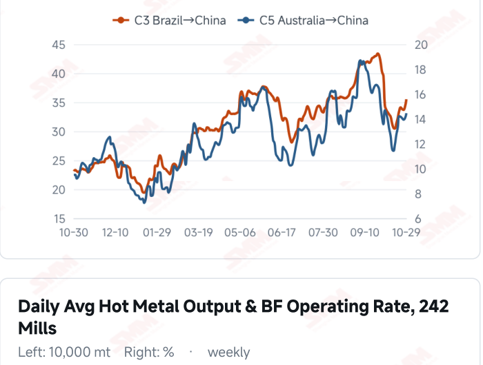
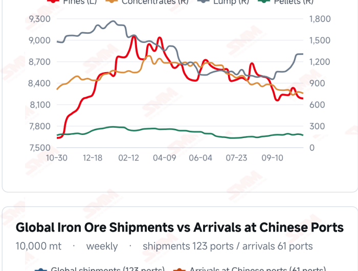
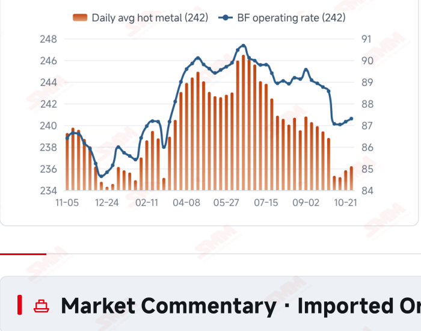
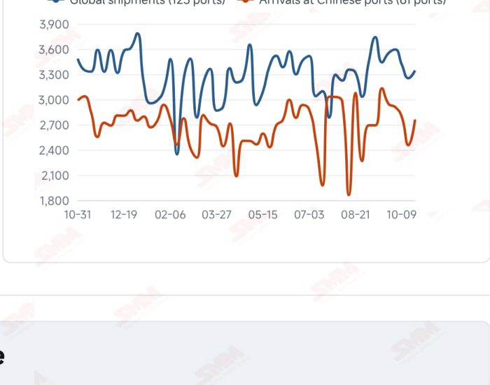

# SMM Iron Ore Daily — 2026-10-30 (Friday)

**Source:** SMM Data-pro · Shanghai Metals Market (SMM)

---

## Futures Contracts

| Exchange | Contract | Price | Unit | Daily Change | Daily Change % | MTD Avg |
|:---|:---|:---:|:---:|:---:|:---:|:---:|
| DCE | DCE Iron Ore Most-traded I2701 | 672.00 | yuan/mt | -10.0 | -1.47% | 676.10 |

## SMM Iron Ore Price Index (Physical & Benchmark Indices)

| Index Name | Market Type | Fe % | Price | Unit | Daily Change | Daily Change % | MTD Avg |
|:---|:---|:---:|:---:|:---:|:---:|:---:|:---:|
| MMi 61% Port Spot | port_spot | 61.0% | 650.00 | yuan/wmt | -4.0 | -0.61% | 657.00 |
| MMi 58% Port Spot | port_spot | 58.0% | 602.00 | yuan/wmt | -6.0 | -0.99% | 614.00 |
| MMi 65% Port Spot | port_spot | 65.0% | 812.00 | yuan/wmt | -5.0 | -0.61% | 818.00 |
| MMi 61% Seaborne Index | seaborne | 61.0% | 90.50 | USD/dmt | -0.4 | -0.44% | 90.24 |
| MMi 65% Seaborne Index | seaborne | 65.0% | 106.75 | USD/dmt | -0.3 | -0.28% | 108.34 |
| SMM Domestic Ore Composite Index | domestic_composite | 66.0% | 791.29 | yuan/mt | -6.15 | -0.77% | 805.48 |

## Key View

### Prices retreat after recovering; higher freight keeps trading and margins in focus

The earlier recovery did not persist, with futures, port prices and seaborne quotations weakening together today. DCE most-traded fell 1.47% to 672.0 yuan/mt, while all eight Qingdao products declined 10 yuan/wmt. The 61%, 58% and 65% port indices were 650, 602 and 812 yuan/wmt; the seaborne 61% and 65% indices were USD 90.50 and 106.75/dmt. All 12 brands fell, showing that the rebound still lacks durable price support. Production and inventories offer some marginal support. Latest surveyed hot metal increased for a second period and ten-port stocks fell 618,100 mt from the preceding survey. However, higher production is not equivalent to discretionary restocking, and inventories also reflect arrivals and unloading schedules. Actual buying still needs support from orders, profitability and stock management rather than isolated improvements establishing stronger aggregate demand. Near-term attention should focus on the balance between higher costs and selling support. Rising C3 and C5 freight may reduce cost advantages for some cargoes. Needs-based mill buying could constrain a recovery, while stronger orders and profitability followed by persistent transactions would offer firmer downside support. A cautious, range-bound view remains appropriate rather than extrapolating a single price move into a trend change.

## Today's Highlights

- Futures and spot prices retreated, testing the earlier recovery. DCE most-traded I2701 closed at 672.0 yuan/mt, down 10.0 yuan (-1.47%). All eight Qingdao products fell 10 yuan/wmt, with PB Fines at 640, Newman Fines 640, Mac Fines 647 and Carajas Fines 812.
- Seaborne indices and brand quotations declined together. The 61% index was USD 90.50/dmt, down 0.40 (-0.44%), and the 65% was 106.75, down 0.30 (-0.28%). All 12 brands fell against the Oct 29 report; PB Fines were 90.80, Newman Fines 89.95 and Mac Fines 89.90 USD/dmt.
- All port indices fell, with relatively greater pressure on low grade. The 61%, 58% and 65% indices were 650, 602 and 812 yuan/wmt, down 4, 6 and 5 yuan. The 65%-58% spread widened from 209 to 210 yuan/wmt.
- The domestic ore composite index declined. The Oct 30 index was 791.29 yuan/mt, down 6.15 yuan (-0.77%) from 797.44. Purchasing persistence and mill profitability remain important indicators of price support.

## Qingdao Port Imported Ore Spot Prices (yuan/wet mt, tax incl.)

| Product | Fe % | Type | Price (yuan/wmt) | Daily Change | Daily Change % | MTD Avg |
|:---|:---:|:---:|:---:|:---:|:---:|:---:|
| PB Fines 60.8% | 60.8% | Fines | 640.0 | -10.0 | -1.54% | 644.0 |
| Newman Fines 61.2% | 61.2% | Fines | 640.0 | -10.0 | -1.54% | 646.0 |
| Mac Fines 60.8% | 60.8% | Fines | 647.0 | -10.0 | -1.52% | 649.0 |
| BRBF 62.5% | 62.5% | Fines | 690.0 | -10.0 | -1.43% | 696.0 |
| Newman Lump 63% | 63.0% | Lump | 815.0 | -10.0 | -1.21% | 833.0 |
| Super Special Fines (SSF) 56.5% | 56.5% | Fines | 502.0 | -10.0 | -1.95% | 506.0 |
| Carajas Fines (IOCJ) 65% | 65.0% | Fines | 812.0 | -10.0 | -1.22% | 822.0 |
| PB Lump 61.5% | 61.5% | Lump | 810.0 | -10.0 | -1.22% | 827.0 |

## Seaborne Brand Prices in USD (CFR Qingdao, USD/dry mt, as of 2026-10-30)

| Product | Price (USD/dmt) | Daily Change | Daily Change % | Previous |
|:---|:---:|:---:|:---:|:---:|
| Roy Hill Fines 62% | 87.15 | -0.5 | -0.57% | 87.65 |
| SIMEC Fines 61% | 88.35 | -0.65 | -0.73% | 89.00 |
| PB Fines 62% | 90.80 | -0.4 | -0.44% | 91.20 |
| Newman Fines 60.7% | 89.95 | -0.4 | -0.44% | 90.35 |
| Mac Fines 60.5% | 89.90 | -0.5 | -0.55% | 90.40 |
| Jimblebar Fines 60.30% | 87.10 | -0.6 | -0.68% | 87.70 |
| Carajas Fines (IOCJ) 65% | 106.80 | -0.4 | -0.37% | 107.20 |
| SSFT / SSFG 60% | 97.80 | -0.4 | -0.41% | 98.20 |
| Brazilian Blend Fines (BRBF) 64% | 97.35 | -0.4 | -0.41% | 97.75 |
| RTX Fines 61% | 86.95 | -0.4 | -0.46% | 87.35 |
| West Pilbara Fines (WPF) 60% | 89.85 | -0.6 | -0.66% | 90.45 |
| SP10 Fines 59%-60% | 80.15 | -0.9 | -1.11% | 81.05 |

## SMM Iron Ore Price Index — Weekly / Monthly Statistics

| Index Name | Month-to-date Avg | MoM % | YTD % | Unit |
|:---|:---:|:---:|:---:|:---:|
| SMM MMi 61% Iron Ore Seaborne Index | 90.24 | -6.49% | -14.6% | USD/dmt |
| SMM MMi 65% Iron Ore Seaborne Index | 108.34 | -5.32% | -12.0% | USD/dmt |
| SMM MMi 61% Iron Ore Port Spot Index | 657.00 | -5.11% | -20.0% | yuan/wmt |
| SMM MMi 65% Iron Ore Port Spot Index | 818.00 | -2.60% | -9.7% | yuan/wmt |
| SMM MMi 58% Iron Ore Port Spot Index | 614.00 | -5.11% | -16.2% | yuan/wmt |
| SMM China Domestic Ore Composite Price Index | 805.48 | -3.95% | -10.7% | yuan/mt |

## Key Price Drivers (12-Month Charts & Operational Metrics)

### Charts: Freight & Port Inventory

### Charts: Hot Metal Output & Shipments vs Arrivals

### Operational Fundamentals Snapshot

| Fundamental Indicator | Value | Unit |
|:---|:---:|:---:|
| C3 Freight (Brazil to China) | 35.51 | USD/mt |
| C5 Freight (Australia to China) | 14.45 | USD/mt |
| Iron Ore Port Inventory (10 Major Ports) | 104.0353 | Million MT |
| Global Iron Ore Shipments (Weekly) | 33.4494 | Million MT |
| Chinese Port Arrivals (Weekly) | 27.6076 | Million MT |

## Market Commentary · Imported Ore

### Futures & Spot

DCE most-traded I2701 closed at 672.0 yuan/mt, down 1.47% from the previous session. Qingdao PB Fines were 640, Newman Fines 640, Mac Fines 647, BRBF 690, Newman Lump 815, SSF 502, Carajas Fines 812 and PB Lump 810 yuan/wmt, all down 10 yuan. SGX official near-month FEFX26 (November 2026) was last priced at USD 90.80/dmt, timestamped Oct 30, 17:40:04 (UTC+8). SMM’s daily review described needs-based mill buying and limited overall transactions.

### Driver

Following two sessions of recovery, domestic futures, port prices and seaborne quotations all retreated, showing that the rebound still needs support from transactions. The low-grade port index fell relatively more, while the seaborne 61%-65% price differential widened slightly from USD 16.15 to 16.25/dmt. Resource availability and purchasing schedules may influence these structural moves; one session does not establish a shift in blending demand.

### Demand

The latest 242-mill survey showed daily hot metal output of 2.3621 million mt on Oct 28, up 3,700 mt from Oct 21; the blast furnace operating rate rose 0.14 percentage point to 87.30%. Two consecutive increases support baseline consumption, but raw-material stocks, finished-steel orders and margins still determine discretionary restocking. Environmental restrictions and maintenance plans may affect subsequent production, leaving actual purchases in focus.

### Inventory & Supply

The latest ten-port stocks were 104.0353 million mt on Oct 29, down 618,100 mt from Oct 22, with declines in fines, concentrates and pellets and a small increase in lump. Global shipments and arrivals in China were 33.4494 and 27.6076 million mt in the week to Oct 23, up 2.83% and 12.47% WoW. Inventories and arrivals describe different dates and stages; subsequent stocks depend on unloading and mill collections rather than one measure alone establishing tighter supply.

### Cost & Margin

Oct 29 freight was USD 35.51/mt for C3, up 3.92% from the previous reading, and 14.45 for C5, up 2.99%. Higher transport costs alongside weaker port selling prices may pressure returns on some imports, but actual margins also depend on contracts, exchange rates and settlement timing. Import trading profitability should not be equated with steelmaking margins.

## Market Commentary · Domestic Ore

### Prices

The Domestic Ore Composite Price Index was 791.29 yuan/mt on Oct 30, down 6.15 yuan (-0.77%). SMM’s current west Liaoning brief described lower offers from some sellers and quiet trading; regional grades and pricing terms should be assessed separately.

### Supply & Demand

SMM reported that local safety checks tightened resources and constrained production at independent concentrators in west Liaoning. Mills continued pressing bids lower and transactions were scarce. Supply constraints may not fully offset demand pressure, leaving willingness to transact central to the balance.

### Outlook

SMM expects west Liaoning concentrate prices to remain soft and range-bound near term. Limited improvement in mill orders and margins could keep buying cautious, while tight resources alongside stronger collections could support some quotations.

## Market Factors

### Supportive Factors

- Latest daily hot metal output rose 3,700 mt WoW.
- Ten-port stocks fell 618,100 mt from Oct 22.
- Some domestic ore regions remain resource-constrained.
- Lower prices could improve trading support if they attract persistent buying.

### Bearish Factors

- DCE fell 1.47% and all eight port products declined 10 yuan.
- All five MMi indices and all 12 seaborne brands weakened.
- Higher C3 and C5 freight may increase landed costs for some cargoes.
- Mill margins, orders and stock management still influence restocking appetite.

## Flash News Briefs

- [Domestic Iron Ore Brief] Iron ore concentrates prices in west Liaoning may consolidate on a subdued note (2026-10-30)
- [SMM Coking Coal and Coke Daily Briefing] 20261030 (2026-10-30)
- [Vale Q3 profit falls; iron ore output of 88.4 Mt misses expectations] (2026-10-30)
- [Algoma Steel's EAF Unit 2 Produces First Heat; Q4 Shipments Guided Up 25%-35%] (2026-10-30)
- [Italy's top court upholds ruling to shut blast furnaces at former Ilva steelworks] (2026-10-30)
- [Malaysia Plans Fresh Incentives for Steelmakers Shifting to Automotive-Grade, High-Value Steel] (2026-10-30)

---
*(c) 2026 Shanghai Metals Market (SMM) · Iron Ore Value-Chain Data & Research*
