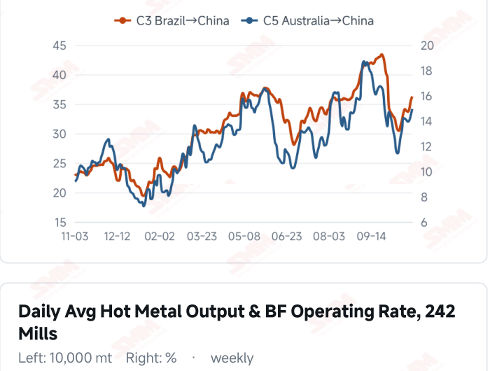
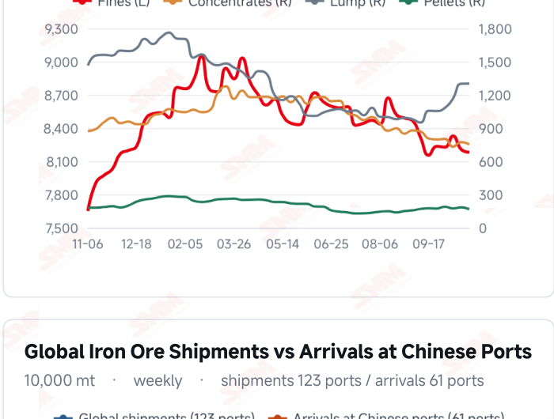
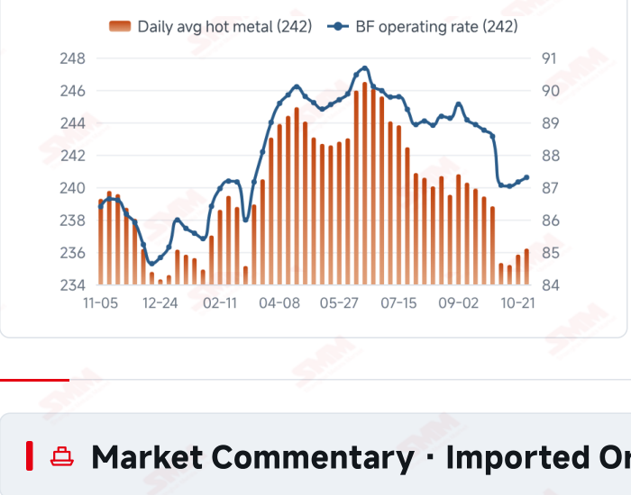
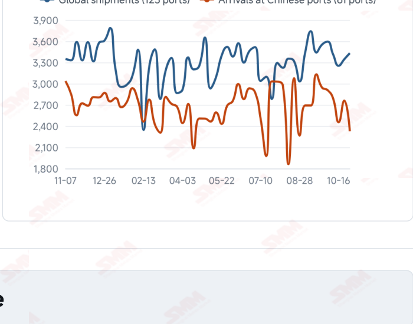

# SMM Iron Ore Daily — 2026-11-02 (Monday)

**Source:** SMM Data-pro · Shanghai Metals Market (SMM)

---

## Futures Contracts

| Exchange | Contract | Price | Unit | Daily Change | Daily Change % | MTD Avg |
|:---|:---|:---:|:---:|:---:|:---:|:---:|
| DCE | DCE Iron Ore Most-traded I2701 | 674.50 | yuan/mt | +2.5 | +0.37% | 674.50 |

## SMM Iron Ore Price Index (Physical & Benchmark Indices)

| Index Name | Market Type | Fe % | Price | Unit | Daily Change | Daily Change % | MTD Avg |
|:---|:---|:---:|:---:|:---:|:---:|:---:|:---:|
| MMi 61% Port Spot | port_spot | 61.0% | 653.00 | yuan/wmt | +3.0 | +0.46% | 653.00 |
| MMi 58% Port Spot | port_spot | 58.0% | 605.00 | yuan/wmt | +3.0 | +0.50% | 605.00 |
| MMi 65% Port Spot | port_spot | 65.0% | 815.00 | yuan/wmt | +3.0 | +0.37% | 815.00 |
| MMi 61% Seaborne Index | seaborne | 61.0% | 90.90 | USD/dmt | +0.4 | +0.44% | 90.90 |
| MMi 65% Seaborne Index | seaborne | 65.0% | 106.90 | USD/dmt | +0.15 | +0.14% | 106.90 |
| SMM Domestic Ore Composite Index | domestic_composite | 66.0% | 791.29 | yuan/mt | -6.15 | -0.77% | — |

## Key View

### Prices recover at the month’s start as arrivals ease; sustained buying remains key

Prices recovered in November’s first session, with futures, port and seaborne indices moving higher together. DCE most-traded closed at 674.5 yuan/mt, up 0.37%; the 61%, 58% and 65% port indices each rose 3 yuan to 653, 605 and 815 yuan/wmt. The seaborne 61% and 65% indices reached USD 90.90 and 106.90/dmt, with most brand quotations firmer, indicating improved short-term price support. Supply flows offer some cushion. Arrivals in China fell 15.73% WoW in the week to Oct 30, potentially easing near- term incoming pressure, although global shipments rose 2.58%, leaving room for later changes in arrivals. Two consecutive increases in the latest hot metal readings support baseline consumption, but production recovery is not the same as discretionary restocking; orders and margins determine purchasing persistence. The near-term test is whether transactions keep pace with firmer offers. Stronger restocking and orders could provide firmer downside support, while purchases limited to immediate needs could leave existing stocks and subsequent supply constraining upside. Rising freight also increases the importance of procurement costs. A cautious, range-bound view remains appropriate rather than treating a single gain at the month’s start as a trend reversal.

## Today's Highlights

- Futures and spot prices recovered in November’s first session. DCE most-traded I2701 closed at 674.5 yuan/mt, up 2.5 yuan (+0.37%) from Oct 30. Qingdao PB and Newman Fines were both 645 yuan/wmt, up 5 yuan; Mac Fines at 650 and BRBF at 693 each rose 3 yuan.
- All five MMi indices moved higher. The 61% seaborne index was USD 90.90/dmt, up 0.40 (+0.44%), and the 65% was 106.90, up 0.15 (+0.14%). The 61%, 58% and 65% port indices were 653, 605 and 815 yuan/wmt, each up 3 yuan.
- Most seaborne brand quotations recovered. Against the Oct 30 report, PB Fines at USD 91.20/dmt and Newman Fines at 90.35 each rose USD 0.40; Mac Fines increased USD 0.25 to 90.15. Eleven of the 12 brands rose, while SP10 edged down USD 0.10 to 80.05.
- Arrivals declined while shipments increased. Arrivals in China were 23.2663 million mt in the week to Oct 30, down 15.73% WoW; global shipments rose 2.58% to 34.3119 million mt. Flows at different stages of the supply chain do not move simultaneously, leaving inventories dependent on collections as well.

## Qingdao Port Imported Ore Spot Prices (yuan/wet mt, tax incl.)

| Product | Fe % | Type | Price (yuan/wmt) | Daily Change | Daily Change % | MTD Avg |
|:---|:---:|:---:|:---:|:---:|:---:|:---:|
| PB Fines 60.8% | 60.8% | Fines | 645.0 | +5.0 | +0.78% | 645.0 |
| Newman Fines 61.2% | 61.2% | Fines | 645.0 | +5.0 | +0.78% | 645.0 |
| Mac Fines 60.8% | 60.8% | Fines | 650.0 | +3.0 | +0.46% | 650.0 |
| BRBF 62.5% | 62.5% | Fines | 693.0 | +3.0 | +0.43% | 693.0 |
| Newman Lump 63% | 63.0% | Lump | 820.0 | +5.0 | +0.61% | 820.0 |
| Super Special Fines (SSF) 56.5% | 56.5% | Fines | 507.0 | +5.0 | +1.00% | 507.0 |
| Carajas Fines (IOCJ) 65% | 65.0% | Fines | 817.0 | +5.0 | +0.62% | 817.0 |
| PB Lump 61.5% | 61.5% | Lump | 815.0 | +5.0 | +0.62% | 815.0 |

## Seaborne Brand Prices in USD (CFR Qingdao, USD/dry mt, as of 2026-11-02)

| Product | Price (USD/dmt) | Daily Change | Daily Change % | Previous |
|:---|:---:|:---:|:---:|:---:|
| Roy Hill Fines 62% | 87.50 | +0.35 | +0.40% | 87.15 |
| SIMEC Fines 61% | 88.50 | +0.15 | +0.17% | 88.35 |
| PB Fines 62% | 91.20 | +0.4 | +0.44% | 90.80 |
| Newman Fines 60.7% | 90.35 | +0.4 | +0.44% | 89.95 |
| Mac Fines 60.5% | 90.15 | +0.25 | +0.28% | 89.90 |
| Jimblebar Fines 60.30% | 87.35 | +0.25 | +0.29% | 87.10 |
| Carajas Fines (IOCJ) 65% | 107.20 | +0.4 | +0.37% | 106.80 |
| SSFT / SSFG 60% | 98.20 | +0.4 | +0.41% | 97.80 |
| Brazilian Blend Fines (BRBF) 64% | 97.75 | +0.4 | +0.41% | 97.35 |
| RTX Fines 61% | 87.35 | +0.4 | +0.46% | 86.95 |
| West Pilbara Fines (WPF) 60% | 90.00 | +0.15 | +0.17% | 89.85 |
| SP10 Fines 59%-60% | 80.05 | -0.1 | -0.12% | 80.15 |

## SMM Iron Ore Price Index — Weekly / Monthly Statistics

| Index Name | Month-to-date Avg | MoM % | YTD % | Unit |
|:---|:---:|:---:|:---:|:---:|
| SMM MMi 61% Iron Ore Seaborne Index | 90.90 | +0.73% | -14.2% | USD/dmt |
| SMM MMi 65% Iron Ore Seaborne Index | 106.90 | -1.33% | -11.9% | USD/dmt |
| SMM MMi 61% Iron Ore Port Spot Index | 653.00 | -0.58% | -19.7% | yuan/wmt |
| SMM MMi 65% Iron Ore Port Spot Index | 815.00 | -0.35% | -9.3% | yuan/wmt |
| SMM MMi 58% Iron Ore Port Spot Index | 605.00 | -1.51% | -15.7% | yuan/wmt |

## Key Price Drivers (12-Month Charts & Operational Metrics)

### Charts: Freight & Port Inventory

### Charts: Hot Metal Output & Shipments vs Arrivals

### Operational Fundamentals Snapshot

| Fundamental Indicator | Value | Unit |
|:---|:---:|:---:|
| C3 Freight (Brazil to China) | 36.26 | USD/mt |
| C5 Freight (Australia to China) | 14.94 | USD/mt |
| Blast Furnace Operating Rate (242 Mills) | 87.3 | % |
| Iron Ore Port Inventory (10 Major Ports) | 104.0353 | Million MT |
| Global Iron Ore Shipments (Weekly) | 34.3119 | Million MT |
| Chinese Port Arrivals (Weekly) | 23.2663 | Million MT |

## Market Commentary · Imported Ore

### Futures & Spot

DCE most-traded I2701 closed at 674.5 yuan/mt, up 0.37% from Oct 30. Qingdao PB Fines were 645, Newman Fines 645, Newman Lump 820, SSF 507, Carajas Fines 817 and PB Lump 815 yuan/wmt, each up 5 yuan; Mac Fines at 650 and BRBF at 693 rose 3 yuan. SGX official near-month FEFX26 (November 2026) was last priced at USD 91.25/dmt, timestamped Nov 2, 17:30:47 (UTC+8). SMM’s daily review described moderate trader activity, needs-based mill purchases and reasonable overall trading.

### Driver

Futures, port indices and seaborne composite indices recovered together, accompanied by gains in most brand quotations. The 61% seaborne index rose more than the 65%, narrowing their spread from USD 16.25 to 16.00/dmt, while the 65%-58% port spread held at 210 yuan/wmt. Firmer offers may encourage buying, but persistence still needs support from physical transactions, orders and mill margins.

### Demand

The latest 242-mill survey showed daily hot metal output of 2.3621 million mt on Oct 28, up 3,700 mt from Oct 21, and a blast furnace operating rate of 87.30%. Two consecutive increases support baseline consumption, while environmental maintenance, mill stocks and finished-steel orders still influence purchasing. Buying restricted to immediate needs may limit the persistence of a one-day price recovery.

### Inventory & Supply

Global shipments were 34.3119 million mt in the week to Oct 30, up 862,500 mt (+2.58%) WoW; Australia shipped 18.5359 million mt (-5.98%) and Brazil 8.5097 million mt (+3.31%). Arrivals in China fell 4.3413 million mt (-15.73%) to 23.2663 million mt. Latest ten-port stocks were 104.0353 million mt on Oct 29, down 618,100 mt from Oct 22. Lower arrivals may ease near-term incoming supply pressure, while stock absorption also depends on unloading and mill collections.

### Cost & Margin

Oct 30 freight was USD 36.26/mt for C3, up 2.11% from the preceding reading, and 14.94 for C5, up 3.39%. Higher transport costs may raise landed costs for some cargoes, while firmer spot quotations support selling prices. Actual profitability also depends on contracts, exchange rates and settlement timing rather than a rebound alone establishing a broad recovery in import trading or steelmaking margins. SMM’s assessment published on the morning of Nov 2 put the period’s average import margin at 0.04 yuan/mt, down 8.68 yuan from 8.72. This measures import trading, not mill profitability after the current session’s close.

## Market Commentary · Domestic Ore

### Prices

The latest Domestic Ore Composite Price Index was 791.29 yuan/mt on Oct 30. SMM’s Nov 2 Shandong brief quoted 64% basic concentrate at 754 yuan/mt, down 3 yuan, on a dry-basis, pre-tax ex-mine quotation payable by acceptance bill. Grade and pricing terms distinguish this regional quotation from the national index.

### Supply & Demand

SMM described mostly normal mine operations and good sales in Shandong, improved relative value for domestic concentrates and comparatively active mill purchases. These regional observations do not establish a nationwide demand recovery; resources, contracts and actual collections should be tracked separately.

### Outlook

SMM expects Shandong concentrate prices to remain range-bound near term. Persistent regional buying improvement could support prices, while continued pressure on mill margins could limit upside.

## Market Factors

### Supportive Factors

- DCE and all five MMi indices recovered together.
- Eleven of the 12 seaborne brands increased.
- Latest arrivals in China fell 15.73% WoW.
- The latest hot metal reading extended a modest recovery.

### Bearish Factors

- Higher global shipments keep subsequent supply flows in focus.
- C3 and C5 freight rose further.
- Orders, margins and environmental maintenance may influence mill buying.
- A one-day rebound still needs confirmation from sustained transactions.

## Flash News Briefs

- [SMM Iron Ore] Arrivals drop 15.7% to support spot; iron ore futures ease after early gains (2026-11-02)
- [SMM Iron Ore] 2026Q3 Major Miner Production & Shipment (2026-11-02)
- [Whitehaven's Winchester South coal project receives Queensland Land Court approval recommendation] (2026-11-02)
- [Bharat Coking Coal October 2026 Raw Coal Output 2.86 Mt, Up 7.1% YoY] (2026-11-02)
- [SMM Steel] Indonesian Slab Steady at USD 478/mt FOB with No Price Cuts from Local Mills or Chinese Sellers (2026-11-02)
- [SMM Steel] Vietnam HRC Import Prices Remain Stable as Buyers Await Domestic Mill's New Offers (2026-11-02)

---
*(c) 2026 Shanghai Metals Market (SMM) · Iron Ore Value-Chain Data & Research*
