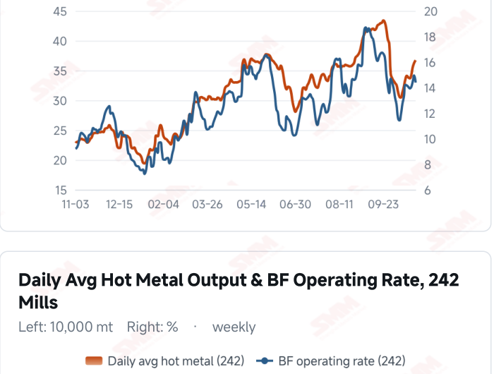
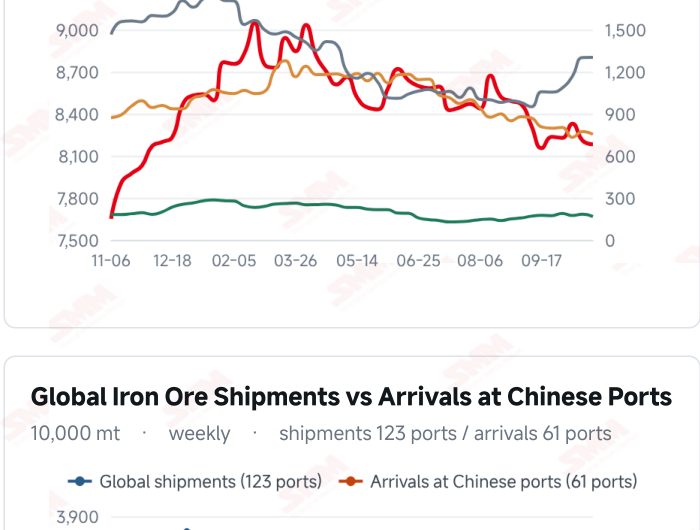
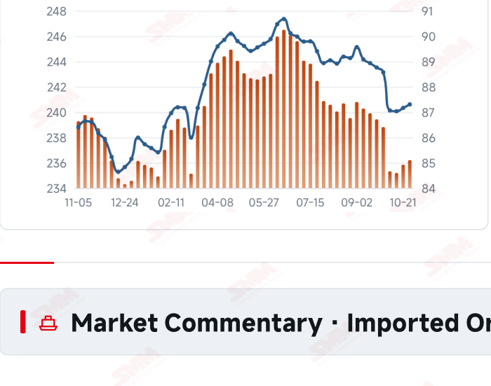
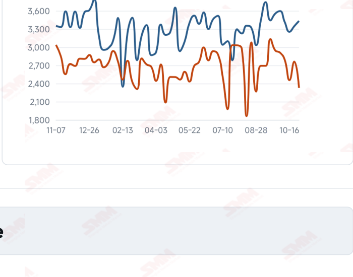

# SMM Iron Ore Daily — 2026-11-03 (Tuesday)

**Source:** SMM Data-pro · Shanghai Metals Market (SMM)

---

## Futures Contracts

| Exchange | Contract | Price | Unit | Daily Change | Daily Change % | MTD Avg |
|:---|:---|:---:|:---:|:---:|:---:|:---:|
| DCE | DCE Iron Ore Most-traded I2701 | 671.00 | yuan/mt | -3.5 | -0.52% | 672.80 |

## SMM Iron Ore Price Index (Physical & Benchmark Indices)

| Index Name | Market Type | Fe % | Price | Unit | Daily Change | Daily Change % | MTD Avg |
|:---|:---|:---:|:---:|:---:|:---:|:---:|:---:|
| MMi 61% Port Spot | port_spot | 61.0% | 651.00 | yuan/wmt | -2.0 | -0.31% | 652.00 |
| MMi 58% Port Spot | port_spot | 58.0% | 605.00 | yuan/wmt | 0.0 | 0.00% | 605.00 |
| MMi 65% Port Spot | port_spot | 65.0% | 813.00 | yuan/wmt | -2.0 | -0.25% | 814.00 |
| MMi 61% Seaborne Index | seaborne | 61.0% | 90.70 | USD/dmt | -0.2 | -0.22% | 90.80 |
| MMi 65% Seaborne Index | seaborne | 65.0% | 106.40 | USD/dmt | -0.5 | -0.47% | 106.65 |
| SMM Domestic Ore Composite Index | domestic_composite | 66.0% | 791.29 | yuan/mt | -6.15 | -0.77% | — |

## Key View

### Prices retreat after the month’s opening recovery; sustained trading remains key

The previous recovery did not persist, with domestic futures and spot prices retreating today. DCE most-traded closed at 671.0 yuan/mt, down 0.52%. The 61%, 58% and 65% port indices were 651, 605 and 813 yuan/wmt: the low-grade index held steady while the others eased. The seaborne 61% and 65% indices were USD 90.70 and 106.40/dmt, with all 12 brands lower, indicating fragile price support. Supply flows and baseline consumption offer some cushion. Latest Chinese arrivals fell sharply, ten-port stocks declined and hot metal previously rose modestly. These observations cover different periods and do not by themselves establish stronger demand today. Actual restocking still depends on orders, margins and mill stocks, with transactions needed to confirm the transmission from production to buying. The near-term test is whether price adjustments generate persistent collections. Needs-based buying could leave stocks and profitability constraining upside, while stronger orders alongside margin repair could improve support. Divergent C3 and C5 freight also calls for route-specific cost assessment. A cautious, range- bound view remains appropriate rather than extrapolating a single move into a trend reversal.

## Today's Highlights

- Domestic futures and spot prices retreated. DCE most-traded I2701 closed at 671.0 yuan/mt, down 3.5 yuan (-0.52%). Qingdao PB and Newman Fines were both 640 yuan/wmt, down 5 yuan; Mac Fines fell 2 yuan to 648 and Newman Lump fell 10 yuan to 810.
- Seaborne indices and brand quotations softened. The 61% index was USD 90.70/dmt, down 0.20 (-0.22%), and the 65% was 106.40, down 0.50 (-0.47%). All 12 brands declined against the Nov 2 report; PB Fines were 91.00, Newman Fines 90.15 and Mac Fines 89.85 USD/dmt.
- Port indices showed mixed performance. The 61%, 58% and 65% indices were 651, 605 and 813 yuan/wmt, changing by -2, 0 and -2 yuan. The 65%-58% spread narrowed from 210 to 208 yuan/wmt.
- Freight costs moved in different directions. Nov 2 C3 freight was USD 36.72/mt (+1.27%) and C5 was 14.38 (-3.75%). Route-specific changes should be assessed alongside contracts and settlement timing rather than equated directly with current trading margins.

## Qingdao Port Imported Ore Spot Prices (yuan/wet mt, tax incl.)

| Product | Fe % | Type | Price (yuan/wmt) | Daily Change | Daily Change % | MTD Avg |
|:---|:---:|:---:|:---:|:---:|:---:|:---:|
| PB Fines 60.8% | 60.8% | Fines | 640.0 | -5.0 | -0.78% | 642.0 |
| Newman Fines 61.2% | 61.2% | Fines | 640.0 | -5.0 | -0.78% | 642.0 |
| Mac Fines 60.8% | 60.8% | Fines | 648.0 | -2.0 | -0.31% | 649.0 |
| BRBF 62.5% | 62.5% | Fines | 688.0 | -5.0 | -0.72% | 690.0 |
| Newman Lump 63% | 63.0% | Lump | 810.0 | -10.0 | -1.22% | 815.0 |
| Super Special Fines (SSF) 56.5% | 56.5% | Fines | 502.0 | -5.0 | -0.99% | 504.0 |
| Carajas Fines (IOCJ) 65% | 65.0% | Fines | 812.0 | -5.0 | -0.61% | 814.0 |
| PB Lump 61.5% | 61.5% | Lump | 810.0 | -5.0 | -0.61% | 812.0 |

## Seaborne Brand Prices in USD (CFR Qingdao, USD/dry mt, as of 2026-11-03)

| Product | Price (USD/dmt) | Daily Change | Daily Change % | Previous |
|:---|:---:|:---:|:---:|:---:|
| Roy Hill Fines 62% | 87.15 | -0.35 | -0.40% | 87.50 |
| SIMEC Fines 61% | 88.00 | -0.5 | -0.56% | 88.50 |
| PB Fines 62% | 91.00 | -0.2 | -0.22% | 91.20 |
| Newman Fines 60.7% | 90.15 | -0.2 | -0.22% | 90.35 |
| Mac Fines 60.5% | 89.85 | -0.3 | -0.33% | 90.15 |
| Jimblebar Fines 60.30% | 86.95 | -0.4 | -0.46% | 87.35 |
| Carajas Fines (IOCJ) 65% | 106.70 | -0.5 | -0.47% | 107.20 |
| SSFT / SSFG 60% | 97.60 | -0.6 | -0.61% | 98.20 |
| Brazilian Blend Fines (BRBF) 64% | 97.30 | -0.45 | -0.46% | 97.75 |
| RTX Fines 61% | 87.15 | -0.2 | -0.23% | 87.35 |
| West Pilbara Fines (WPF) 60% | 89.55 | -0.45 | -0.50% | 90.00 |
| SP10 Fines 59%-60% | 79.35 | -0.7 | -0.87% | 80.05 |

## SMM Iron Ore Price Index — Weekly / Monthly Statistics

| Index Name | Month-to-date Avg | MoM % | YTD % | Unit |
|:---|:---:|:---:|:---:|:---:|
| SMM MMi 61% Iron Ore Seaborne Index | 90.80 | +0.62% | -14.4% | USD/dmt |
| SMM MMi 65% Iron Ore Seaborne Index | 106.65 | -1.56% | -12.3% | USD/dmt |
| SMM MMi 61% Iron Ore Port Spot Index | 652.00 | -0.73% | -19.9% | yuan/wmt |
| SMM MMi 65% Iron Ore Port Spot Index | 814.00 | -0.47% | -9.6% | yuan/wmt |
| SMM MMi 58% Iron Ore Port Spot Index | 605.00 | -1.51% | -15.7% | yuan/wmt |

## Key Price Drivers (12-Month Charts & Operational Metrics)

### Charts: Freight & Port Inventory

### Charts: Hot Metal Output & Shipments vs Arrivals

### Operational Fundamentals Snapshot

| Fundamental Indicator | Value | Unit |
|:---|:---:|:---:|
| C3 Freight (Brazil to China) | 36.72 | USD/mt |
| C5 Freight (Australia to China) | 14.38 | USD/mt |
| Blast Furnace Operating Rate (242 Mills) | 87.3 | % |
| Iron Ore Port Inventory (10 Major Ports) | 104.0353 | Million MT |
| Global Iron Ore Shipments (Weekly) | 34.3119 | Million MT |

## Market Commentary · Imported Ore

### Futures & Spot

DCE most-traded I2701 closed at 671.0 yuan/mt, down 0.52% from Nov 2. Qingdao PB Fines were 640, Newman Fines 640, BRBF 688, SSF 502, Carajas Fines 812 and PB Lump 810 yuan/wmt, each down 5 yuan; Mac Fines were 648 (-2) and Newman Lump 810 (-10). SGX official near-month FEFX26 (November 2026) was last priced at USD 90.85/dmt, timestamped Nov 3, 17:49:40 (UTC+8). SMM’s daily review reported needs- based mill buying and moderate overall transactions.

### Driver

Futures and most spot quotations pulled back after the month’s opening recovery, leaving the rebound dependent on persistent transactions. The seaborne 65% index fell more than the 61%, narrowing their spread from USD 16.00 to 15.70/dmt. Resource composition and buying schedules may influence relative pricing, but one session is insufficient to establish a lasting change in demand preferences.

### Demand

The latest 242-mill survey showed daily hot metal output of 2.3621 million mt on Oct 28, up 3,700 mt, with a blast furnace operating rate of 87.30%. Whether stronger baseline consumption generates discretionary restocking depends on mill stocks, finished-steel orders and margins. Environmental restrictions and maintenance may affect subsequent production, leaving actual transactions important to assessing buying intensity. SMM’s Nov 3 review cited projected blast furnace maintenance losses of 1.6983 million mt for Oct 31– Nov 6, down 57,900 mt from the preceding week. This is a whole-week maintenance estimate, not daily hot metal or realised additional output.

### Inventory & Supply

Global shipments were 34.3119 million mt in the week to Oct 30, up 2.58% WoW, while arrivals in China fell 15.73% to 23.2663 million mt. The latest ten-port inventory was 104.0353 million mt on Oct 29, down 618,100 mt from Oct 22. Lower arrivals ease near-term incoming pressure, but stock absorption also depends on unloading and mill collections rather than one flow measure establishing broad supply tightness.

### Cost & Margin

Nov 2 freight was USD 36.72/mt for C3, up 0.46 (+1.27%), and 14.38 for C5, down 0.56 (-3.75%). Lower port selling prices may squeeze some trading returns while transport costs diverge across routes. Contracts, exchange rates and settlement periods determine actual margins; import trading profitability should not be equated with steelmaking or coking earnings. SMM’s assessment published on the morning of Nov 3 put the period’s average import margin at 2.19 yuan/mt, up 2.15 yuan from 0.04; this import trading measure should not be treated as post-close mill profitability for the current session.

## Market Commentary · Domestic Ore

### Prices

The latest Domestic Ore Composite Price Index was 791.29 yuan/mt on Oct 30. SMM’s Nov 2 Shandong brief quoted 64% basic concentrate at 754 yuan/mt, down 3 yuan, on a dry-basis, pre-tax ex-mine quotation payable by acceptance bill. Grade and pricing terms distinguish this regional quotation from the national index.

### Supply & Demand

SMM described mostly normal mine operations and good sales in Shandong, improved relative value for domestic concentrates and comparatively active mill purchases. These regional observations do not establish a nationwide demand recovery; resources, contracts and actual collections should be tracked separately.

### Outlook

SMM expects Shandong concentrate prices to remain range-bound near term. Persistent regional buying improvement could support prices, while continued pressure on mill margins could limit upside.

## Market Factors

### Supportive Factors

- Latest arrivals in China fell 15.73% WoW.
- The latest hot metal reading increased 3,700 mt WoW.
- Latest ten-port stocks fell 618,100 mt from the preceding survey.
- Lower C5 freight reduced transport costs for some cargoes.

### Bearish Factors

- DCE fell 0.52% and all eight port products declined.
- Both seaborne indices and all 12 brand quotations weakened.
- Sustained restocking remains constrained by orders, margins and stock management.
- Higher C3 freight may increase costs on some routes.

## Flash News Briefs

- [SMM Iron Ore] Iron ore futures, spot ease as maintenance cut offers limited support (2026-11-03)
- [SMM Coking Coal and Coke Daily Brief] 20261103 (2026-11-03)
- [ArcelorMittal Advances Liberia Iron Ore Expansion with Country's First Concentrator] (2026-11-03)
- [SMM Steel] Vietnam HRC Import Prices Edge Higher as Domestic Offers Exceed Indonesian Cargoes (2026-11-03)
- [SMM Steel] India Domestic Steel Prices Soften on Weak Demand (2026-11-03)
- [SMM Steel] Indian Steel Prices Hold Steady Amid Slow Export Buying (2026-11-03)

---
*(c) 2026 Shanghai Metals Market (SMM) · Iron Ore Value-Chain Data & Research*
