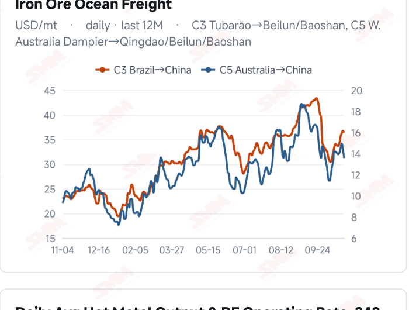
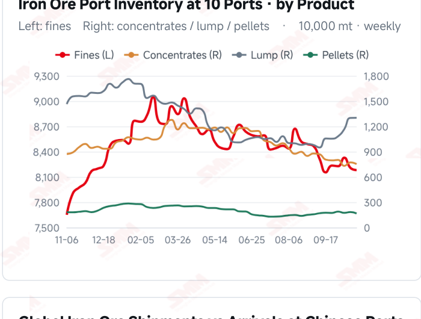
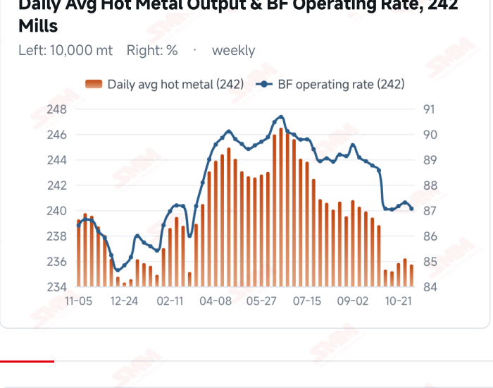
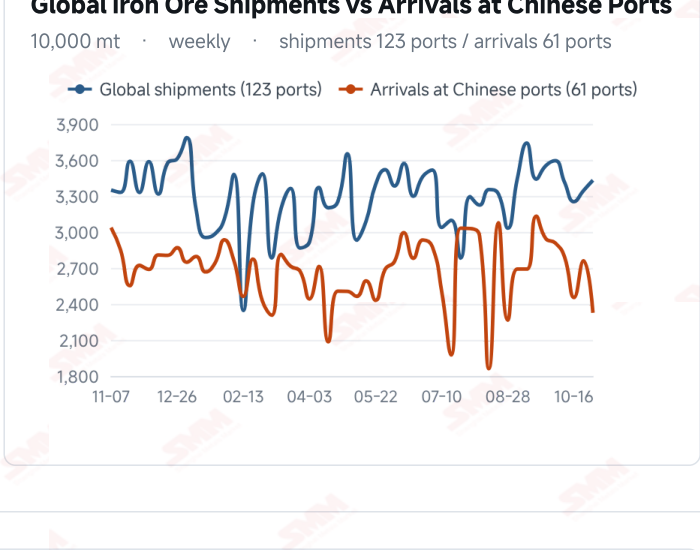

# SMM Iron Ore Daily — 2026-11-04 (Wednesday)

**Source:** SMM Data-pro · Shanghai Metals Market (SMM)

---

## Futures Contracts

| Exchange | Contract | Price | Unit | Daily Change | Daily Change % | MTD Avg |
|:---|:---|:---:|:---:|:---:|:---:|:---:|
| DCE | DCE Iron Ore Most-traded I2701 | 682.00 | yuan/mt | +11.0 | +1.64% | 675.80 |

## SMM Iron Ore Price Index (Physical & Benchmark Indices)

| Index Name | Market Type | Fe % | Price | Unit | Daily Change | Daily Change % | MTD Avg |
|:---|:---|:---:|:---:|:---:|:---:|:---:|:---:|
| MMi 61% Port Spot | port_spot | 61.0% | 656.00 | yuan/wmt | +5.0 | +0.77% | 653.00 |
| MMi 58% Port Spot | port_spot | 58.0% | 607.00 | yuan/wmt | +2.0 | +0.33% | 606.00 |
| MMi 65% Port Spot | port_spot | 65.0% | 818.00 | yuan/wmt | +5.0 | +0.62% | 815.00 |
| MMi 61% Seaborne Index | seaborne | 61.0% | 91.10 | USD/dmt | +0.4 | +0.44% | 90.90 |
| MMi 65% Seaborne Index | seaborne | 65.0% | 106.75 | USD/dmt | +0.35 | +0.33% | 106.68 |
| SMM Domestic Ore Composite Index | domestic_composite | 66.0% | 791.29 | yuan/mt | -6.15 | -0.77% | — |

## Key View

### Prices recover as hot metal eases; sustained transactions will determine the rebound’s footing

Futures, port and seaborne prices recovered together today while production eased. DCE most-traded closed at 682.0 yuan/mt, up 1.64%, and the 61%, 58% and 65% port indices rose to 656, 607 and 818 yuan/wmt. The seaborne indices reached USD 91.10/dmt for the 61% and 106.75 for the 65%, with all 12 brands higher. Price direction was aligned, suggesting better short-term support, but one rebound does not establish a stronger demand trend. Surveyed daily hot metal output was 2.3573 million mt on Nov 4, down 4,800 mt, and the blast furnace operating rate fell to 87.06%. Softer baseline consumption alongside firmer prices highlights the different timing of production, procurement and pricing. Lower latest arrivals, reduced ten-port stocks and softer freight offer some cushion, with their subsequent effects still dependent on collections and transactions. The near-term focus is whether the rebound attracts persistent restocking. Better orders and margins could strengthen downside support; needs-based buying could leave lower production and subsequent supply constraining upside. A cautious, range-bound view remains appropriate, assessing transactions, hot metal and inventories together rather than treating a futures gain alone as a trend reversal.

## Today's Highlights

- Futures and port spot prices recovered. DCE most-traded I2701 closed at 682.0 yuan/mt, up 11.0 yuan (+1.64%) from Nov 3. Qingdao PB and Newman Fines were both 650 yuan/wmt and Mac Fines were 658, each up 10 yuan; PB Lump rose 5 yuan to 815.
- All five MMi indices and seaborne brands rose. The 61% seaborne index was USD 91.10/dmt, up 0.40 (+0.44%), and the 65% was 106.75, up 0.35 (+0.33%). All 12 brands increased against the Nov 3 report; PB Fines were 91.40, Newman Fines 90.55 and Mac Fines 90.20 USD/dmt.
- The port high-low grade spread widened. The 61%, 58% and 65% port indices were 656, 607 and 818 yuan/wmt, up 5, 2 and 5 yuan. The 65%-58% spread widened from 208 to 211 yuan/wmt, while the seaborne 65%-61% spread narrowed from USD 15.70 to 15.65/dmt.
- Hot metal declined WoW, leaving the price recovery dependent on demand support. Surveyed daily output was 2.3573 million mt on Nov 4, down 4,800 mt (-0.20%) from Oct 28; the blast furnace operating rate fell 0.24 percentage point to 87.06%. Prices and production did not move together, keeping purchasing persistence in focus.

## Qingdao Port Imported Ore Spot Prices (yuan/wet mt, tax incl.)

| Product | Fe % | Type | Price (yuan/wmt) | Daily Change | Daily Change % | MTD Avg |
|:---|:---:|:---:|:---:|:---:|:---:|:---:|
| PB Fines 60.8% | 60.8% | Fines | 650.0 | +10.0 | +1.56% | 645.0 |
| Newman Fines 61.2% | 61.2% | Fines | 650.0 | +10.0 | +1.56% | 645.0 |
| Mac Fines 60.8% | 60.8% | Fines | 658.0 | +10.0 | +1.54% | 652.0 |
| BRBF 62.5% | 62.5% | Fines | 698.0 | +10.0 | +1.45% | 693.0 |
| Newman Lump 63% | 63.0% | Lump | 820.0 | +10.0 | +1.23% | 817.0 |
| Super Special Fines (SSF) 56.5% | 56.5% | Fines | 512.0 | +10.0 | +1.99% | 507.0 |
| Carajas Fines (IOCJ) 65% | 65.0% | Fines | 822.0 | +10.0 | +1.23% | 817.0 |
| PB Lump 61.5% | 61.5% | Lump | 815.0 | +5.0 | +0.62% | 813.0 |

## Seaborne Brand Prices in USD (CFR Qingdao, USD/dry mt, as of 2026-11-04)

| Product | Price (USD/dmt) | Daily Change | Daily Change % | Previous |
|:---|:---:|:---:|:---:|:---:|
| Roy Hill Fines 62% | 87.55 | +0.4 | +0.46% | 87.15 |
| SIMEC Fines 61% | 88.40 | +0.4 | +0.45% | 88.00 |
| PB Fines 62% | 91.40 | +0.4 | +0.44% | 91.00 |
| Newman Fines 60.7% | 90.55 | +0.4 | +0.44% | 90.15 |
| Mac Fines 60.5% | 90.20 | +0.35 | +0.39% | 89.85 |
| Jimblebar Fines 60.30% | 87.35 | +0.4 | +0.46% | 86.95 |
| Carajas Fines (IOCJ) 65% | 107.10 | +0.4 | +0.37% | 106.70 |
| SSFT / SSFG 60% | 98.00 | +0.4 | +0.41% | 97.60 |
| Brazilian Blend Fines (BRBF) 64% | 97.70 | +0.4 | +0.41% | 97.30 |
| RTX Fines 61% | 87.55 | +0.4 | +0.46% | 87.15 |
| West Pilbara Fines (WPF) 60% | 89.90 | +0.35 | +0.39% | 89.55 |
| SP10 Fines 59%-60% | 79.75 | +0.4 | +0.50% | 79.35 |

## SMM Iron Ore Price Index — Weekly / Monthly Statistics

| Index Name | Month-to-date Avg | MoM % | YTD % | Unit |
|:---|:---:|:---:|:---:|:---:|
| SMM MMi 61% Iron Ore Seaborne Index | 90.90 | +0.73% | -14.0% | USD/dmt |
| SMM MMi 65% Iron Ore Seaborne Index | 106.68 | -1.53% | -12.0% | USD/dmt |
| SMM MMi 61% Iron Ore Port Spot Index | 653.00 | -0.53% | -19.3% | yuan/wmt |
| SMM MMi 65% Iron Ore Port Spot Index | 815.00 | -0.30% | -9.0% | yuan/wmt |
| SMM MMi 58% Iron Ore Port Spot Index | 606.00 | -1.40% | -15.5% | yuan/wmt |

## Key Price Drivers (12-Month Charts & Operational Metrics)

### Charts: Freight & Port Inventory

### Charts: Hot Metal Output & Shipments vs Arrivals

### Operational Fundamentals Snapshot

| Fundamental Indicator | Value | Unit |
|:---|:---:|:---:|
| C3 Freight (Brazil to China) | 36.38 | USD/mt |
| C5 Freight (Australia to China) | 13.57 | USD/mt |
| Daily Avg Hot Metal Output (242 Mills) | 2.3573 | Million MT |
| Iron Ore Port Inventory (10 Major Ports) | 104.0353 | Million MT |
| Global Iron Ore Shipments (Weekly) | 34.3119 | Million MT |

## Market Commentary · Imported Ore

### Futures & Spot

DCE most-traded I2701 closed at 682.0 yuan/mt, up 1.64% from the previous session. Qingdao PB Fines were 650, Newman Fines 650, Mac Fines 658, BRBF 698, Newman Lump 820, SSF 512 and Carajas Fines 822 yuan/wmt, each up 10 yuan; PB Lump rose 5 yuan to 815. SGX official near-month FEFX26 (November 2026) was last priced at USD 92.00/dmt, timestamped Nov 4, 17:25:06 (UTC+8). SMM’s daily review described normal trader selling, limited mill buying appetite and moderate spot transactions.

### Driver

Futures, port and seaborne quotations recovered together, with relatively aligned short-term price performance. The port high-low spread widened while the seaborne grade spread narrowed slightly, reflecting different resource baskets and purchasing schedules. Firmer prices may encourage offers, but a durable recovery still requires orders, mill margins and physical transactions rather than one broad advance establishing stronger aggregate demand.

### Demand

SMM’s 242-mill survey showed daily hot metal output of 2.3573 million mt on Nov 4, down 4,800 mt from 2.3621 million mt on Oct 28. The blast furnace operating rate fell from 87.30% to 87.06%. Output eased after two modest increases, keeping marginal changes in baseline consumption in focus. Restocking depends on mill stocks, profitability and end-user orders; production and prices should not be linked through an unverified one- way causal claim.

### Inventory & Supply

Global shipments were 34.3119 million mt in the week to Oct 30, up 2.58% WoW, while arrivals in China fell 15.73% to 23.2663 million mt. Latest ten-port stocks were 104.0353 million mt on Oct 29, down 618,100 mt from Oct 22. Lower arrivals may ease near-term inflows, but subsequent inventories also depend on unloading, mill collections and the transmission of shipments rather than a single flow defining the balance.

### Cost & Margin

Nov 3 freight was USD 36.38/mt for C3, down 0.93% from the previous reading, and 13.57 for C5, down 5.63%. Lower freight may ease transport costs for some cargoes, while higher port prices support receipts. Actual margins still depend on procurement contracts, exchange rates and settlement timing; import trading and steelmaking profitability should be assessed separately. SMM’s assessment published on the morning of Nov 4 put the period’s average import margin at -3.09 yuan/mt, compared with +2.19 previously. This import trading measure is not a post-close margin for the current session and is distinct from steelmaking and coking profitability. Further coke price cuts remain an expectation, not realised cost relief.

## Market Commentary · Domestic Ore

### Prices

The latest Domestic Ore Composite Price Index was 791.29 yuan/mt on Oct 30. SMM’s Nov 3 Tangshan brief quoted 66% concentrate at 890–895 yuan/mt on a dry-basis, tax-inclusive delivered-to-mill basis, distinct from the national index in region, grade and delivery terms.

### Supply & Demand

Previously suspended operations showed no clear restart progress, keeping Tangshan concentrate resources tight. Mill losses and pressure on bids sustained bargaining between buyers and sellers. The latest decline in surveyed hot metal constrains baseline consumption, but regional demand also depends on orders, contracts and collections.

### Outlook

SMM’s earlier Tangshan brief expected range-bound prices in the short term. Persistent resource constraints alongside recovering purchases could support some offers, while weak profitability and orders could limit upside.

## Market Factors

### Supportive Factors

- DCE, all five MMi indices and all 12 seaborne brands recovered together.
- Most port products gained 10 yuan/wmt.
- Latest arrivals in China fell 15.73% and ten-port stocks edged lower.
- Lower C3 and C5 freight cushioned costs for some cargoes.

### Bearish Factors

- Surveyed daily hot metal output fell 4,800 mt WoW.
- Mill buying remains constrained by margins, orders and raw-material stocks.
- Latest global shipments increased, keeping subsequent arrivals in focus.
- A broad one-day price rise is insufficient to confirm a demand trend reversal.

## Flash News Briefs

- [SMM Iron Ore] Coke price cut expectations ease bearish pressure on iron ore (2026-11-04)
- [SMM Coking Coal and Coke Daily Briefing] 20261104 (2026-11-04)
- [SMM Steel] India Steel Prices Largely Flat Ahead of Diwali (2026-11-04)
- [SMM Steel] Turkish Billet: Domestic Prices Bounce on Rebar Restocking, Low-Priced Imports Squeeze Premium (2026-11-04)
- [SMM Steel] Indian HRC Domestic Prices Edge Higher While Export Trading Remains Subdued (2026-11-04)
- [SSAB Americas Q3 2026 shipments fall QoQ to 446,000 mt on planned maintenance outage] (2026-11-04)

---
*(c) 2026 Shanghai Metals Market (SMM) · Iron Ore Value-Chain Data & Research*
