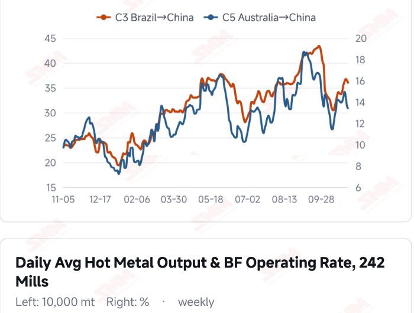
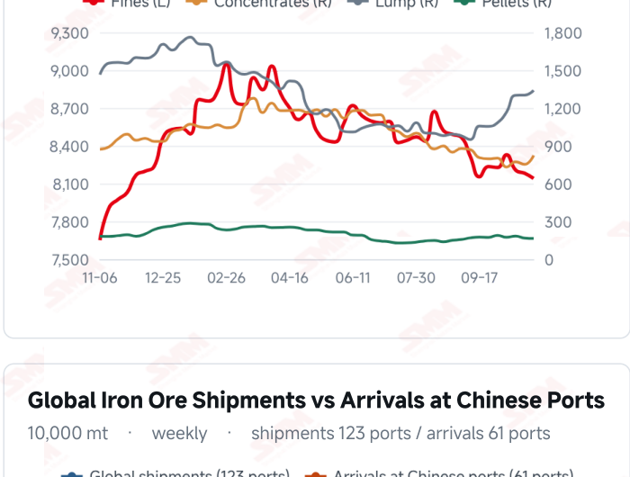
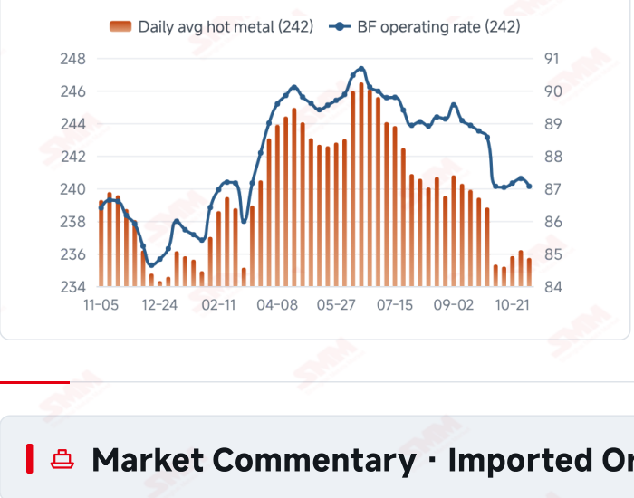
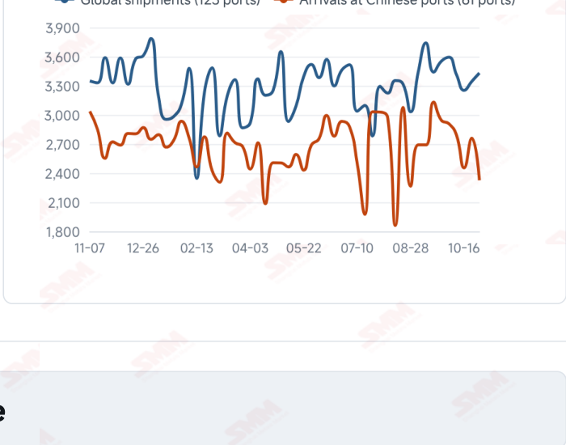

# SMM Iron Ore Daily — 2026-11-05 (Thursday)

**Source:** SMM Data-pro · Shanghai Metals Market (SMM)

---

## Futures Contracts

| Exchange | Contract | Price | Unit | Daily Change | Daily Change % | MTD Avg |
|:---|:---|:---:|:---:|:---:|:---:|:---:|
| DCE | DCE Iron Ore Most-traded I2701 | 691.00 | yuan/mt | +9.0 | +1.32% | 679.60 |

## SMM Iron Ore Price Index (Physical & Benchmark Indices)

| Index Name | Market Type | Fe % | Price | Unit | Daily Change | Daily Change % | MTD Avg |
|:---|:---|:---:|:---:|:---:|:---:|:---:|:---:|
| MMi 61% Port Spot | port_spot | 61.0% | 658.00 | yuan/wmt | +2.0 | +0.30% | 654.00 |
| MMi 58% Port Spot | port_spot | 58.0% | 609.00 | yuan/wmt | +2.0 | +0.33% | 606.00 |
| MMi 65% Port Spot | port_spot | 65.0% | 820.00 | yuan/wmt | +2.0 | +0.24% | 816.00 |
| MMi 61% Seaborne Index | seaborne | 61.0% | 91.75 | USD/dmt | +0.65 | +0.71% | 91.11 |
| MMi 65% Seaborne Index | seaborne | 65.0% | 107.70 | USD/dmt | +0.95 | +0.89% | 106.94 |
| SMM Domestic Ore Composite Index | domestic_composite | 66.0% | 743.46 | yuan/mt | 0.0 | 0.00% | 743.46 |

## Key View

### Prices extend their recovery as port stocks rise; sustained trading remains the test

The price recovery continued today across futures, port indices and seaborne quotations. DCE most- traded closed at 691.0 yuan/mt, up 1.32%; the 61%, 58% and 65% port indices rose to 658, 609 and 820 yuan/wmt. The seaborne indices reached USD 91.75/dmt for the 61% and 107.70 for the 65%, with all 12 brands higher, indicating improved short-term pricing sentiment. However, prices and physical balances are not fully aligned. Latest surveyed hot metal fell 4,800 mt WoW, while ten-port stocks increased 643,600 mt, led by concentrates and lump as fines and pellets declined. The mix may reflect both supply and collection schedules rather than a simple strengthening or weakening of demand for one product. The near-term test is whether trading and buying continue to follow. Lower freight and arrivals offer some cushion, but mill orders, margins and stocks determine restocking intensity. Persistent transactions alongside firmer prices would strengthen support; a recovery confined to quotations could leave inventory and demand constraints limiting upside. A cautious, range-bound view remains appropriate rather than equating two sessions of gains with a trend reversal.

## Today's Highlights

- Futures and spot prices extended their recovery. DCE most-traded I2701 closed at 691.0 yuan/mt, up 9.0 yuan (+1.32%) from Nov 4. Qingdao PB and Newman Fines were both 656 yuan/wmt and Mac Fines were 664, each up 6 yuan; Carajas Fines rose 4 yuan to 826.
- All five MMi indices and seaborne brands rose together. The 61% index was USD 91.75/dmt, up 0.65 (+0.71%), and the 65% was 107.70, up 0.95 (+0.89%). All 12 brands increased against the Nov 4 report; PB Fines were 92.05, Newman Fines 91.20 and Mac Fines 90.90 USD/dmt.
- Each port index gained 2 yuan. The 61%, 58% and 65% indices were 658, 609 and 820 yuan/wmt. The 65%-58% spread held at 211 yuan/wmt, while the seaborne 65%-61% spread widened from USD 15.65 to 15.95/dmt.
- Ten-port stocks increased with a mixed product profile. Inventory reached 104.6789 million mt on Nov 5, up 643,600 mt (+0.62%) from Oct 29. Concentrates and lump rose 705,000 and 382,900 mt, while fines and pellets fell 413,500 and 30,800 mt.

## Qingdao Port Imported Ore Spot Prices (yuan/wet mt, tax incl.)

| Product | Fe % | Type | Price (yuan/wmt) | Daily Change | Daily Change % | MTD Avg |
|:---|:---:|:---:|:---:|:---:|:---:|:---:|
| PB Fines 60.8% | 60.8% | Fines | 656.0 | +6.0 | +0.92% | 648.0 |
| Newman Fines 61.2% | 61.2% | Fines | 656.0 | +6.0 | +0.92% | 648.0 |
| Mac Fines 60.8% | 60.8% | Fines | 664.0 | +6.0 | +0.91% | 655.0 |
| BRBF 62.5% | 62.5% | Fines | 704.0 | +6.0 | +0.86% | 696.0 |
| Newman Lump 63% | 63.0% | Lump | 826.0 | +6.0 | +0.73% | 819.0 |
| Super Special Fines (SSF) 56.5% | 56.5% | Fines | 518.0 | +6.0 | +1.17% | 510.0 |
| Carajas Fines (IOCJ) 65% | 65.0% | Fines | 826.0 | +4.0 | +0.49% | 819.0 |
| PB Lump 61.5% | 61.5% | Lump | 821.0 | +6.0 | +0.74% | 815.0 |

## Seaborne Brand Prices in USD (CFR Qingdao, USD/dry mt, as of 2026-11-05)

| Product | Price (USD/dmt) | Daily Change | Daily Change % | Previous |
|:---|:---:|:---:|:---:|:---:|
| Roy Hill Fines 62% | 88.20 | +0.65 | +0.74% | 87.55 |
| SIMEC Fines 61% | 89.05 | +0.65 | +0.74% | 88.40 |
| PB Fines 62% | 92.05 | +0.65 | +0.71% | 91.40 |
| Newman Fines 60.7% | 91.20 | +0.65 | +0.72% | 90.55 |
| Mac Fines 60.5% | 90.90 | +0.7 | +0.78% | 90.20 |
| Jimblebar Fines 60.30% | 88.00 | +0.65 | +0.74% | 87.35 |
| Carajas Fines (IOCJ) 65% | 107.75 | +0.65 | +0.61% | 107.10 |
| SSFT / SSFG 60% | 98.65 | +0.65 | +0.66% | 98.00 |
| Brazilian Blend Fines (BRBF) 64% | 98.35 | +0.65 | +0.67% | 97.70 |
| RTX Fines 61% | 88.20 | +0.65 | +0.74% | 87.55 |
| West Pilbara Fines (WPF) 60% | 90.60 | +0.7 | +0.78% | 89.90 |
| SP10 Fines 59%-60% | 80.40 | +0.65 | +0.82% | 79.75 |

## SMM Iron Ore Price Index — Weekly / Monthly Statistics

| Index Name | Month-to-date Avg | MoM % | YTD % | Unit |
|:---|:---:|:---:|:---:|:---:|
| SMM MMi 61% Iron Ore Seaborne Index | 91.11 | +0.96% | -13.4% | USD/dmt |
| SMM MMi 65% Iron Ore Seaborne Index | 106.94 | -1.29% | -11.2% | USD/dmt |
| SMM MMi 61% Iron Ore Port Spot Index | 654.00 | -0.35% | -19.1% | yuan/wmt |
| SMM MMi 65% Iron Ore Port Spot Index | 816.00 | -0.16% | -8.8% | yuan/wmt |
| SMM MMi 58% Iron Ore Port Spot Index | 606.00 | -1.27% | -15.2% | yuan/wmt |
| SMM China Domestic Ore Composite Price Index | 743.46 | -7.70% | -16.1% | yuan/mt |

## Key Price Drivers (12-Month Charts & Operational Metrics)

### Charts: Freight & Port Inventory

### Charts: Hot Metal Output & Shipments vs Arrivals

### Operational Fundamentals Snapshot

| Fundamental Indicator | Value | Unit |
|:---|:---:|:---:|
| C3 Freight (Brazil to China) | 35.84 | USD/mt |
| C5 Freight (Australia to China) | 13.35 | USD/mt |
| Blast Furnace Operating Rate (242 Mills) | 87.06 | % |
| Iron Ore Port Inventory (10 Major Ports) | 104.6789 | Million MT |

## Market Commentary · Imported Ore

### Futures & Spot

DCE most-traded I2701 closed at 691.0 yuan/mt, up 1.32% from the previous session. Qingdao PB Fines were 656, Newman Fines 656, Mac Fines 664, BRBF 704, Newman Lump 826, SSF 518 and PB Lump 821 yuan/wmt, each up 6 yuan; Carajas Fines rose 4 yuan to 826. SGX official near-month FEFX26 (November 2026) was last priced at USD 93.40/dmt, timestamped Nov 5, 17:50:53 (UTC+8). SMM’s daily review described normal trader selling, limited and cautious mill enquiries, and reasonable overall spot trading.

### Driver

Futures and spot prices rose for a second session, accompanied by gains in seaborne indices and brand quotations. The seaborne 65% index rose more than the 61%, widening their spread to USD 15.95/dmt, while the port high-low spread held steady. Resource availability and buying schedules remain relevant to this pattern; a one-day spread change does not establish a structural shift in blending demand.

### Demand

The latest 242-mill survey showed daily hot metal output of 2.3573 million mt on Nov 4, down 4,800 mt from Oct 28, and a blast furnace operating rate of 87.06%, down 0.24 percentage point. Firmer prices alongside softer production highlight differences in the timing of quotation adjustments and physical consumption. Needs-based buying leaves the rebound dependent on orders and margin repair; persistent restocking would offer stronger support.

### Inventory & Supply

Ten-port stocks were 104.6789 million mt on Nov 5, up 643,600 mt from Oct 29. Fines were 81.4047 million mt (-413,500 mt), concentrates 8.2354 million mt (+705,000 mt), lump 13.3981 million mt (+382,900 mt) and pellets 1.6407 million mt (-30,800 mt). A total build alongside product divergence may reflect both arrival composition and mill collections. Latest global shipments and Chinese arrivals, for the week to Oct 30, were 34.3119 and 23.2663 million mt, changing +2.58% and -15.73% WoW.

### Cost & Margin

Nov 4 freight was USD 35.84/mt for C3, down 1.48% from the previous reading, and 13.35 for C5, down 1.62%. Lower freight may ease some transport costs and higher port selling prices support receipts, but seaborne purchase prices also rose. Contracts, exchange rates and settlement timing determine actual margins; better import trading returns do not establish that steelmaking has become profitable. SMM’s coke briefing described losses and voluntary cuts offset by restarts at some previously restricted plants, with no clear contraction in aggregate supply. A third-round price cut remained an expectation rather than realised cost relief.

## Market Commentary · Domestic Ore

### Prices

The Domestic Ore Composite Price Index held at 743.46 yuan/mt on Nov 5, unchanged from Nov 4. SMM’s west Liaoning brief quoted 66% concentrates at 670–675 yuan/mt on a wet-basis, tax-exclusive ex-works basis, distinct from the national composite in region and pricing terms.

### Supply & Demand

SMM reported some mining and beneficiation operations still suspended and others preparing to restart; preparations do not mean additional output has already materialised. Mill losses remained significant and buyers sought lower raw-material purchase prices, leaving supply constraints alongside pressure on bids.

### Outlook

SMM expects stronger futures could help west Liaoning concentrates edge higher in the near term, but transactions still need to support that view. Limited improvement in mill orders and margins could restrain the recovery.

## Market Factors

### Supportive Factors

- DCE and all five MMi indices increased together.
- All 12 seaborne brands rose, extending the quotation recovery.
- C3 and C5 freight eased slightly.
- Latest arrivals in China fell 15.73% WoW, easing incoming pressure.

### Bearish Factors

- Latest surveyed daily hot metal output fell 4,800 mt.
- Ten-port stocks increased 643,600 mt.
- Orders, profitability and stock management still constrain restocking intensity.
- Consecutive price gains require sustained transaction support.

## Flash News Briefs

- [SMM Iron Ore] Short-covering lifts iron ore; prices likely to stay slightly firm (2026-11-05)
- [Domestic Iron Ore Brief] Iron ore concentrate prices in west Liaoning may edge up slightly (2026-11-05)
- [SMM Coking Coal and Coke Daily Briefing] 20261105 (2026-11-05)
- [SMM Steel] Vietnam HRC Import Prices Hold Steady Amid Persistent Bid-Offer Gap (2026-11-05)
- [SMM Steel] Indonesian Wire Rod Flat at USD 500/mt FOB as Local Demand Cools and Chinese Prices Hold (2026-11-05)
- [SMM Steel] EU HRC: Mills Push Higher Offers to Test Market, Flat Fundamentals Keep Trade Stagnant (2026-11-05)

---
*(c) 2026 Shanghai Metals Market (SMM) · Iron Ore Value-Chain Data & Research*
