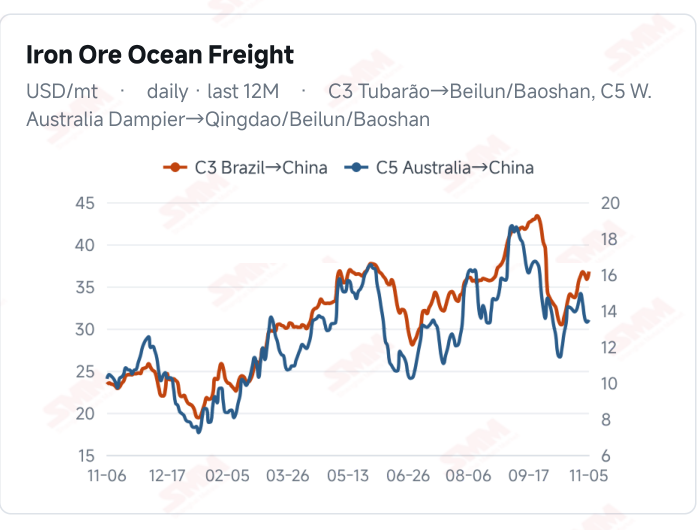
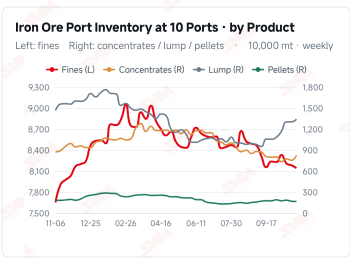
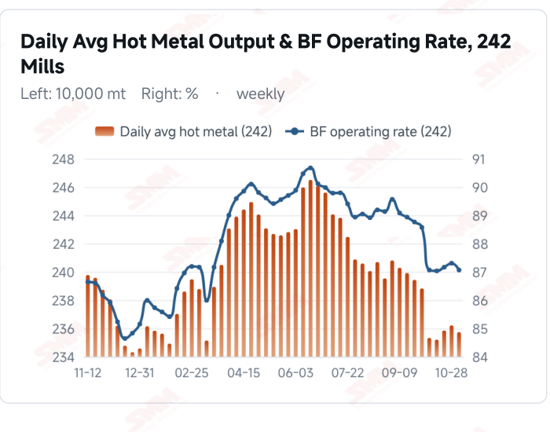
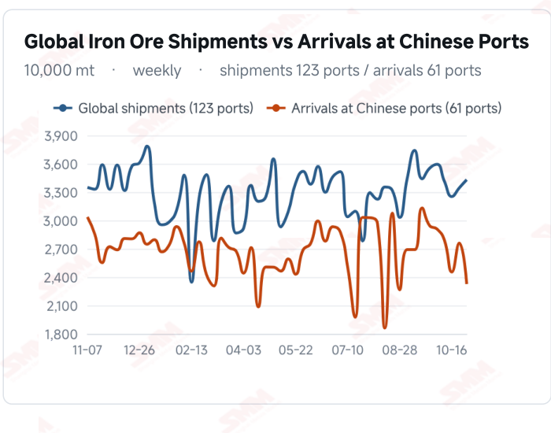

# SMM Iron Ore Daily — 2026-11-06 (Friday)

**Source:** SMM Data-pro · Shanghai Metals Market (SMM)

---

## Futures Contracts

| Exchange | Contract | Price | Unit | Daily Change | Daily Change % | MTD Avg |
|:---|:---|:---:|:---:|:---:|:---:|:---:|
| DCE | DCE Iron Ore Most-traded I2701 | 687.50 | yuan/mt | -3.5 | -0.51% | 681.20 |

## SMM Iron Ore Price Index (Physical & Benchmark Indices)

| Index Name | Market Type | Fe % | Price | Unit | Daily Change | Daily Change % | MTD Avg |
|:---|:---|:---:|:---:|:---:|:---:|:---:|:---:|
| MMi 61% Port Spot | port_spot | 61.0% | 656.00 | yuan/wmt | -2.0 | -0.30% | 655.00 |
| MMi 58% Port Spot | port_spot | 58.0% | 609.00 | yuan/wmt | 0.0 | 0.00% | 607.00 |
| MMi 65% Port Spot | port_spot | 65.0% | 818.00 | yuan/wmt | -2.0 | -0.24% | 817.00 |
| MMi 61% Seaborne Index | seaborne | 61.0% | 91.95 | USD/dmt | +0.2 | +0.22% | 91.28 |
| MMi 65% Seaborne Index | seaborne | 65.0% | 107.95 | USD/dmt | +0.25 | +0.23% | 107.14 |
| SMM Domestic Ore Composite Index | domestic_composite | 66.0% | 792.84 | yuan/mt | +1.63 | +0.21% | 791.54 |

## Key View

### Port spot prices fall while seaborne quotes edge up; trading and stock absorption remain key

Iron ore prices diverged across domestic and seaborne markets today. DCE most-traded closed at 687.5 yuan/mt, down 0.51%. The 61% and 65% port indices each lost 2 yuan, the 58% held steady, and all eight spot products declined. The seaborne 61% and 65% composite indices rose to USD 91.95 and 107.95/dmt, while all 12 brands gained USD 0.20/dmt against the previous report. Gains in one market alone do not establish broad strength across the chain. Physical balances remain central to assessing sustainability. Latest surveyed hot metal fell 4,800 mt WoW, while ten-port stocks increased 643,600 mt, with concentrates and lump building as fines and pellets declined. Latest shipment and arrival data cover the week to Oct 30. Lower arrivals may ease incoming pressure for that period, but do not establish that current port stocks are already falling. A cautious, range-bound near-term view remains appropriate. Small gains in seaborne quotations and the domestic ore index offer some price support, while port weakness, inventory accumulation and softer hot metal constrain demand expectations. Better mill margins accompanied by sustained buying could strengthen support; predominantly needs-based purchasing could leave prices fluctuating with trading, stocks and resource composition.

## Today's Highlights

- Futures eased and port spot prices fell. DCE most-traded I2701 closed at 687.5 yuan/mt, down 3.5 yuan (-0.51%) from Nov 5. Qingdao PB and Newman Fines were both 653 yuan/wmt, each down 3 yuan; Mac Fines fell 6 yuan to 658, while Newman Lump and PB Lump each lost 8 yuan.
- Seaborne quotations edged higher. The 61% index was USD 91.95/dmt, up 0.20 (+0.22%), and the 65% index was 107.95, up 0.25 (+0.23%). All 12 brands rose USD 0.20/dmt against the Nov 5 report; PB Fines were 92.25, Newman Fines 91.40 and Mac Fines 91.10.
- The low-grade port index held steady as grade spreads narrowed. The 61%, 58% and 65% port indices were 656, 609 and 818 yuan/wmt, changing -2, 0 and -2 yuan. The 65%-58% spread narrowed from 211 to 209 yuan/wmt; the seaborne 65%-61% spread edged up from USD 15.95 to 16.00/dmt.
- Stocks and hot metal still constrain demand expectations. Latest ten-port inventory was 104.6789 million mt on Nov 5, up 643,600 mt (+0.62%) WoW. Nov 4 surveyed daily hot metal output was 2.3573 million mt, down 4,800 mt WoW. The Domestic Ore Composite Index rose 1.63 yuan (+0.21%) to 792.84 yuan/mt.

## Qingdao Port Imported Ore Spot Prices (yuan/wet mt, tax incl.)

| Product | Fe % | Type | Price (yuan/wmt) | Daily Change | Daily Change % | MTD Avg |
|:---|:---:|:---:|:---:|:---:|:---:|:---:|
| PB Fines 60.8% | 60.8% | Fines | 653.0 | -3.0 | -0.46% | 649.0 |
| Newman Fines 61.2% | 61.2% | Fines | 653.0 | -3.0 | -0.46% | 649.0 |
| Mac Fines 60.8% | 60.8% | Fines | 658.0 | -6.0 | -0.90% | 656.0 |
| BRBF 62.5% | 62.5% | Fines | 701.0 | -3.0 | -0.43% | 697.0 |
| Newman Lump 63% | 63.0% | Lump | 818.0 | -8.0 | -0.97% | 819.0 |
| Super Special Fines (SSF) 56.5% | 56.5% | Fines | 515.0 | -3.0 | -0.58% | 511.0 |
| Carajas Fines (IOCJ) 65% | 65.0% | Fines | 823.0 | -3.0 | -0.36% | 820.0 |
| PB Lump 61.5% | 61.5% | Lump | 813.0 | -8.0 | -0.97% | 815.0 |

## Seaborne Brand Prices in USD (CFR Qingdao, USD/dry mt, as of 2026-11-06)

| Product | Price (USD/dmt) | Daily Change | Daily Change % | Previous |
|:---|:---:|:---:|:---:|:---:|
| Roy Hill Fines 62% | 88.40 | +0.2 | +0.23% | 88.20 |
| SIMEC Fines 61% | 89.25 | +0.2 | +0.22% | 89.05 |
| PB Fines 62% | 92.25 | +0.2 | +0.22% | 92.05 |
| Newman Fines 60.7% | 91.40 | +0.2 | +0.22% | 91.20 |
| Mac Fines 60.5% | 91.10 | +0.2 | +0.22% | 90.90 |
| Jimblebar Fines 60.30% | 88.20 | +0.2 | +0.23% | 88.00 |
| Carajas Fines (IOCJ) 65% | 107.95 | +0.2 | +0.19% | 107.75 |
| SSFT / SSFG 60% | 98.85 | +0.2 | +0.20% | 98.65 |
| Brazilian Blend Fines (BRBF) 64% | 98.55 | +0.2 | +0.20% | 98.35 |
| RTX Fines 61% | 88.40 | +0.2 | +0.23% | 88.20 |
| West Pilbara Fines (WPF) 60% | 90.80 | +0.2 | +0.22% | 90.60 |
| SP10 Fines 59%-60% | 80.60 | +0.2 | +0.25% | 80.40 |

## SMM Iron Ore Price Index — Weekly / Monthly Statistics

| Index Name | Month-to-date Avg | MoM % | YTD % | Unit |
|:---|:---:|:---:|:---:|:---:|
| SMM MMi 61% Iron Ore Seaborne Index | 91.28 | +1.15% | -13.2% | USD/dmt |
| SMM MMi 65% Iron Ore Seaborne Index | 107.14 | -1.10% | -11.0% | USD/dmt |
| SMM MMi 61% Iron Ore Port Spot Index | 655.00 | -0.31% | -19.3% | yuan/wmt |
| SMM MMi 65% Iron Ore Port Spot Index | 817.00 | -0.13% | -9.0% | yuan/wmt |
| SMM MMi 58% Iron Ore Port Spot Index | 607.00 | -1.19% | -15.2% | yuan/wmt |
| SMM China Domestic Ore Composite Price Index | 791.54 | -1.73% | -10.6% | yuan/mt |

## Key Price Drivers (12-Month Charts & Operational Metrics)

### Charts: Freight & Port Inventory

### Charts: Hot Metal Output & Shipments vs Arrivals

### Operational Fundamentals Snapshot

| Fundamental Indicator | Value | Unit |
|:---|:---:|:---:|
| C3 Freight (Brazil to China) | 36.76 | USD/mt |
| Daily Avg Hot Metal Output (242 Mills) | 2.3573 | Million MT |
| Blast Furnace Operating Rate (242 Mills) | 87.06 | % |
| Iron Ore Port Inventory (10 Major Ports) | 104.6789 | Million MT |
| Global Iron Ore Shipments (Weekly) | 34.3119 | Million MT |

## Market Commentary · Imported Ore

### Futures & Spot

DCE most-traded I2701 closed at 687.5 yuan/mt, down 0.51% from the previous session. Qingdao PB Fines were 653, Newman Fines 653, BRBF 701, SSF 515 and Carajas Fines 823 yuan/wmt, each down 3 yuan. Mac Fines fell 6 yuan to 658; Newman Lump was 818 and PB Lump 813, each down 8 yuan. SGX official near-month FEFX26 (November 2026) was last priced at USD 93.05/dmt, timestamped Nov 6, 18:10:43 (UTC+8). SMM's daily review described an initial futures rise followed by a retreat, subdued mill enquiries and spot trading, and

### Driver

RMB futures and port spot prices diverged from USD seaborne quotations. The seaborne 61% and 65% composite indices rose 0.22% and 0.23%, while both corresponding port indices fell 2 yuan and the 58% held steady. Quotation timing, resource composition and procurement schedules may all contribute; differing pricing bases cannot be treated as directly realisable arbitrage returns. A one-day narrowing of port grade spreads also does not establish a structural shift in blending demand.

### Demand

The latest 242-mill survey showed daily hot metal output of 2.3573 million mt on Nov 4, down 4,800 mt from Oct 28, and a blast furnace operating rate of 87.06%, down 0.24 percentage point. The modest decline in hot metal suggests physical consumption has yet to provide incremental support. Mill orders, margins and sustained purchasing remain key; predominantly needs-based restocking could limit the scope for a price rebound.

### Inventory & Supply

Ten-port stocks were 104.6789 million mt on Nov 5, up 643,600 mt from Oct 29. Fines were 81.4047 million mt (-413,500 mt), concentrates 8.2354 million mt (+705,000 mt), lump 13.3981 million mt (+382,900 mt) and pellets 1.6407 million mt (-30,800 mt). A total build alongside product divergence cannot be attributed entirely to demand. Latest shipment and arrival data cover the week to Oct 30: global shipments were 34.3119 million mt (+2.58%) and Chinese arrivals 23.2663 million mt (-15.73%). Voyage lags mean these series do not describe identical same-week supply changes.

### Cost & Margin

Nov 5 C3 freight was USD 36.76/mt, up 2.57% from Nov 4, while C5 was 13.48, up 0.97%. Higher freight may raise some import transport costs, although contract pricing and settlement timing affect transmission. Rising seaborne quotations alongside lower port selling prices may narrow some trading spreads. Exchange rates, grades and tax bases still require separate calculation; this alone does not establish a change in steelmaking profitability.

## Market Commentary · Domestic Ore

### Prices

The Domestic Ore Composite Price Index was 792.84 yuan/mt on Nov 6, up 1.63 yuan (+0.21%) from 791.21 on Nov 5. The national composite and regional concentrate quotations differ in grade, wet/dry basis and tax treatment, so their absolute prices are not directly comparable.

### Supply & Demand

SMM's Tangshan briefing described broadly steady concentrate offers with isolated gains. Tight availability supported sellers, while cautious buyers constrained transaction follow-through. These are local Tangshan conditions, not evidence of nationwide supply tightness. With the latest surveyed hot metal output edging lower, the alignment of mine and beneficiation shipments with mill purchases remains a key test.

### Outlook

Regional differences may persist in the near term. Tight local availability accompanied by mill purchases could support offers; limited improvement in margins and orders, alongside cautious procurement, could restrain gains.

## Market Factors

### Supportive Factors

- Both seaborne indices and all 12 brand quotations edged higher.
- The 58% port index held steady, showing relative low-grade resilience.
- The Domestic Ore Composite Index rose 0.21% on the day.
- Latest Chinese arrivals fell 15.73% WoW, easing incoming pressure for that period.

### Bearish Factors

- DCE most-traded fell 0.51%, and all eight port spot products declined.
- Latest surveyed daily hot metal output fell 4,800 mt WoW.
- Ten-port stocks rose 643,600 mt WoW; inventory absorption remains a test.
- Freight rose, while mill orders and margins still constrain restocking.

## Flash News Briefs

- [SMM Iron Ore] Port stock build caps rebound; iron ore turns range-bound at high levels (2026-11-06)
- [Domestic Iron Ore Brief] Tangshan prices edge up; iron ore concentrate prices may consolidate later (2026-11-06)
- [SMM Coking Coal and Coke Daily Briefing] 20261105 (2026-11-05)
- [SMM Steel] EU HRC: Mills Raise Q1 Offers to Lift Spot, Off-Season Demand Friction & Import Barriers Persist (2026-11-06)
- [JSW Steel Board Approves 5 Mtpa Sambalpur Expansion in Odisha] (2026-11-06)
- [Pakistan's Aisha Steel raises CRC prices by Rs9,000/t] (2026-11-06)

---
*(c) 2026 Shanghai Metals Market (SMM) · Iron Ore Value-Chain Data & Research*
