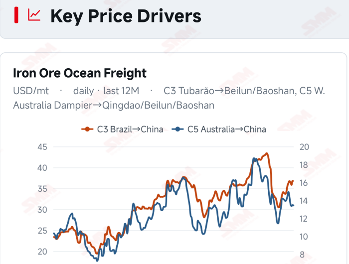
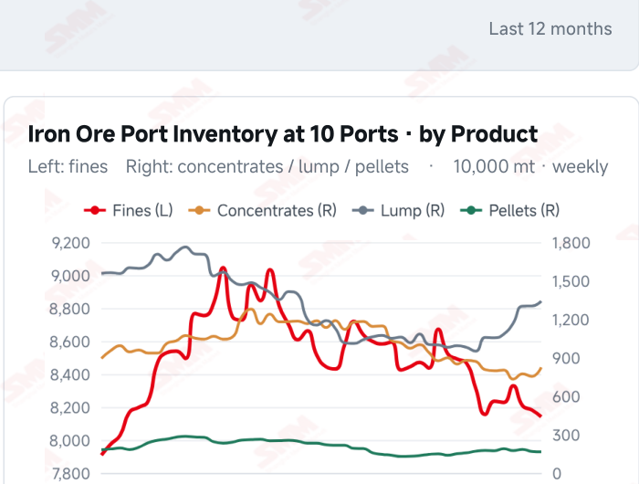
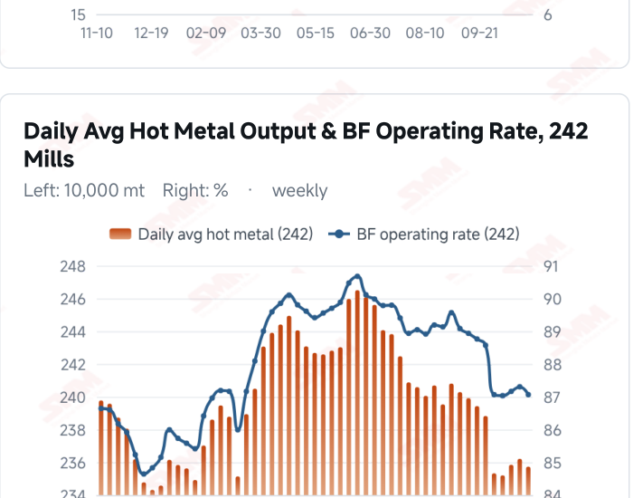
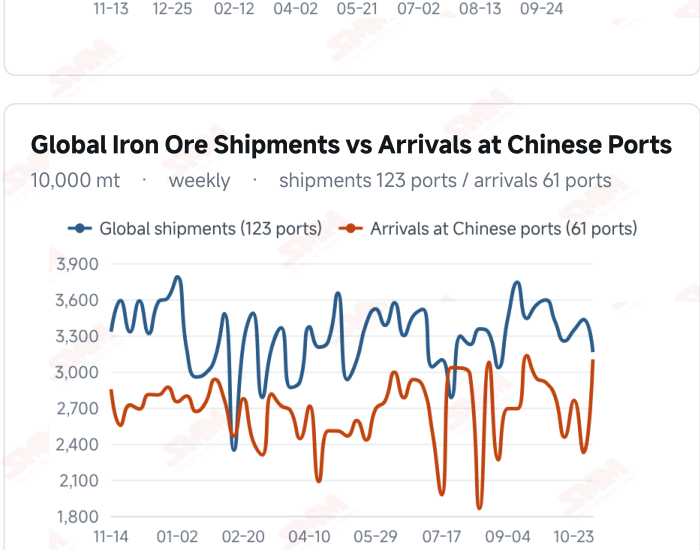

# SMM Iron Ore Daily — 2026-11-09 (Monday)

**Source:** SMM Data-pro · Shanghai Metals Market (SMM)

---

## Futures Contracts

| Exchange | Contract | Price | Unit | Daily Change | Daily Change % | MTD Avg |
|:---|:---|:---:|:---:|:---:|:---:|:---:|
| SGX | SGX Iron Ore Current-month FEFX26 | 92.85 | USD/dmt | — | — | — |
| DCE | DCE Iron Ore Most-traded I2701 | 687.50 | yuan/mt | 0.0 | 0.00% | 682.20 |

## SMM Iron Ore Price Index (Physical & Benchmark Indices)

| Index Name | Market Type | Fe % | Price | Unit | Daily Change | Daily Change % | MTD Avg |
|:---|:---|:---:|:---:|:---:|:---:|:---:|:---:|
| MMi 61% Port Spot | port_spot | 61.0% | 655.00 | yuan/wmt | -1.0 | -0.15% | 655.00 |
| MMi 58% Port Spot | port_spot | 58.0% | 610.00 | yuan/wmt | +1.0 | +0.16% | 608.00 |
| MMi 65% Port Spot | port_spot | 65.0% | 817.00 | yuan/wmt | -1.0 | -0.12% | 817.00 |
| MMi 61% Seaborne Index | seaborne | 61.0% | 91.50 | USD/dmt | -0.45 | -0.49% | 91.32 |
| MMi 65% Seaborne Index | seaborne | 65.0% | 107.60 | USD/dmt | -0.35 | -0.32% | 107.22 |
| SMM Domestic Ore Composite Index | domestic_composite | 66.0% | 792.84 | yuan/mt | 0.0 | 0.00% | 791.75 |

## Key View

### Futures and port quotes steady, seaborne prices lower; rising arrivals test stock absorption

Iron ore prices combined stability with weakness today. DCE most-traded closed unchanged at 687.5 yuan/mt, and all eight major Qingdao port product quotations were steady. The 61% and 65% port indices each fell 1 yuan while the 58% rose 1 yuan. Seaborne 61% and 65% indices declined to USD 91.50 and 107.60/dmt, and all 12 brands eased against the previous report. Different moves in composite indices and product quotations highlight resource composition and pricing bases; no single market alone establishes broad strengthening or weakening. Incoming supply and physical consumption remain central. Chinese arrivals rose 33.30% WoW in the week to Nov 6, while global shipments fell 7.89%; voyage lags and reporting periods can produce divergence. Latest ten-port stocks rose 643,600 mt from the previous period, while surveyed daily hot metal fell 4,800 mt. Higher arrivals may increase subsequent absorption pressure, but do not establish that current inventories have already risen further. A cautious, range-bound near-term view remains appropriate. Steady futures and major port quotations, together with relative low-grade resilience, offer some support. Lower seaborne prices, existing stock accumulation and slightly weaker hot metal limit upside momentum. Better mill orders and margins accompanied by sustained purchasing could strengthen support; difficulty absorbing arrivals and predominantly needs-based restocking could leave ore prices fluctuating under pressure.

## Today's Highlights

- Futures and major port quotations held steady. DCE most-traded I2701 closed at 687.5 yuan/mt, unchanged from Nov 6. Qingdao PB Fines were 653, Newman Fines 653 and Mac Fines 658 yuan/wmt. All eight spot products were unchanged; price support still needs follow-through in trading.
- Seaborne composite indices and brand quotations eased. The 61% seaborne index was USD 91.50/dmt, down 0.45 (-0.49%); the 65% was 107.60, down 0.35 (-0.32%). All 12 brands fell USD 0.40-0.50/dmt against the Nov 6 report, with PB Fines at 91.75, Newman Fines at 91.00 and Mac Fines at 90.65.
- The low-grade port index showed relative resilience. The 61%, 58% and 65% port indices were 655, 610 and 817 yuan/wmt, changing -1, +1 and -1 yuan. The 65%-58% spread narrowed from 209 to 207 yuan/wmt; the seaborne 65%-61% spread widened from USD 16.00 to 16.10/dmt. The Domestic Ore Composite Index was unchanged at 792.84 yuan/mt.
- Arrivals rebounded; stock absorption remains key. Chinese arrivals were 31.0133 million mt in the week to Nov 6, up 7.7470 million mt (+33.30%) WoW; global shipments fell 7.89% to 31.6051 million mt. Latest ten-port inventory remains 104.6789 million mt as of Nov 5, and surveyed hot metal 2.3573 million mt/day as of Nov 4. Different reporting periods should not be treated as a same-week balance.

## Qingdao Port Imported Ore Spot Prices (yuan/wet mt, tax incl.)

| Product | Fe % | Type | Price (yuan/wmt) | Daily Change | Daily Change % | MTD Avg |
|:---|:---:|:---:|:---:|:---:|:---:|:---:|
| PB Fines 60.8% | 60.8% | Fines | 653.0 | 0.0 | 0.00% | 650.0 |
| Newman Fines 61.2% | 61.2% | Fines | 653.0 | 0.0 | 0.00% | 650.0 |
| Mac Fines 60.8% | 60.8% | Fines | 658.0 | 0.0 | 0.00% | 656.0 |
| BRBF 62.5% | 62.5% | Fines | 701.0 | 0.0 | 0.00% | 698.0 |
| Newman Lump 63% | 63.0% | Lump | 818.0 | 0.0 | 0.00% | 819.0 |
| Super Special Fines (SSF) 56.5% | 56.5% | Fines | 515.0 | 0.0 | 0.00% | 512.0 |
| Carajas Fines (IOCJ) 65% | 65.0% | Fines | 823.0 | 0.0 | 0.00% | 820.0 |
| PB Lump 61.5% | 61.5% | Lump | 813.0 | 0.0 | 0.00% | 814.0 |

## Seaborne Brand Prices in USD (CFR Qingdao, USD/dry mt, as of 2026-11-09)

| Product | Price (USD/dmt) | Daily Change | Daily Change % | Previous |
|:---|:---:|:---:|:---:|:---:|
| Roy Hill Fines 62% | 88.00 | -0.4 | -0.45% | 88.40 |
| SIMEC Fines 61% | 88.80 | -0.45 | -0.50% | 89.25 |
| PB Fines 62% | 91.75 | -0.5 | -0.54% | 92.25 |
| Newman Fines 60.7% | 91.00 | -0.4 | -0.44% | 91.40 |
| Mac Fines 60.5% | 90.65 | -0.45 | -0.49% | 91.10 |
| Jimblebar Fines 60.30% | 87.80 | -0.4 | -0.45% | 88.20 |
| Carajas Fines (IOCJ) 65% | 107.50 | -0.45 | -0.42% | 107.95 |
| SSFT / SSFG 60% | 98.40 | -0.45 | -0.46% | 98.85 |
| Brazilian Blend Fines (BRBF) 64% | 98.10 | -0.45 | -0.46% | 98.55 |
| RTX Fines 61% | 87.95 | -0.45 | -0.51% | 88.40 |
| West Pilbara Fines (WPF) 60% | 90.35 | -0.45 | -0.50% | 90.80 |
| SP10 Fines 59%-60% | 80.15 | -0.45 | -0.56% | 80.60 |

## SMM Iron Ore Price Index — Weekly / Monthly Statistics

| Index Name | Month-to-date Avg | MoM % | YTD % | Unit |
|:---|:---:|:---:|:---:|:---:|
| SMM MMi 61% Iron Ore Seaborne Index | 91.32 | +1.19% | -13.6% | USD/dmt |
| SMM MMi 65% Iron Ore Seaborne Index | 107.22 | -1.03% | -11.3% | USD/dmt |
| SMM MMi 61% Iron Ore Port Spot Index | 655.00 | -0.30% | -19.4% | yuan/wmt |
| SMM MMi 65% Iron Ore Port Spot Index | 817.00 | -0.12% | -9.1% | yuan/wmt |
| SMM MMi 58% Iron Ore Port Spot Index | 608.00 | -1.11% | -15.0% | yuan/wmt |
| SMM China Domestic Ore Composite Price Index | 791.75 | -1.70% | -10.6% | yuan/mt |

## Key Price Drivers (12-Month Charts & Operational Metrics)

### Charts: Freight & Port Inventory

### Charts: Hot Metal Output & Shipments vs Arrivals

### Operational Fundamentals Snapshot

| Fundamental Indicator | Value | Unit |
|:---|:---:|:---:|
| C3 Freight (Brazil to China) | 36.71 | USD/mt |
| Blast Furnace Operating Rate (242 Mills) | 87.06 | % |
| Iron Ore Port Inventory (10 Major Ports) | 104.6789 | Million MT |
| Global Iron Ore Shipments (Weekly) | 31.6051 | Million MT |

## Market Commentary · Imported Ore

### Futures & Spot

DCE most-traded I2701 closed at 687.5 yuan/mt, unchanged from Nov 6. Qingdao PB Fines were 653, Newman Fines 653, Mac Fines 658, BRBF 701, Newman Lump 818, SSF 515, Carajas Fines 823 and PB Lump 813 yuan/wmt, all unchanged. Port composite indices diverged: the 61% and 65% each fell 1 yuan while the 58% gained 1 yuan. Product quotations and composite indices have different samples; this does not by itself establish inconsistent pricing.

### Driver

The seaborne 61% and 65% composite indices fell 0.49% and 0.32%, respectively, and all 12 brand quotations eased against the previous report, while RMB futures and major port products held steady. Quotation timing, resource composition and procurement schedules may contribute to these differences. A slightly wider seaborne grade spread alongside a narrower port spread does not establish a change in blending demand. Dry/wet bases, taxes and exchange rates also prevent direct comparison of absolute prices across the two markets.

### Demand

The latest 242-mill survey showed daily hot metal output of 2.3573 million mt on Nov 4, down 4,800 mt from Oct 28, and a blast furnace operating rate of 87.06%, down 0.24 percentage point. Existing weekly indicators have yet to show incremental support from ore consumption. Better margins and orders accompanied by sustained purchases could strengthen spot support; predominantly needs-based restocking could make stock absorption more challenging as arrivals rebound.

### Inventory & Supply

Ten-port stocks were 104.6789 million mt on Nov 5, up 643,600 mt (+0.62%) from Oct 29. Fines were 81.4047 million mt (-413,500 mt), concentrates 8.2354 million mt (+705,000 mt), lump 13.3981 million mt (+382,900 mt) and pellets 1.6407 million mt (-30,800 mt). In the week to Nov 6, global shipments fell 2.7068 million mt (-7.89%) to 31.6051 million mt, while Chinese arrivals rose 7.7470 million mt (+33.30%) to 31.0133 million mt. Voyage lags can explain differing directions in shipments and arrivals. Higher arrivals may add to subsequent port absorption pressure, but the earlier stock build cannot be attributed entirely to that arrivals period.

### Cost & Margin

Latest C3 freight was USD 36.71/mt on Nov 6, down 0.05 (-0.14%) from Nov 5; C5 was 13.35, down 0.13 (-0.96%). Slightly lower freight may ease import transport costs, with actual transmission depending on contract pricing and settlement timing. Lower seaborne quotations alongside steady major port prices may alter some trading spreads, but exchange rates, grades, taxes and inventory costs require separate assessment; this does not directly imply improved steelmaking margins.

## Market Commentary · Domestic Ore

### Prices

The Domestic Ore Composite Price Index was 792.84 yuan/mt on Nov 9, unchanged from Nov 6. The national composite and regional concentrate quotations differ in grade, wet/dry basis and tax treatment, so absolute prices are not directly comparable. An unchanged composite does not mean transaction prices in every region were unchanged.

### Supply & Demand

The latest modest decline in surveyed hot metal output has yet to provide incremental support for domestic ore consumption. Mine and beneficiation supply, regional transport conditions and mill procurement schedules may still create regional differences. The composite alone does not establish nationwide tightness or stronger trading; regional quotations and sustained actual purchases remain important.

### Outlook

Regional divergence may persist in the near term. Tight local availability accompanied by mill purchases could support offers; limited improvement in margins and orders, with mainly needs-based buying, could constrain gains. Lower seaborne quotations may influence substitution expectations, but differing grades and pricing bases require separate assessment.

## Market Factors

### Supportive Factors

- DCE and eight major port quotations held steady, indicating some price support for now.
- The 58% port index rose 1 yuan/wmt, showing relative low-grade resilience.
- Latest global shipments fell 7.89% WoW, potentially affecting subsequent supply timing.
- C3 and C5 freight edged lower, potentially easing some import transport costs.

### Bearish Factors

- Both seaborne indices and all 12 brand quotations declined.
- Latest Chinese arrivals rose 33.30% WoW; subsequent port absorption remains a test.
- Ten-port stocks rose 643,600 mt WoW, with concentrates and lump building.
- Surveyed daily hot metal fell 4,800 mt WoW; incremental demand remains uncertain.

## Flash News Briefs

- [Brief Comment on China Iron Ore] Iron ore prices in the Shandong region are likely to consolidate (2026-11-09)
- [Grange approves FID for underground mining at Savage River iron ore mine] (2026-11-09)
- [U.S. Steel breaks ground on $1.9 billion DRI facility in Osceola, Arkansas] (2026-11-09)
- [SMM Coking Coal and Coke Daily Brief] 20261109 (2026-11-09)
- [Steel billet price adjustment] (2026-11-09)
- [SMM Steel] Vietnam HRC Import Prices Edge Lower as Indonesian Cargoes Secure Deals (2026-11-09)

---
*(c) 2026 Shanghai Metals Market (SMM) · Iron Ore Value-Chain Data & Research*
