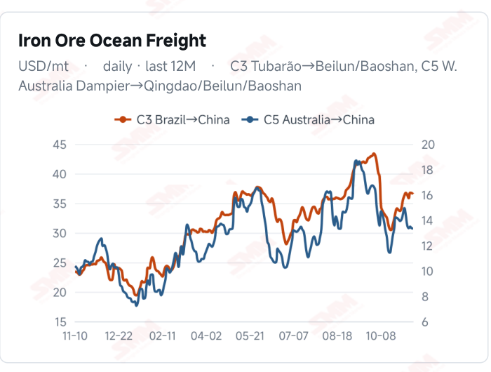
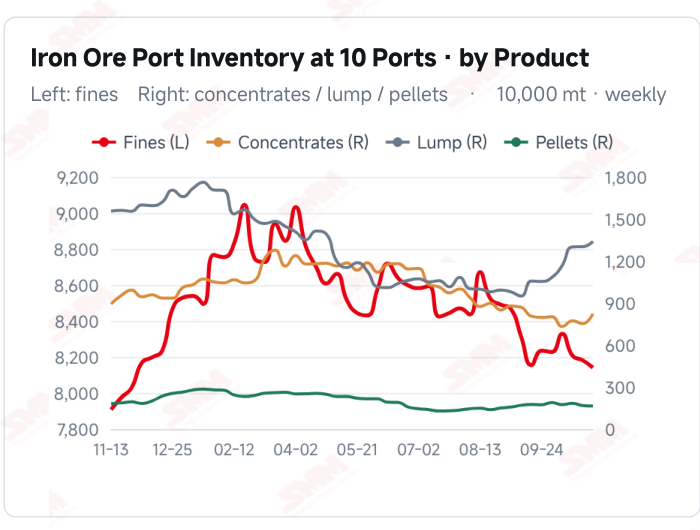
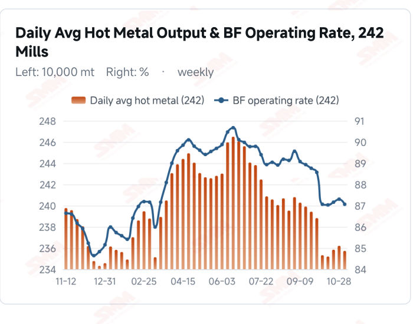
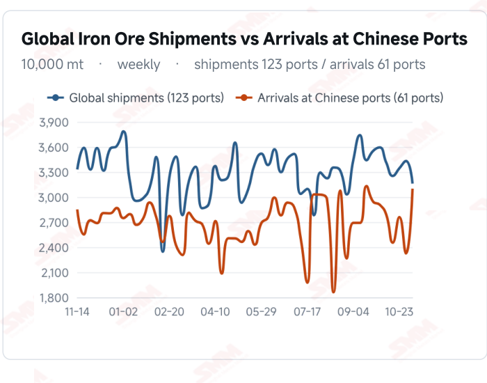

# SMM Iron Ore Daily — 2026-11-10 (Tuesday)

**Source:** SMM Data-pro · Shanghai Metals Market (SMM)

---

## Futures Contracts

| Exchange | Contract | Price | Unit | Daily Change | Daily Change % | MTD Avg |
|:---|:---|:---:|:---:|:---:|:---:|:---:|
| SGX | SGX Iron Ore Current-month FEFX26 | 92.75 | USD/dmt | — | — | — |
| DCE | DCE Iron Ore Most-traded I2701 | 684.00 | yuan/mt | -3.5 | -0.51% | 682.50 |

## SMM Iron Ore Price Index (Physical & Benchmark Indices)

| Index Name | Market Type | Fe % | Price | Unit | Daily Change | Daily Change % | MTD Avg |
|:---|:---|:---:|:---:|:---:|:---:|:---:|:---:|
| MMi 61% Port Spot | port_spot | 61.0% | 652.00 | yuan/wmt | -3.0 | -0.46% | 654.00 |
| MMi 58% Port Spot | port_spot | 58.0% | 609.00 | yuan/wmt | -1.0 | -0.16% | 608.00 |
| MMi 65% Port Spot | port_spot | 65.0% | 813.00 | yuan/wmt | -4.0 | -0.49% | 816.00 |
| MMi 61% Seaborne Index | seaborne | 61.0% | 91.35 | USD/dmt | -0.15 | -0.16% | 91.32 |
| MMi 65% Seaborne Index | seaborne | 65.0% | 107.60 | USD/dmt | 0.0 | 0.00% | 107.27 |
| SMM Domestic Ore Composite Index | domestic_composite | 66.0% | 792.84 | yuan/mt | 0.0 | 0.00% | 791.75 |

## Key View

### Futures and spot retreat; higher arrivals and mill buying remain key

Iron ore futures and spot prices were broadly under pressure today. DCE most-traded closed at 684.0 yuan/mt, down 0.51% from the previous close, and all eight major Qingdao port quotations declined. The 61%, 58% and 65% port indices fell 3, 1 and 4 yuan, respectively. The seaborne 61% index eased to USD 91.35/dmt, the 65% held at 107.60, and all 12 brands edged lower. Grade spreads moved differently across markets; one-day changes do not establish a shift in blending trends. Physical balances still constrain a sustained rebound. Latest Chinese arrivals rose 33.30% WoW while global shipments fell 7.89%, with voyage lags potentially explaining the divergence. Existing ten-port stocks increased 643,600 mt from the previous period and surveyed daily hot metal fell 4,800 mt. Higher arrivals require mill buying and port absorption, but there is not yet a basis to state that current inventories have already risen further. A cautious, range-bound near-term view remains appropriate. A steady high-grade seaborne index and lower freight offer some buffer, while declining futures and spot prices and limited incremental demand restrain upside. Better orders and margins accompanied by sustained restocking could strengthen support; needs-based buying and slow absorption of arrivals could leave ore prices fluctuating under pressure.

## Today's Highlights

- Futures and spot prices weakened together. DCE most-traded I2701 closed at 684.0 yuan/mt, down 3.5 yuan (-0.51%) from Nov 9. Qingdao PB Fines were 647, Newman Fines 647 and Mac Fines 652 yuan/wmt, each down 6 yuan; Carajas Fines fell 10 yuan to 813. All eight spot products declined.
- The lower-grade seaborne index eased while the high-grade index held steady. The 61% index was USD 91.35/dmt, down 0.15 (-0.16%); the 65% was unchanged at 107.60. All 12 seaborne brands fell USD 0.10-0.15/dmt against the Nov 9 report, with PB Fines at 91.60, Newman Fines at 90.90 and Mac Fines at 90.55.
- Port grade spreads narrowed further. The 61%, 58% and 65% port indices were 652, 609 and 813 yuan/wmt, changing -3, -1 and -4 yuan. The 65%-58% spread narrowed from 207 to 204 yuan/wmt, while the seaborne 65%-61% spread widened from USD 16.10 to 16.25/dmt, highlighting structural differences across market bases.
- Higher arrivals and existing stocks still need absorption. Chinese arrivals were 31.0133 million mt in the week to Nov 6, up 33.30% WoW; global shipments fell 7.89% to 31.6051 million mt. Latest ten-port stocks were 104.6789 million mt as of Nov 5, up 643,600 mt WoW; surveyed daily hot metal was 2.3573 million mt as of Nov 4, down 4,800 mt WoW.

## Qingdao Port Imported Ore Spot Prices (yuan/wet mt, tax incl.)

| Product | Fe % | Type | Price (yuan/wmt) | Daily Change | Daily Change % | MTD Avg |
|:---|:---:|:---:|:---:|:---:|:---:|:---:|
| PB Fines 60.8% | 60.8% | Fines | 647.0 | -6.0 | -0.92% | 649.0 |
| Newman Fines 61.2% | 61.2% | Fines | 647.0 | -6.0 | -0.92% | 649.0 |
| Mac Fines 60.8% | 60.8% | Fines | 652.0 | -6.0 | -0.91% | 655.0 |
| BRBF 62.5% | 62.5% | Fines | 695.0 | -6.0 | -0.86% | 697.0 |
| Newman Lump 63% | 63.0% | Lump | 812.0 | -6.0 | -0.73% | 818.0 |
| Super Special Fines (SSF) 56.5% | 56.5% | Fines | 509.0 | -6.0 | -1.17% | 511.0 |
| Carajas Fines (IOCJ) 65% | 65.0% | Fines | 813.0 | -10.0 | -1.22% | 819.0 |
| PB Lump 61.5% | 61.5% | Lump | 807.0 | -6.0 | -0.74% | 813.0 |

## Seaborne Brand Prices in USD (CFR Qingdao, USD/dry mt, as of 2026-11-10)

| Product | Price (USD/dmt) | Daily Change | Daily Change % | Previous |
|:---|:---:|:---:|:---:|:---:|
| Roy Hill Fines 62% | 87.90 | -0.1 | -0.11% | 88.00 |
| SIMEC Fines 61% | 88.70 | -0.1 | -0.11% | 88.80 |
| PB Fines 62% | 91.60 | -0.15 | -0.16% | 91.75 |
| Newman Fines 60.7% | 90.90 | -0.1 | -0.11% | 91.00 |
| Mac Fines 60.5% | 90.55 | -0.1 | -0.11% | 90.65 |
| Jimblebar Fines 60.30% | 87.65 | -0.15 | -0.17% | 87.80 |
| Carajas Fines (IOCJ) 65% | 107.35 | -0.15 | -0.14% | 107.50 |
| SSFT / SSFG 60% | 98.25 | -0.15 | -0.15% | 98.40 |
| Brazilian Blend Fines (BRBF) 64% | 97.95 | -0.15 | -0.15% | 98.10 |
| RTX Fines 61% | 87.85 | -0.1 | -0.11% | 87.95 |
| West Pilbara Fines (WPF) 60% | 90.20 | -0.15 | -0.17% | 90.35 |
| SP10 Fines 59%-60% | 80.00 | -0.15 | -0.19% | 80.15 |

## SMM Iron Ore Price Index — Weekly / Monthly Statistics

| Index Name | Month-to-date Avg | MoM % | YTD % | Unit |
|:---|:---:|:---:|:---:|:---:|
| SMM MMi 61% Iron Ore Seaborne Index | 91.32 | +1.19% | -13.8% | USD/dmt |
| SMM MMi 65% Iron Ore Seaborne Index | 107.27 | -0.98% | -11.3% | USD/dmt |
| SMM MMi 61% Iron Ore Port Spot Index | 654.00 | -0.36% | -19.8% | yuan/wmt |
| SMM MMi 65% Iron Ore Port Spot Index | 816.00 | -0.19% | -9.6% | yuan/wmt |
| SMM MMi 58% Iron Ore Port Spot Index | 608.00 | -1.07% | -15.2% | yuan/wmt |
| SMM China Domestic Ore Composite Price Index | 791.75 | -1.70% | -10.6% | yuan/mt |

## Key Price Drivers (12-Month Charts & Operational Metrics)

### Charts: Freight & Port Inventory

### Charts: Hot Metal Output & Shipments vs Arrivals

### Operational Fundamentals Snapshot

| Fundamental Indicator | Value | Unit |
|:---|:---:|:---:|
| C3 Freight (Brazil to China) | 36.51 | USD/mt |
| Daily Avg Hot Metal Output (242 Mills) | 2.3573 | Million MT |
| Blast Furnace Operating Rate (242 Mills) | 87.06 | % |
| Iron Ore Port Inventory (10 Major Ports) | 104.6789 | Million MT |
| Global Iron Ore Shipments (Weekly) | 31.6051 | Million MT |

## Market Commentary · Imported Ore

### Futures & Spot

DCE most-traded I2701 closed at 684.0 yuan/mt, down 3.5 yuan (-0.51%) from the Nov 9 close of 687.5. Qingdao PB Fines were 647, Newman Fines 647, Mac Fines 652, BRBF 695, Newman Lump 812, SSF 509 and PB Lump 807 yuan/wmt, all down 6 yuan; Carajas Fines fell 10 yuan to 813. Broadly lower major port quotations indicate price pressure, but quotation changes alone do not quantify trading or procurement strength. SGX official current-month FEFX26 was last priced at USD 92.75/dmt, with quote time Nov 10, 17:30:00 and preparation time 17:44:50 (UTC+8).

### Driver

The seaborne 61% index fell 0.16%, the 65% held steady, and all 12 brand quotations edged lower. All three port grade indices declined, with the high-grade index falling more than the low-grade one. Differing grade-spread moves may reflect resource composition, quotation timing and procurement schedules; one-day spreads do not establish a structural shift in blending. USD dry-basis seaborne and RMB wet-basis port prices are not directly comparable as absolute spreads.

### Demand

The latest 242-mill survey showed daily hot metal output of 2.3573 million mt on Nov 4, down 4,800 mt from Oct 28, and a blast furnace operating rate of 87.06%, down 0.24 percentage point. Existing weekly indicators have yet to show incremental support from ore consumption. Better mill orders and margins accompanied by sustained procurement could strengthen spot support; predominantly needs-based restocking could limit the durability of a rebound.

### Inventory & Supply

Ten-port stocks were 104.6789 million mt on Nov 5, up 643,600 mt (+0.62%) from Oct 29. Fines were 81.4047 million mt (-413,500 mt), concentrates 8.2354 million mt (+705,000 mt), lump 13.3981 million mt (+382,900 mt) and pellets 1.6407 million mt (-30,800 mt). In the week to Nov 6, global shipments fell 2.7068 million mt to 31.6051 million mt, while Chinese arrivals rose 7.7470 million mt to 31.0133 million mt. Voyage lags can create divergence; higher arrivals may increase subsequent absorption pressure, but do not establish that current port stocks have already risen further.

### Cost & Margin

Latest C3 freight was USD 36.51/mt on Nov 9, down 0.20 (-0.54%) from Nov 6; C5 was 13.33, down 0.02 (-0.15%). Slightly lower transport costs may provide a buffer, with actual transmission depending on contracts and settlement timing. Lower port selling prices and changing seaborne quotations may alter trading spreads, but grades, exchange rates, taxes and inventory costs require separate assessment; this does not directly establish improved steelmaking margins.

## Market Commentary · Domestic Ore

### Prices

The latest valid Domestic Ore Composite Price Index quotation was 792.84 yuan/mt on Nov 9, unchanged on that date from Nov 6. The national composite and regional concentrate quotations differ in grade, wet/dry basis and taxes; their absolute prices are not directly comparable, and one composite cannot establish simultaneous price moves in all regions.

### Supply & Demand

The latest modest decline in surveyed hot metal output leaves incremental domestic ore consumption uncertain. Mine and beneficiation operations, regional transport conditions and mill procurement schedules may create regional differences. Tight availability of good-quality resources accompanied by purchases could support local offers, but local conditions should not be generalized nationwide.

### Outlook

Regional divergence may persist in the near term. Lower port ore prices may influence substitution demand, subject to grades, transport and pricing bases. Limited improvement in margins and orders alongside predominantly needs-based procurement could constrain price gains, while local supply changes may still produce differentiated outcomes.

## Market Factors

### Supportive Factors

- The 65% seaborne composite held steady, showing relative high-grade USD price stability.
- The 58% port index fell less, indicating relative low-grade resilience.
- Latest global shipments fell 7.89% WoW, potentially affecting subsequent arrival timing.
- C3 and C5 freight edged lower, potentially easing some import transport costs.

### Bearish Factors

- DCE closed 0.51% lower, and all eight port products declined.
- The seaborne 61% index and all 12 brand quotations eased.
- Latest Chinese arrivals rose 33.30% WoW, leaving stock absorption under pressure.
- Existing ten-port stock accumulation and lower hot metal suggest limited incremental demand.

## Flash News Briefs

- [Domestic Iron Ore Brief] Iron ore concentrate prices in the Tangshan area are likely to consolidate (2026-11-10)
- [SMM Coking Coal and Coke Daily Brief] 20261110 (2026-11-10)
- [SMM Steel] Vietnam's Hoa Phat Reportedly Secures 500,000 Tonnes of Domestic HRC Orders (2026-11-10)
- [SMM Steel] Vietnam HRC Import Prices Edge Lower as Indonesian Cargoes Secure Deals (2026-11-09)
- [Grange approves FID for underground mining at Savage River iron ore mine] (2026-11-09)
- [U.S. Steel breaks ground on $1.9 billion DRI facility in Osceola, Arkansas] (2026-11-09)

---
*(c) 2026 Shanghai Metals Market (SMM) · Iron Ore Value-Chain Data & Research*
