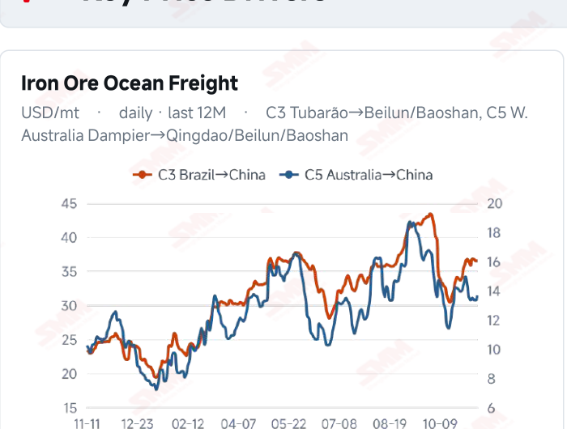
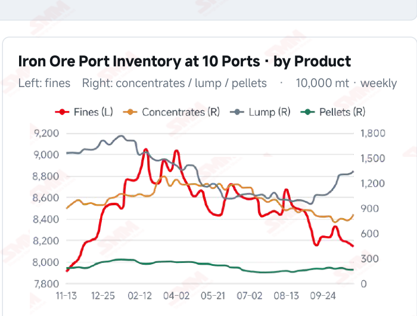
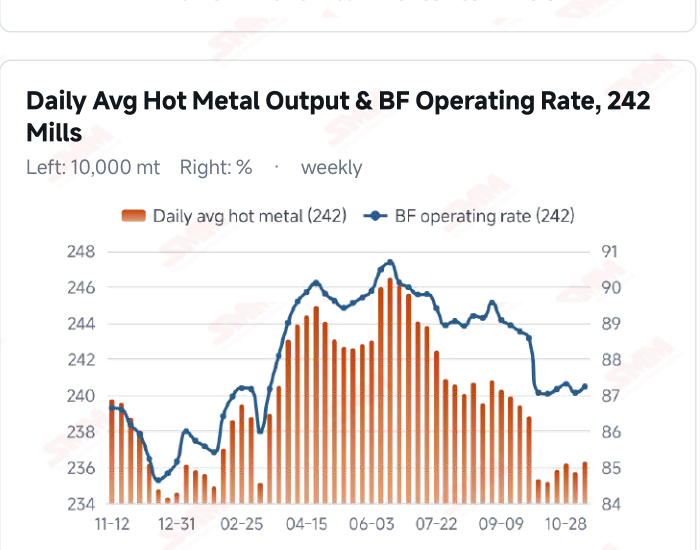
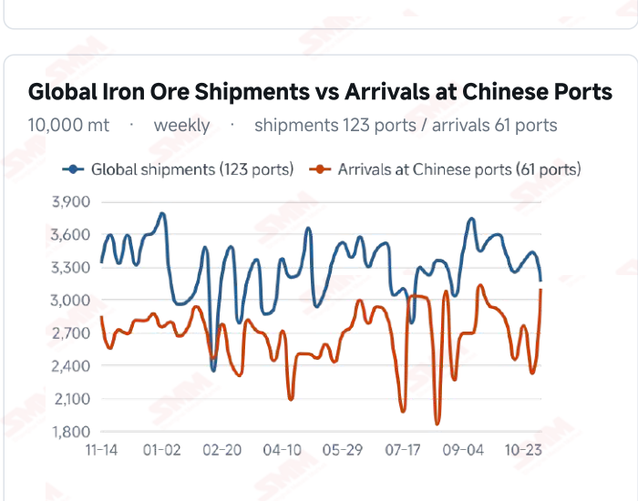

# SMM Iron Ore Daily — 2026-11-11 (Wednesday)

**Source:** SMM Data-pro · Shanghai Metals Market (SMM)

---

## Futures Contracts

| Exchange | Contract | Price | Unit | Daily Change | Daily Change % | MTD Avg |
|:---|:---|:---:|:---:|:---:|:---:|:---:|
| SGX | SGX Iron Ore Current-month FEFX26 | 92.50 | USD/dmt | — | — | — |
| DCE | DCE Iron Ore Most-traded I2701 | 683.50 | yuan/mt | -0.5 | -0.07% | 682.60 |

## SMM Iron Ore Price Index (Physical & Benchmark Indices)

| Index Name | Market Type | Fe % | Price | Unit | Daily Change | Daily Change % | MTD Avg |
|:---|:---|:---:|:---:|:---:|:---:|:---:|:---:|
| MMi 61% Port Spot | port_spot | 61.0% | 653.00 | yuan/wmt | +1.0 | +0.15% | 654.00 |
| MMi 58% Port Spot | port_spot | 58.0% | 609.00 | yuan/wmt | 0.0 | 0.00% | 608.00 |
| MMi 65% Port Spot | port_spot | 65.0% | 813.00 | yuan/wmt | 0.0 | 0.00% | 816.00 |
| MMi 61% Seaborne Index | seaborne | 61.0% | 91.30 | USD/dmt | -0.05 | -0.05% | 91.32 |
| MMi 65% Seaborne Index | seaborne | 65.0% | 107.10 | USD/dmt | -0.5 | -0.46% | 107.25 |
| SMM Domestic Ore Composite Index | domestic_composite | 66.0% | 792.84 | yuan/mt | 0.0 | 0.00% | 791.75 |

## Key View

### Higher hot metal offers support; softer seaborne prices and stocks constrain a rebound

Iron ore combined price weakness with selective support today. DCE most-traded closed at 683.5 yuan/mt, down 0.07% from the previous close, and all eight Qingdao spot products fell 1 yuan. The 61% port index rose 1 yuan while the 58% and 65% held steady. Seaborne 61% and 65% indices eased to USD 91.30 and 107.10/dmt, and all 12 brands declined, highlighting differences across samples and quotation bases. Demand showed a modest improvement: surveyed daily hot metal rose 5,600 mt WoW on Nov 11 and the blast furnace operating rate increased 0.17 percentage point, offering some support to ore consumption. However, latest available ten-port stocks were still up 643,600 mt from the previous period and earlier arrivals rose 33.30%. Higher hot metal does not establish that stocks have already declined; port outbound volume and sustained purchases remain important. A cautious, range-bound near-term view remains appropriate. Higher hot metal and stable parts of the port index complex may ease pressure, while softer seaborne prices, existing stocks and some higher transport costs constrain a rebound. Better mill margins and orders accompanied by sustained purchases could strengthen support; slow absorption of arrivals could leave ore prices fluctuating with trading and resource composition.

## Today's Highlights

- Futures edged lower and port product quotations softened. DCE most-traded I2701 closed at 683.5 yuan/mt, down 0.5 yuan (-0.07%) from Nov 10. Qingdao PB Fines were 646, Newman Fines 646 and Mac Fines 651 yuan/wmt. All eight products fell 1 yuan; spot support still needs confirmation from trading.
- Seaborne indices declined with differing brand moves. The 61% index was USD 91.30/dmt, down 0.05 (-0.05%); the 65% was 107.10, down 0.50 (-0.46%). All 12 brands fell USD 0.05-1.00/dmt against the Nov 10 report, with PB Fines at 91.55, Newman Fines at 90.65 and Mac Fines at 90.15.
- Port indices were relatively stable. The 61%, 58% and 65% indices were 653, 609 and 813 yuan/wmt, changing +1, 0 and 0 yuan. The 65%-58% port spread remained 204 yuan/wmt; the seaborne 65%-61% spread narrowed from USD 16.25 to 15.80/dmt. Different pricing bases prevent direct comparison of absolute spreads.
- Hot metal edged higher, but stock absorption remains key. Surveyed daily hot metal was 2.3629 million mt on Nov 11, up 5,600 mt from Nov 4; the blast furnace operating rate rose 0.17 percentage point to 87.23%. Latest ten- port stocks remain 104.6789 million mt as of Nov 5, up 643,600 mt WoW. Higher hot metal does not by itself establish port destocking.

## Qingdao Port Imported Ore Spot Prices (yuan/wet mt, tax incl.)

| Product | Fe % | Type | Price (yuan/wmt) | Daily Change | Daily Change % | MTD Avg |
|:---|:---:|:---:|:---:|:---:|:---:|:---:|
| PB Fines 60.8% | 60.8% | Fines | 646.0 | -1.0 | -0.15% | 649.0 |
| Newman Fines 61.2% | 61.2% | Fines | 646.0 | -1.0 | -0.15% | 649.0 |
| Mac Fines 60.8% | 60.8% | Fines | 651.0 | -1.0 | -0.15% | 655.0 |
| BRBF 62.5% | 62.5% | Fines | 694.0 | -1.0 | -0.14% | 697.0 |
| Newman Lump 63% | 63.0% | Lump | 811.0 | -1.0 | -0.12% | 817.0 |
| Super Special Fines (SSF) 56.5% | 56.5% | Fines | 508.0 | -1.0 | -0.20% | 511.0 |
| Carajas Fines (IOCJ) 65% | 65.0% | Fines | 812.0 | -1.0 | -0.12% | 818.0 |
| PB Lump 61.5% | 61.5% | Lump | 806.0 | -1.0 | -0.12% | 812.0 |

## Seaborne Brand Prices in USD (CFR Qingdao, USD/dry mt, as of 2026-11-11)

| Product | Price (USD/dmt) | Daily Change | Daily Change % | Previous |
|:---|:---:|:---:|:---:|:---:|
| Roy Hill Fines 62% | 87.60 | -0.3 | -0.34% | 87.90 |
| SIMEC Fines 61% | 88.10 | -0.6 | -0.68% | 88.70 |
| PB Fines 62% | 91.55 | -0.05 | -0.05% | 91.60 |
| Newman Fines 60.7% | 90.65 | -0.25 | -0.28% | 90.90 |
| Mac Fines 60.5% | 90.15 | -0.4 | -0.44% | 90.55 |
| Jimblebar Fines 60.30% | 86.65 | -1.0 | -1.14% | 87.65 |
| Carajas Fines (IOCJ) 65% | 107.30 | -0.05 | -0.05% | 107.35 |
| SSFT / SSFG 60% | 98.20 | -0.05 | -0.05% | 98.25 |
| Brazilian Blend Fines (BRBF) 64% | 97.90 | -0.05 | -0.05% | 97.95 |
| RTX Fines 61% | 87.80 | -0.05 | -0.06% | 87.85 |
| West Pilbara Fines (WPF) 60% | 89.65 | -0.55 | -0.61% | 90.20 |
| SP10 Fines 59%-60% | 79.35 | -0.65 | -0.81% | 80.00 |

## SMM Iron Ore Price Index — Weekly / Monthly Statistics

| Index Name | Month-to-date Avg | MoM % | YTD % | Unit |
|:---|:---:|:---:|:---:|:---:|
| SMM MMi 61% Iron Ore Seaborne Index | 91.32 | +1.19% | -13.8% | USD/dmt |
| SMM MMi 65% Iron Ore Seaborne Index | 107.25 | -1.00% | -11.7% | USD/dmt |
| SMM MMi 61% Iron Ore Port Spot Index | 654.00 | -0.39% | -19.7% | yuan/wmt |
| SMM MMi 65% Iron Ore Port Spot Index | 816.00 | -0.24% | -9.6% | yuan/wmt |
| SMM MMi 58% Iron Ore Port Spot Index | 608.00 | -1.04% | -15.2% | yuan/wmt |
| SMM China Domestic Ore Composite Price Index | 791.75 | -1.70% | -10.6% | yuan/mt |

## Key Price Drivers (12-Month Charts & Operational Metrics)

### Charts: Freight & Port Inventory

### Charts: Hot Metal Output & Shipments vs Arrivals

### Operational Fundamentals Snapshot

| Fundamental Indicator | Value | Unit |
|:---|:---:|:---:|
| C3 Freight (Brazil to China) | 36.51 | USD/mt |
| Daily Avg Hot Metal Output (242 Mills) | 2.3629 | Million MT |
| Iron Ore Port Inventory (10 Major Ports) | 104.6789 | Million MT |
| Global Iron Ore Shipments (Weekly) | 31.6051 | Million MT |

## Market Commentary · Imported Ore

### Futures & Spot

DCE most-traded I2701 closed at 683.5 yuan/mt, down 0.5 yuan (-0.07%) from 684.0 on Nov 10. Qingdao PB Fines were 646, Newman Fines 646, Mac Fines 651, BRBF 694, Newman Lump 811, SSF 508, Carajas Fines 812 and PB Lump 806 yuan/wmt, all down 1 yuan. The 61% port composite rose 1 yuan while the 58% and 65% held steady. Different samples underpin composite indices and product quotations; differing moves do not establish contradictory data. SGX official current-month FEFX26 was last priced at USD 92.50/dmt, with quote time Nov 11, 17:25:06 and preparation time 17:41:15 (UTC+8).

### Driver

The seaborne 61% and 65% composite indices fell 0.05% and 0.46%, narrowing their grade spread. Port indices were relatively stable, while all 12 seaborne brands declined by varying amounts. Quotation timing, resource quality and procurement composition may contribute, but one-day changes do not establish a structural shift in blending demand. Wet-basis RMB port and dry-basis USD seaborne quotations differ in taxes and exchange- rate treatment and are not directly comparable as absolute prices.

### Demand

Daily hot metal output at the 242 surveyed mills was 2.3629 million mt on Nov 11, up 5,600 mt (+0.24%) from Nov 4; the blast furnace operating rate rose 0.17 percentage point to 87.23%. The modest rebound offers some support to ore consumption but does not establish sustained demand expansion. Mill orders, margins and continued procurement remain important; predominantly needs-based restocking could constrain spot upside.

### Inventory & Supply

Latest ten-port stocks were 104.6789 million mt on Nov 5, up 643,600 mt (+0.62%) from Oct 29: fines 81.4047 million mt, concentrates 8.2354 million mt, lump 13.3981 million mt and pellets 1.6407 million mt. In the week to Nov 6, global shipments fell 7.89% to 31.6051 million mt while Chinese arrivals rose 33.30% to 31.0133 million mt. Voyage lags separate shipments and arrivals, and hot metal and inventory periods also differ; these figures should not be combined into a same-week balance. Additional arrivals still require purchases and port outbound volume to absorb them.

### Cost & Margin

Latest C3 freight was USD 36.51/mt on Nov 10, unchanged from Nov 9; C5 rose 0.34 (+2.55%) to 13.67. Higher Australian-route freight may increase some import transport costs, with transmission affected by contract pricing and settlement timing. Lower seaborne quotations and slightly softer port selling prices may change trading spreads, but grades, exchange rates, taxes and inventory costs need separate assessment; this does not directly establish changes in steelmaking margins.

## Market Commentary · Domestic Ore

### Prices

The latest confirmed Domestic Ore Composite Price Index quotation was 792.84 yuan/mt on Nov 9, unchanged on that date from Nov 6. This is not a new Nov 11 quotation. The national composite and regional concentrates differ in grade, wet/dry basis and tax treatment, so absolute prices are not directly comparable and the composite does not establish simultaneous regional moves.

### Supply & Demand

The latest modest rebound in surveyed hot metal may provide some support to physical domestic ore consumption. Regional mine and beneficiation operations, resource quality and transport conditions still create differences. Sustained mill purchases are needed for consumption gains to translate into trading support. Local tightness or a single weekly hot metal change should not be generalized into a nationwide trend.

### Outlook

Regional divergence may persist in the near term. Tight availability of good-quality resources accompanied by active purchases could support local offers; limited improvement in orders and margins, with mainly needs- based buying, could restrain gains. Lower imported ore quotations may influence substitution, subject to grades, transport and taxes.

## Market Factors

### Supportive Factors

- Surveyed daily hot metal rose 5,600 mt WoW, modestly improving ore consumption.
- The blast furnace operating rate rose 0.17 percentage point to 87.23%.
- The 61% port index gained 1 yuan; the 58% and 65% were unchanged.
- Latest global shipments fell 7.89% WoW, potentially affecting subsequent supply timing.

### Bearish Factors

- Both seaborne indices and all 12 brand quotations declined.
- DCE edged lower and all eight port products fell 1 yuan.
- Latest Chinese arrivals rose 33.30% WoW and still need absorption.
- Existing ten-port stock accumulation and higher C5 freight add some pressure.

## Flash News Briefs

- Simandou North Reaches Full Production, Iron Ore May Move Sideways in the Short Term [SMM Iron Ore Daily Review] (2026-11-11)
- [Domestic Iron Ore Brief] Iron ore concentrate prices in west Liaoning may remain in the doldrums (2026-11-11)
- [SMM Coking Coal and Coke Daily Brief] 20261111 (2026-11-11)
- [SMM Steel] EU HRC holds at highs as buyers resist mills' Q1 targets (2026-11-11)
- [SMM Steel] Mill blast halts output in Türkiye; Izmir rebar and HRC offers firm (2026-11-11)
- [SMM Steel] Indian Domestic HRC Remains Stable as Europe-Bound Export Offers Firm (2026-11-11)

---
*(c) 2026 Shanghai Metals Market (SMM) · Iron Ore Value-Chain Data & Research*
