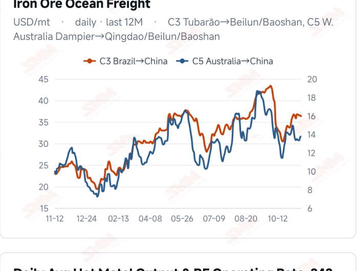
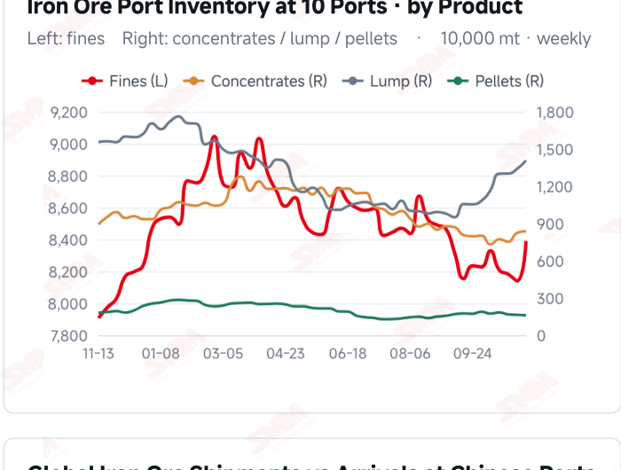
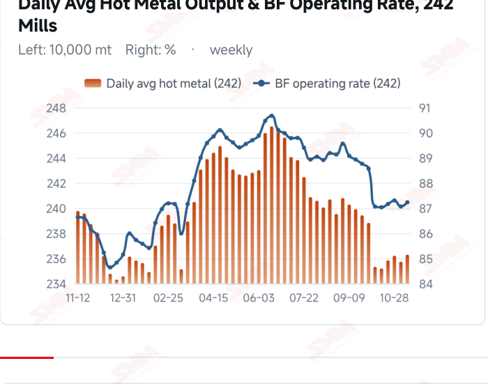
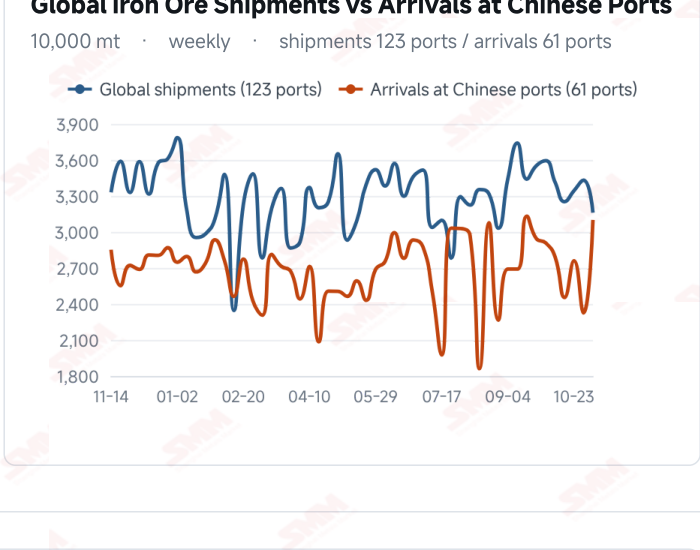

# SMM Iron Ore Daily — 2026-11-12 (Thursday)

**Source:** SMM Data-pro · Shanghai Metals Market (SMM)

---

## Futures Contracts

| Exchange | Contract | Price | Unit | Daily Change | Daily Change % | MTD Avg |
|:---|:---|:---:|:---:|:---:|:---:|:---:|
| SGX | SGX Iron Ore Current-month FEFX26 | 91.25 | USD/dmt | — | — | — |
| DCE | DCE Iron Ore Most-traded I2701 | 671.00 | yuan/mt | -12.5 | -1.83% | 681.30 |

## SMM Iron Ore Price Index (Physical & Benchmark Indices)

| Index Name | Market Type | Fe % | Price | Unit | Daily Change | Daily Change % | MTD Avg |
|:---|:---|:---:|:---:|:---:|:---:|:---:|:---:|
| MMi 61% Port Spot | port_spot | 61.0% | 649.00 | yuan/wmt | -4.0 | -0.61% | 654.00 |
| MMi 58% Port Spot | port_spot | 58.0% | 606.00 | yuan/wmt | -3.0 | -0.49% | 608.00 |
| MMi 65% Port Spot | port_spot | 65.0% | 810.00 | yuan/wmt | -3.0 | -0.37% | 815.00 |
| MMi 61% Seaborne Index | seaborne | 61.0% | 90.20 | USD/dmt | -1.1 | -1.20% | 91.19 |
| MMi 65% Seaborne Index | seaborne | 65.0% | 106.65 | USD/dmt | -0.45 | -0.42% | 107.18 |
| SMM Domestic Ore Composite Index | domestic_composite | 66.0% | 792.92 | yuan/mt | 0.0 | 0.00% | 792.15 |

## Key View

### Futures and spot soften as port stocks build; modest hot metal gains offer limited relief

Iron ore prices weakened broadly today. DCE most-traded closed at 671.0 yuan/mt, down 1.83% from the previous close, and all eight Qingdao spot products declined. The 61%, 58% and 65% port indices fell 4, 3 and 3 yuan, respectively; seaborne 61% and 65% indices eased to USD 90.20 and 106.65/dmt. Most brands fell while SP10 edged higher, highlighting resource differences rather than a broad trend inferred from one product. Inventory pressure is an important constraint. Ten-port stocks rose 3.2766 million mt WoW on Nov 12, with fines and lump contributing most of the increase. Latest surveyed daily hot metal rose 5,600 mt, but the improvement in consumption was modest. Earlier higher arrivals still require purchasing and port outbound volume to absorb them. Different samples and reporting periods mean the stock increase should not be attributed entirely to one factor. A cautious, range-bound near-term view remains appropriate. Slightly higher hot metal and a steady domestic index provide some support, while weaker futures and spot prices, port stock accumulation and some higher transport costs constrain a rebound. Better mill orders and margins accompanied by sustained purchases could strengthen support; slow stock absorption and needs-based buying could leave ore prices fluctuating under pressure.

## Today's Highlights

- Futures and spot prices retreated. DCE most-traded I2701 closed at 671.0 yuan/mt, down 12.5 yuan (-1.83%) from Nov 11. Qingdao PB and Newman Fines were both 638 yuan/wmt, each down 8 yuan; Mac Fines fell 10 yuan to 641. All eight spot products declined.
- Seaborne indices softened and most brand quotations fell. The 61% index was USD 90.20/dmt, down 1.10 (-1.20%); the 65% was 106.65, down 0.45 (-0.42%). Eleven brands fell USD 0.60-1.10/dmt against the Nov 11 report, while SP10 rose 0.25; moves were not uniform across products.
- Port indices declined across grades. The 61%, 58% and 65% indices were 649, 606 and 810 yuan/wmt, changing 4, -3 and -3 yuan; the 65%-58% spread remained 204 yuan. The seaborne 65%-61% spread widened from USD 15.80 to 16.45/dmt. Different market bases prevent direct comparison of absolute spreads.
- Ten-port stocks built substantially. Total inventory reached 107.9555 million mt on Nov 12, up 3.2766 million mt (+3.13%) from Nov 5. Fines, concentrates and lump increased while pellets declined. Latest surveyed hot metal rose 5,600 mt WoW to 2.3629 million mt/day, but stock absorption still requires sustained purchasing.

## Qingdao Port Imported Ore Spot Prices (yuan/wet mt, tax incl.)

| Product | Fe % | Type | Price (yuan/wmt) | Daily Change | Daily Change % | MTD Avg |
|:---|:---:|:---:|:---:|:---:|:---:|:---:|
| PB Fines 60.8% | 60.8% | Fines | 638.0 | -8.0 | -1.24% | 648.0 |
| Newman Fines 61.2% | 61.2% | Fines | 638.0 | -8.0 | -1.24% | 648.0 |
| Mac Fines 60.8% | 60.8% | Fines | 641.0 | -10.0 | -1.54% | 653.0 |
| BRBF 62.5% | 62.5% | Fines | 686.0 | -8.0 | -1.15% | 696.0 |
| Newman Lump 63% | 63.0% | Lump | 803.0 | -8.0 | -0.99% | 815.0 |
| Super Special Fines (SSF) 56.5% | 56.5% | Fines | 500.0 | -8.0 | -1.57% | 510.0 |
| Carajas Fines (IOCJ) 65% | 65.0% | Fines | 808.0 | -4.0 | -0.49% | 817.0 |
| PB Lump 61.5% | 61.5% | Lump | 800.0 | -6.0 | -0.74% | 811.0 |

## Seaborne Brand Prices in USD (CFR Qingdao, USD/dry mt, as of 2026-11-12)

| Product | Price (USD/dmt) | Daily Change | Daily Change % | Previous |
|:---|:---:|:---:|:---:|:---:|
| Roy Hill Fines 62% | 86.50 | -1.1 | -1.26% | 87.60 |
| SIMEC Fines 61% | 87.00 | -1.1 | -1.25% | 88.10 |
| PB Fines 62% | 90.45 | -1.1 | -1.20% | 91.55 |
| Newman Fines 60.7% | 89.60 | -1.05 | -1.16% | 90.65 |
| Mac Fines 60.5% | 89.10 | -1.05 | -1.16% | 90.15 |
| Jimblebar Fines 60.30% | 85.65 | -1.0 | -1.15% | 86.65 |
| Carajas Fines (IOCJ) 65% | 106.20 | -1.1 | -1.03% | 107.30 |
| SSFT / SSFG 60% | 97.10 | -1.1 | -1.12% | 98.20 |
| Brazilian Blend Fines (BRBF) 64% | 96.80 | -1.1 | -1.12% | 97.90 |
| RTX Fines 61% | 87.20 | -0.6 | -0.68% | 87.80 |
| West Pilbara Fines (WPF) 60% | 88.60 | -1.05 | -1.17% | 89.65 |
| SP10 Fines 59%-60% | 79.60 | +0.25 | +0.32% | 79.35 |

## SMM Iron Ore Price Index — Weekly / Monthly Statistics

| Index Name | Month-to-date Avg | MoM % | YTD % | Unit |
|:---|:---:|:---:|:---:|:---:|
| SMM MMi 61% Iron Ore Seaborne Index | 91.19 | +1.05% | -14.9% | USD/dmt |
| SMM MMi 65% Iron Ore Seaborne Index | 107.18 | -1.06% | -12.1% | USD/dmt |
| SMM MMi 61% Iron Ore Port Spot Index | 654.00 | -0.48% | -20.2% | yuan/wmt |
| SMM MMi 65% Iron Ore Port Spot Index | 815.00 | -0.32% | -9.9% | yuan/wmt |
| SMM MMi 58% Iron Ore Port Spot Index | 608.00 | -1.08% | -15.6% | yuan/wmt |
| SMM China Domestic Ore Composite Price Index | 792.15 | -1.66% | -10.6% | yuan/mt |

## Key Price Drivers (12-Month Charts & Operational Metrics)

### Charts: Freight & Port Inventory

### Charts: Hot Metal Output & Shipments vs Arrivals

### Operational Fundamentals Snapshot

| Fundamental Indicator | Value | Unit |
|:---|:---:|:---:|
| C3 Freight (Brazil to China) | 36.16 | USD/mt |
| Iron Ore Port Inventory (10 Major Ports) | 107.9555 | Million MT |
| Global Iron Ore Shipments (Weekly) | 31.6051 | Million MT |

## Market Commentary · Imported Ore

### Futures & Spot

DCE most-traded I2701 closed at 671.0 yuan/mt, down 12.5 yuan (-1.83%) from 683.5 on Nov 11. Qingdao PB Fines were 638, Newman Fines 638, BRBF 686, Newman Lump 803 and SSF 500 yuan/wmt, all down 8 yuan. Mac Fines fell 10 yuan to 641, Carajas Fines 4 yuan to 808 and PB Lump 6 yuan to 800. Joint futures and spot declines indicate pricing pressure, but do not directly quantify trading or procurement strength. SGX official current-month FEFX26 was last priced at USD 91.25/dmt, with quote time Nov 12, 17:38:33 and preparation time 17:56:32 (UTC+8).

### Driver

The seaborne 61% and 65% indices fell 1.20% and 0.42%, widening their grade spread; all three port grade indices declined. Most seaborne brands softened while SP10 rose, potentially reflecting resource quality, quotation timing or procurement composition. A single brand rebound does not establish broad demand improvement. USD dry-basis and RMB wet-basis prices differ in taxes and exchange-rate treatment and should not be translated directly into realizable arbitrage spreads.

### Demand

improvement. USD dry-basis and RMB wet-basis prices differ in taxes and exchange-rate treatment and should not be translated directly into realizable arbitrage spreads. Demand Latest surveyed daily hot metal at 242 mills was 2.3629 million mt on Nov 11, up 5,600 mt (+0.24%) from Nov 4; the blast furnace operating rate rose 0.17 percentage point to 87.23%. Modestly improved consumption provides some support, but the limited gain is not enough to offset stock-building pressure. Better orders and margins accompanied by sustained buying could strengthen spot support; predominantly needs-based restocking could constrain a durable rebound.

### Inventory & Supply

Ten-port stocks were 107.9555 million mt on Nov 12, up 3.2766 million mt (+3.13%) from Nov 5. Fines were 83.9000 million mt (+2.4953 million mt), concentrates 8.3723 million mt (+136,900 mt), lump 14.0730 million mt (+674,900 mt) and pellets 1.6102 million mt (-30,500 mt). Fines and lump accounted for most of the total increase. In the latest week to Nov 6, global shipments fell 7.89% to 31.6051 million mt while Chinese arrivals rose 33.30% to 31.0133 million mt. Voyage lags and reporting periods differ; the latest stock build cannot be attributed entirely to a single supply or demand factor.

### Cost & Margin

Latest C3 freight was USD 36.16/mt on Nov 11, down 0.35 (-0.96%) from Nov 10; C5 rose 0.11 (+0.80%) to 13.78. Costs diverged across the two routes, with actual transmission depending on contracts and settlement timing. Lower seaborne and port prices may alter trading and steelmaking costs, but grades, exchange rates, taxes and inventory valuation require separate assessment; lower ore prices alone do not establish improved margins.

## Market Commentary · Domestic Ore

### Prices

The Domestic Ore Composite Price Index was 792.92 yuan/mt on Nov 12, unchanged from Nov 11. The national composite and regional concentrates differ in grade, wet/dry basis and taxes; absolute prices are not directly comparable, and an unchanged composite does not establish unchanged transaction prices in every region.

### Supply & Demand

The latest modest rebound in surveyed hot metal may offer some support to domestic ore consumption, while mine and beneficiation supply, regional transport and resource quality still create differences. Lower imported ore quotations may alter substitution choices at some mills, subject to grades and delivered costs. The composite alone does not establish nationwide tightness or sustained procurement improvement.

### Outlook

Regional divergence may persist in the near term. Tight availability of good-quality resources accompanied by mill purchases could support local offers; limited improvement in orders and margins, with needs-based buying and price pressure from buyers, could restrain gains. Continued alignment between mine shipments and mill restocking remains important.

## Market Factors

### Supportive Factors

- Latest surveyed daily hot metal rose 5,600 mt WoW, modestly improving consumption.
- The blast furnace operating rate rose 0.17 percentage point to 87.23%.
- The Domestic Ore Composite Index held steady, indicating some price resilience.
- C3 freight fell 0.96%, potentially easing some Brazilian-route transport costs.

### Bearish Factors

- DCE fell 1.83% from the previous close and all eight port products declined.
- The seaborne 61% and 65% indices fell 1.20% and 0.42%.
- Ten-port stocks rose 3.2766 million mt WoW, with substantial fines and lump builds.
- Earlier higher arrivals still need absorption, while rising C5 freight adds some cost pressure.

## Flash News Briefs

- [SMM Iron Ore] Tighter output curbs and negative feedback weigh on iron ore (2026-11-12)
- [SMM Coking Coal and Coke Daily Brief] 20261112 (2026-11-12)
- [SMM Steel] Indonesian Wire Rod Stays Firm at $500/tonne FOB Amid Gradual Demand Recovery; Mills Hold Prices Steady (2026-11-12)
- [Domestic Iron Ore Brief] Iron ore concentrate prices in west Liaoning may remain in the doldrums (2026-11-11)
- [SMM Steel] EU HRC holds at highs as buyers resist mills' Q1 targets (2026-11-11)
- [SMM Steel] Indian Domestic HRC Remains Stable as Europe-Bound Export Offers Firm (2026-11-11)

---
*(c) 2026 Shanghai Metals Market (SMM) · Iron Ore Value-Chain Data & Research*
