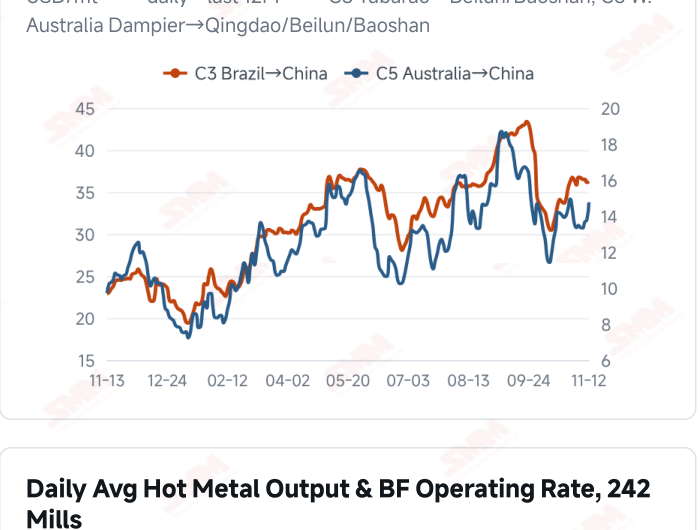
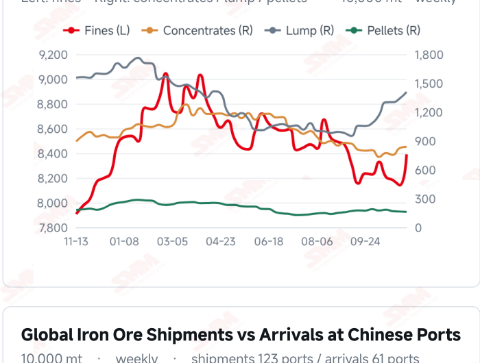
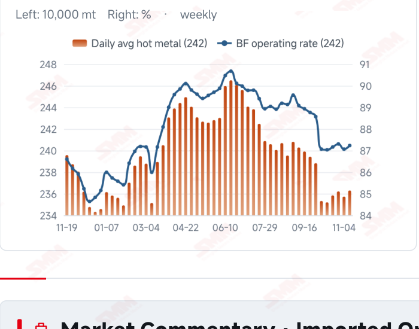
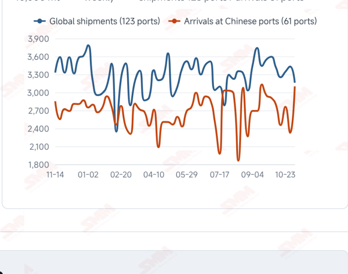

# SMM Iron Ore Daily — 2026-11-13 (Friday)

**Source:** SMM Data-pro · Shanghai Metals Market (SMM)

---

## Futures Contracts

| Exchange | Contract | Price | Unit | Daily Change | Daily Change % | MTD Avg |
|:---|:---|:---:|:---:|:---:|:---:|:---:|
| SGX | SGX Iron Ore Current-month FEFX26 | 91.35 | USD/dmt | — | — | — |
| DCE | DCE Iron Ore Most-traded I2701 | 669.50 | yuan/mt | -1.5 | -0.22% | 680.10 |

## SMM Iron Ore Price Index (Physical & Benchmark Indices)

| Index Name | Market Type | Fe % | Price | Unit | Daily Change | Daily Change % | MTD Avg |
|:---|:---|:---:|:---:|:---:|:---:|:---:|:---:|
| MMi 61% Port Spot | port_spot | 61.0% | 648.00 | yuan/wmt | -1.0 | -0.15% | 653.00 |
| MMi 58% Port Spot | port_spot | 58.0% | 605.00 | yuan/wmt | -1.0 | -0.17% | 607.00 |
| MMi 65% Port Spot | port_spot | 65.0% | 810.00 | yuan/wmt | 0.0 | 0.00% | 815.00 |
| MMi 61% Seaborne Index | seaborne | 61.0% | 90.35 | USD/dmt | +0.15 | +0.17% | 91.11 |
| MMi 65% Seaborne Index | seaborne | 65.0% | 106.70 | USD/dmt | +0.05 | +0.05% | 107.13 |
| SMM Domestic Ore Composite Index | domestic_composite | 66.0% | 800.72 | yuan/mt | +7.8 | +0.98% | 793.01 |

## Key View

### Seaborne and domestic quotes recover, but inventories constrain a sustained rebound

Iron ore showed selective price recovery today. The seaborne 61% and 65% indices rose to USD 90.35 and 106.70/dmt, all 12 brands gained, and the Domestic Ore Composite Index reached 800.72 yuan/mt. However, DCE most-traded closed at 669.5 yuan/mt, down 0.22% from the previous close; the 61% and 58% port indices each fell 1 yuan while the 65% held steady. Improving quotations have not become synchronized market-wide strength. Physical balances remain central to sustainability. Latest surveyed daily hot metal increased 5,600 mt WoW, offering limited consumption support, while ten-port stocks rose 3.2766 million mt, mainly in fines and lump. Earlier higher arrivals still require mill purchases and port outbound volume to absorb them; higher seaborne quotes do not establish destocking. A cautious, range-bound near-term view remains appropriate. Recovering seaborne and domestic prices and broadly stable port products help ease pressure, while inventory accumulation and higher freight constrain sustained gains. Better orders and margins accompanied by steady restocking could strengthen support; mainly needs-based purchasing could leave prices fluctuating with stocks, trading and resource composition.

## Today's Highlights

- Futures edged lower while port quotations were broadly steady. DCE most-traded I2701 closed at 669.5 yuan/mt, down 1.5 yuan (-0.22%) from Nov 12. Qingdao PB Fines were 638, Newman Fines 638 and Mac Fines 641 yuan/wmt, all unchanged; BRBF rose 5 yuan to 691 and PB Lump gained 1 yuan to 801.
- Seaborne quotations recovered. The 61% index was USD 90.35/dmt, up 0.15 (+0.17%); the 65% was 106.70, up 0.05 (+0.05%). All 12 brands rose USD 0.10-1.85/dmt against the Nov 12 report, with PB Fines at 90.60, Newman Fines at 89.75 and Mac Fines at 89.20.
- The domestic index rose as port grades diverged. The Domestic Ore Composite Index reached 800.72 yuan/mt, up 7.80 yuan (+0.98%) from the previous valid observation. Port 61%, 58% and 65% indices were 648, 605 and 810 yuan/wmt, changing -1, -1 and 0 yuan; the 65%-58% spread widened from 204 to 205 yuan.
- Inventory pressure still needs absorption. Latest ten-port stocks were 107.9555 million mt on Nov 12, up 3.2766 million mt (+3.13%) WoW; surveyed daily hot metal was 2.3629 million mt on Nov 11, up 5,600 mt WoW. Modestly improved demand coexists with stock accumulation; higher quotations do not establish destocking.

## Qingdao Port Imported Ore Spot Prices (yuan/wet mt, tax incl.)

| Product | Fe % | Type | Price (yuan/wmt) | Daily Change | Daily Change % | MTD Avg |
|:---|:---:|:---:|:---:|:---:|:---:|:---:|
| PB Fines 60.8% | 60.8% | Fines | 638.0 | 0.0 | 0.00% | 647.0 |
| Newman Fines 61.2% | 61.2% | Fines | 638.0 | 0.0 | 0.00% | 647.0 |
| Mac Fines 60.8% | 60.8% | Fines | 641.0 | 0.0 | 0.00% | 652.0 |
| BRBF 62.5% | 62.5% | Fines | 691.0 | +5.0 | +0.73% | 695.0 |
| Newman Lump 63% | 63.0% | Lump | 803.0 | 0.0 | 0.00% | 814.0 |
| Super Special Fines (SSF) 56.5% | 56.5% | Fines | 500.0 | 0.0 | 0.00% | 509.0 |
| Carajas Fines (IOCJ) 65% | 65.0% | Fines | 808.0 | 0.0 | 0.00% | 816.0 |
| PB Lump 61.5% | 61.5% | Lump | 801.0 | +1.0 | +0.12% | 810.0 |

## Seaborne Brand Prices in USD (CFR Qingdao, USD/dry mt, as of 2026-11-13)

| Product | Price (USD/dmt) | Daily Change | Daily Change % | Previous |
|:---|:---:|:---:|:---:|:---:|
| Roy Hill Fines 62% | 86.65 | +0.15 | +0.17% | 86.50 |
| SIMEC Fines 61% | 87.15 | +0.15 | +0.17% | 87.00 |
| PB Fines 62% | 90.60 | +0.15 | +0.17% | 90.45 |
| Newman Fines 60.7% | 89.75 | +0.15 | +0.17% | 89.60 |
| Mac Fines 60.5% | 89.20 | +0.1 | +0.11% | 89.10 |
| Jimblebar Fines 60.30% | 86.15 | +0.5 | +0.58% | 85.65 |
| Carajas Fines (IOCJ) 65% | 106.35 | +0.15 | +0.14% | 106.20 |
| SSFT / SSFG 60% | 97.25 | +0.15 | +0.15% | 97.10 |
| Brazilian Blend Fines (BRBF) 64% | 96.95 | +0.15 | +0.15% | 96.80 |
| RTX Fines 61% | 88.00 | +0.8 | +0.92% | 87.20 |
| West Pilbara Fines (WPF) 60% | 88.70 | +0.1 | +0.11% | 88.60 |
| SP10 Fines 59%-60% | 81.45 | +1.85 | +2.32% | 79.60 |

## SMM Iron Ore Price Index — Weekly / Monthly Statistics

| Index Name | Month-to-date Avg | MoM % | YTD % | Unit |
|:---|:---:|:---:|:---:|:---:|
| SMM MMi 61% Iron Ore Seaborne Index | 91.11 | +0.96% | -14.7% | USD/dmt |
| SMM MMi 65% Iron Ore Seaborne Index | 107.13 | -1.11% | -12.1% | USD/dmt |
| SMM MMi 61% Iron Ore Port Spot Index | 653.00 | -0.57% | -20.3% | yuan/wmt |
| SMM MMi 65% Iron Ore Port Spot Index | 815.00 | -0.38% | -9.9% | yuan/wmt |
| SMM MMi 58% Iron Ore Port Spot Index | 607.00 | -1.12% | -15.7% | yuan/wmt |
| SMM China Domestic Ore Composite Price Index | 793.01 | -1.55% | -9.7% | yuan/mt |

## Key Price Drivers (12-Month Charts & Operational Metrics)

### Charts: Freight & Port Inventory

### Charts: Hot Metal Output & Shipments vs Arrivals

### Operational Fundamentals Snapshot

| Fundamental Indicator | Value | Unit |
|:---|:---:|:---:|
| C3 Freight (Brazil to China) | 36.26 | USD/mt |
| Daily Avg Hot Metal Output (242 Mills) | 2.3629 | Million MT |
| Iron Ore Port Inventory (10 Major Ports) | 107.9555 | Million MT |
| Global Iron Ore Shipments (Weekly) | 31.6051 | Million MT |

## Market Commentary · Imported Ore

### Futures & Spot

DCE most-traded I2701 closed at 669.5 yuan/mt, down 1.5 yuan (-0.22%) from 671.0 on Nov 12. Qingdao PB Fines were 638, Newman Fines 638, Mac Fines 641, Newman Lump 803, SSF 500 and Carajas Fines 808 yuan/wmt, all unchanged. BRBF rose 5 yuan to 691 and PB Lump gained 1 yuan to 801. Selective product gains alongside softer futures require assessment of resource composition and actual buying; quotations do not substitute for trading volumes. SGX official current-month FEFX26 was last priced at USD 91.35/dmt, with quote time Nov 13, 17:29:58 and preparation time 17:43:07 (UTC+8).

### Driver

The seaborne 61% and 65% indices rose 0.17% and 0.05%, narrowing their spread from USD 16.45 to 16.35/dmt. All 12 brands recovered by differing amounts, while the 61% and 58% port indices each fell 1 yuan. Quality, quotation timing and procurement schedules may explain divergence; a one-day brand rebound does not establish stronger demand trends. Different wet/dry bases, taxes and currencies prevent direct interpretation as arbitrage spreads.

### Demand

Latest surveyed daily hot metal was 2.3629 million mt on Nov 11, up 5,600 mt (+0.24%) from Nov 4; the blast furnace operating rate rose 0.17 percentage point to 87.23%. Modest improvement supports ore consumption to some extent, but sustained orders, margins and purchases are needed. Mainly needs-based restocking could constrain a durable rebound; one weekly increase does not establish broad demand expansion.

### Inventory & Supply

Latest ten-port stocks were 107.9555 million mt on Nov 12, up 3.2766 million mt (+3.13%) from Nov 5. Fines were 83.9000 million mt (+2.4953 million mt), concentrates 8.3723 million mt (+136,900 mt), lump 14.0730 million mt (+674,900 mt) and pellets 1.6102 million mt (-30,500 mt). Fines and lump accounted for most of the build. In the latest week to Nov 6, global shipments fell 7.89% to 31.6051 million mt while Chinese arrivals rose 33.30% to 31.0133 million mt. Reporting periods and voyage lags differ; port absorption remains key, and higher prices do not establish falling stocks.

### Cost & Margin

Latest C3 freight was USD 36.26/mt on Nov 12, up 0.10 (+0.28%) from Nov 11; C5 rose 0.98 (+7.11%) to 14.76. Higher freight may increase some import transport costs, with transmission depending on contracts and settlement timing. Firmer seaborne quotations and differing port moves may alter trading spreads, but exchange rates, grades, taxes and inventory costs require separate calculation; this does not directly imply improved steelmaking margins.

## Market Commentary · Domestic Ore

### Prices

The Domestic Ore Composite Price Index was 800.72 yuan/mt on Nov 13, up 7.80 yuan (+0.98%) from 792.92 on Nov 12. The national composite and regional concentrates differ in grade, wet/dry basis and tax treatment. Absolute prices are not directly comparable, and a higher composite does not establish simultaneous regional trading strength.

### Supply & Demand

The latest modest rebound in surveyed hot metal may support domestic ore consumption, while regional mine and beneficiation supply, resource quality and transport conditions still create differences. Continued actual purchasing is needed for sustained gains; the index alone does not establish nationwide tightness or accelerated mill restocking.

### Outlook

Regional divergence may persist in the near term. Tight good-quality availability accompanied by buying could support local offers; limited improvement in orders and margins, with needs-based procurement and buyer pressure, could constrain gains. Imported ore quotations and freight may affect substitution choices, requiring assessment of delivered costs rather than one price.

## Market Factors

### Supportive Factors

- Both seaborne indices and all 12 brand quotations recovered.
- The Domestic Ore Composite Index rose 0.98%.
- Latest surveyed daily hot metal rose 5,600 mt WoW, modestly improving consumption.
- Most major port quotations held steady, with BRBF and PB Lump gaining.

### Bearish Factors

- DCE edged lower; the 61% and 58% port indices each lost 1 yuan.
- Ten-port stocks rose 3.2766 million mt WoW, leaving inventory pressure.
- Earlier Chinese arrivals rose 33.30% WoW and still need absorption.
- C5 freight rose 7.11%, potentially raising some import costs.

## Flash News Briefs

- [Domestic Iron Ore Brief] Iron ore prices in west Liaoning may consolidate on a subdued note (2026-11-13)
- [SMM Steel] Indonesian Wire Rod Rises to USD 510/tonne FOB as Billet Strength Spreads to Finished Longs (2026-11-13)
- [SMM Coking Coal and Coke Daily Brief] 20261113 (2026-11-13)
- [SMM Steel] Vietnam HRC Import Prices Remain Stable as Buyers Stay Cautious (2026-11-13)
- [SMM Iron Ore] Tighter output curbs and negative feedback weigh on iron ore (2026-11-12)
- [SMM Rebar Daily Review] Futures trend weak, building materials prices may continue to consolidate on a subdued note (2026-11-12)

---
*(c) 2026 Shanghai Metals Market (SMM) · Iron Ore Value-Chain Data & Research*
