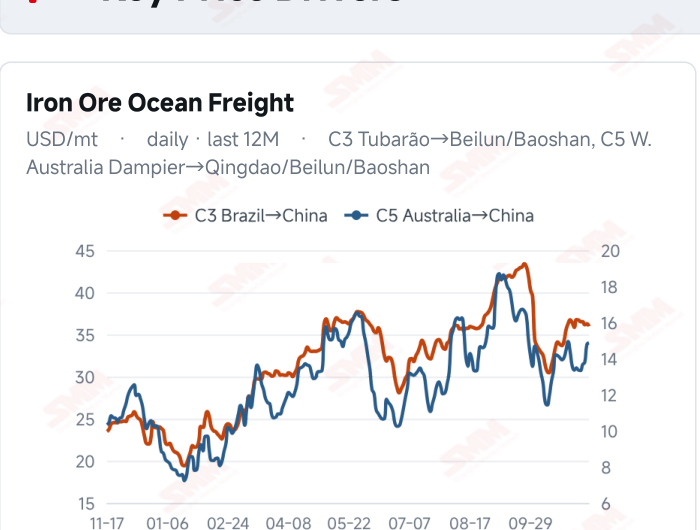
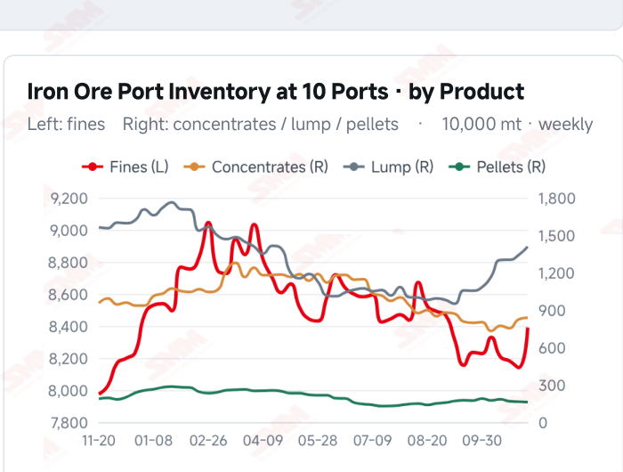
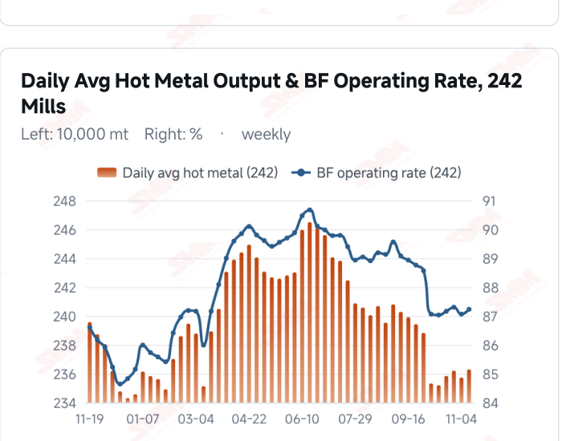
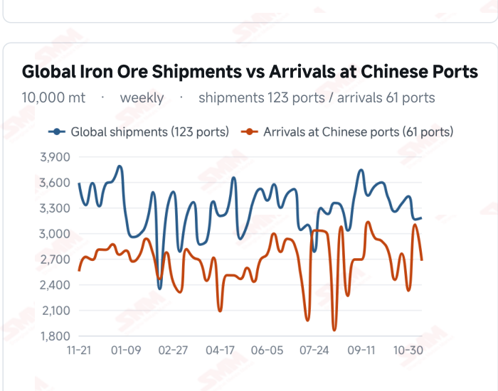

# SMM Iron Ore Daily — 2026-11-16 (Monday)

**Source:** SMM Data-pro · Shanghai Metals Market (SMM)

---

## Futures Contracts

| Exchange | Contract | Price | Unit | Daily Change | Daily Change % | MTD Avg |
|:---|:---|:---:|:---:|:---:|:---:|:---:|
| SGX | SGX Iron Ore Current-month FEFX26 | 90.15 | USD/dmt | — | — | — |
| DCE | DCE Iron Ore Most-traded I2701 | 648.00 | yuan/mt | -21.5 | -3.21% | 677.20 |

## SMM Iron Ore Price Index (Physical & Benchmark Indices)

| Index Name | Market Type | Fe % | Price | Unit | Daily Change | Daily Change % | MTD Avg |
|:---|:---|:---:|:---:|:---:|:---:|:---:|:---:|
| MMi 61% Port Spot | port_spot | 61.0% | 639.00 | yuan/wmt | -9.0 | -1.39% | 652.00 |
| MMi 58% Port Spot | port_spot | 58.0% | 597.00 | yuan/wmt | -8.0 | -1.32% | 606.00 |
| MMi 65% Port Spot | port_spot | 65.0% | 801.00 | yuan/wmt | -9.0 | -1.11% | 813.00 |
| MMi 61% Seaborne Index | seaborne | 61.0% | 88.70 | USD/dmt | -1.65 | -1.83% | 90.89 |
| MMi 65% Seaborne Index | seaborne | 65.0% | 104.20 | USD/dmt | -2.5 | -2.34% | 106.87 |
| SMM Domestic Ore Composite Index | domestic_composite | 66.0% | 800.72 | yuan/mt | +7.8 | +0.98% | 793.01 |

## Key View

### Futures and spot weaken together; lower arrivals do not yet establish inventory relief

Iron ore futures and spot prices weakened broadly today. DCE most-traded closed at 648.0 yuan/mt, down 3.21% from the previous close. All eight Qingdao spot products declined, seaborne 61% and 65% indices fell to USD 88.70 and 104.20/dmt, and all 12 brands moved lower. Prices indicate near-term quotation pressure, but synchronized declines do not establish any one event as the sole driver. Incoming supply pressure has changed. Chinese arrivals fell 13.70% WoW in the week to Nov 13 while global shipments rose 0.62%; voyage lags can explain divergence. Latest available ten-port stocks remain 107.9555 million mt as of Nov 12, up 3.2766 million mt from the preceding period. The earlier modest hot metal increase offers some support, but lower arrivals do not prove that current stocks have already been absorbed. A cautious, range-bound near-term view remains appropriate. Lower arrivals and some easing in transport costs may relieve pressure, while existing inventory accumulation, weaker futures and spot prices and the risk of insufficient sustained buying constrain rebounds. Better mill orders and margins accompanied by steady restocking could strengthen support; mainly needs-based procurement could leave prices fluctuating with trading and resource composition.

## Today's Highlights

- Futures and spot prices declined together. DCE most-traded I2701 closed at 648.0 yuan/mt, down 21.5 yuan (-3.21%) from Nov 13. Qingdao PB Fines were 627, Newman Fines 627 and Mac Fines 630 yuan/wmt, each down 11 yuan; Carajas Fines fell 16 yuan to 792 and PB Lump 14 yuan to 787.
- Seaborne indices and brand quotations fell. The 61% index was USD 88.70/dmt, down 1.65 (-1.83%); the 65% was 104.20, down 2.50 (-2.34%). All 12 brands fell USD 0.80-1.65/dmt against the Nov 13 report, with PB Fines at 89.00, Newman Fines at 88.15 and Mac Fines at 87.70.
- Port indices declined as the seaborne grade spread narrowed. Port 61%, 58% and 65% indices were 639, 597 and 801 yuan/wmt, changing -9, -8 and -9 yuan; the 65%-58% spread narrowed from 205 to 204 yuan. The seaborne 65%-61% spread narrowed from USD 16.35 to 15.50/dmt. Different wet/dry bases and currencies prevent direct comparison of absolute spreads.
- Arrivals eased, but existing stocks still need absorption. Chinese arrivals were 26.7658 million mt in the week to Nov 13, down 4.2475 million mt (-13.70%) WoW; global shipments rose 0.62% to 31.8003 million mt. Latest ten-port stocks remain 107.9555 million mt as of Nov 12; lower arrivals do not establish that stocks have already declined.

## Qingdao Port Imported Ore Spot Prices (yuan/wet mt, tax incl.)

| Product | Fe % | Type | Price (yuan/wmt) | Daily Change | Daily Change % | MTD Avg |
|:---|:---:|:---:|:---:|:---:|:---:|:---:|
| PB Fines 60.8% | 60.8% | Fines | 627.0 | -11.0 | -1.72% | 645.0 |
| Newman Fines 61.2% | 61.2% | Fines | 627.0 | -11.0 | -1.72% | 645.0 |
| Mac Fines 60.8% | 60.8% | Fines | 630.0 | -11.0 | -1.72% | 650.0 |
| BRBF 62.5% | 62.5% | Fines | 680.0 | -11.0 | -1.59% | 694.0 |
| Newman Lump 63% | 63.0% | Lump | 792.0 | -11.0 | -1.37% | 812.0 |
| Super Special Fines (SSF) 56.5% | 56.5% | Fines | 489.0 | -11.0 | -2.20% | 507.0 |
| Carajas Fines (IOCJ) 65% | 65.0% | Fines | 792.0 | -16.0 | -1.98% | 814.0 |
| PB Lump 61.5% | 61.5% | Lump | 787.0 | -14.0 | -1.75% | 808.0 |

## Seaborne Brand Prices in USD (CFR Qingdao, USD/dry mt, as of 2026-11-16)

| Product | Price (USD/dmt) | Daily Change | Daily Change % | Previous |
|:---|:---:|:---:|:---:|:---:|
| Roy Hill Fines 62% | 85.10 | -1.55 | -1.79% | 86.65 |
| SIMEC Fines 61% | 85.75 | -1.4 | -1.61% | 87.15 |
| PB Fines 62% | 89.00 | -1.6 | -1.77% | 90.60 |
| Newman Fines 60.7% | 88.15 | -1.6 | -1.78% | 89.75 |
| Mac Fines 60.5% | 87.70 | -1.5 | -1.68% | 89.20 |
| Jimblebar Fines 60.30% | 84.95 | -1.2 | -1.39% | 86.15 |
| Carajas Fines (IOCJ) 65% | 104.70 | -1.65 | -1.55% | 106.35 |
| SSFT / SSFG 60% | 95.60 | -1.65 | -1.70% | 97.25 |
| Brazilian Blend Fines (BRBF) 64% | 95.30 | -1.65 | -1.70% | 96.95 |
| RTX Fines 61% | 86.50 | -1.5 | -1.70% | 88.00 |
| West Pilbara Fines (WPF) 60% | 87.30 | -1.4 | -1.58% | 88.70 |
| SP10 Fines 59%-60% | 80.65 | -0.8 | -0.98% | 81.45 |

## SMM Iron Ore Price Index — Weekly / Monthly Statistics

| Index Name | Month-to-date Avg | MoM % | YTD % | Unit |
|:---|:---:|:---:|:---:|:---:|
| SMM MMi 61% Iron Ore Seaborne Index | 90.89 | +0.72% | -16.3% | USD/dmt |
| SMM MMi 65% Iron Ore Seaborne Index | 106.87 | -1.36% | -14.1% | USD/dmt |
| SMM MMi 61% Iron Ore Port Spot Index | 652.00 | -0.76% | -21.4% | yuan/wmt |
| SMM MMi 65% Iron Ore Port Spot Index | 813.00 | -0.53% | -10.9% | yuan/wmt |
| SMM MMi 58% Iron Ore Port Spot Index | 606.00 | -1.28% | -16.9% | yuan/wmt |
| SMM China Domestic Ore Composite Price Index | 793.01 | -1.55% | -9.7% | yuan/mt |

## Key Price Drivers (12-Month Charts & Operational Metrics)

### Charts: Freight & Port Inventory

### Charts: Hot Metal Output & Shipments vs Arrivals

### Operational Fundamentals Snapshot

| Fundamental Indicator | Value | Unit |
|:---|:---:|:---:|
| C3 Freight (Brazil to China) | 35.96 | USD/mt |
| Daily Avg Hot Metal Output (242 Mills) | 2.3629 | Million MT |
| Iron Ore Port Inventory (10 Major Ports) | 107.9555 | Million MT |
| Global Iron Ore Shipments (Weekly) | 31.8003 | Million MT |

## Market Commentary · Imported Ore

### Futures & Spot

DCE most-traded I2701 closed at 648.0 yuan/mt, down 21.5 yuan (-3.21%) from 669.5 on Nov 13. Qingdao PB Fines were 627, Newman Fines 627, Mac Fines 630, BRBF 680, Newman Lump 792 and SSF 489 yuan/wmt, all down 11 yuan; Carajas Fines fell 16 yuan to 792 and PB Lump 14 yuan to 787. Joint futures and spot declines indicate pricing pressure, but one-day prices do not directly quantify trading volumes or purchasing changes. SGX official current-month FEFX26 was last priced at USD 90.15/dmt, with quote time Nov 16, 17:28:55 and preparation time 17:46:22 (UTC+8).

### Driver

The seaborne 61% and 65% indices fell 1.83% and 2.34%, narrowing their grade spread; all three port indices and all 12 seaborne brands also declined. Differing moves may reflect grades, quotation timing and procurement composition. Shared weakness should not be attributed directly to one event, nor should one-day spreads establish a shift in blending trends. RMB wet-basis and USD dry-basis prices require separate tax and currency assessment.

### Demand

Latest surveyed daily hot metal was 2.3629 million mt on Nov 11, up 5,600 mt (+0.24%) from Nov 4; the blast furnace operating rate rose 0.17 percentage point to 87.23%. Consumption improved modestly in that week, but this does not establish ongoing expansion today, and lower futures do not prove that hot metal has already fallen. Mill orders, margins and sustained restocking remain important; predominantly needs-based buying could constrain rebound potential.

### Inventory & Supply

Latest ten-port stocks were 107.9555 million mt on Nov 12, up 3.2766 million mt (+3.13%) from Nov 5: fines 83.9000 million mt, concentrates 8.3723 million mt, lump 14.0730 million mt and pellets 1.6102 million mt. In the week to Nov 13, global shipments rose 195,200 mt (+0.62%) to 31.8003 million mt while Chinese arrivals fell 4.2475 million mt (-13.70%) to 26.7658 million mt. Lower arrivals may ease incoming pressure for that period, but differing inventory and arrival periods do not establish current destocking. Voyage lags may also produce opposite shipment and arrival moves.

### Cost & Margin

Latest C3 freight was USD 35.96/mt on Nov 13, down 0.30 (-0.83%) from Nov 12; C5 rose 0.11 (+0.75%) to 14.87. Costs diverged across routes, with actual transmission depending on contracts and settlement timing. Lower ore prices may reduce new procurement costs, but steel selling prices, exchange rates, grades, taxes and inventory valuation must also be considered; improved steelmaking margins cannot be inferred directly.

## Market Commentary · Domestic Ore

### Prices

The latest Domestic Ore Composite Price Index quotation was 800.72 yuan/mt on Nov 13, up 7.80 yuan (+0.98%) on that date from 792.92 on Nov 12. The national composite and regional concentrates differ in grade, wet/dry basis and tax treatment. Absolute prices are not directly comparable, and that earlier gain is not a Nov 16 daily move.

### Supply & Demand

The latest modest rise in surveyed hot metal may support domestic ore consumption, while regional mine and beneficiation operations, quality and transport conditions create differences. Lower imported ore quotations may influence substitution choices, subject to grades and delivered costs. The composite alone cannot establish nationwide tightness or accelerated buying.

### Outlook

Regional divergence may persist in the near term. Tight availability of good-quality resources accompanied by purchases could support local offers; limited improvement in orders and margins, with needs-based buying and price pressure, could constrain upside. The alignment of mine shipments and mill purchases remains important.

## Market Factors

### Supportive Factors

- Latest surveyed daily hot metal rose 5,600 mt WoW, offering some consumption support.
- The blast furnace operating rate reached 87.23%, up 0.17 percentage point WoW.
- Latest Chinese arrivals fell 13.70% WoW, easing incoming pressure for that period.
- C3 freight fell 0.83%, potentially easing some import transport costs.

### Bearish Factors

- DCE fell 3.21% from the previous close and all eight port products declined.
- The seaborne 61% and 65% indices fell 1.83% and 2.34%.
- Ten-port stocks remain at the level following the earlier 3.2766 million mt weekly build.
- Global shipments edged higher and C5 freight rose; sustained buying remains a test.

## Flash News Briefs

- [Odisha produces 158 Mt of iron ore in FY2025-26, using about 57% of cleared capacity] (2026-11-16)
- [High Tide's Labrador West pilot plant produces 67.3% Fe concentrate] (2026-11-16)
- [Australia Warns China's Iron Ore Buying Group Is Interfering in Trade, Flags Budget Impact] (2026-11-16)
- [EU imposes definitive anti-dumping duties on cold-rolled steel from India, Japan, Taiwan, Türkiye and Vietnam] (2026-11-16)
- [Steel billet price adjustment] (2026-11-16)
- [SMM Steel] Indian HRC Prices Ease for the Middle East as Post-Diwali Buying Remains Cautious (2026-11-16)

---
*(c) 2026 Shanghai Metals Market (SMM) · Iron Ore Value-Chain Data & Research*
