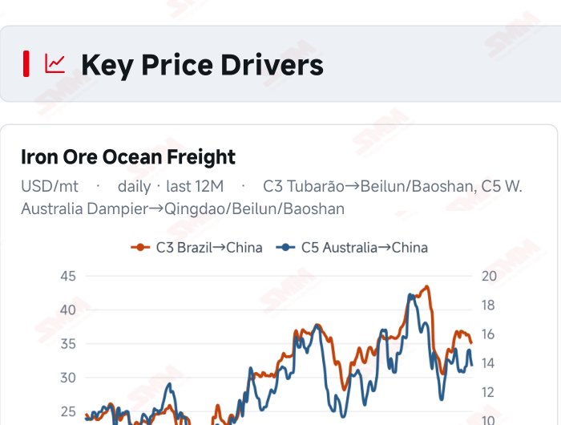
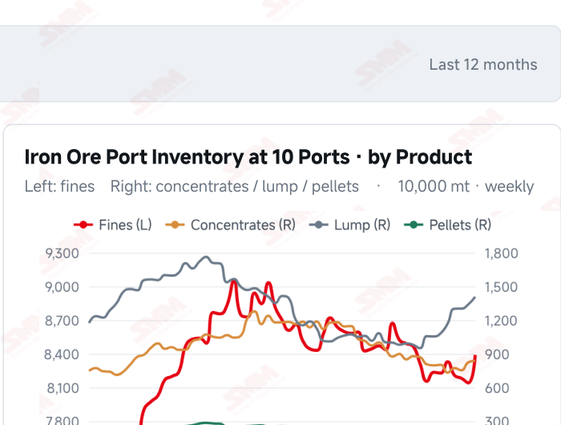
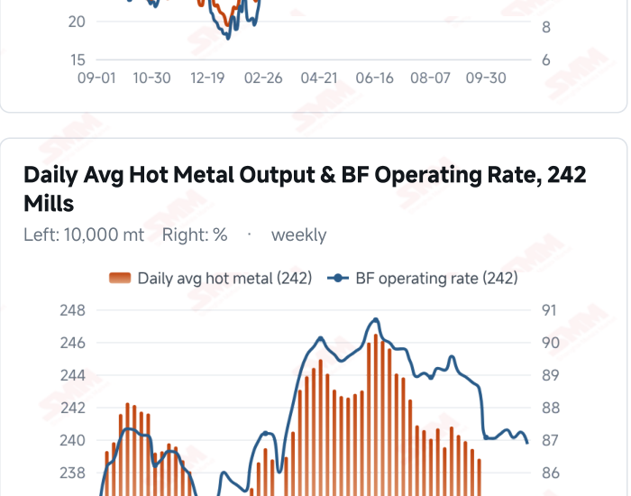
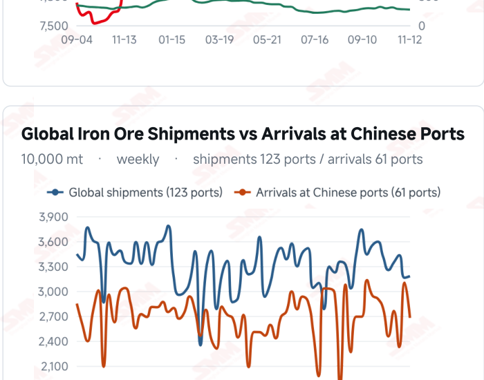

# SMM Iron Ore Daily — 2026-11-18 (Wednesday)

**Source:** SMM Data-pro · Shanghai Metals Market (SMM)

---

## Futures Contracts

| Exchange | Contract | Price | Unit | Daily Change | Daily Change % | MTD Avg |
|:---|:---|:---:|:---:|:---:|:---:|:---:|
| SGX | SGX Iron Ore Current-month FEFX26 | 90.00 | USD/dmt | — | — | — |
| DCE | DCE Iron Ore Most-traded I2701 | 646.00 | yuan/mt | +5.5 | +0.86% | 672.00 |

## SMM Iron Ore Price Index (Physical & Benchmark Indices)

| Index Name | Market Type | Fe % | Price | Unit | Daily Change | Daily Change % | MTD Avg |
|:---|:---|:---:|:---:|:---:|:---:|:---:|:---:|
| MMi 61% Port Spot | port_spot | 61.0% | 638.00 | yuan/wmt | +5.0 | +0.79% | 649.00 |
| MMi 58% Port Spot | port_spot | 58.0% | 597.00 | yuan/wmt | +6.0 | +1.02% | 605.00 |
| MMi 65% Port Spot | port_spot | 65.0% | 800.00 | yuan/wmt | +5.0 | +0.63% | 811.00 |
| MMi 61% Seaborne Index | seaborne | 61.0% | 88.70 | USD/dmt | +0.55 | +0.62% | 90.51 |
| MMi 65% Seaborne Index | seaborne | 65.0% | 104.00 | USD/dmt | +0.4 | +0.39% | 106.40 |
| SMM Domestic Ore Composite Index | domestic_composite | 66.0% | 800.72 | yuan/mt | +7.8 | +0.98% | 793.01 |

## Key View

### Futures and spot rebound modestly, but lower hot metal and existing stocks cap upside

Iron ore futures and spot prices rebounded modestly together today. DCE most-traded closed at 646.0 yuan/mt, up 0.86% from the previous close. All eight Qingdao spot products rose 3 yuan/wmt, seaborne 61% and 65% indices climbed to USD 88.70 and 104.00/dmt, and all 12 brands moved higher. The rebound indicates near- term quotation support, but a single-day gain does not establish a broad strengthening in procurement demand. Supply-demand and freight indicators remained mixed. Latest surveyed daily hot metal edged down to 2.3479 million mt on Nov 18 (down 15,000 mt WoW) and the blast furnace operating rate slipped 0.37 percentage point to 86.86%, while C3 and C5 ocean freight fell another 0.82% and 3.38% on Nov 17. Chinese arrivals fell 13.70% WoW in the week to Nov 13, whereas latest available ten-port stocks remain 107.9555 million mt as of Nov 12; lower arrivals or a one-day rebound do not prove that inventory pressure has cleared. A cautious, range-bound near-term view remains appropriate. Firmer prices, lower arrivals and softer ocean freight offer interim support, while lower hot metal output, existing inventory accumulation and the risk of limited restocking follow-through constrain upside. Improved mill margins accompanied by steady restocking could reinforce support; predominantly needs-based buying could keep prices fluctuating with trading and resource composition.

## Today's Highlights

- Futures and spot prices rebounded modestly. DCE most-traded I2701 closed at 646.0 yuan/mt, up 5.5 yuan (+0.86%) from Nov 17. Qingdao PB Fines were 624, Newman Fines 624, Mac Fines 627, BRBF 679, Newman Lump 789, SSF 486, Carajas Fines 784 and PB Lump 784 yuan/wmt, each up 3 yuan.
- Seaborne indices and all 12 brand quotations rose together. The 61% index was USD 88.70/dmt, up 0.55 (+0.62%); the 65% was 104.00, up 0.40 (+0.39%). All 12 brands rose USD 0.55-1.05/dmt against the Nov 17 report, with PB Fines at 89.00, Newman Fines at 88.15 and Mac Fines at 87.95.
- Port indices rebounded as grade spreads narrowed slightly. Port 61%, 58% and 65% indices were 638, 597 and 800 yuan/wmt, changing +5, +6 and +5 yuan; the 65%-58% spread narrowed from 204 to 203 yuan. The seaborne 65%-61% spread narrowed from USD 15.45 to 15.30/dmt. Different wet/dry bases and currencies prevent direct comparison of absolute spreads.
- Latest hot metal and operating rate edged down while existing stocks await absorption. Surveyed daily hot metal fell to 2.3479 million mt on Nov 18, down 15,000 mt (-0.63%) WoW; the blast furnace operating rate fell 0.37 percentage point to 86.86%. On Nov 17, C3 and C5 freight eased further to USD 34.93 and 13.74/mt, while ten- port stocks remain 107.9555 million mt as of Nov 12.

## Qingdao Port Imported Ore Spot Prices (yuan/wet mt, tax incl.)

| Product | Fe % | Type | Price (yuan/wmt) | Daily Change | Daily Change % | MTD Avg |
|:---|:---:|:---:|:---:|:---:|:---:|:---:|
| PB Fines 60.8% | 60.8% | Fines | 624.0 | +3.0 | +0.48% | 641.0 |
| Newman Fines 61.2% | 61.2% | Fines | 624.0 | +3.0 | +0.48% | 641.0 |
| Mac Fines 60.8% | 60.8% | Fines | 627.0 | +3.0 | +0.48% | 646.0 |
| BRBF 62.5% | 62.5% | Fines | 679.0 | +3.0 | +0.44% | 691.0 |
| Newman Lump 63% | 63.0% | Lump | 789.0 | +3.0 | +0.38% | 808.0 |
| Super Special Fines (SSF) 56.5% | 56.5% | Fines | 486.0 | +3.0 | +0.62% | 503.0 |
| Carajas Fines (IOCJ) 65% | 65.0% | Fines | 784.0 | +3.0 | +0.38% | 809.0 |
| PB Lump 61.5% | 61.5% | Lump | 784.0 | +3.0 | +0.38% | 804.0 |

## Seaborne Brand Prices in USD (CFR Qingdao, USD/dry mt, as of 2026-11-18)

| Product | Price (USD/dmt) | Daily Change | Daily Change % | Previous |
|:---|:---:|:---:|:---:|:---:|
| Roy Hill Fines 62% | 85.35 | +0.7 | +0.83% | 84.65 |
| SIMEC Fines 61% | 86.35 | +0.85 | +0.99% | 85.50 |
| PB Fines 62% | 89.00 | +0.55 | +0.62% | 88.45 |
| Newman Fines 60.7% | 88.15 | +0.55 | +0.63% | 87.60 |
| Mac Fines 60.5% | 87.95 | +0.65 | +0.74% | 87.30 |
| Jimblebar Fines 60.30% | 85.30 | +0.75 | +0.89% | 84.55 |
| Carajas Fines (IOCJ) 65% | 105.30 | +0.85 | +0.81% | 104.45 |
| SSFT / SSFG 60% | 96.35 | +0.9 | +0.94% | 95.45 |
| Brazilian Blend Fines (BRBF) 64% | 95.80 | +0.8 | +0.84% | 95.00 |
| RTX Fines 61% | 86.50 | +0.55 | +0.64% | 85.95 |
| West Pilbara Fines (WPF) 60% | 87.85 | +0.8 | +0.92% | 87.05 |
| SP10 Fines 59%-60% | 81.65 | +1.05 | +1.30% | 80.60 |

## SMM Iron Ore Price Index — Weekly / Monthly Statistics

| Index Name | Month-to-date Avg | MoM % | YTD % | Unit |
|:---|:---:|:---:|:---:|:---:|
| SMM MMi 61% Iron Ore Seaborne Index | 90.51 | +0.30% | -16.3% | USD/dmt |
| SMM MMi 65% Iron Ore Seaborne Index | 106.40 | -1.79% | -14.3% | USD/dmt |
| SMM MMi 61% Iron Ore Port Spot Index | 649.00 | -1.14% | -21.5% | yuan/wmt |
| SMM MMi 65% Iron Ore Port Spot Index | 811.00 | -0.83% | -11.0% | yuan/wmt |
| SMM MMi 58% Iron Ore Port Spot Index | 605.00 | -1.59% | -16.9% | yuan/wmt |
| SMM China Domestic Ore Composite Price Index | 793.01 | -1.55% | -9.7% | yuan/mt |

## Key Price Drivers (12-Month Charts & Operational Metrics)

### Charts: Freight & Port Inventory

### Charts: Hot Metal Output & Shipments vs Arrivals

### Operational Fundamentals Snapshot

| Fundamental Indicator | Value | Unit |
|:---|:---:|:---:|
| C3 Freight (Brazil to China) | 34.93 | USD/mt |
| Daily Avg Hot Metal Output (242 Mills) | 2.3479 | Million MT |
| Iron Ore Port Inventory (10 Major Ports) | 107.9555 | Million MT |
| Global Iron Ore Shipments (Weekly) | 31.8003 | Million MT |

## Market Commentary · Imported Ore

### Futures & Spot

DCE most-traded I2701 closed at 646.0 yuan/mt, up 5.5 yuan (+0.86%) from 640.5 on Nov 17. Qingdao PB Fines were 624, Newman Fines 624, Mac Fines 627, BRBF 679, Newman Lump 789, SSF 486, Carajas Fines 784 and PB Lump 784 yuan/wmt, all up 3 yuan. Synchronized futures and spot gains indicate intraday quotation support, but a modest one-day rebound does not directly quantify higher trading volumes or stronger restocking. SGX official current-month FEFX26 was last priced at USD 90.00/dmt, with quote time Nov 18, 17:24:21 and preparation time 17:43:25 (UTC+8).

### Driver

The seaborne 61% and 65% indices rose 0.62% and 0.39%, narrowing their grade spread to USD 15.30/dmt; all three port indices and all 12 seaborne brands also advanced. Differing moves may reflect grades, quotation timing and buying composition. Shared gains should not be attributed directly to one event, nor should one-day spread changes establish a reversal in blending trends. RMB wet-basis and USD dry-basis prices require separate tax and currency assessment.

### Demand

Latest surveyed daily hot metal was 2.3479 million mt on Nov 18, down 15,000 mt (-0.63%) from Nov 11; the blast furnace operating rate fell 0.37 percentage point to 86.86%. Additional furnace maintenance reduced hot metal output slightly and may temper raw material demand, though a single-week dip does not establish a sharp downturn. Mill orders, margins and restocking pace remain important; predominantly needs-based buying could cap rebound room.

### Inventory & Supply

Latest ten-port stocks were 107.9555 million mt on Nov 12, up 3.2766 million mt (+3.13%) from Nov 5: fines 83.9000 million mt, concentrates 8.3723 million mt, lump 14.0730 million mt and pellets 1.6102 million mt. In the week to Nov 13, global shipments rose 195,200 mt (+0.62%) to 31.8003 million mt while Chinese arrivals fell 4.2475 million mt (-13.70%) to 26.7658 million mt. Lower arrivals may ease incoming pressure for that period, but differing inventory and arrival periods do not establish current destocking. Voyage lags may also produce opposite shipment and arrival moves.

### Cost & Margin

Latest C3 freight was USD 34.93/mt on Nov 17, down 0.29 (-0.82%) from Nov 16; C5 fell 0.48 (-3.38%) to 13.74. Continued freight declines across both routes may ease forward import transport costs, with actual transmission depending on contracts and settlement timing. With ore prices rebounding slightly today while freight eased, steelmaking margins still require assessment alongside steel selling prices, exchange rates, grades, taxes and inventory valuation.

## Market Commentary · Domestic Ore

### Prices

The latest Domestic Ore Composite Price Index quotation was 800.72 yuan/mt on Nov 13, up 7.80 yuan (+0.98%) on that date from 792.92 on Nov 12. The national composite and regional concentrates differ in grade, wet/dry basis and tax treatment. Absolute prices are not directly comparable, and that earlier gain is not a Nov 18 daily move.

### Supply & Demand

Surveyed daily hot metal fell 15,000 mt WoW on Nov 18 as furnace maintenance increased, which may temper local consumption, while regional mine operations, environmental controls and transport conditions create differences. Today's modest rebound in imported ore prices may affect relative value, subject to grades and delivered costs. The composite alone cannot establish nationwide supply-demand shifts.

### Outlook

Regional divergence may persist in the near term. Tight availability of good-quality resources accompanied by purchases could support local offers; lower hot metal and limited improvement in orders, with needs-based buying and price pressure, could constrain upside. The alignment of mine shipments and mill purchases remains important.

## Market Factors

### Supportive Factors

- DCE rose 0.86% from the previous close and all eight port products gained 3 yuan/wmt.
- The seaborne 61% and 65% indices rose 0.62% and 0.39%, with all 12 brands higher.
- Latest Chinese arrivals fell 13.70% WoW, easing incoming pressure for that period.
- C3 and C5 freight fell another 0.82% and 3.38%, potentially easing forward transport costs.

### Bearish Factors

- Surveyed daily hot metal fell to 2.3479 million mt on Nov 18, down 15,000 mt (-0.63%) WoW.
- The blast furnace operating rate declined 0.37 percentage point WoW to 86.86%.
- Ten-port stocks remain at 107.9555 million mt following the earlier 3.2766 million mt build.
- Global shipments edged higher; sustained buying and downstream order follow-through remain a test.

## Flash News Briefs

- [China Iron Ore Briefing] The Liaodong region is likely to consolidate on a weak note (2026-11-18)
- [SMM Coking Coal and Coke Daily Briefing] 20261118 (2026-11-18)
- [SMM Steel] Vietnam HRC imports steady; Indonesian mill sells 60 kt (2026-11-18)
- [SMM Steel] Türkiye HRC holds high; rebar edges up as import billet eases (2026-11-18)
- [SMM Steel] Indonesian HRC Steady at USD 515/tonne FOB as Slab Trades Only Case by Case (2026-11-18)
- [SMM Steel] EU HRC extends gains led by Italy; energy costs idle long-product mills (2026-11-18)

---
*(c) 2026 Shanghai Metals Market (SMM) · Iron Ore Value-Chain Data & Research*
