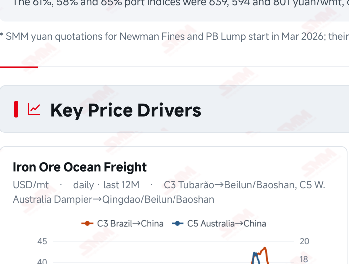
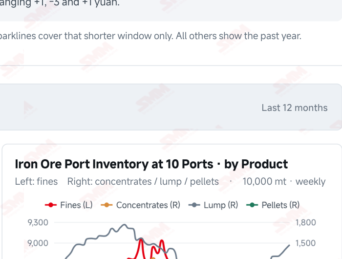
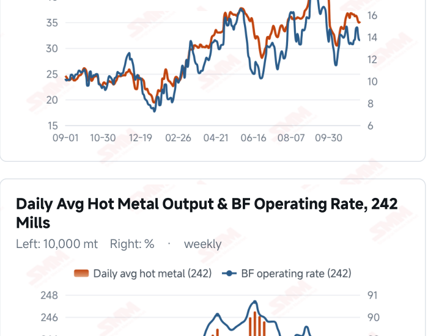
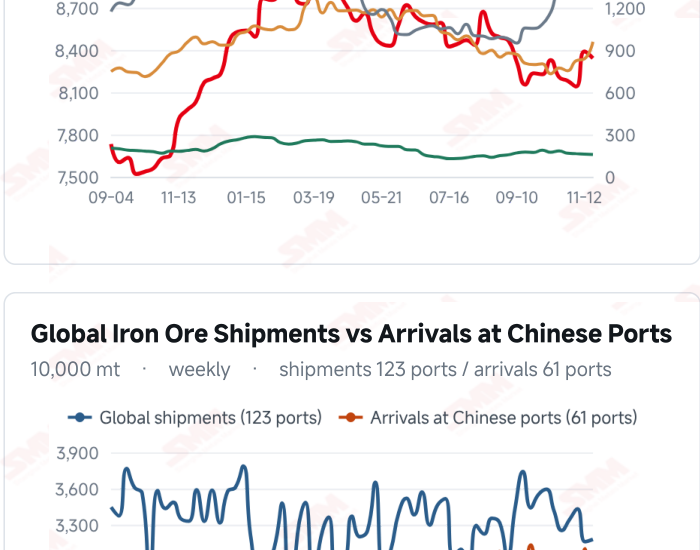

# SMM Iron Ore Daily — 2026-11-19 (Thursday)

**Source:** SMM Data-pro · Shanghai Metals Market (SMM)

---

## Futures Contracts

| Exchange | Contract | Price | Unit | Daily Change | Daily Change % | MTD Avg |
|:---|:---|:---:|:---:|:---:|:---:|:---:|
| SGX | SGX Iron Ore Current-month FEFX26 | 90.35 | USD/dmt | — | — | — |
| DCE | DCE Iron Ore Most-traded I2701 | 648.00 | yuan/mt | +2.0 | +0.31% | 670.30 |

## SMM Iron Ore Price Index (Physical & Benchmark Indices)

| Index Name | Market Type | Fe % | Price | Unit | Daily Change | Daily Change % | MTD Avg |
|:---|:---|:---:|:---:|:---:|:---:|:---:|:---:|
| MMi 61% Port Spot | port_spot | 61.0% | 639.00 | yuan/wmt | +1.0 | +0.16% | 649.00 |
| MMi 58% Port Spot | port_spot | 58.0% | 594.00 | yuan/wmt | -3.0 | -0.50% | 604.00 |
| MMi 65% Port Spot | port_spot | 65.0% | 801.00 | yuan/wmt | +1.0 | +0.12% | 810.00 |
| MMi 61% Seaborne Index | seaborne | 61.0% | 89.10 | USD/dmt | +0.4 | +0.45% | 90.41 |
| MMi 65% Seaborne Index | seaborne | 65.0% | 105.00 | USD/dmt | +1.0 | +0.96% | 106.30 |
| SMM Domestic Ore Composite Index | domestic_composite | 66.0% | 800.72 | yuan/mt | +7.8 | +0.98% | 793.01 |

## Key View

### Futures and spot edge higher, but further ten-port inventory build and lower hot metal cap upside

Iron ore futures and spot prices extended modest gains today with slight divergence across products. DCE most-traded closed at 648.0 yuan/mt, up 0.31% from the previous close. Seven Qingdao spot products including PB Fines and Carajas Fines rose 1 yuan/wmt while PB Lump slipped 2 yuan/wmt; seaborne 61% and 65% indices rose to USD 89.10 and 105.00/dmt with all 12 seaborne brands higher, whereas the port 58% index fell 3 yuan to 594 yuan/wmt. Offers remained resilient overall, though mild one-day moves do not establish a broad strengthening in procurement demand. Fundamental data showed continued inventory accumulation alongside softer demand indicators. Latest ten-port inventory climbed to 109.2582 million mt on Nov 19, up 1.3027 million mt (+1.21%) WoW, as higher concentrate and lump stocks outweighed modest draws in fines and pellets. Surveyed daily hot metal fell to 2.3479 million mt on Nov 18 (down 15,000 mt WoW) and the BF operating rate slipped 0.37 percentage point to 86.86%. On Nov 18, C3 ocean freight edged up 0.57% to USD 35.13/mt while C5 dipped 0.29% to USD 13.70/mt. A cautious, range-bound near-term view remains appropriate. Steady futures and spot offers together with a modest draw in port fines inventory provide interim support, but higher total ten-port inventory, lower hot metal output and needs-based mill purchasing continue to cap upside room. Improved mill margins accompanied by winter restocking could firm support; continued inventory build and limited buying follow-through could keep ore prices fluctuating narrowly around trading activity and product structure.

## Today's Highlights

- Futures and spot prices extended modest gains as most port products edged up. DCE most-traded I2701 closed at 648.0 yuan/mt, up 2.0 yuan (+0.31%) from Nov 18. Qingdao PB Fines were 625, Newman Fines 625, Mac Fines 628, BRBF 680, Newman Lump 790, SSF 487 and Carajas Fines 785 yuan/wmt, each up 1 yuan, while PB Lump fell 2 yuan to 782 yuan/wmt.
- Seaborne indices and all 12 brand quotations continued to advance. The 61% index was USD 89.10/dmt, up 0.40 (+0.45%); the 65% was 105.00, up 1.00 (+0.96%). All 12 brands rose USD 0.15-0.70/dmt against the Nov 18 report, with PB Fines at 89.35, Newman Fines at 88.45 and Mac Fines at 88.45.
- Port indices diverged slightly as high-low grade spreads widened. Port 61%, 58% and 65% indices were 639, 594 and 801 yuan/wmt, changing +1, -3 and +1 yuan; the 65%-58% spread widened from 203 to 207 yuan. The seaborne 65%-61% spread widened from USD 15.30 to 15.90/dmt. Different wet/dry bases and currencies prevent direct comparison of absolute spreads.
- Latest ten-port inventory rose further while lower hot metal caps demand elasticity. Ten-port stocks climbed to 109.2582 million mt on Nov 19, up 1.3027 million mt (+1.21%) WoW. On Nov 18, surveyed daily hot metal was 2.3479 million mt (down 15,000 mt WoW) and the BF operating rate was 86.86% (down 0.37 percentage point); C3 freight edged up to USD 35.13/mt while C5 dipped to 13.70/mt.

## Qingdao Port Imported Ore Spot Prices (yuan/wet mt, tax incl.)

| Product | Fe % | Type | Price (yuan/wmt) | Daily Change | Daily Change % | MTD Avg |
|:---|:---:|:---:|:---:|:---:|:---:|:---:|
| PB Fines 60.8% | 60.8% | Fines | 625.0 | +1.0 | +0.16% | 640.0 |
| Newman Fines 61.2% | 61.2% | Fines | 625.0 | +1.0 | +0.16% | 640.0 |
| Mac Fines 60.8% | 60.8% | Fines | 628.0 | +1.0 | +0.16% | 645.0 |
| BRBF 62.5% | 62.5% | Fines | 680.0 | +1.0 | +0.15% | 690.0 |
| Newman Lump 63% | 63.0% | Lump | 790.0 | +1.0 | +0.13% | 807.0 |
| Super Special Fines (SSF) 56.5% | 56.5% | Fines | 487.0 | +1.0 | +0.21% | 502.0 |
| Carajas Fines (IOCJ) 65% | 65.0% | Fines | 785.0 | +1.0 | +0.13% | 808.0 |
| PB Lump 61.5% | 61.5% | Lump | 782.0 | -2.0 | -0.26% | 802.0 |

## Seaborne Brand Prices in USD (CFR Qingdao, USD/dry mt, as of 2026-11-19)

| Product | Price (USD/dmt) | Daily Change | Daily Change % | Previous |
|:---|:---:|:---:|:---:|:---:|
| Roy Hill Fines 62% | 85.85 | +0.5 | +0.59% | 85.35 |
| SIMEC Fines 61% | 87.05 | +0.7 | +0.81% | 86.35 |
| PB Fines 62% | 89.35 | +0.35 | +0.39% | 89.00 |
| Newman Fines 60.7% | 88.45 | +0.3 | +0.34% | 88.15 |
| Mac Fines 60.5% | 88.45 | +0.5 | +0.57% | 87.95 |
| Jimblebar Fines 60.30% | 85.60 | +0.3 | +0.35% | 85.30 |
| Carajas Fines (IOCJ) 65% | 105.50 | +0.2 | +0.19% | 105.30 |
| SSFT / SSFG 60% | 96.90 | +0.55 | +0.57% | 96.35 |
| Brazilian Blend Fines (BRBF) 64% | 95.95 | +0.15 | +0.16% | 95.80 |
| RTX Fines 61% | 86.75 | +0.25 | +0.29% | 86.50 |
| West Pilbara Fines (WPF) 60% | 88.50 | +0.65 | +0.74% | 87.85 |
| SP10 Fines 59%-60% | 82.20 | +0.55 | +0.67% | 81.65 |

## SMM Iron Ore Price Index — Weekly / Monthly Statistics

| Index Name | Month-to-date Avg | MoM % | YTD % | Unit |
|:---|:---:|:---:|:---:|:---:|
| SMM MMi 61% Iron Ore Seaborne Index | 90.41 | +0.19% | -15.9% | USD/dmt |
| SMM MMi 65% Iron Ore Seaborne Index | 106.30 | -1.88% | -13.5% | USD/dmt |
| SMM MMi 61% Iron Ore Port Spot Index | 649.00 | -1.26% | -21.4% | yuan/wmt |
| SMM MMi 65% Iron Ore Port Spot Index | 810.00 | -0.92% | -10.9% | yuan/wmt |
| SMM MMi 58% Iron Ore Port Spot Index | 604.00 | -1.71% | -17.3% | yuan/wmt |
| SMM China Domestic Ore Composite Price Index | 793.01 | -1.55% | -9.7% | yuan/mt |

## Key Price Drivers (12-Month Charts & Operational Metrics)

### Charts: Freight & Port Inventory

### Charts: Hot Metal Output & Shipments vs Arrivals

### Operational Fundamentals Snapshot

| Fundamental Indicator | Value | Unit |
|:---|:---:|:---:|
| C3 Freight (Brazil to China) | 35.13 | USD/mt |
| Daily Avg Hot Metal Output (242 Mills) | 2.3479 | Million MT |
| Iron Ore Port Inventory (10 Major Ports) | 109.2582 | Million MT |
| Global Iron Ore Shipments (Weekly) | 31.8003 | Million MT |

## Market Commentary · Imported Ore

### Futures & Spot

DCE most-traded I2701 closed at 648.0 yuan/mt, up 2.0 yuan (+0.31%) from 646.0 on Nov 18. Qingdao PB Fines were 625, Newman Fines 625, Mac Fines 628, BRBF 680, Newman Lump 790, SSF 487 and Carajas Fines 785 yuan/wmt, each up 1 yuan, while PB Lump fell 2 yuan to 782 yuan/wmt. Futures and spot prices stayed mildly firm within a narrow range, though minor divergence appeared between fines and lump, and one-day moves do not directly quantify trading volumes. SGX official current-month FEFX26 was last priced at USD 90.35/dmt, with quote time Nov 19, 17:29:14 and preparation time 17:44:46 (UTC+8).

### Driver

The seaborne 61% and 65% indices rose 0.45% and 0.96%, widening their grade spread to USD 15.90/dmt; port 61% and 65% indices each gained 1 yuan while the 58% index fell 3 yuan, and all 12 seaborne brands advanced. Performance across grades and products reflects quotation timing, resource structure and buying preferences; a one-day spread widening should not be read directly as a trend reversal in blending. RMB wet-basis and USD dry-basis prices require separate tax and currency assessment.

### Demand

Latest surveyed daily hot metal was 2.3479 million mt on Nov 18, down 15,000 mt (-0.63%) from Nov 11; the BF operating rate fell 0.37 percentage point to 86.86%. Additional furnace maintenance reduced hot metal output slightly and may temper raw material demand release. Mill orders, margins and winter restocking pace remain key to watch; predominantly needs-based buying could cap upside room.

### Inventory & Supply

Latest ten-port stocks rose to 109.2582 million mt on Nov 19, up 1.3027 million mt (+1.21%) from 107.9555 million mt on Nov 12: fines fell 480,500 mt to 83.4195 million mt, concentrates rose 1.2156 million mt to 9.5879 million mt, lump gained 603,300 mt to 14.6763 million mt and pellets edged down 35,700 mt to 1.5745 million mt. In the week to Nov 13, global shipments rose 0.62% to 31.8003 million mt while Chinese arrivals fell 13.70% to 26.7658 million mt. Total port inventory continued to build with diverging product trends; inventory and shipment/arrival periods differ, and voyage lags can cause opposite movements across stages.

### Cost & Margin

Latest C3 freight was USD 35.13/mt on Nov 18, up 0.20 (+0.57%) from Nov 17; C5 edged down 0.04 (-0.29%) to 13.70. Narrow freight fluctuations have limited immediate impact on forward import transport costs, with actual transmission depending on contracts and settlement timing. With most ore prices edging up today, steelmaking margins still require comprehensive assessment alongside steel selling prices, coke costs, exchange rates, grades, taxes and inventory valuation.

## Market Commentary · Domestic Ore

### Prices

The latest Domestic Ore Composite Price Index quotation was 800.72 yuan/mt on Nov 13, up 7.80 yuan (+0.98%) on that date from 792.92 on Nov 12. The national composite and regional concentrates differ in grade, wet/dry basis and tax treatment. Absolute prices are not directly comparable, and that earlier gain is not a Nov 19 daily move.

### Supply & Demand

Surveyed daily hot metal fell 15,000 mt WoW on Nov 18 as furnace maintenance increased, which may temper local consumption, while regional mine operations, environmental controls and transport conditions create differences. Today's modest gains in imported ore prices may affect relative value, subject to grades and delivered costs. The composite alone cannot establish nationwide supply-demand shifts.

### Outlook

Regional divergence may persist in the near term. Tight availability of good-quality resources accompanied by purchases could support local offers; lower hot metal and limited improvement in orders, with needs-based buying and price pressure, could constrain upside. The alignment of mine shipments and mill purchases remains important.

## Market Factors

### Supportive Factors

- DCE most-traded rose another 0.31% from the previous close and seven Qingdao spot products gained 1 yuan/wmt.
- The seaborne 61% and 65% indices rose 0.45% and 0.96%, with all 12 seaborne brands higher.
- Ten-port fines and pellet inventories fell 480,500 mt and 35,700 mt WoW on Nov 19.
- Latest Chinese arrivals (Nov 13) fell 13.70% WoW, moderating incoming cargo flow for that period.

### Bearish Factors

- Total ten-port inventory climbed to 109.2582 million mt on Nov 19, up 1.3027 million mt (+1.21%) WoW.
- Surveyed daily hot metal fell to 2.3479 million mt (-0.63%) on Nov 18, with the BF operating rate down to 86.86%.
- The port 58% index fell 3 yuan and Qingdao PB Lump dropped 2 yuan, showing softer low-grade and lump performance.
- Global shipments edged higher; sustained buying and downstream order follow-through remain a test.

## Flash News Briefs

- [SMM Iron Ore] Iron ore futures pare gains as market waits for policy signals during summit (2026-11-19)
- [SMM Coking Coal and Coke Daily Brief] 20261119 (2026-11-19)
- [SMM Steel] Indonesian Billet Prices Rise to USD 475/tonne FOB Amid Firm Demand (2026-11-19)
- [SMM Steel] Vietnam HRC imports steady; Indonesian March offers edge up (2026-11-19)
- [SMM Steel] Indian HRC Market Looks to December Pricing as Buying Remains Selective (2026-11-19)
- [SMM Steel] India domestic steel prices edged up (2026-11-19)

---
*(c) 2026 Shanghai Metals Market (SMM) · Iron Ore Value-Chain Data & Research*
