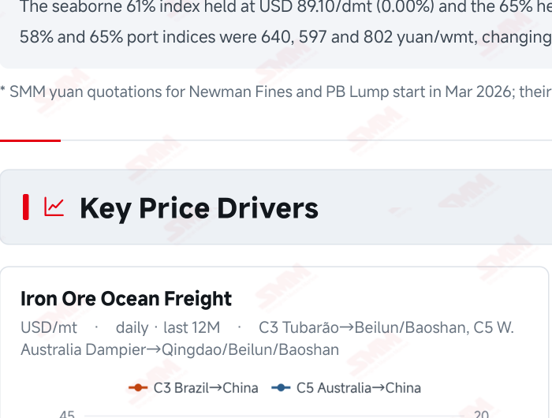
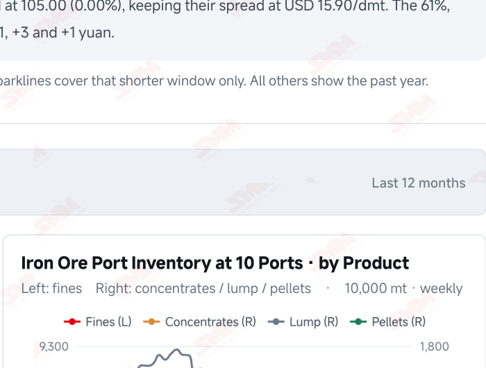
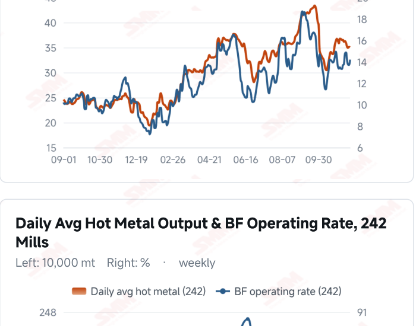
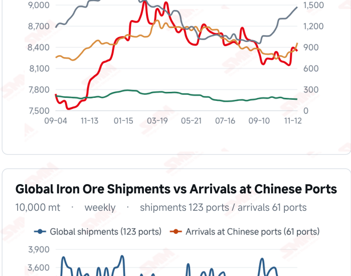

# SMM Iron Ore Daily — 2026-11-20 (Friday)

**Source:** SMM Data-pro · Shanghai Metals Market (SMM)

---

## Futures Contracts

| Exchange | Contract | Price | Unit | Daily Change | Daily Change % | MTD Avg |
|:---|:---|:---:|:---:|:---:|:---:|:---:|
| SGX | SGX Iron Ore Current-month FEFX26 | 90.45 | USD/dmt | — | — | — |
| DCE | DCE Iron Ore Most-traded I2701 | 652.50 | yuan/mt | +4.5 | +0.69% | 669.10 |

## SMM Iron Ore Price Index (Physical & Benchmark Indices)

| Index Name | Market Type | Fe % | Price | Unit | Daily Change | Daily Change % | MTD Avg |
|:---|:---|:---:|:---:|:---:|:---:|:---:|:---:|
| MMi 61% Port Spot | port_spot | 61.0% | 640.00 | yuan/wmt | +1.0 | +0.16% | 648.00 |
| MMi 58% Port Spot | port_spot | 58.0% | 597.00 | yuan/wmt | +3.0 | +0.51% | 603.00 |
| MMi 65% Port Spot | port_spot | 65.0% | 802.00 | yuan/wmt | +1.0 | +0.12% | 810.00 |
| MMi 61% Seaborne Index | seaborne | 61.0% | 89.10 | USD/dmt | 0.0 | 0.00% | 90.32 |
| MMi 65% Seaborne Index | seaborne | 65.0% | 105.00 | USD/dmt | 0.0 | 0.00% | 106.21 |
| SMM Domestic Ore Composite Index | domestic_composite | 66.0% | 792.40 | yuan/mt | -8.48 | -1.06% | 795.07 |

## Key View

### Futures and most port spot prices extend gains, but softer seaborne brands and port stock build cap upside

Iron ore futures and most port spot prices rose modestly today, while seaborne brands and domestic ore softened slightly. DCE most-traded closed at 652.5 yuan/mt, up 0.69% from the previous close. Six Qingdao spot products including PB Fines, Newman Fines and Mac Fines rose 3 yuan/wmt, PB Lump gained 1 yuan and Carajas Fines dipped 2 yuan; port 61%, 58% and 65% indices advanced to 640, 597 and 802 yuan/wmt. Seaborne 61% and 65% composite indices held flat at USD 89.10 and 105.00/dmt while 10 of the 12 seaborne brands edged down USD 0.05-0.80/dmt; the Friday-updated Domestic Ore Composite Price Index fell 1.06% from Nov 19 to 792.40 yuan/mt. On the fundamental side, total port inventory continued to build while demand remained relatively soft. Latest ten- port inventory climbed to 109.2582 million mt on Nov 19, up 1.3027 million mt (+1.21%) WoW, as builds in concentrates and lump outweighed draws in fines and pellets. Surveyed daily hot metal stood at 2.3479 million mt on Nov 18 (down 15,000 mt WoW) with the BF operating rate at 86.86% (down 0.37 percentage point). On Nov 19, C3 ocean freight dipped 0.26% to USD 35.04/mt while C5 rose 3.65% to USD 14.20/mt. A cautious, range-bound near-term view remains appropriate. Firmer futures and mainstream medium/low-grade port spot prices provide interim support, but elevated ten-port inventory, lower hot metal output and slight easing across seaborne brand quotes continue to limit upside elasticity. Mill margin changes and the timing of winter restocking remain key to watch; predominantly needs-based purchasing could keep ore prices fluctuating within a narrow range.

## Today's Highlights

- Futures extended gains as most port spot products moved higher. DCE most-traded I2701 closed at 652.5 yuan/mt, up 4.5 yuan (+0.69%) from Nov 19. Qingdao PB Fines were 628, Newman Fines 628, Mac Fines 631, BRBF 683, Newman Lump 793 and SSF 490 yuan/wmt, each up 3 yuan; PB Lump rose 1 yuan to 783 yuan/wmt, while Carajas Fines dipped 2 yuan to 783 yuan/wmt.
- Seaborne indices held steady while most individual brand quotes edged down. The 61% seaborne index was flat at USD 89.10/dmt and the 65% index held at USD 105.00/dmt. Among the 12 seaborne brands, PB Fines (89.35) and Mac Fines (88.45) were unchanged, while the other 10 brands edged down USD 0.05-0.80/dmt against the Nov 19 report.
- Port indices rose modestly while the Friday-updated domestic ore index pulled back. Port 61%, 58% and 65% indices were 640, 597 and 802 yuan/wmt, changing +1, +3 and +1 yuan; the 65%-58% spread narrowed from 207 to 205 yuan. The Domestic Ore Composite Price Index updated on Nov 20 to 792.40 yuan/mt, down 8.48 yuan (-1.06%) from 800.88 on Nov 19.
- Ten-port inventory stayed elevated while C5 ocean freight rebounded slightly. Ten-port stocks stood at 109.2582 million mt on Nov 19, up 1.3027 million mt (+1.21%) WoW. Surveyed daily hot metal on Nov 18 was 2.3479 million mt (down 15,000 mt WoW) with the BF operating rate at 86.86% (down 0.37 percentage point); on Nov 19, C3 freight dipped to USD 35.04/mt while C5 rose to USD 14.20/mt.

## Qingdao Port Imported Ore Spot Prices (yuan/wet mt, tax incl.)

| Product | Fe % | Type | Price (yuan/wmt) | Daily Change | Daily Change % | MTD Avg |
|:---|:---:|:---:|:---:|:---:|:---:|:---:|
| PB Fines 60.8% | 60.8% | Fines | 628.0 | +3.0 | +0.48% | 639.0 |
| Newman Fines 61.2% | 61.2% | Fines | 628.0 | +3.0 | +0.48% | 639.0 |
| Mac Fines 60.8% | 60.8% | Fines | 631.0 | +3.0 | +0.48% | 644.0 |
| BRBF 62.5% | 62.5% | Fines | 683.0 | +3.0 | +0.44% | 690.0 |
| Newman Lump 63% | 63.0% | Lump | 793.0 | +3.0 | +0.38% | 806.0 |
| Super Special Fines (SSF) 56.5% | 56.5% | Fines | 490.0 | +3.0 | +0.62% | 501.0 |
| Carajas Fines (IOCJ) 65% | 65.0% | Fines | 783.0 | -2.0 | -0.25% | 806.0 |
| PB Lump 61.5% | 61.5% | Lump | 783.0 | +1.0 | +0.13% | 801.0 |

## Seaborne Brand Prices in USD (CFR Qingdao, USD/dry mt, as of 2026-11-20)

| Product | Price (USD/dmt) | Daily Change | Daily Change % | Previous |
|:---|:---:|:---:|:---:|:---:|
| Roy Hill Fines 62% | 85.80 | -0.05 | -0.06% | 85.85 |
| SIMEC Fines 61% | 87.00 | -0.05 | -0.06% | 87.05 |
| PB Fines 62% | 89.35 | 0.0 | 0.00% | 89.35 |
| Newman Fines 60.7% | 88.40 | -0.05 | -0.06% | 88.45 |
| Mac Fines 60.5% | 88.45 | 0.0 | 0.00% | 88.45 |
| Jimblebar Fines 60.30% | 85.45 | -0.15 | -0.18% | 85.60 |
| Carajas Fines (IOCJ) 65% | 104.70 | -0.8 | -0.76% | 105.50 |
| SSFT / SSFG 60% | 96.25 | -0.65 | -0.67% | 96.90 |
| Brazilian Blend Fines (BRBF) 64% | 95.20 | -0.75 | -0.78% | 95.95 |
| RTX Fines 61% | 86.65 | -0.1 | -0.12% | 86.75 |
| West Pilbara Fines (WPF) 60% | 88.45 | -0.05 | -0.06% | 88.50 |
| SP10 Fines 59%-60% | 81.95 | -0.25 | -0.30% | 82.20 |

## SMM Iron Ore Price Index — Weekly / Monthly Statistics

| Index Name | Month-to-date Avg | MoM % | YTD % | Unit |
|:---|:---:|:---:|:---:|:---:|
| SMM MMi 61% Iron Ore Seaborne Index | 90.32 | +0.09% | -15.9% | USD/dmt |
| SMM MMi 65% Iron Ore Seaborne Index | 106.21 | -1.96% | -13.5% | USD/dmt |
| SMM MMi 61% Iron Ore Port Spot Index | 648.00 | -1.34% | -21.3% | yuan/wmt |
| SMM MMi 65% Iron Ore Port Spot Index | 810.00 | -0.99% | -10.8% | yuan/wmt |
| SMM MMi 58% Iron Ore Port Spot Index | 603.00 | -1.78% | -16.9% | yuan/wmt |
| SMM China Domestic Ore Composite Price Index | 795.07 | -1.29% | -10.6% | yuan/mt |

## Key Price Drivers (12-Month Charts & Operational Metrics)

### Charts: Freight & Port Inventory

### Charts: Hot Metal Output & Shipments vs Arrivals

### Operational Fundamentals Snapshot

| Fundamental Indicator | Value | Unit |
|:---|:---:|:---:|
| C3 Freight (Brazil to China) | 35.04 | USD/mt |
| Daily Avg Hot Metal Output (242 Mills) | 2.3479 | Million MT |
| Iron Ore Port Inventory (10 Major Ports) | 109.2582 | Million MT |
| Global Iron Ore Shipments (Weekly) | 31.8003 | Million MT |

## Market Commentary · Imported Ore

### Futures & Spot

DCE most-traded I2701 closed at 652.5 yuan/mt, up 4.5 yuan (+0.69%) from 648.0 on Nov 19. Qingdao PB Fines were 628, Newman Fines 628, Mac Fines 631, BRBF 683, Newman Lump 793 and SSF 490 yuan/wmt, each up 3 yuan; PB Lump gained 1 yuan to 783 yuan/wmt, whereas Carajas Fines slipped 2 yuan to 783 yuan/wmt. Futures and spot prices continued to recover modestly, though divergence appeared between high-grade fines and mainstream medium grades, and single-day moves do not establish broad restocking expansion. SGX official current-month FEFX26 was last priced at USD 90.45/dmt, with quote time Nov 20, 17:43:03 and preparation time 17:59:42 (UTC+8).

### Driver

The seaborne 61% and 65% indices held steady at USD 89.10 and 105.00/dmt, keeping their grade spread at USD 15.90/dmt; port 61%, 58% and 65% indices rose 1, 3 and 1 yuan, while 10 of the 12 seaborne brands edged lower and PB Fines and Mac Fines held flat. Differences across markets and grades reflect sampling windows, cargo liquidity and inquiry structure; one-day divergence does not establish a reversal in blending trends. RMB wet-basis and USD dry-basis prices require separate tax and currency assessment.

### Demand

Latest surveyed daily hot metal was 2.3479 million mt on Nov 18, down 15,000 mt (-0.63%) from Nov 11; the BF operating rate fell 0.37 percentage point to 86.86%. Additional furnace maintenance reduced hot metal output slightly and may temper raw material demand release. Finished steel sales, mill margins and winter restocking pace remain key to watch; predominantly needs-based buying could cap upside room.

### Inventory & Supply

Latest ten-port stocks rose to 109.2582 million mt on Nov 19, up 1.3027 million mt (+1.21%) from 107.9555 million mt on Nov 12: fines fell 480,500 mt to 83.4195 million mt, concentrates rose 1.2156 million mt to 9.5879 million mt, lump gained 603,300 mt to 14.6763 million mt and pellets edged down 35,700 mt to 1.5745 million mt. In the week to Nov 13, global shipments rose 0.62% to 31.8003 million mt while Chinese arrivals fell 13.70% to 26.7658 million mt. Total port inventory continued to build with diverging product trends; inventory and shipment/arrival periods differ, and voyage lags can cause opposite movements across stages.

### Cost & Margin

Latest C3 freight was USD 35.04/mt on Nov 19, down 0.09 (-0.26%) from Nov 18; C5 rose 0.50 (+3.65%) to 14.20. A mild rebound on the Australia route alongside a slight dip on the Brazil route will transmit to forward landed costs depending on contracts and settlement timing. With most port ore prices edging higher today, steelmaking margins still require comprehensive assessment alongside steel selling prices, coke price-cut expectations, exchange rates, grades, taxes and inventory valuation.

## Market Commentary · Domestic Ore

### Prices

The Friday-updated Domestic Ore Composite Price Index stood at 792.40 yuan/mt on Nov 20, down 8.48 yuan (-1.06%) from 800.88 on Nov 19. The national composite and regional iron ore concentrates differ in grade, wet/dry basis and tax treatment, so absolute price levels are not directly comparable.

### Supply & Demand

Surveyed daily hot metal fell 15,000 mt WoW on Nov 18 as furnace maintenance increased, keeping mill procurement of domestic concentrates cautious and needs-based; regional mine operations, environmental controls and winter transport conditions also continue to diverge. Modest gains in imported port spot prices may affect local relative value, subject to grades and delivered costs.

### Outlook

The domestic ore market may remain steady-to-soft with regional divergence in the near term. Tight local availability of quality concentrates accompanied by restocking could lend resilience to offers, whereas lower hot metal output and soft finished steel demand could keep mills pressing prices and cap upside. Alignment between mine shipments and mill procurement remains key to monitor.

## Market Factors

### Supportive Factors

- DCE most-traded rose another 0.69% and seven Qingdao spot products gained 1-3 yuan/wmt.
- Port 61%, 58% and 65% indices all advanced while seaborne 61% and 65% composite indices held firm.
- Ten-port fines and pellet inventories fell 480,500 mt and 35,700 mt WoW on Nov 19.
- Latest Chinese arrivals (Nov 13) fell 13.70% WoW, moderating incoming cargo flow for that period.

### Bearish Factors

- Total ten-port inventory climbed to 109.2582 million mt on Nov 19, up 1.3027 million mt (+1.21%) WoW.
- Surveyed daily hot metal fell to 2.3479 million mt (-0.63%) on Nov 18, with the BF operating rate down to 86.86%.
- Ten seaborne brand quotes eased USD 0.05-0.80/dmt and Qingdao Carajas Fines slipped 2 yuan/wmt.
- The Domestic Ore Composite Index fell 1.06% to 792.40 yuan/mt as needs-based buying persisted.

## Flash News Briefs

- [SMM Iron Ore] Port stock build caps iron ore after early gains (2026-11-20)
- [SMM Coking Coal and Coke Daily Briefing] 20261120 (2026-11-20)
- [SMM Rebar Daily Review] Limited Fundamental Drivers, Prices May Continue to Consolidate at Lows (2026-11-20)
- [SMM Steel] Vietnam HRC imports steady; Chinese loadings slip on tight shipping (2026-11-20)
- [SMM Steel] Indonesian Flat Products Caught Between Weak Demand and Rising Slab Costs (2026-11-20)
- [SMM Steel] European HRC gains slow; Italy falls EUR 5/tonne (2026-11-20)

---
*(c) 2026 Shanghai Metals Market (SMM) · Iron Ore Value-Chain Data & Research*
