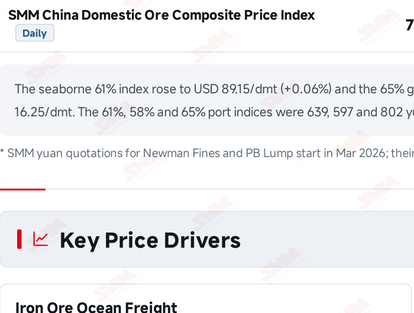
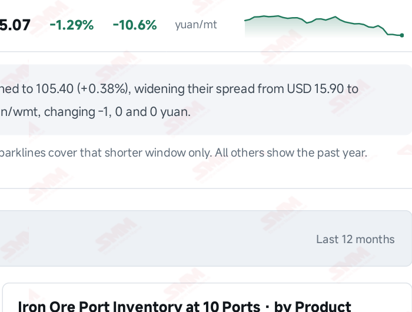
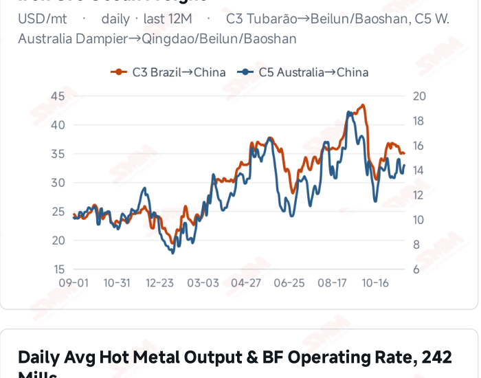
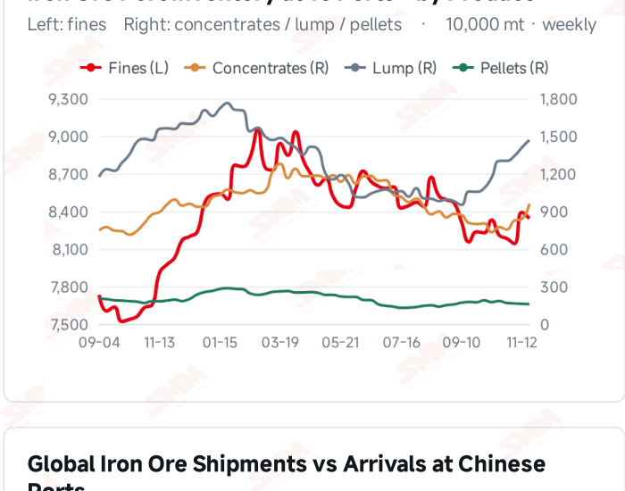

# SMM Iron Ore Daily — 2026-11-23 (Monday)

**Source:** SMM Data-pro · Shanghai Metals Market (SMM)

---

## Futures Contracts

| Exchange | Contract | Price | Unit | Daily Change | Daily Change % | MTD Avg |
|:---|:---|:---:|:---:|:---:|:---:|:---:|
| SGX | SGX Iron Ore Current-month FEFX26 | 90.50 | USD/dmt | — | — | — |
| DCE | DCE Iron Ore Most-traded I2701 | 654.00 | yuan/mt | +1.5 | +0.23% | 668.20 |

## SMM Iron Ore Price Index (Physical & Benchmark Indices)

| Index Name | Market Type | Fe % | Price | Unit | Daily Change | Daily Change % | MTD Avg |
|:---|:---|:---:|:---:|:---:|:---:|:---:|:---:|
| MMi 61% Port Spot | port_spot | 61.0% | 639.00 | yuan/wmt | -1.0 | -0.16% | 647.00 |
| MMi 58% Port Spot | port_spot | 58.0% | 597.00 | yuan/wmt | 0.0 | 0.00% | 603.00 |
| MMi 65% Port Spot | port_spot | 65.0% | 802.00 | yuan/wmt | 0.0 | 0.00% | 809.00 |
| MMi 61% Seaborne Index | seaborne | 61.0% | 89.15 | USD/dmt | +0.05 | +0.06% | 90.25 |
| MMi 65% Seaborne Index | seaborne | 65.0% | 105.40 | USD/dmt | +0.4 | +0.38% | 106.16 |
| SMM Domestic Ore Composite Index | domestic_composite | 66.0% | 792.40 | yuan/mt | -8.48 | -1.06% | 795.07 |

## Key View

### Futures and seaborne composite indices tick up, but higher global shipments and elevated port stocks keep prices range-bound

Iron ore futures and seaborne composite indices edged higher today, while port spot products and seaborne brands diverged narrowly. DCE most-traded closed at 654.0 yuan/mt, up 0.23% from Nov 20. Five Qingdao spot products including PB Fines and Newman Fines held flat, Mac Fines gained 2 yuan/wmt, and Carajas Fines and PB Lump slipped 2 yuan and 3 yuan/wmt; port 61%, 58% and 65% indices stood at 639, 597 and 802 yuan/wmt. Seaborne 61% and 65% composite indices rose slightly to USD 89.15 and 105.40/dmt while the 12 seaborne brands saw 4 gainers, 1 unchanged and 7 decliners; the Friday-updated Domestic Ore Composite Price Index retained its Nov 20 quote of 792.40 yuan/mt (down 1.06% from Nov 19 on that date). On the fundamental side, overseas shipments rebounded notably while port inventory stayed elevated. In the week to Nov 20, global iron ore shipments climbed to 35.2588 million mt, up 3.4585 million mt (+10.88% WoW), and Chinese port arrivals reached 27.0447 million mt, up 278,900 mt (+1.04% WoW). Total ten-port inventory stood at 109.2582 million mt on Nov 19, up 1.3027 million mt (+1.21%) WoW; surveyed daily hot metal was 2.3479 million mt on Nov 18 (down 15,000 mt WoW) with the BF operating rate at 86.86% (down 0.37 percentage point). On Nov 20, C3 ocean freight dipped 0.60% to USD 34.83/mt while C5 rose 1.62% to USD 14.43/mt. A cautious, range-bound near-term view remains appropriate. Steadying futures and resilient mainstream medium-grade spot prices offer floor support, but rebounding global shipments, elevated ten-port inventory and subdued hot metal output continue to cap upside room. Mill margin developments and the pace of winter restocking remain key to monitor; predominantly needs-based procurement could keep ore prices fluctuating within a narrow range.

## Today's Highlights

- Futures edged higher while port spot products diverged narrowly. DCE most-traded I2701 closed at 654.0 yuan/mt, up 1.5 yuan (+0.23%) from Nov 20. Qingdao PB Fines were unchanged at 628, Newman Fines at 628, BRBF at 683, Newman Lump at 793 and SSF at 490 yuan/wmt; Mac Fines rose 2 yuan to 633 yuan/wmt, while Carajas Fines and PB Lump slipped 2 yuan and 3 yuan to 781 and 780 yuan/wmt.
- Seaborne composite indices ticked up while individual brand quotes were mixed. The 61% seaborne index rose to USD 89.15/dmt (+0.05, +0.06%) and the 65% index gained to USD 105.40/dmt (+0.40, +0.38%). Among the 12 seaborne brands, Roy Hill Fines, SIMEC Fines, Mac Fines and West Pilbara Fines rose USD 0.05-0.10/dmt against the Nov 20 report, PB Fines held at 89.35, and the other 7 brands eased USD 0.05-0.45/dmt.
- Port indices held largely steady while the domestic ore index retained Friday’s quote. Port 61%, 58% and 65% indices were 639, 597 and 802 yuan/wmt, changing -1, 0 and 0 yuan; the 65%-58% spread held at 205 yuan. Updated every Friday, the Domestic Ore Composite Price Index stood at 792.40 yuan/mt as of Nov 20, down 8.48 yuan (-1.06%) from Nov 19 on that date.
- Global shipments and Chinese arrivals rebounded while ten-port inventory stayed elevated. In the week to Nov 20, global shipments climbed to 35.2588 million mt (up 3.4585 million mt, +10.88% WoW) and Chinese arrivals reached 27.0447 million mt (up 278,900 mt, +1.04% WoW). Ten-port stocks were 109.2582 million mt on Nov 19 (up 1.3027 million mt WoW); surveyed daily hot metal was 2.3479 million mt on Nov 18; on Nov 20, C3 freight dipped to USD 34.83/mt while C5 rose to USD 14.43/mt.

## Qingdao Port Imported Ore Spot Prices (yuan/wet mt, tax incl.)

| Product | Fe % | Type | Price (yuan/wmt) | Daily Change | Daily Change % | MTD Avg |
|:---|:---:|:---:|:---:|:---:|:---:|:---:|
| PB Fines 60.8% | 60.8% | Fines | 628.0 | 0.0 | 0.00% | 639.0 |
| Newman Fines 61.2% | 61.2% | Fines | 628.0 | 0.0 | 0.00% | 639.0 |
| Mac Fines 60.8% | 60.8% | Fines | 633.0 | +2.0 | +0.32% | 643.0 |
| BRBF 62.5% | 62.5% | Fines | 683.0 | 0.0 | 0.00% | 690.0 |
| Newman Lump 63% | 63.0% | Lump | 793.0 | 0.0 | 0.00% | 805.0 |
| Super Special Fines (SSF) 56.5% | 56.5% | Fines | 490.0 | 0.0 | 0.00% | 501.0 |
| Carajas Fines (IOCJ) 65% | 65.0% | Fines | 781.0 | -2.0 | -0.26% | 804.0 |
| PB Lump 61.5% | 61.5% | Lump | 780.0 | -3.0 | -0.38% | 800.0 |

## Seaborne Brand Prices in USD (CFR Qingdao, USD/dry mt, as of 2026-11-23)

| Product | Price (USD/dmt) | Daily Change | Daily Change % | Previous |
|:---|:---:|:---:|:---:|:---:|
| Roy Hill Fines 62% | 85.90 | +0.1 | +0.12% | 85.80 |
| SIMEC Fines 61% | 87.05 | +0.05 | +0.06% | 87.00 |
| PB Fines 62% | 89.35 | 0.0 | 0.00% | 89.35 |
| Newman Fines 60.7% | 88.35 | -0.05 | -0.06% | 88.40 |
| Mac Fines 60.5% | 88.55 | +0.1 | +0.11% | 88.45 |
| Jimblebar Fines 60.30% | 85.20 | -0.25 | -0.29% | 85.45 |
| Carajas Fines (IOCJ) 65% | 104.25 | -0.45 | -0.43% | 104.70 |
| SSFT / SSFG 60% | 96.05 | -0.2 | -0.21% | 96.25 |
| Brazilian Blend Fines (BRBF) 64% | 94.75 | -0.45 | -0.47% | 95.20 |
| RTX Fines 61% | 86.50 | -0.15 | -0.17% | 86.65 |
| West Pilbara Fines (WPF) 60% | 88.55 | +0.1 | +0.11% | 88.45 |
| SP10 Fines 59%-60% | 81.60 | -0.35 | -0.43% | 81.95 |

## SMM Iron Ore Price Index — Weekly / Monthly Statistics

| Index Name | Month-to-date Avg | MoM % | YTD % | Unit |
|:---|:---:|:---:|:---:|:---:|
| SMM MMi 61% Iron Ore Seaborne Index | 90.25 | +0.01% | -15.9% | USD/dmt |
| SMM MMi 65% Iron Ore Seaborne Index | 106.16 | -2.01% | -13.1% | USD/dmt |
| SMM MMi 61% Iron Ore Port Spot Index | 647.00 | -1.43% | -21.4% | yuan/wmt |
| SMM MMi 65% Iron Ore Port Spot Index | 809.00 | -1.05% | -10.8% | yuan/wmt |
| SMM MMi 58% Iron Ore Port Spot Index | 603.00 | -1.85% | -16.9% | yuan/wmt |
| SMM China Domestic Ore Composite Price Index | 795.07 | -1.29% | -10.6% | yuan/mt |

## Key Price Drivers (12-Month Charts & Operational Metrics)

### Charts: Freight & Port Inventory

### Charts: Hot Metal Output & Shipments vs Arrivals

### Operational Fundamentals Snapshot

| Fundamental Indicator | Value | Unit |
|:---|:---:|:---:|
| C3 Freight (Brazil to China) | 34.83 | USD/mt |
| Daily Avg Hot Metal Output (242 Mills) | 2.3479 | Million MT |
| Iron Ore Port Inventory (10 Major Ports) | 109.2582 | Million MT |
| Global Iron Ore Shipments (Weekly) | 35.2588 | Million MT |

## Market Commentary · Imported Ore

### Futures & Spot

DCE most-traded I2701 closed at 654.0 yuan/mt, up 1.5 yuan (+0.23%) from 652.5 on Nov 20. Qingdao PB Fines (628), Newman Fines (628), BRBF (683), Newman Lump (793) and SSF (490 yuan/wmt) all held flat from the previous trading day; Mac Fines gained 2 yuan to 633 yuan/wmt, while Carajas Fines fell 2 yuan to 781 yuan/wmt and PB Lump slipped 3 yuan to 780 yuan/wmt. Futures continued to edge higher while mainstream medium-grade fines held steady and high-grade fines and lump softened slightly; single-day divergence mainly reflects trading pace across products rather than a trend shift in end-use demand. SGX official current-month FEFX26 was last priced at USD 90.50/dmt, with quote time Nov 23, 17:29:03 and preparation time 17:43:58 (UTC+8).

### Driver

The seaborne 61% and 65% indices rose to USD 89.15 and 105.40/dmt (+0.06% and +0.38%), widening their grade spread from USD 15.90 to 16.25/dmt; the port 61% index edged down 1 yuan to 639 yuan/wmt while the 58% and 65% indices held at 597 and 802 yuan/wmt. Across the 12 seaborne brands, 4 rose, 1 held flat and 7 declined, diverging slightly from the composite indices due to sampling windows, forward cargo liquidity and spot negotiation differences; one-day spread changes do not imply a reversal in blending preferences. RMB wet-basis and USD dry-basis quotes require separate tax and currency assessment.

### Demand

Latest surveyed daily hot metal was 2.3479 million mt on Nov 18, down 15,000 mt (-0.63%) from Nov 11; the BF operating rate fell 0.37 percentage point to 86.86%. Routine furnace maintenance kept hot metal output relatively soft, leaving mill procurement focused on needs-based restocking. Apparent finished steel consumption, mill profitability and the pace of winter raw material restocking remain key to monitor; without a clear rebound in hot metal output, upside elasticity for ore prices may stay capped.

### Inventory & Supply

In the week to Nov 20, global iron ore shipments rose to 35.2588 million mt, up 3.4585 million mt (+10.88%) from 31.8003 million mt on Nov 13; Chinese port arrivals reached 27.0447 million mt, up 278,900 mt (+1.04%) from 26.7658 million mt on Nov 13. Total ten-port inventory stood at 109.2582 million mt on Nov 19, up 1.3027 million mt (+1.21%) WoW: fines fell 480,500 mt to 83.4195 million mt, concentrates rose 1.2156 million mt to 9.5879 million mt, lump gained 603,300 mt to 14.6763 million mt and pellets dipped 35,700 mt to 1.5745 million mt. Higher overseas shipments will feed into arrivals over upcoming voyage cycles, keeping overall supply ample alongside elevated ten-port stocks; inventory and shipment/arrival periods differ, and shipping lags can cause asynchronous moves across stages.

### Cost & Margin

Latest C3 freight was USD 34.83/mt on Nov 20, down 0.21 (-0.60%) from Nov 19; C5 rose 0.23 (+1.62%) to 14.43. A further modest gain on the Western Australia route alongside a slight dip on the Brazil route will transmit to forward landed costs depending on laycans and contract settlement terms. With port spot prices consolidating narrowly, steelmaking margins still require comprehensive evaluation alongside ex-works steel prices, coke price-cut developments, exchange rates, grades, taxes and inventory valuation.

## Market Commentary · Domestic Ore

### Prices

Updated every Friday, the Domestic Ore Composite Price Index stood at its latest valid quote of 792.40 yuan/mt as of Nov 20, down 8.48 yuan (-1.06%) from 800.88 on Nov 19 on that date. The national composite index and regional iron ore concentrates differ in grade, wet/dry basis and tax treatment, so absolute price levels are not directly comparable.

### Supply & Demand

Surveyed daily hot metal fell 15,000 mt WoW to 2.3479 million mt on Nov 18, keeping mill purchasing of domestic concentrates cautious and volume-controlled during furnace maintenance; beneficiation plant operating rates, environmental requirements and winter transport conditions also continue to vary across regions. With imported port spot prices holding largely steady, local domestic-imported price spreads still require evaluation alongside grades and delivered plant costs.

### Outlook

The domestic ore market may remain steady-to-soft with regional divergence in the near term. Tight local availability of quality concentrates paired with periodic mill restocking could offer partial support, whereas subdued hot metal output and pressure on finished steel sales may keep cost control weighing on upside room. Beneficiation plant shipping sentiment and winter restocking pace remain key to watch.

## Market Factors

### Supportive Factors

- DCE most-traded edged up 0.23%, while seaborne 61% and 65% composite indices rose 0.06% and 0.38%.
- Five Qingdao spot products including PB Fines and Newman Fines held steady, Mac Fines gained 2 yuan/wmt, and four Australian medium-grade seaborne brands ticked up.
- Ten-port fines and pellet inventories fell 480,500 mt and 35,700 mt WoW on Nov 19.
- C5 freight rose 1.62% to USD 14.43/mt on Nov 20, showing continued resilience on the Australia route.

### Bearish Factors

- Global iron ore shipments rose to 35.2588 million mt (+10.88% WoW) and Chinese arrivals reached 27.0447 million mt (+1.04% WoW) in the week to Nov 20.
- Total ten-port inventory stood at 109.2582 million mt on Nov 19, up 1.3027 million mt (+1.21%) WoW.
- Surveyed daily hot metal dipped to 2.3479 million mt (-0.63%) on Nov 18, with the BF operating rate down to 86.86%.
- Seven seaborne brand quotes eased USD 0.05-0.45/dmt, while Qingdao Carajas Fines and PB Lump slipped 2 yuan and 3 yuan/wmt.

## Flash News Briefs

- [SMM Iron Ore] Iron ore range-bound as shipments rise, port stocks build (2026-11-23)
- [Domestic Iron Ore Brief] Iron ore concentrates prices in the Shandong region may consolidate on a subdued note (2026-11-23)
- [SMM Coking Coal and Coke Daily Brief] 20261123 (2026-11-23)
- [SMM Rebar Daily Review] Fundamentals Provide No Driving Force, Prices Mainly Consolidate (2026-11-23)
- [Stegra, LKAB Sign MOU to Advance Long-Term DR Pellet Supply] (2026-11-23)
- [SMM Steel] Indian HRC Prices Hold in Asia, Fall in Europe (2026-11-23)

---
*(c) 2026 Shanghai Metals Market (SMM) · Iron Ore Value-Chain Data & Research*
