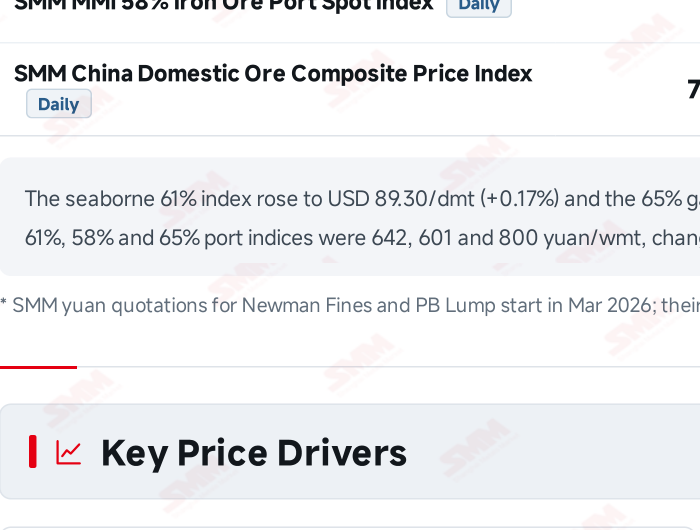
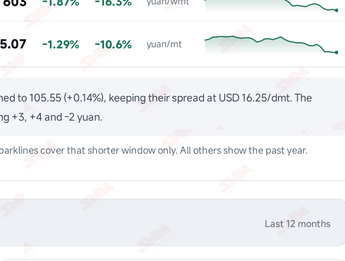
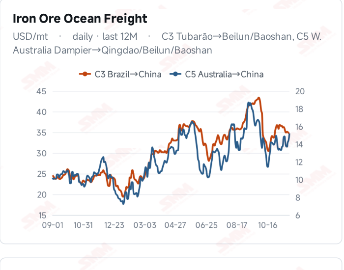
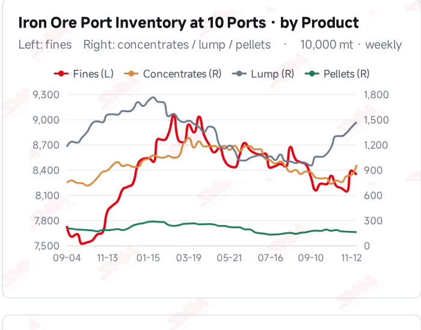

# SMM Iron Ore Daily — 2026-11-24 (Tuesday)

**Source:** SMM Data-pro · Shanghai Metals Market (SMM)

---

## Futures Contracts

| Exchange | Contract | Price | Unit | Daily Change | Daily Change % | MTD Avg |
|:---|:---|:---:|:---:|:---:|:---:|:---:|
| SGX | SGX Iron Ore Current-month FEFX26 | 90.55 | USD/dmt | — | — | — |
| DCE | DCE Iron Ore Most-traded I2701 | 658.50 | yuan/mt | +4.5 | +0.69% | 667.60 |

## SMM Iron Ore Price Index (Physical & Benchmark Indices)

| Index Name | Market Type | Fe % | Price | Unit | Daily Change | Daily Change % | MTD Avg |
|:---|:---|:---:|:---:|:---:|:---:|:---:|:---:|
| MMi 61% Port Spot | port_spot | 61.0% | 642.00 | yuan/wmt | +3.0 | +0.47% | 647.00 |
| MMi 58% Port Spot | port_spot | 58.0% | 601.00 | yuan/wmt | +4.0 | +0.67% | 603.00 |
| MMi 65% Port Spot | port_spot | 65.0% | 800.00 | yuan/wmt | -2.0 | -0.25% | 809.00 |
| MMi 61% Seaborne Index | seaborne | 61.0% | 89.30 | USD/dmt | +0.15 | +0.17% | 90.19 |
| MMi 65% Seaborne Index | seaborne | 65.0% | 105.55 | USD/dmt | +0.15 | +0.14% | 106.12 |
| SMM Domestic Ore Composite Index | domestic_composite | 66.0% | 792.40 | yuan/mt | -8.48 | -1.06% | 795.07 |

## Key View

### Futures, port spot and seaborne quotes firm in tandem, but high global shipments and elevated port stocks still cap upside room

Iron ore futures, Qingdao port spot products and seaborne quotes firmed in tandem today, while the high-grade port composite index diverged slightly. DCE most-traded closed at 658.5 yuan/mt, up 0.69% from Nov 23. All eight Qingdao spot products including PB Fines, Newman Fines, Mac Fines and Carajas Fines gained 5 yuan/wmt; port 61% and 58% indices climbed to 642 and 601 yuan/wmt while the 65% port composite index edged down 2 yuan to 800 yuan/wmt. Seaborne 61% and 65% composite indices rose to USD 89.30 and 105.55/dmt (each up USD 0.15/dmt) and all 12 seaborne brands advanced USD 0.10-0.20/dmt; the Friday-updated Domestic Ore Composite Price Index retained its Nov 20 quote of 792.40 yuan/mt (down 1.06% from Nov 19 on that date). On the fundamental side, Western Australia route freight rose notably while overall supply and port inventory stayed elevated. Latest C5 freight climbed 5.34% to USD 15.20/mt on Nov 23 while C3 edged down 0.14% to USD 34.78/mt. In the week to Nov 20, global iron ore shipments stood at 35.2588 million mt (+10.88% WoW) and Chinese port arrivals at 27.0447 million mt (+1.04% WoW); total ten-port inventory was 109.2582 million mt on Nov 19 (up 1.3027 million mt, +1.21% WoW); surveyed daily hot metal was 2.3479 million mt on Nov 18 (down 15,000 mt WoW) with the BF operating rate at 86.86% (down 0.37 percentage point). Iron ore prices may trade on a steady-to-firm note in the short term, though upside room remains constrained. Consecutive futures gains, underlying mill demand and firmer C5 freight bolster spot sentiment, but rebounding overseas shipments, elevated ten-port inventory and relatively low hot metal output continue to cap upward elasticity. Mill margin recovery and winter restocking pace remain key to track; without sustained expansion in spot turnover, ore prices may stay within a range-bound pattern.

## Today's Highlights

- Futures extended gains as all eight Qingdao port spot products moved higher. DCE most-traded I2701 closed at 658.5 yuan/mt, up 4.5 yuan (+0.69%) from Nov 23. Qingdao PB Fines (633), Newman Fines (633), Mac Fines (638), BRBF (688), Newman Lump (798), SSF (495), Carajas Fines (786) and PB Lump (785 yuan/wmt) each rose 5 yuan/wmt from Nov 23.
- Seaborne composite indices and all 12 individual brand quotes ticked up in tandem. The 61% seaborne index rose to USD 89.30/dmt (+0.15, +0.17%) and the 65% index advanced to USD 105.55/dmt (+0.15, +0.14%). All 12 seaborne brands gained USD 0.10-0.20/dmt against the Nov 23 report, led by USD 0.20/dmt increases in Roy Hill Fines, SIMEC Fines, Jimblebar Fines and SP10 Fines.
- Medium/low-grade port indices rose while the 65% composite index edged down; the domestic ore index retained Friday’s quote. Port 61%, 58% and 65% indices were 642, 601 and 800 yuan/wmt, changing +3, +4 and -2 yuan; the 65%-58% spread narrowed from 205 to 199 yuan. Updated every Friday, the Domestic Ore Composite Price Index stood at 792.40 yuan/mt as of Nov 20, down 8.48 yuan (-1.06%) from Nov 19 on that date.
- C5 ocean freight climbed 5.34% while shipments and port inventory stayed elevated. On Nov 23, C5 freight rose to USD 15.20/mt (+0.77, +5.34%) while C3 dipped to USD 34.78/mt (-0.05, -0.14%). In the week to Nov 20, global shipments were 35.2588 million mt (+10.88% WoW) and Chinese arrivals 27.0447 million mt (+1.04% WoW); ten-port stocks stood at 109.2582 million mt on Nov 19; surveyed daily hot metal was 2.3479 million mt on Nov 18.

## Qingdao Port Imported Ore Spot Prices (yuan/wet mt, tax incl.)

| Product | Fe % | Type | Price (yuan/wmt) | Daily Change | Daily Change % | MTD Avg |
|:---|:---:|:---:|:---:|:---:|:---:|:---:|
| PB Fines 60.8% | 60.8% | Fines | 633.0 | +5.0 | +0.80% | 638.0 |
| Newman Fines 61.2% | 61.2% | Fines | 633.0 | +5.0 | +0.80% | 638.0 |
| Mac Fines 60.8% | 60.8% | Fines | 638.0 | +5.0 | +0.79% | 643.0 |
| BRBF 62.5% | 62.5% | Fines | 688.0 | +5.0 | +0.73% | 689.0 |
| Newman Lump 63% | 63.0% | Lump | 798.0 | +5.0 | +0.63% | 805.0 |
| Super Special Fines (SSF) 56.5% | 56.5% | Fines | 495.0 | +5.0 | +1.02% | 500.0 |
| Carajas Fines (IOCJ) 65% | 65.0% | Fines | 786.0 | +5.0 | +0.64% | 803.0 |
| PB Lump 61.5% | 61.5% | Lump | 785.0 | +5.0 | +0.64% | 799.0 |

## Seaborne Brand Prices in USD (CFR Qingdao, USD/dry mt, as of 2026-11-24)

| Product | Price (USD/dmt) | Daily Change | Daily Change % | Previous |
|:---|:---:|:---:|:---:|:---:|
| Roy Hill Fines 62% | 86.10 | +0.2 | +0.23% | 85.90 |
| SIMEC Fines 61% | 87.25 | +0.2 | +0.23% | 87.05 |
| PB Fines 62% | 89.50 | +0.15 | +0.17% | 89.35 |
| Newman Fines 60.7% | 88.50 | +0.15 | +0.17% | 88.35 |
| Mac Fines 60.5% | 88.70 | +0.15 | +0.17% | 88.55 |
| Jimblebar Fines 60.30% | 85.40 | +0.2 | +0.23% | 85.20 |
| Carajas Fines (IOCJ) 65% | 104.40 | +0.15 | +0.14% | 104.25 |
| SSFT / SSFG 60% | 96.15 | +0.1 | +0.10% | 96.05 |
| Brazilian Blend Fines (BRBF) 64% | 94.90 | +0.15 | +0.16% | 94.75 |
| RTX Fines 61% | 86.65 | +0.15 | +0.17% | 86.50 |
| West Pilbara Fines (WPF) 60% | 88.70 | +0.15 | +0.17% | 88.55 |
| SP10 Fines 59%-60% | 81.80 | +0.2 | +0.25% | 81.60 |

## SMM Iron Ore Price Index — Weekly / Monthly Statistics

| Index Name | Month-to-date Avg | MoM % | YTD % | Unit |
|:---|:---:|:---:|:---:|:---:|
| SMM MMi 61% Iron Ore Seaborne Index | 90.19 | -0.05% | -15.7% | USD/dmt |
| SMM MMi 65% Iron Ore Seaborne Index | 106.12 | -2.04% | -13.0% | USD/dmt |
| SMM MMi 61% Iron Ore Port Spot Index | 647.00 | -1.48% | -21.0% | yuan/wmt |
| SMM MMi 65% Iron Ore Port Spot Index | 809.00 | -1.11% | -11.0% | yuan/wmt |
| SMM MMi 58% Iron Ore Port Spot Index | 603.00 | -1.87% | -16.3% | yuan/wmt |
| SMM China Domestic Ore Composite Price Index | 795.07 | -1.29% | -10.6% | yuan/mt |

## Key Price Drivers (12-Month Charts & Operational Metrics)

### Charts: Freight & Port Inventory

### Charts: Hot Metal Output & Shipments vs Arrivals

### Operational Fundamentals Snapshot

| Fundamental Indicator | Value | Unit |
|:---|:---:|:---:|
| C3 Freight (Brazil to China) | 34.78 | USD/mt |
| Daily Avg Hot Metal Output (242 Mills) | 2.3479 | Million MT |
| Iron Ore Port Inventory (10 Major Ports) | 109.2582 | Million MT |
| Global Iron Ore Shipments (Weekly) | 35.2588 | Million MT |

## Market Commentary · Imported Ore

### Futures & Spot

DCE most-traded I2701 closed at 658.5 yuan/mt, up 4.5 yuan (+0.69%) from 654.0 on Nov 23. Qingdao PB Fines (633), Newman Fines (633), Mac Fines (638), BRBF (688), Newman Lump (798), SSF (495), Carajas Fines (786) and PB Lump (785 yuan/wmt) all gained 5 yuan/wmt from the previous trading day. Futures and spot prices firmed in tandem and traders lifted offers accordingly, though mill inquiries remained cautious and a single-day broad gain does not confirm a sustained expansion in end-use demand. SGX official current-month FEFX26 was last priced at USD 90.55/dmt, with quote time Nov 24, 17:43:06 and preparation time 18:00:56 (UTC+8).

### Driver

The seaborne 61% and 65% indices rose to USD 89.30 and 105.55/dmt, each up USD 0.15/dmt (+0.17% and +0.14%), keeping their grade spread at USD 16.25/dmt; all 12 seaborne brands advanced USD 0.10-0.20/dmt. Port 61% and 58% indices rose 3 yuan and 4 yuan to 642 and 601 yuan/wmt, whereas the 65% port composite index edged down 2 yuan to 800 yuan/wmt. Composite grade indices and individual brand quotes can diverge due to sample weights and collection windows, with the 65% port narrative benchmarked to the composite index; RMB wet-basis and USD dry-basis quotes require separate tax and currency assessment.

### Demand

Latest surveyed daily hot metal was 2.3479 million mt on Nov 18, down 15,000 mt (-0.63%) from Nov 11; the BF operating rate fell 0.37 percentage point to 86.86%. Routine blast furnace maintenance kept hot metal output relatively low, though steady furnace operations across major steelmaking hubs continued to provide underlying demand support. Sustainability of finished steel transactions, mill margin recovery and the pace of winter raw material restocking remain key to watch; predominantly needs-based buying could continue to cap upside room.

### Inventory & Supply

In the week to Nov 20, global iron ore shipments stood at 35.2588 million mt, up 3.4585 million mt (+10.88%) from 31.8003 million mt on Nov 13; Chinese port arrivals reached 27.0447 million mt, up 278,900 mt (+1.04%) from 26.7658 million mt on Nov 13. Total ten-port inventory was 109.2582 million mt on Nov 19, up 1.3027 million mt (+1.21%) WoW: fines fell 480,500 mt to 83.4195 million mt, concentrates rose 1.2156 million mt to 9.5879 million mt, lump gained 603,300 mt to 14.6763 million mt and pellets dipped 35,700 mt to 1.5745 million mt. Higher overseas shipments alongside elevated port inventory keep overall supply ample; inventory and shipment/arrival periods differ, and voyage lags can cause asynchronous movements across stages.

### Cost & Margin

Latest C3 freight was USD 34.78/mt on Nov 23, down 0.05 (-0.14%) from Nov 20; C5 climbed 0.77 (+5.34%) to 15.20. Continued freight gains on the Western Australia-to-China route alongside a steady Brazil route will pass through to forward landed costs depending on laycans and contract settlement terms. With port spot prices rising 5 yuan/wmt across the board today, steelmaking margins still require comprehensive evaluation alongside finished steel price recovery, fourth-round coke price-cut expectations, exchange rates, grades, taxes and inventory valuation.

## Market Commentary · Domestic Ore

### Prices

Updated every Friday, the Domestic Ore Composite Price Index stood at its latest valid quote of 792.40 yuan/mt as of Nov 20, down 8.48 yuan (-1.06%) from 800.88 on Nov 19 on that date. The national composite index and regional iron ore concentrates such as those in Tangshan differ in grade, wet/dry basis and tax treatment, so absolute price levels are not directly comparable.

### Supply & Demand

Surveyed daily hot metal dipped 15,000 mt WoW to 2.3479 million mt on Nov 18, keeping mill procurement of domestic concentrates largely needs-based and volume-controlled; meanwhile, slow resumption at beneficiation plants in Tangshan and other producing hubs has kept local concentrate supply relatively tight, sustaining negotiation between mines and mills. With imported port spot prices rising 5 yuan/wmt today, local domestic-imported price spreads still require evaluation alongside grades and delivered plant costs.

### Outlook

The domestic ore market may remain steady-to-soft with regional divergence in the near term. Tight local beneficiation supply paired with steady blast furnace demand lends floor resilience, whereas subdued hot metal output and mill cost-control pressure may continue to limit upside room. Beneficiation plant operating recovery in key regions and winter restocking pace remain key to monitor.

## Market Factors

### Supportive Factors

- DCE most-traded rose another 0.69% to 658.5 yuan/mt and all eight Qingdao spot products gained 5 yuan/wmt.
- Seaborne 61% and 65% composite indices rose 0.17% and 0.14%, while all 12 seaborne brands advanced USD 0.10-0.20/dmt.
- C5 freight jumped 5.34% to USD 15.20/mt on Nov 23, and ten-port fines and pellet inventories fell 480,500 mt and 35,700 mt WoW on Nov 19.
- Port 61% and 58% indices rose 3 yuan and 4 yuan/wmt, reflecting continued support for mainstream medium/low-grade spot cargoes.

### Bearish Factors

- Global iron ore shipments rose to 35.2588 million mt (+10.88% WoW) and Chinese arrivals reached 27.0447 million mt (+1.04% WoW) in the week to Nov 20.
- Total ten-port inventory stood at 109.2582 million mt on Nov 19, up 1.3027 million mt (+1.21%) WoW and remaining elevated.
- Surveyed daily hot metal dipped to 2.3479 million mt (-0.63%) on Nov 18, with the BF operating rate down to 86.86%.
- The port 65% composite index edged down 2 yuan to 800 yuan/wmt, and off-season finished steel demand kept mill procurement cautious.

## Flash News Briefs

- Rigid demand supports continued futures gains; iron ore may drift higher in the short term [SMM Iron Ore Daily Review] (2026-11-24)
- Iron ore futures firm as steady mill demand offers support [SMM Iron Ore] (2026-11-24)
- [China Iron Ore Brief] Iron ore concentrate prices in the Tangshan area are likely to remain in the doldrums (2026-11-24)
- [SMM Sheets & Plates Daily Review] Domestic market recovers slightly during the day, HRC transactions improve somewhat (2026-11-24)
- [SMM Rebar Daily Review] Traditional Demand Off-Season, Building Materials Prices Lack Upward Momentum (2026-11-24)
- [SMM Steel] Turkish HRC prices ease; CRC export offers rise (2026-11-24)

---
*(c) 2026 Shanghai Metals Market (SMM) · Iron Ore Value-Chain Data & Research*
