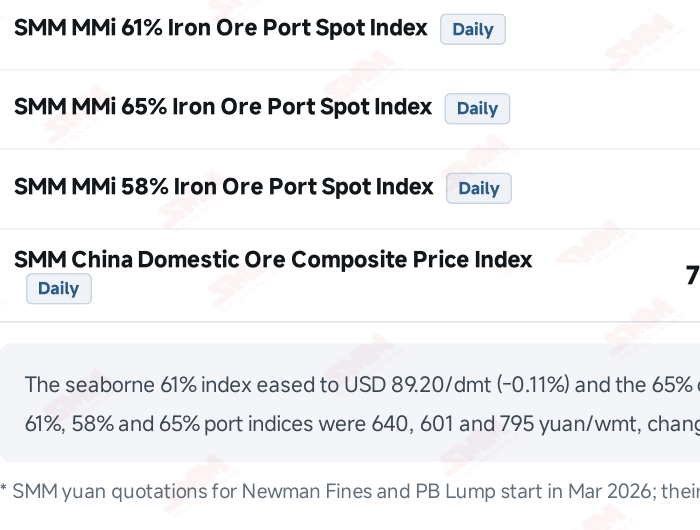
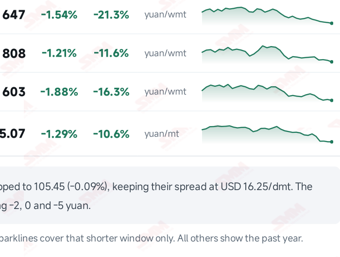
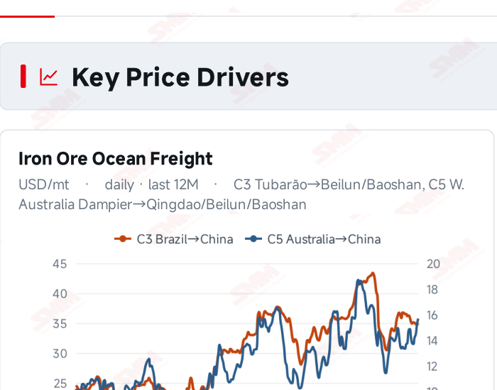
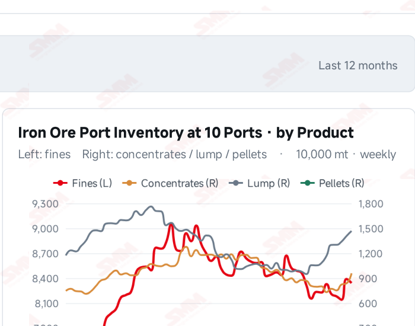

# SMM Iron Ore Daily — 2026-11-25 (Wednesday)

**Source:** SMM Data-pro · Shanghai Metals Market (SMM)

---

## Futures Contracts

| Exchange | Contract | Price | Unit | Daily Change | Daily Change % | MTD Avg |
|:---|:---|:---:|:---:|:---:|:---:|:---:|
| SGX | SGX Iron Ore Current-month FEFX26 | 90.55 | USD/dmt | — | — | — |
| DCE | DCE Iron Ore Most-traded I2701 | 657.00 | yuan/mt | -1.5 | -0.23% | 667.00 |

## SMM Iron Ore Price Index (Physical & Benchmark Indices)

| Index Name | Market Type | Fe % | Price | Unit | Daily Change | Daily Change % | MTD Avg |
|:---|:---|:---:|:---:|:---:|:---:|:---:|:---:|
| MMi 61% Port Spot | port_spot | 61.0% | 640.00 | yuan/wmt | -2.0 | -0.31% | 647.00 |
| MMi 58% Port Spot | port_spot | 58.0% | 601.00 | yuan/wmt | 0.0 | 0.00% | 603.00 |
| MMi 65% Port Spot | port_spot | 65.0% | 795.00 | yuan/wmt | -5.0 | -0.62% | 808.00 |
| MMi 61% Seaborne Index | seaborne | 61.0% | 89.20 | USD/dmt | -0.1 | -0.11% | 90.14 |
| MMi 65% Seaborne Index | seaborne | 65.0% | 105.45 | USD/dmt | -0.1 | -0.09% | 106.09 |
| SMM Domestic Ore Composite Index | domestic_composite | 66.0% | 792.40 | yuan/mt | -8.48 | -1.06% | 795.07 |

## Key View

### Winter maintenance at northwest mills pushes hot metal down further as futures, port spot and seaborne quotes pull back slightly

Iron ore futures, most Qingdao port spot products and seaborne quotes pulled back slightly in tandem today. DCE most-traded closed at 657.0 yuan/mt, down 0.23% from Nov 24. Seven of the eight Qingdao spot products softened while one rose: Newman Lump dropped 20 yuan to 778 yuan/wmt, Carajas Fines fell 6 yuan to 780 yuan/wmt, and PB Fines, Mac Fines, BRBF, SSF and PB Lump each slipped 3 yuan, whereas Newman Fines rose 3 yuan to 636 yuan/wmt. Port 61% and 65% indices declined to 640 and 795 yuan/wmt (-2 and -5 yuan), while the 58% port index held flat at 601 yuan/wmt. Seaborne 61% and 65% composite indices eased to USD 89.20 and 105.45/dmt (each down USD 0.10/dmt) and all 12 seaborne brands declined USD 0.05-0.20/dmt; the Friday- updated Domestic Ore Composite Price Index retained its Nov 20 quote of 792.40 yuan/mt (down 1.06% from Nov 19 on that date). On the fundamental side, annual winter maintenance halts at northwest steel mills drove a further decline in hot metal output, while ocean freight extended gains. Latest surveyed daily hot metal across 242 mills fell to 2.3359 million mt on Nov 25 (down 12,000 mt WoW, -0.51%), while the BF operating rate edged up 0.23 percentage point to 87.09%. On Nov 24, C5 freight rose another 3.22% to USD 15.69/mt and C3 gained 0.58% to USD 34.98/mt. In the week to Nov 20, global iron ore shipments stood at 35.2588 million mt (+10.88% WoW) and Chinese port arrivals at 27.0447 million mt (+1.04% WoW); total ten-port inventory was 109.2582 million mt on Nov 19 (up 1.3027 million mt, +1.21% WoW). Iron ore prices may trade within a narrow range in the short term. Consecutive freight gains and baseline blast furnace demand continue to provide floor support, but declining hot metal output amid northwest mill winter halts, high overseas shipments and elevated port inventory keep upside room constrained. The scope of winter maintenance and the pace of winter raw material restocking remain key to track; under a relatively loose supply- demand balance, ore prices may stay range-bound.

## Today's Highlights

- Futures edged lower while most Qingdao port spot products softened, led by Newman Lump. DCE most- traded I2701 closed at 657.0 yuan/mt, down 1.5 yuan (-0.23%) from Nov 24. At Qingdao port, Newman Lump dropped 20 yuan to 778 yuan/wmt (-2.51%), Carajas Fines fell 6 yuan to 780 yuan/wmt, and PB Fines (630), Mac Fines (635), BRBF (685), SSF (492) and PB Lump (782 yuan/wmt) each slipped 3 yuan, while only Newman Fines gained 3 yuan to 636 yuan/wmt.
- Seaborne composite indices and all 12 individual brand quotes pulled back slightly in tandem. The 61% seaborne index dipped to USD 89.20/dmt (-0.10, -0.11%) and the 65% index eased to USD 105.45/dmt (-0.10, 0.09%). All 12 seaborne brands declined USD 0.05-0.20/dmt against the Nov 24 report, led by a USD 0.20/dmt drop in Roy Hill Fines to USD 85.90/dmt and USD 0.15/dmt declines in SIMEC Fines, Jimblebar Fines and SP10 Fines.
- Port 61% and 65% indices softened while the 58% index held flat; the domestic ore index retained Friday’s quote. Port 61%, 58% and 65% indices were 640, 601 and 795 yuan/wmt, changing -2, 0 and -5 yuan; the 65%-58% spread narrowed from 199 to 194 yuan/wmt. Updated every Friday, the Domestic Ore Composite Price Index stood at 792.40 yuan/mt as of Nov 20, down 8.48 yuan (-1.06%) from Nov 19 on that date.
- Winter maintenance at northwest mills pushed hot metal down further to 2.3359 million mt, while C3 and C5 freight rose in tandem. Latest surveyed daily hot metal fell to 2.3359 million mt on Nov 25 (down 12,000 mt WoW, -0.51%), with the BF operating rate at 87.09% (+0.23 percentage point). On Nov 24, C5 freight climbed to USD 15.69/mt (+0.49, +3.22%) and C3 rose to USD 34.98/mt (+0.20, +0.58%); in the week to Nov 20, global shipments were 35.2588 million mt and Chinese arrivals 27.0447 million mt; ten-port stocks stood at 109.2582 million mt on Nov 19.

## Qingdao Port Imported Ore Spot Prices (yuan/wet mt, tax incl.)

| Product | Fe % | Type | Price (yuan/wmt) | Daily Change | Daily Change % | MTD Avg |
|:---|:---:|:---:|:---:|:---:|:---:|:---:|
| PB Fines 60.8% | 60.8% | Fines | 630.0 | -3.0 | -0.47% | 638.0 |
| Newman Fines 61.2% | 61.2% | Fines | 636.0 | +3.0 | +0.47% | 638.0 |
| Mac Fines 60.8% | 60.8% | Fines | 635.0 | -3.0 | -0.47% | 643.0 |
| BRBF 62.5% | 62.5% | Fines | 685.0 | -3.0 | -0.44% | 689.0 |
| Newman Lump 63% | 63.0% | Lump | 778.0 | -20.0 | -2.51% | 803.0 |
| Super Special Fines (SSF) 56.5% | 56.5% | Fines | 492.0 | -3.0 | -0.61% | 500.0 |
| Carajas Fines (IOCJ) 65% | 65.0% | Fines | 780.0 | -6.0 | -0.76% | 802.0 |
| PB Lump 61.5% | 61.5% | Lump | 782.0 | -3.0 | -0.38% | 798.0 |

## Seaborne Brand Prices in USD (CFR Qingdao, USD/dry mt, as of 2026-11-25)

| Product | Price (USD/dmt) | Daily Change | Daily Change % | Previous |
|:---|:---:|:---:|:---:|:---:|
| Roy Hill Fines 62% | 85.90 | -0.2 | -0.23% | 86.10 |
| SIMEC Fines 61% | 87.10 | -0.15 | -0.17% | 87.25 |
| PB Fines 62% | 89.40 | -0.1 | -0.11% | 89.50 |
| Newman Fines 60.7% | 88.40 | -0.1 | -0.11% | 88.50 |
| Mac Fines 60.5% | 88.60 | -0.1 | -0.11% | 88.70 |
| Jimblebar Fines 60.30% | 85.25 | -0.15 | -0.18% | 85.40 |
| Carajas Fines (IOCJ) 65% | 104.30 | -0.1 | -0.10% | 104.40 |
| SSFT / SSFG 60% | 96.10 | -0.05 | -0.05% | 96.15 |
| Brazilian Blend Fines (BRBF) 64% | 94.80 | -0.1 | -0.11% | 94.90 |
| RTX Fines 61% | 86.55 | -0.1 | -0.12% | 86.65 |
| West Pilbara Fines (WPF) 60% | 88.60 | -0.1 | -0.11% | 88.70 |
| SP10 Fines 59%-60% | 81.65 | -0.15 | -0.18% | 81.80 |

## SMM Iron Ore Price Index — Weekly / Monthly Statistics

| Index Name | Month-to-date Avg | MoM % | YTD % | Unit |
|:---|:---:|:---:|:---:|:---:|
| SMM MMi 61% Iron Ore Seaborne Index | 90.14 | -0.12% | -15.8% | USD/dmt |
| SMM MMi 65% Iron Ore Seaborne Index | 106.09 | -2.08% | -13.1% | USD/dmt |
| SMM MMi 61% Iron Ore Port Spot Index | 647.00 | -1.54% | -21.3% | yuan/wmt |
| SMM MMi 65% Iron Ore Port Spot Index | 808.00 | -1.21% | -11.6% | yuan/wmt |
| SMM MMi 58% Iron Ore Port Spot Index | 603.00 | -1.88% | -16.3% | yuan/wmt |
| SMM China Domestic Ore Composite Price Index | 795.07 | -1.29% | -10.6% | yuan/mt |

## Key Price Drivers (12-Month Charts & Operational Metrics)

### Charts: Freight & Port Inventory

### Charts: Hot Metal Output & Shipments vs Arrivals

### Operational Fundamentals Snapshot

| Fundamental Indicator | Value | Unit |
|:---|:---:|:---:|
| C3 Freight (Brazil to China) | 34.98 | USD/mt |
| Daily Avg Hot Metal Output (242 Mills) | 2.3359 | Million MT |
| Iron Ore Port Inventory (10 Major Ports) | 109.2582 | Million MT |
| Global Iron Ore Shipments (Weekly) | 35.2588 | Million MT |

## Market Commentary · Imported Ore

### Futures & Spot

DCE most-traded I2701 closed at 657.0 yuan/mt, down 1.5 yuan (-0.23%) from 658.5 on Nov 24. Seven of the eight Qingdao port spot products declined while one rose: Newman Lump fell 20 yuan to 778 yuan/wmt (-2.51%), Carajas Fines dropped 6 yuan to 780 yuan/wmt, and PB Fines (630), Mac Fines (635), BRBF (685), SSF (492) and PB Lump (782 yuan/wmt) each eased 3 yuan, whereas Newman Fines edged up 3 yuan to 636 yuan/wmt. As futures lost upward momentum, traders offered slight concessions while steel mills maintained needs-based procurement. SGX official current-month FEFX26 was last priced at USD 90.55/dmt, with quote time Nov 25, 17:26:50 and preparation time 17:43:41 (UTC+8).

### Driver

The seaborne 61% and 65% indices edged down to USD 89.20 and 105.45/dmt, each down USD 0.10/dmt (-0.11% and -0.09%), keeping their grade spread at USD 16.25/dmt; all 12 seaborne brands declined USD 0.05- 0.20/dmt. Port 61% and 65% indices fell 2 yuan and 5 yuan to 640 and 795 yuan/wmt, while the 58% port index was unchanged at 601 yuan/wmt. Composite grade indices and individual brand quotes can diverge due to sample weights and collection windows, with the 65% port narrative benchmarked to the composite index; RMB wet-basis and USD dry-basis quotes require separate tax and currency assessment.

### Demand

Latest surveyed daily hot metal across 242 steel mills stood at 2.3359 million mt on Nov 25, down 12,000 mt (-0.51%) from 2.3479 million mt on Nov 18; the BF operating rate edged up 0.23 percentage point WoW to 87.09%. Annual winter maintenance halts at mills in northwest China and other regions kept hot metal output on a mild downward trajectory, though steady operations at mainstream blast furnaces continued to provide underlying demand support. Sustainability of finished steel destocking, mill margin space and the pace of winter raw material restocking remain key to watch; further declines in hot metal output would keep upside room constrained.

### Inventory & Supply

In the week to Nov 20, global iron ore shipments stood at 35.2588 million mt, up 3.4585 million mt (+10.88%) from 31.8003 million mt on Nov 13; Chinese port arrivals reached 27.0447 million mt, up 278,900 mt (+1.04%) from 26.7658 million mt on Nov 13. Total ten-port inventory was 109.2582 million mt on Nov 19, up 1.3027 million mt (+1.21%) WoW: fines fell 480,500 mt to 83.4195 million mt, concentrates rose 1.2156 million mt to 9.5879 million mt, lump gained 603,300 mt to 14.6763 million mt and pellets dipped 35,700 mt to 1.5745 million mt. High overseas shipments alongside elevated port inventory keep overall supply ample; inventory and shipment/arrival periods differ, and voyage lags can cause asynchronous movements across stages.

### Cost & Margin

Latest C3 freight was USD 34.98/mt on Nov 24, up 0.20 (+0.58%) from Nov 23; C5 rose another 0.49 (+3.22%) to 15.69. Synchronous freight gains on the Western Australia and Brazil routes will pass through to forward landed costs depending on laycans and contract settlement terms. With port lump and high-grade fines prices softening today, steelmaking margins still require comprehensive evaluation alongside finished steel price trends, coking coal and coke fluctuations, exchange rates, grades, taxes and inventory valuation.

## Market Commentary · Domestic Ore

### Prices

Updated every Friday, the Domestic Ore Composite Price Index stood at its latest valid quote of 792.40 yuan/mt as of Nov 20, down 8.48 yuan (-1.06%) from 800.88 on Nov 19 on that date. The national composite index and regional iron ore concentrates such as those in Liaodong and Tangshan differ in grade, wet/dry basis and tax treatment, so absolute price levels are not directly comparable.

### Supply & Demand

Surveyed daily hot metal fell another 12,000 mt WoW to 2.3359 million mt on Nov 25, and the onset of winter maintenance at northwest mills kept procurement of domestic concentrates needs-based and volume- controlled; meanwhile, mines and beneficiation plants in Liaodong and Tangshan maintained firm offer sentiment against mills’ cost-cutting bids amid relatively tight local circulation, sustaining buyer-seller negotiation. With most imported port spot prices softening today, local domestic-imported price spreads still require evaluation alongside grades and delivered plant costs.

### Outlook

The domestic ore market may remain range-bound with regional divergence in the near term. Tight local beneficiation supply paired with baseline blast furnace demand lends floor resilience, whereas declining hot metal output and mill cost-control pressure continue to cap upside room. Beneficiation plant operations in key regions and winter restocking pace remain key to monitor.

## Market Factors

### Supportive Factors

- C5 freight climbed another 3.22% to USD 15.69/mt and C3 freight rose 0.58% to USD 34.98/mt on Nov 24.
- The BF operating rate across 242 surveyed mills edged up 0.23 percentage point to 87.09% on Nov 25, preserving baseline demand.
- Qingdao Newman Fines bucked the trend with a 3 yuan/wmt gain to 636 yuan/wmt, and the 58% port spot index held steady at 601 yuan/wmt.
- Ten-port fines and pellet inventories fell 480,500 mt and 35,700 mt WoW on Nov 19.

### Bearish Factors

- Surveyed daily hot metal declined another 12,000 mt (-0.51%) to 2.3359 million mt on Nov 25 as northwest mills started winter maintenance.
- DCE most-traded edged down 0.23% to 657.0 yuan/mt, while seven Qingdao spot products softened (Newman Lump down 20 yuan and Carajas Fines down 6 yuan/wmt).
- Seaborne 61% and 65% composite indices each slipped USD 0.10/dmt, and all 12 seaborne brands declined USD 0.05-0.20/dmt.
- Global shipments remained elevated at 35.2588 million mt (+10.88% WoW) in the week to Nov 20, and ten-port inventory stood at 109.2582 million mt (+1.21% WoW) on Nov 19.

## Flash News Briefs

- NW Steel Mill Hot Metal Continues to Fall During Winter Break; Iron Ore May Move Sideways in Short Term [SMM Iron Ore Daily Review] (2026-11-25)
- [SMM Iron Ore] Hot metal output falls further as NW mills begin winter halt; iron ore range-bound (2026-11-25)
- [Brief Review of Domestic Iron Ore] Iron ore concentrate prices in the Liaodong region may consolidate (2026-11-25)
- [SMM Coking Coal and Coke Daily Brief] 20261125 (2026-11-25)
- [SMM Rebar Daily Review] Weak Demand Pressures Market Confidence, Short-Term Construction Material Prices May Consolidate (2026-11-25)
- "HRC Prices Edge Up, Coking Coal and Coke Drive Gains; Regional Destocking Accelerates" (2026-11-25)

---
*(c) 2026 Shanghai Metals Market (SMM) · Iron Ore Value-Chain Data & Research*
