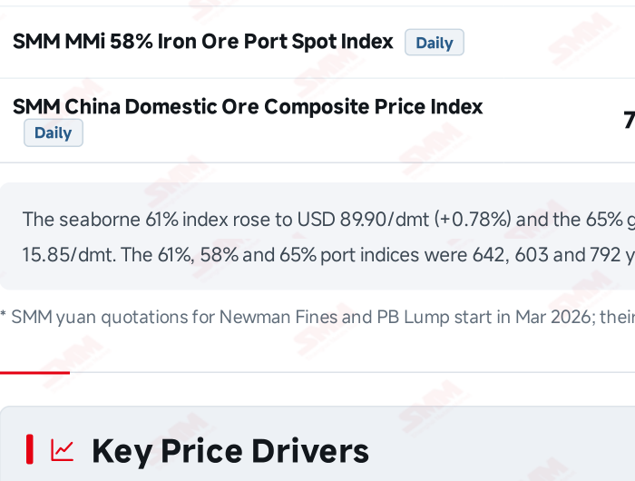
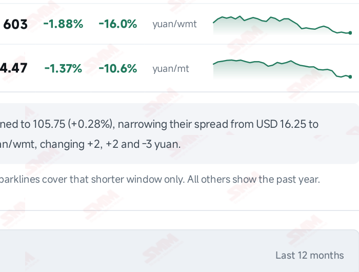
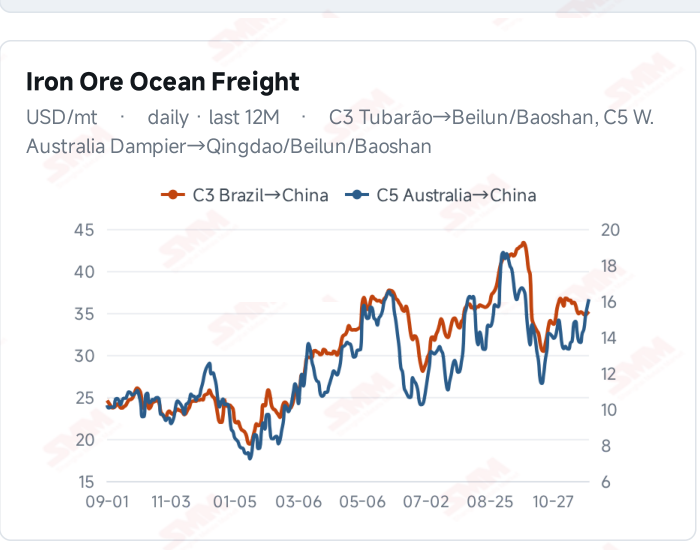
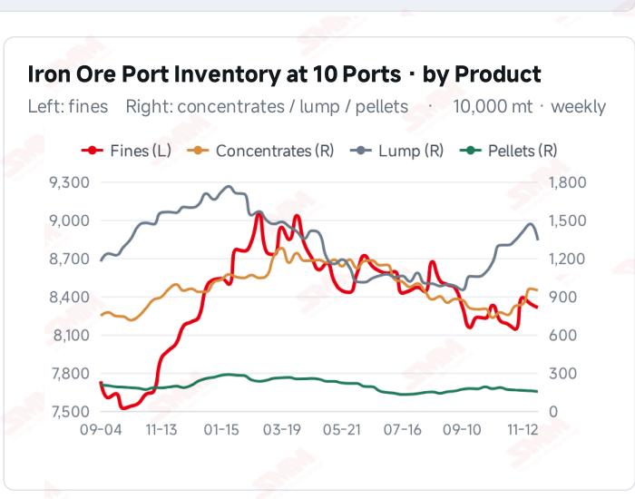

# SMM Iron Ore Daily — 2026-11-26 (Thursday)

**Source:** SMM Data-pro · Shanghai Metals Market (SMM)

---

## Futures Contracts

| Exchange | Contract | Price | Unit | Daily Change | Daily Change % | MTD Avg |
|:---|:---|:---:|:---:|:---:|:---:|:---:|
| SGX | SGX Iron Ore Current-month FEFX26 | 90.70 | USD/dmt | — | — | — |
| DCE | DCE Iron Ore Most-traded I2701 | 663.00 | yuan/mt | +6.0 | +0.91% | 666.80 |

## SMM Iron Ore Price Index (Physical & Benchmark Indices)

| Index Name | Market Type | Fe % | Price | Unit | Daily Change | Daily Change % | MTD Avg |
|:---|:---|:---:|:---:|:---:|:---:|:---:|:---:|
| MMi 61% Port Spot | port_spot | 61.0% | 642.00 | yuan/wmt | +2.0 | +0.31% | 646.00 |
| MMi 58% Port Spot | port_spot | 58.0% | 603.00 | yuan/wmt | +2.0 | +0.33% | 603.00 |
| MMi 65% Port Spot | port_spot | 65.0% | 792.00 | yuan/wmt | -3.0 | -0.38% | 807.00 |
| MMi 61% Seaborne Index | seaborne | 61.0% | 89.90 | USD/dmt | +0.7 | +0.78% | 90.13 |
| MMi 65% Seaborne Index | seaborne | 65.0% | 105.75 | USD/dmt | +0.3 | +0.28% | 106.07 |
| SMM Domestic Ore Composite Index | domestic_composite | 66.0% | 792.24 | yuan/mt | 0.0 | 0.00% | 794.47 |

## Key View

### Ten-port destocking lifts futures and seaborne quotes, while subdued hot metal output keeps port spot gains modest

Iron ore futures and seaborne quotes firmed notably today, while most Qingdao port spot products posted modest gains. DCE most-traded closed at 663.0 yuan/mt, up 0.91% from Nov 25. Seven of the eight Qingdao spot products advanced while one declined: PB Fines, Newman Fines, Mac Fines, BRBF, Newman Lump, SSF and Carajas Fines each rose 3 yuan/wmt, whereas PB Lump edged down 2 yuan to 780 yuan/wmt. Port 61% and 58% indices climbed to 642 and 603 yuan/wmt (each +2 yuan), while the 65% port composite index eased 3 yuan to 792 yuan/wmt. Seaborne 61% and 65% composite indices rose to USD 89.90 and 105.75/dmt (+0.70 and +0.30/dmt) and all 12 seaborne brands advanced USD 0.70-1.20/dmt; the SMM Domestic Ore Composite Price Index stood at 792.24 yuan/mt on Nov 26, unchanged from Nov 25. On the fundamental side, ten-port inventory recorded a phased drawdown and ocean freight extended gains, while hot metal output remained relatively low. Latest ten-port total inventory fell to 107.4695 million mt on Nov 26, down 1.7887 million mt (-1.64%) from Nov 19 as fines, lump, concentrates and pellets all destocked. On Nov 25, C5 freight rose another 2.61% to USD 16.10/mt and C3 gained 0.57% to USD 35.18/mt. On the demand side, surveyed daily hot metal across 242 mills was 2.3359 million mt on Nov 25 (down 12,000 mt WoW, -0.51%) with the BF operating rate at 87.09% (+0.23 percentage point); on the supply side, global iron ore shipments stood at 35.2588 million mt (+10.88% WoW) and Chinese port arrivals at 27.0447 million mt (+1.04% WoW) in the week to Nov 20. Iron ore prices may maintain a range-bound pattern in the short term. Phased port destocking and consecutive freight gains support futures and seaborne offers, but lower hot metal output amid northwest mill winter maintenance, cautious mill inquiries and upcoming arrivals from prior high overseas shipments continue to constrain spot upside. Continuity of port inventory drawdowns and the start of winter raw material restocking remain key to track.

## Today's Highlights

- Port destocking lifted futures, while seven of eight Qingdao port spot products posted modest gains. DCE most-traded I2701 closed at 663.0 yuan/mt, up 6.0 yuan (+0.91%) from Nov 25. At Qingdao port, PB Fines (633), Newman Fines (639), Mac Fines (638), BRBF (688), Newman Lump (781), SSF (495) and Carajas Fines (783 yuan/wmt) each rose 3 yuan/wmt from Nov 25, while only PB Lump edged down 2 yuan to 780 yuan/wmt.
- Seaborne composite indices and all 12 individual brand quotes rebounded across the board. The 61% seaborne index climbed to USD 89.90/dmt (+0.70, +0.78%) and the 65% index rose to USD 105.75/dmt (+0.30, +0.28%), narrowing their grade spread from USD 16.25 to 15.85/dmt. All 12 seaborne brands advanced USD 0.70- 1.20/dmt against the Nov 25 report, led by USD 1.20/dmt gains in Carajas Fines and BRBF and a USD 0.95/dmt increase in SSFT/SSFG.
- Medium/low-grade port indices firmed while the 65% composite index eased; the domestic ore composite index held steady. Port 61%, 58% and 65% indices stood at 642, 603 and 792 yuan/wmt, changing +2, +2 and -3 yuan; the 65%-58% spread narrowed from 194 to 189 yuan/wmt. The SMM Domestic Ore Composite Price Index stood at 792.24 yuan/mt on Nov 26, unchanged from Nov 25 (down 0.16 yuan from 792.40 on Nov 20).
- Ten-port inventory destocked by 1.7887 million mt WoW as C5 and C3 ocean freight extended gains. Latest ten-port total inventory fell to 107.4695 million mt on Nov 26 (down 1.7887 million mt WoW, -1.64%), with fines, lump, concentrates and pellets all drawing down. On Nov 25, C5 freight climbed further to USD 16.10/mt (+0.41, +2.61%) and C3 rose to USD 35.18/mt (+0.20, +0.57%); surveyed daily hot metal was 2.3359 million mt on Nov 25 (down 12,000 mt WoW).

## Qingdao Port Imported Ore Spot Prices (yuan/wet mt, tax incl.)

| Product | Fe % | Type | Price (yuan/wmt) | Daily Change | Daily Change % | MTD Avg |
|:---|:---:|:---:|:---:|:---:|:---:|:---:|
| PB Fines 60.8% | 60.8% | Fines | 633.0 | +3.0 | +0.48% | 638.0 |
| Newman Fines 61.2% | 61.2% | Fines | 639.0 | +3.0 | +0.47% | 638.0 |
| Mac Fines 60.8% | 60.8% | Fines | 638.0 | +3.0 | +0.47% | 642.0 |
| BRBF 62.5% | 62.5% | Fines | 688.0 | +3.0 | +0.44% | 689.0 |
| Newman Lump 63% | 63.0% | Lump | 781.0 | +3.0 | +0.39% | 802.0 |
| Super Special Fines (SSF) 56.5% | 56.5% | Fines | 495.0 | +3.0 | +0.61% | 500.0 |
| Carajas Fines (IOCJ) 65% | 65.0% | Fines | 783.0 | +3.0 | +0.38% | 801.0 |
| PB Lump 61.5% | 61.5% | Lump | 780.0 | -2.0 | -0.26% | 797.0 |

## Seaborne Brand Prices in USD (CFR Qingdao, USD/dry mt, as of 2026-11-26)

| Product | Price (USD/dmt) | Daily Change | Daily Change % | Previous |
|:---|:---:|:---:|:---:|:---:|
| Roy Hill Fines 62% | 86.65 | +0.75 | +0.87% | 85.90 |
| SIMEC Fines 61% | 87.80 | +0.7 | +0.80% | 87.10 |
| PB Fines 62% | 90.10 | +0.7 | +0.78% | 89.40 |
| Newman Fines 60.7% | 89.15 | +0.75 | +0.85% | 88.40 |
| Mac Fines 60.5% | 89.30 | +0.7 | +0.79% | 88.60 |
| Jimblebar Fines 60.30% | 85.95 | +0.7 | +0.82% | 85.25 |
| Carajas Fines (IOCJ) 65% | 105.50 | +1.2 | +1.15% | 104.30 |
| SSFT / SSFG 60% | 97.05 | +0.95 | +0.99% | 96.10 |
| Brazilian Blend Fines (BRBF) 64% | 96.00 | +1.2 | +1.27% | 94.80 |
| RTX Fines 61% | 87.25 | +0.7 | +0.81% | 86.55 |
| West Pilbara Fines (WPF) 60% | 89.30 | +0.7 | +0.79% | 88.60 |
| SP10 Fines 59%-60% | 82.35 | +0.7 | +0.86% | 81.65 |

## SMM Iron Ore Price Index — Weekly / Monthly Statistics

| Index Name | Month-to-date Avg | MoM % | YTD % | Unit |
|:---|:---:|:---:|:---:|:---:|
| SMM MMi 61% Iron Ore Seaborne Index | 90.13 | -0.13% | -15.1% | USD/dmt |
| SMM MMi 65% Iron Ore Seaborne Index | 106.07 | -2.09% | -12.9% | USD/dmt |
| SMM MMi 61% Iron Ore Port Spot Index | 646.00 | -1.58% | -21.0% | yuan/wmt |
| SMM MMi 65% Iron Ore Port Spot Index | 807.00 | -1.31% | -11.9% | yuan/wmt |
| SMM MMi 58% Iron Ore Port Spot Index | 603.00 | -1.88% | -16.0% | yuan/wmt |
| SMM China Domestic Ore Composite Price Index | 794.47 | -1.37% | -10.6% | yuan/mt |

## Key Price Drivers (12-Month Charts & Operational Metrics)

### Charts: Freight & Port Inventory

### Charts: Hot Metal Output & Shipments vs Arrivals

### Operational Fundamentals Snapshot

| Fundamental Indicator | Value | Unit |
|:---|:---:|:---:|
| C3 Freight (Brazil to China) | 35.18 | USD/mt |
| Daily Avg Hot Metal Output (242 Mills) | 2.3359 | Million MT |
| Global Iron Ore Shipments (Weekly) | 35.2588 | Million MT |

## Market Commentary · Imported Ore

### Futures & Spot

DCE most-traded I2701 closed at 663.0 yuan/mt, up 6.0 yuan (+0.91%) from 657.0 on Nov 25. Seven of the eight Qingdao port spot products advanced while one declined: PB Fines (633), Newman Fines (639), Mac Fines (638), BRBF (688), Newman Lump (781), SSF (495) and Carajas Fines (783 yuan/wmt) each gained 3 yuan/wmt from the previous trading day, whereas PB Lump edged down 2 yuan to 780 yuan/wmt. Phased port inventory drawdowns supported futures and prompted traders to lift offers, though steel mill inquiries remained cautious and spot gains lagged the futures advance. SGX official current-month FEFX26 was last priced at USD 90.70/dmt, with quote time Nov 26, 17:18:50 and preparation time 17:35:32 (UTC+8).

### Driver

The seaborne 61% and 65% indices rose to USD 89.90 and 105.75/dmt, up USD 0.70 and 0.30/dmt (+0.78% and +0.28%), narrowing their grade spread from USD 16.25 to 15.85/dmt; all 12 seaborne brands climbed USD 0.70-1.20/dmt. Port 61% and 58% indices each gained 2 yuan to 642 and 603 yuan/wmt, while the 65% port composite index eased 3 yuan to 792 yuan/wmt. Composite grade indices and individual brand quotes can diverge due to sample weights and collection windows, with the 65% port narrative benchmarked to the composite index; RMB wet-basis and USD dry-basis quotes require separate tax and currency assessment.

### Demand

Latest surveyed daily hot metal across 242 steel mills stood at 2.3359 million mt on Nov 25, down 12,000 mt (-0.51%) from 2.3479 million mt on Nov 18; the BF operating rate edged up 0.23 percentage point WoW to 87.09%. As mills in northwest China and other regions entered annual winter maintenance, hot metal output stayed at a relatively low level, keeping mill raw material procurement needs-based and limiting acceptance of higher-priced spot cargoes. Apparent finished steel demand, destocking sustainability, mill margin space and the pace of winter restocking remain key to watch.

### Inventory & Supply

Latest ten-port total inventory fell to 107.4695 million mt on Nov 26, down 1.7887 million mt (-1.64%) from 109.2582 million mt on Nov 19: fines decreased 312,200 mt to 83.1073 million mt, lump dropped 1.2880 million mt to 13.3883 million mt, concentrates declined 128,000 mt to 9.4599 million mt and pellets dipped 60,500 mt to 1.5140 million mt, marking a broad drawdown across all four categories. On the supply side, global iron ore shipments stood at 35.2588 million mt (+3.4585 million mt, +10.88% WoW) and Chinese port arrivals at 27.0447 million mt (+278,900 mt, +1.04% WoW) in the week to Nov 20. Phased port destocking lends near-term support to market sentiment, though high prior overseas shipments will gradually arrive at ports and the continuity of inventory drawdowns remains to be verified.

### Cost & Margin

Latest C3 freight was USD 35.18/mt on Nov 25, up 0.20 (+0.57%) from Nov 24; C5 climbed another 0.41 (+2.61%) to 16.10. Consecutive freight increases on the Western Australia and Brazil routes will pass through to forward landed costs depending on laycans and contract settlement terms. With most port spot products posting modest gains today while coking coal and coke face softening expectations, steelmaking margins still require comprehensive evaluation alongside finished steel price trends, coke price-cut expectations, exchange rates, grades, taxes and inventory valuation.

## Market Commentary · Domestic Ore

### Prices

The SMM Domestic Ore Composite Price Index stood at 792.24 yuan/mt on Nov 26, unchanged from Nov 25 (down 0.16 yuan or 0.02% from 792.40 on Nov 20). The national composite index and regional iron ore concentrates such as those in Tangshan and Liaodong differ in grade, wet/dry basis and tax treatment, so absolute price levels are not directly comparable.

### Supply & Demand

Overall operating rates across mines and beneficiation plants in Tangshan and other producing areas remained relatively low, keeping local concentrate availability steady; on the demand side, with surveyed daily hot metal down to 2.3359 million mt on Nov 25 and mills facing cost-control pressure, procurement remained predominantly needs-based with strong bid-cutting sentiment, leaving spot trading subdued. With most imported port spot prices rising 3 yuan/wmt today, local domestic-imported price spreads still require evaluation alongside grades and delivered plant costs.

### Outlook

The domestic ore market may remain range-bound with regional divergence in the near term. Steady local supply under low beneficiation operating rates paired with baseline blast furnace demand lends floor resilience, whereas subdued hot metal output and mill cost-control pressure continue to cap upside room. Beneficiation plant operations in key regions and winter restocking pace remain key to monitor.

## Market Factors

### Supportive Factors

- Ten-port total inventory fell 1.7887 million mt (-1.64%) WoW to 107.4695 million mt on Nov 26, with fines, lump, concentrates and pellets all destocking.
- DCE most-traded gained 0.91% to 663.0 yuan/mt, seven Qingdao spot products rose 3 yuan/wmt, and port 61% and 58% indices each advanced 2 yuan/wmt.
- Seaborne 61% and 65% composite indices climbed 0.78% and 0.28%, while all 12 seaborne brands rose USD 0.70-1.20/dmt.
- C5 freight rose another 2.61% to USD 16.10/mt and C3 freight gained 0.57% to USD 35.18/mt on Nov 25.

### Bearish Factors

- Surveyed daily hot metal declined 12,000 mt (-0.51%) WoW to 2.3359 million mt on Nov 25 amid winter maintenance at northwest mills.
- The port 65% composite index eased 3 yuan to 792 yuan/wmt and Qingdao PB Lump dipped 2 yuan/wmt as mills remained cautious toward higher-priced spot cargoes.
- Global iron ore shipments stayed elevated at 35.2588 million mt (+10.88% WoW) and Chinese arrivals reached 27.0447 million mt (+1.04% WoW) in the week to Nov 20.
- Off-season end-use steel demand kept mill procurement strictly needs-based, leaving spot follow-through softer than futures gains.

## Flash News Briefs

- Iron ore futures firm on port destocking as spot lags [SMM Iron Ore] (2026-11-26)
- [Brief Comment on China Iron Ore] Iron ore prices in the Tangshan area may consolidate (2026-11-26)
- [SMM Coking Coal and Coke Daily Brief] 20261126 (2026-11-26)
- [SMM Rebar Daily Review] Market Trading Remains Cautious, Short-Term Prices May Move Sideways (2026-11-26)
- [SMM Steel] European HRC buyers restock for Q1; Northwest European floor up EUR 10/tonne (2026-11-26)
- [SMM Steel] Vietnam HRC Import Prices Remain Stable as Indonesian Cargoes Trade at USD 530/tonne (2026-11-26)

---
*(c) 2026 Shanghai Metals Market (SMM) · Iron Ore Value-Chain Data & Research*
