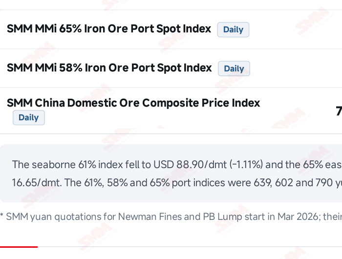
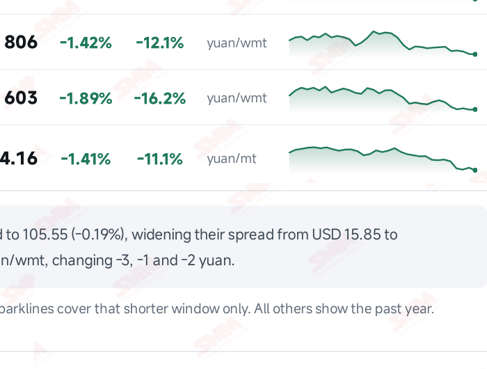
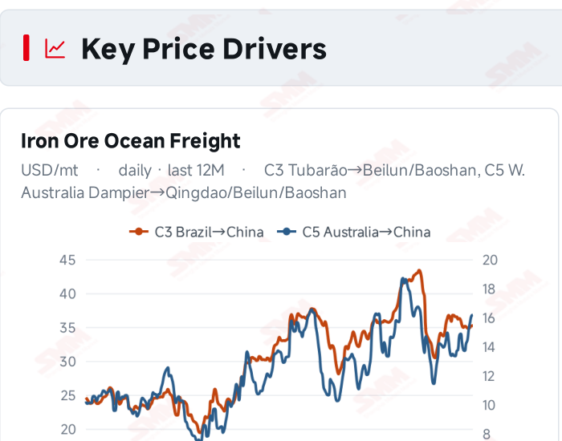
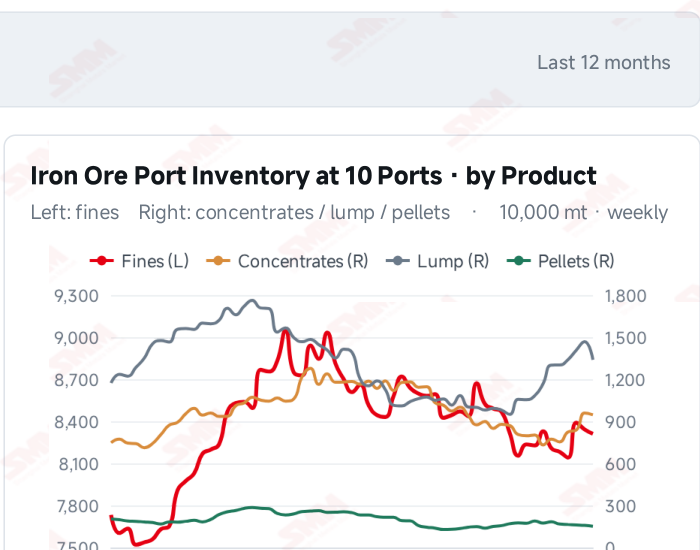

# SMM Iron Ore Daily — 2026-11-27 (Friday)

**Source:** SMM Data-pro · Shanghai Metals Market (SMM)

---

## Futures Contracts

| Exchange | Contract | Price | Unit | Daily Change | Daily Change % | MTD Avg |
|:---|:---|:---:|:---:|:---:|:---:|:---:|
| SGX | SGX Iron Ore Current-month FEFX26 | 90.65 | USD/dmt | — | — | — |
| DCE | DCE Iron Ore Most-traded I2701 | 659.50 | yuan/mt | -3.5 | -0.53% | 666.40 |

## SMM Iron Ore Price Index (Physical & Benchmark Indices)

| Index Name | Market Type | Fe % | Price | Unit | Daily Change | Daily Change % | MTD Avg |
|:---|:---|:---:|:---:|:---:|:---:|:---:|:---:|
| MMi 61% Port Spot | port_spot | 61.0% | 639.00 | yuan/wmt | -3.0 | -0.47% | 646.00 |
| MMi 58% Port Spot | port_spot | 58.0% | 602.00 | yuan/wmt | -1.0 | -0.17% | 603.00 |
| MMi 65% Port Spot | port_spot | 65.0% | 790.00 | yuan/wmt | -2.0 | -0.25% | 806.00 |
| MMi 61% Seaborne Index | seaborne | 61.0% | 88.90 | USD/dmt | -1.0 | -1.11% | 90.06 |
| MMi 65% Seaborne Index | seaborne | 65.0% | 105.55 | USD/dmt | -0.2 | -0.19% | 106.04 |
| SMM Domestic Ore Composite Index | domestic_composite | 66.0% | 788.29 | yuan/mt | -3.95 | -0.50% | 794.16 |

## Key View

### Futures retreat after early gains amid conflicting drivers as port spot, seaborne quotes and domestic ore index pull back

Iron ore futures retreated after early gains today, while most Qingdao port spot products, seaborne quotes and the domestic ore composite index weakened in tandem. DCE most-traded closed at 659.5 yuan/mt, down 0.53% from Nov 26. Six of the eight Qingdao spot products declined while two held flat: PB Fines, Newman Fines, Newman Lump, SSF, Carajas Fines and PB Lump each fell 3 yuan/wmt, whereas Mac Fines (638) and BRBF (688 yuan/wmt) were unchanged. Port 61%, 58% and 65% indices dropped to 639, 602 and 790 yuan/wmt (-3, -1 and -2 yuan). Seaborne 61% and 65% composite indices fell to USD 88.90 and 105.55/dmt (-1.00 and -0.20/dmt) and all 12 seaborne brands declined USD 1.00-1.35/dmt; updated on Friday, the SMM Domestic Ore Composite Price Index fell to 788.29 yuan/mt on Nov 27, down 3.95 yuan (-0.50%) from Nov 26. On the fundamental side, port inventories posted a modest phased drawdown and ocean freight stayed elevated, while lower hot metal output and high prior overseas shipments posed forward pressure. On Nov 27, 35-port iron ore inventory edged down to 153.45 million mt (down 300,000 mt WoW, -0.20%) as daily port outbound volume rose to 3.025 million mt (up 25,000 mt WoW, +0.83%); ten-port total inventory stood at 107.4695 million mt on Nov 26 (down 1.7887 million mt WoW, -1.64%). On Nov 26, C5 freight edged up 0.43% to USD 16.17/mt and C3 ticked up 0.06% to USD 35.20/mt. On the demand side, surveyed daily hot metal across 242 mills was 2.3359 million mt on Nov 25 (down 12,000 mt WoW) with the BF operating rate at 87.09%; on the supply side, global iron ore shipments stood at 35.2588 million mt (+10.88% WoW) and Chinese port arrivals at 27.0447 million mt (+1.04% WoW) in the week to Nov 20. Iron ore prices may continue to trade within a narrow range in the short term. Modest port inventory drawdowns, firmer port outbound volume and winter restocking expectations provide floor support, but declining hot metal output amid northern production controls and winter maintenance, expected arrivals from prior high overseas shipments and macro headwinds continue to cap upside room. Port arrival pace, hot metal declines and winter raw material restocking progress remain key to track.

## Today's Highlights

- Futures retreated after early gains as six of eight Qingdao port spot products softened. DCE most-traded I2701 closed at 659.5 yuan/mt, down 3.5 yuan (-0.53%) from Nov 26. At Qingdao port, PB Fines (630), Newman Fines (636), Newman Lump (778), SSF (492), Carajas Fines (780) and PB Lump (777 yuan/wmt) each fell 3 yuan/wmt from Nov 26, while Mac Fines (638) and BRBF (688 yuan/wmt) held flat.
- Seaborne composite indices and all 12 individual brand quotes pulled back in tandem. The 61% seaborne index fell to USD 88.90/dmt (-1.00, -1.11%) and the 65% index eased to USD 105.55/dmt (-0.20, -0.19%), widening their grade spread from USD 15.85 to 16.65/dmt. All 12 seaborne brands declined USD 1.00-1.35/dmt against the Nov 26 report, led by drops of USD 1.35/dmt in SSFT/SSFG, USD 1.30/dmt in Carajas Fines and USD 1.25/dmt in BRBF.
- All three port spot indices and the domestic ore composite index weakened in tandem. Port 61%, 58% and 65% indices stood at 639, 602 and 790 yuan/wmt, changing -3, -1 and -2 yuan; the 65%-58% spread narrowed from 189 to 188 yuan/wmt. Updated on Friday, the SMM Domestic Ore Composite Price Index fell to 788.29 yuan/mt on Nov 27, down 3.95 yuan (-0.50%) from 792.24 on Nov 26.
- 35-port and 10-port stocks posted phased drawdowns while C5 and C3 freight ticked higher. On Nov 27, 35-port iron ore inventory edged down to 153.45 million mt (down 300,000 mt WoW, -0.20%) as daily port outbound volume rose 25,000 mt to 3.025 million mt; ten-port inventory stood at 107.4695 million mt on Nov 26 (down 1.7887 million mt WoW). On Nov 26, C5 freight edged up to USD 16.17/mt (+0.07, +0.43%) and C3 ticked up to USD 35.20/mt (+0.02, +0.06%).

## Qingdao Port Imported Ore Spot Prices (yuan/wet mt, tax incl.)

| Product | Fe % | Type | Price (yuan/wmt) | Daily Change | Daily Change % | MTD Avg |
|:---|:---:|:---:|:---:|:---:|:---:|:---:|
| PB Fines 60.8% | 60.8% | Fines | 630.0 | -3.0 | -0.47% | 637.0 |
| Newman Fines 61.2% | 61.2% | Fines | 636.0 | -3.0 | -0.47% | 638.0 |
| Mac Fines 60.8% | 60.8% | Fines | 638.0 | 0.0 | 0.00% | 642.0 |
| BRBF 62.5% | 62.5% | Fines | 688.0 | 0.0 | 0.00% | 689.0 |
| Newman Lump 63% | 63.0% | Lump | 778.0 | -3.0 | -0.38% | 801.0 |
| Super Special Fines (SSF) 56.5% | 56.5% | Fines | 492.0 | -3.0 | -0.61% | 499.0 |
| Carajas Fines (IOCJ) 65% | 65.0% | Fines | 780.0 | -3.0 | -0.38% | 800.0 |
| PB Lump 61.5% | 61.5% | Lump | 777.0 | -3.0 | -0.38% | 796.0 |

## Seaborne Brand Prices in USD (CFR Qingdao, USD/dry mt, as of 2026-11-27)

| Product | Price (USD/dmt) | Daily Change | Daily Change % | Previous |
|:---|:---:|:---:|:---:|:---:|
| Roy Hill Fines 62% | 85.60 | -1.05 | -1.21% | 86.65 |
| SIMEC Fines 61% | 86.75 | -1.05 | -1.20% | 87.80 |
| PB Fines 62% | 89.10 | -1.0 | -1.11% | 90.10 |
| Newman Fines 60.7% | 88.15 | -1.0 | -1.12% | 89.15 |
| Mac Fines 60.5% | 88.30 | -1.0 | -1.12% | 89.30 |
| Jimblebar Fines 60.30% | 84.95 | -1.0 | -1.16% | 85.95 |
| Carajas Fines (IOCJ) 65% | 104.20 | -1.3 | -1.23% | 105.50 |
| SSFT / SSFG 60% | 95.70 | -1.35 | -1.39% | 97.05 |
| Brazilian Blend Fines (BRBF) 64% | 94.75 | -1.25 | -1.30% | 96.00 |
| RTX Fines 61% | 86.25 | -1.0 | -1.15% | 87.25 |
| West Pilbara Fines (WPF) 60% | 88.25 | -1.05 | -1.18% | 89.30 |
| SP10 Fines 59%-60% | 81.35 | -1.0 | -1.21% | 82.35 |

## SMM Iron Ore Price Index — Weekly / Monthly Statistics

| Index Name | Month-to-date Avg | MoM % | YTD % | Unit |
|:---|:---:|:---:|:---:|:---:|
| SMM MMi 61% Iron Ore Seaborne Index | 90.06 | -0.20% | -16.1% | USD/dmt |
| SMM MMi 65% Iron Ore Seaborne Index | 106.04 | -2.12% | -13.0% | USD/dmt |
| SMM MMi 61% Iron Ore Port Spot Index | 646.00 | -1.63% | -21.4% | yuan/wmt |
| SMM MMi 65% Iron Ore Port Spot Index | 806.00 | -1.42% | -12.1% | yuan/wmt |
| SMM MMi 58% Iron Ore Port Spot Index | 603.00 | -1.89% | -16.2% | yuan/wmt |
| SMM China Domestic Ore Composite Price Index | 794.16 | -1.41% | -11.1% | yuan/mt |

## Key Price Drivers (12-Month Charts & Operational Metrics)

### Charts: Freight & Port Inventory

### Charts: Hot Metal Output & Shipments vs Arrivals

### Operational Fundamentals Snapshot

| Fundamental Indicator | Value | Unit |
|:---|:---:|:---:|
| C3 Freight (Brazil to China) | 35.2 | USD/mt |
| Daily Avg Hot Metal Output (242 Mills) | 2.3359 | Million MT |
| Iron Ore Port Inventory (10 Major Ports) | 107.4695 | Million MT |
| Iron Ore Port Inventory (35 Major Ports) | 153.45 | Million MT |
| Global Iron Ore Shipments (Weekly) | 35.2588 | Million MT |

## Market Commentary · Imported Ore

### Futures & Spot

DCE most-traded I2701 pared morning gains to close at 659.5 yuan/mt, down 3.5 yuan (-0.53%) from 663.0 on Nov 26. Six of the eight Qingdao port spot products declined while two held flat: PB Fines (630), Newman Fines (636), Newman Lump (778), SSF (492), Carajas Fines (780) and PB Lump (777 yuan/wmt) each fell 3 yuan/wmt from the previous trading day, whereas Mac Fines (638) and BRBF (688 yuan/wmt) were unchanged. As conflicting macro and fundamental drivers weighed on afternoon futures, traders softened offers while steel mills kept inquiries cautious. SGX official current-month FEFX26 was last priced at USD 90.65/dmt, with quote time Nov 27, 17:38:12 and preparation time 17:53:22 (UTC+8).

### Driver

The seaborne 61% and 65% indices retreated to USD 88.90 and 105.55/dmt, down USD 1.00 and 0.20/dmt (-1.11% and -0.19%), widening their grade spread from USD 15.85 to 16.65/dmt; all 12 seaborne brands fell USD 1.00-1.35/dmt. Port 61%, 58% and 65% indices declined 3 yuan, 1 yuan and 2 yuan to 639, 602 and 790 yuan/wmt. Composite grade indices and individual brand quotes can diverge due to sample weights and collection windows, with the 65% port narrative benchmarked to the composite index; RMB wet-basis and USD dry-basis quotes require separate tax and currency assessment.

### Demand

Latest surveyed daily hot metal across 242 steel mills stood at 2.3359 million mt on Nov 25, down 12,000 mt (-0.51%) from 2.3479 million mt on Nov 18; the BF operating rate edged up 0.23 percentage point WoW to 87.09%. Environmental production controls in northern China and annual winter maintenance in the northwest kept hot metal output at a relatively low level; however, narrower mill losses helped lift 35-port daily avg outbound volume by 25,000 mt WoW to 3.025 million mt on Nov 27, with baseline procurement and winter restocking expectations still providing floor support.

### Inventory & Supply

On Nov 27, 35-port iron ore inventory stood at 153.45 million mt, down 300,000 mt (-0.20%) from 153.75 million mt on Nov 20; on Nov 26, ten-port total inventory was 107.4695 million mt, down 1.7887 million mt (-1.64%) from Nov 19: fines fell 312,200 mt to 83.1073 million mt, lump dropped 1.2880 million mt to 13.3883 million mt, concentrates declined 128,000 mt to 9.4599 million mt and pellets dipped 60,500 mt to 1.5140 million mt. On the supply side, global iron ore shipments reached 35.2588 million mt (+3.4585 million mt, +10.88% WoW) and Chinese port arrivals stood at 27.0447 million mt (+278,900 mt, +1.04% WoW) in the week to Nov 20. Although port inventories recorded a modest drawdown this week, upcoming arrivals from prior high overseas shipments alongside lower hot metal output may test the sustainability of port destocking.

### Cost & Margin

Latest C3 freight was USD 35.20/mt on Nov 26, up 0.02 (+0.06%) from Nov 25; C5 edged up 0.07 (+0.43%) to 16.17. Freight rates on the Western Australia and Brazil routes remained near recent highs, with pass-through to forward landed costs depending on laycans and contract settlement terms. With most port spot products dropping 3 yuan/wmt today, steelmaking margins still require comprehensive evaluation alongside finished steel price trends, steady-to-soft coking coal and coke prices, exchange rates, grades, taxes and inventory valuation.

## Market Commentary · Domestic Ore

### Prices

Updated on Friday, the SMM Domestic Ore Composite Price Index stood at 788.29 yuan/mt on Nov 27, down 3.95 yuan (-0.50%) from 792.24 on Nov 26 and down 4.11 yuan (-0.52%) from 792.40 on last Friday, Nov 20. The national composite index and regional iron ore concentrates such as those in west Liaoning and Tangshan differ in grade, wet/dry basis and tax treatment, so absolute price levels are not directly comparable.

### Supply & Demand

Mines and beneficiation plants in west Liaoning and Tangshan largely stayed on the sidelines without immediate inventory or working-capital pressure, and low operating rates kept local spot availability relatively tight; on the demand side, with daily hot metal down to 2.3359 million mt and leading mills setting low purchase prices, buyers remained cautious with strong bid-cutting sentiment, leaving inquiries and spot turnover subdued. With most imported port spot prices falling 3 yuan/wmt today, local domestic-imported price spreads still require evaluation alongside grades and delivered plant costs.

### Outlook

The domestic ore market may remain steady-to-soft with regional divergence in the near term. Manageable mine inventory pressure paired with baseline blast furnace demand provides floor support, whereas deeper off-season finished steel demand, lower hot metal output and mill cost-control pressure continue to limit mines’ ability to hold firm offers. Beneficiation plant operating rates and winter restocking pace remain key to monitor.

## Market Factors

### Supportive Factors

- 35-port inventory fell 300,000 mt WoW to 153.45 million mt and daily outbound volume rose 25,000 mt to 3.025 million mt on Nov 27; ten-port inventory dropped 1.7887 million mt WoW on Nov 26.
- C5 freight edged up 0.43% to USD 16.17/mt and C3 freight ticked up 0.06% to USD 35.20/mt on Nov 26, extending recent highs.
- Qingdao Mac Fines and BRBF held steady at 638 and 688 yuan/wmt, while relatively low mainstream medium-grade stocks and winter restocking expectations lent floor support.
- The BF operating rate across 242 surveyed mills held at 87.09% on Nov 25, and narrower mill losses supported baseline procurement.

### Bearish Factors

- DCE most-traded pared early gains to close down 0.53% at 659.5 yuan/mt, while six Qingdao spot products fell 3 yuan/wmt.
- Seaborne 61% and 65% composite indices fell 1.11% and 0.19%, and all 12 seaborne brands dropped USD 1.00-1.35/dmt.
- Port 61%, 58% and 65% indices declined 1-3 yuan/wmt, and the SMM Domestic Ore Composite Price Index fell 0.50% to 788.29 yuan/mt.
- Surveyed daily hot metal fell to 2.3359 million mt (-0.51%) on Nov 25, while global shipments remained elevated at 35.2588 million mt (+10.88% WoW) in the week to Nov 20.

## Flash News Briefs

- Tug-of-war intensifies as longs and shorts interweave, iron ore retreats after rapid rise and moves sideways [SMM Iron Ore Daily Review] (2026-11-27)
- [SMM Iron Ore] Iron ore pares early gains as bullish and bearish factors collide (2026-11-27)
- [Domestic Iron Ore Brief] Iron ore prices in west Liaoning may consolidate (2026-11-27)
- [SMM Coking Coal and Coke Daily Brief] 20261127 (2026-11-27)
- [SMM Rebar Daily Review] Merchants Operate Cautiously to Accelerate Profit Realization, Spot Price Increase Falls Short of Expectations (2026-11-27)
- HRC Futures Rebound on Macro Tailwinds; Coking Coal Gains and Supply Eases Next Week (2026-11-27)

---
*(c) 2026 Shanghai Metals Market (SMM) · Iron Ore Value-Chain Data & Research*
