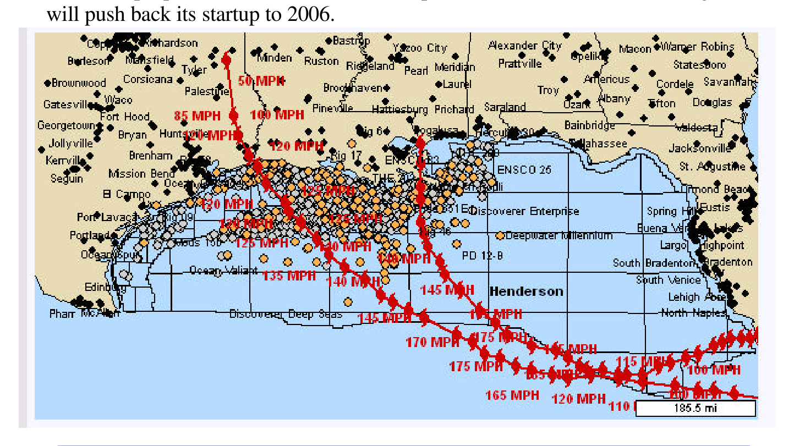

# Down for the Count!

According to the U.S. Minerals Management Service, Katrina-Rita has knocked out 98.59% of U.S. Gulf production (1,478,780 bpd out of pre-Katrina production of 1,500,000 bpd). Shut-in natural gas production is 79.79% of pre-Katrina production of 10 billion cubic feet per day. The one-two punch delivered by the paths of Katrina-Rita hit the totality of U.S. Gulf production as shown below (markers in the Gulf represent natural gas and oil installations). The Mars 220,000 bpd Shell production platform was wrecked by Katrina and Rita severed Chevron’s Typhoon tension-leg platform from its mooring, which is now floating upside down, knocking out 40,000 bpd of oil production. Also BP’s Thunder Horse 250,000 bpd platform, scheduled for startup in 2005, suffered storm damage that will push back its startup to 2006.

*Chart*

From a refinery standpoint, 15%-20% (sources vary) of total U.S. capacity of 15.4 million bpd is estimated to be out of commission. What is particularly disturbing is the anticipated schedule of major affected refineries shown below.

| # of Refineries | Estimate for Start-up |
| --- | --- |
| 2 | Currently restarting |
| 1 | One week |
| 1 | Two weeks |
| 1 | One month |
| 1 | Three months |
| 5 | No estimate |

Of the eleven reporting refineries affected by the storm, nearly half declined to give an estimate of when they would restart. As a consequence of reduced refinery output, the Colonial pipeline, the major pipeline moving oil products from the U.S. Gulf to the Northeast is operating at 75% of its capacity. In addition, Capline, the major crude oil pipeline supplying refineries in the Midwest all the way to Chicago is also operating at 75% capacity. Other affected pipelines are Sun pipeline, which is closed, and the Centennial, Longhorn, Dixie, and Explorer all operating with delays.

### Clean Product Carrier Impact

There are two problems that refineries have to face: one is getting started and the second is replacing U.S. Gulf crude that has not yet been restored. As discussed last week, crude carriers are going to find incremental employment both in moving crude to the United States and serving as floating storage until the receiving terminals are brought back into operation.

But there is also a refined product problem. The United States has total refinery capacity of 15.4 million bpd of which 7.3 million bpd is located in the U.S. Gulf Coast region. With a loss of U.S. refinery capacity of 15-20%, refinery production is down by 2.3-3.0 million bpd in the Gulf region. Suppose that 1 million bpd of refinery capacity can be restored in the coming weeks. In this event, the United States will be short on refined products of the order of 1.3-2.0 million bpd. For discussion purposes, suppose that the shortfall averages 1.5 million bpd over the next two months.

This shortfall in refinery capacity in the U.S. Gulf is already being felt and the Bush administration issued its second waiver for Jones Act tonnage permitting foreign flag tankers to trade in a historically protected trade, despite vigorous protests from Jones Act operators. Six foreign flag vessels were reported fixed to carry cargoes from New York to the U.S. Gulf, an extremely unusual situation since cargoes are normally fixed from the U.S. Gulf to the Northeast. These cargoes were intended to take advantage of the differential in gasoline prices between New York and Houston. All but one of these fixtures failed because congestion is at such a high level in Gulf coast ports that the financial incentive would be eaten away in demurrage charges.

However, the price differential is causing a diversion of cargoes destined for the Northeast to the U.S. Gulf. A review of clean fixtures over the past 30 days shows that a preponderance of cargoes is carried in Handymaxes with only 8 out of 71 fixtures for Panamax clean product carriers. The following chart shows daily earnings for Handymaxes and fixture activity for all sized clean cargoes in the transatlantic trade.

*Chart: TransAtlantic Clean Cargo Fixtures*

A 1.5 million bpd sustained shortage translates to 5-6 cargoes per day, or around 300-350 extra cargoes over the next two months as a result of the one-two punch. Cargoes currently being diverted from the Northeast to the Gulf have to be replaced. Vessels with cargoes moving into the Gulf region that cannot be offloaded because of port and terminal congestion become floating storage, thus reducing vessel availability for other trades.

The one-two punch has put U.S. refining capacity down for the count, which will lead to a strong product carrier market that is not going to disappear anytime soon.

## Market Exhibits & Charts

> **Exhibit 2: TransAtlantic Clean Cargo Fixtures**  
> Unit: $/Day | # Fixtures · X-axis: Jan-02 to Jul-05  
> Series: $/Day, # Fixtures  
> *Source: Poten & Partners*  
> [Chart image (200 DPI PNG)](../../../charts/poten/2005/poten_2005-09-30_down-for-the-count_chart2.png)
