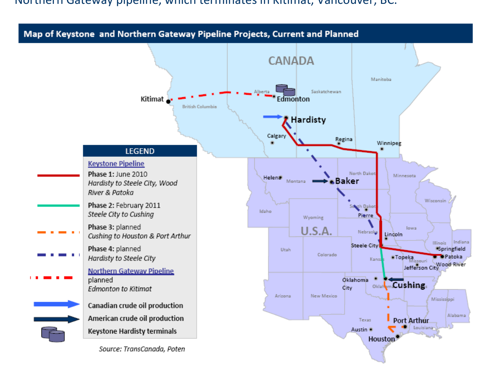

# Key‐Stonewalled

This week President Obama rejected a permit for the Keystone XL pipeline. If ever built, the pipeline would further open the taps for crude oil supplies from Canada to the US Gulf Coast. Most pipeline construction projects typically do not require a presidential stamp of approval, but the cross‐border nature of Keystone XL mandates one. Not only is the pipeline an important crude oil artery between the United States and Canada, it has become an important political test of President Obama as he struggles to balance conflicting interests. Regardless of whether President Obama’s ultimate plans are to green‐light the project, this week’s decision might provide enough motivation to accelerate approval on alternate Canadian pipeline projects to services other markets.

The map below shows the proposed routes for TransCanada’s Keystone XL pipeline and Enbridge’s Northern Gateway pipeline, which terminates in Kitimat, Vancouver, BC.

*Chart*

Given the existing pipeline infrastructure, Canada is the logical source of crude oil for the United States, much to the chagrin of tanker owners everywhere. The following chart shows total United States crude oil and refined product imports from Canada over the past ten years. Over that period, Canada’s market share has grown from 15% to 25% making it the largest supplier of crude oil to the States.

*Chart: US Crude Oil & Product Imports*

### Source: EIA

The decision to block the pipeline’s construction inhibits Canada’s ability to increase exports to the United States. An untended consequence of stalling in Washington may result in Canadian oil being pushed into the arms of Far East markets.

### Who would win and who would lose?

The table below is a summary of who might win or lose if Keystone XL does not get built.

Winners Neutral Losers

| Non‐Canadian Oil Suppliers | Environmentalists | American consumers |
| --- | --- | --- |
| United States continued | Canadian oil sands will | Importation of oil from |
| reliance on imported barrels | continue to be developed | farther abroad |
|  | and brought to other |  |
|  | markets |  |
| VLCC, Suezmax and Aframax | Product tanker owners | Gulf Coast refiners |
| ship owners |  |  |
| Continued shipments to US | United States will continue | Continued reliance on more |
| Gulf; development of West | to both import and export | expensive seaborne crude oil |
| Coast Canada export trade | finished refined products | streams |

| Enbridge | Canadian oil producers | TransCanada Corp. |
| --- | --- | --- |
| National support for West | Oil will flow to market via | Sunk costs |
| Coast crude oil outlet – | other channels |  |
| Northern Gateway Pipeline |  |  |
| China | Mid‐Continent Refiners | House Democrats |
| Diversification in oil | Status quo | Embarrassed by loss of job |
| suppliers |  | creation and increased |

energy security

House Republicans

Embarrassed president (loss of job creation and increased energy security)

Canada

Gives impetus for much needed market diversification

While the discussion on the pipeline continues, the political will to support the initiative in the United States looks increasing bleak at least until November’s election. By that time, momentum in Canada to establish a West Coast outlet may be sufficient enough to help crude oil tanker owners around the world sleep better at night.

## Market Exhibits & Charts

> **Exhibit 1: US Crude Oil & Product Imports**  
> Unit: bbls per day | % from Canada · X-axis: 2002 to 2011  
> Series: Imports - Canada, Other, % Canada  
> *Source: EIA*  
> [Chart image (200 DPI PNG)](../../../charts/poten/2012/poten_2012-01-20_keystonewalled_chart1.png)
