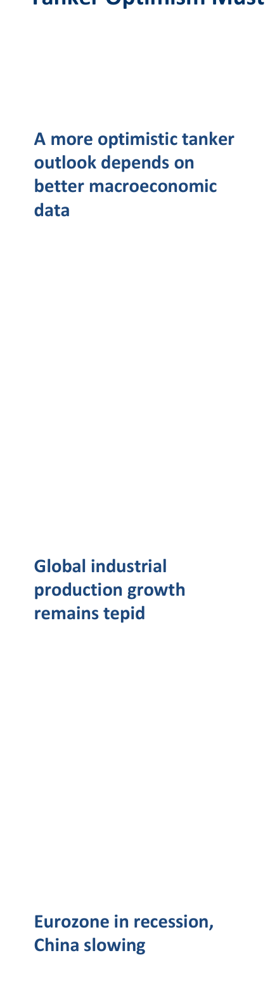
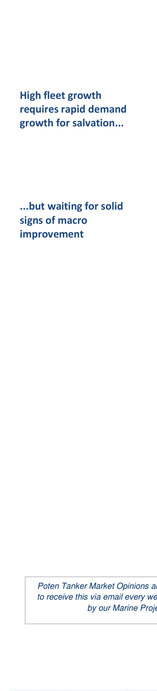

# Tanker Optimism Must Wait for Macro Improvement

*Chart: A more optimistic tanker outlook depends on better macroeconomic*

Like tanker company earnings reports, the Poten Weekly Tanker Opinion has made for grim reading in recent weeks, with discussions of flagging IEA demand outlooks, rising US crude production driving sharp cuts in crude imports and the prospects of scrapping 15-year old tankers. The relentlessly-negative tone is due, not so much to the dire current earnings environment, but to the uncertain global macroeconomic outlook. Dirty tanker supply should slow meaningfully during 2013, and provide a powerful underpinning to the next tanker market recovery, but until the global economy rebounds and supports strong oil demand growth and crude runs, near-term tanker prospects will remain mired in low utilisations and earnings. Although some global economic indicators have shown occasional signs of improvement, the vast majority of economic reports from both emerging and developed nations have revealed stuttering aggregate demand. As shown in the chart below, industrial production has shown a marked deceleration in several key economies.

*Chart: Global Industial Production*

Sources: US Federal Reserve, Bloomberg

The Eurozone slid into recession during 2q12, and as Germany’s export impetus fades and while the sovereign solvency issue festers, the outlook is not encouraging. Still, the slowing of Chinese growth may be the most disturbing for the shipping sector. Export orders and industrial production are slowing, the HSBC/Markit purchasing managers indices are languishing below the contractionary 50 level and Chinese electricity generation is flat year over year. Meanwhile, Chinese iron ore prices are collapsing to levels not seen since 2009, as domestic steel producers shun cargoes and cut their ore inventories, as shown in the chart below.

*Chart: Dramatic collapse in Chinese iron ore prices is disturbing*

*Chart: Chinese Iron Ore Prices*

*Source: Bloomberg*

Iron ore is a leading economic indicator, given it role in key industrial sectors such as automotive manufacturing and construction, so the collapse in demand is sobering. Of course, the iron ore market has seen previous destocking and restocking cycles from Chinese steel mills, often with violent price swings, but as steel prices and profitability decline for mills, steel production is fading. Given China’s share of any incremental dirty tanker tonne-mile demand, its economy must demonstrate a clear return to rapid industrial production gains, in order to produce sufficient oil demand growth for robust crude import demand. In addition, European oil demand must recover to provide some stability or growth to its large refining base, currently at 12 mbpd of crude runs. This demand growth is critical, given the utilisation hole that the dirty tanker fleet has found itself. As shown in the chart on the following page, dirty tanker utilisation has plunged by 13-14 percentage points since market highs in 2008. The collapse emerged in two stages. The first downdraft came in 2009, from the recessionary 7% plunge in dwt demand and a 4% rise in the operating fleet, limited by floating storage. Following a small rebound in utilisations in 2010, fleet growth hit 8% in 2011, so that a slight decline in dwt demand provided the next leg down in dirty tanker utilisations.

*Chart: Utilisations are 14 points lower from 2008 level*

*Chart: Dirty Tanker Fleet Utilisation*

*Source: Poten*

With dirty tanker utilisations languishing near 80%, current earnings are at or below marginal cash operating costs. As shown in the chart below, the relationship between earnings and utilisations is exponential, reflecting the inelasticity of the vessel supply curve for tanker markets operating at high fleet utilisations.

*Chart: Nominal Dirty Tanker Earnings vs. Fleet Utilisation*

*Source: Poten*

When the market is operating at high utilisations, small shifts in demand can produce large swings in freight rates, when vessel availability is low and as charterers bid aggressively for remaining tonnage. Freight rate and earnings volatility is high during these periods of high utilisations and earnings. Conversely, when the market is operating at low utilisations, plentiful supply keeps rates and volatilities low, but more important, a large rise in utilisations is required to bring the market back to a level of tightness that encourages charterer competitiveness. Seasonal demand should provide some near-term earnings relief to owners, but to achieve financially-sustainable earnings, utilisations must jump by at least five High fleet growth percentage points from current levels, with a ten-point surge required to provide requires rapid demand desired returns on capital. With fleet supply growth still running at a 6-7% pace, the growth for salvation...

dirty tanker market would require a drastic rebound in demand to achieve desired utilisation levels. Even if aggressive demolition slows dirty supply growth to near zero in 2013, the demand growth requirement is still sizable, for a fleet still struggling with low utilisations. Until economic releases start to demonstrate sustained, positive surprises relative to ...but waiting for solid signs of macro consensus estimates, the dirty tanker outlook remains uninspiring.

**improvement**

## Market Exhibits & Charts

> **Exhibit 1: Global Industial Production Selected Regions**  
> Unit: yoy Percent Change · X-axis: Jan-07 to Jan-12  
> Series: India, US ex-Autos, China, Eurozone  
> *Source: US Federal Reserve, Bloomberg*  
> [Chart image (200 DPI PNG)](../../../charts/poten/2012/poten_2012-08-31_tanker-optimism-must-wait-for-macro-improvement_chart1.png)

> **Exhibit 2: Chinese Iron Ore Prices**  
> Unit: US$/MT · X-axis: Dec-08 to Dec-11  
> Series: 62% Fe Content, Delivered Tianjin  
> *Source: Bloomberg*  
> [Chart image (200 DPI PNG)](../../../charts/poten/2012/poten_2012-08-31_tanker-optimism-must-wait-for-macro-improvement_chart2.png)

> **Exhibit 3: Dirty Tanker Fleet Utilisation**  
> Unit: Percent Utilisation · X-axis: 1999 to 2011  
> Series: Dirty Tanker Fleet Utilisation  
> *Source: Poten*  
> [Chart image (200 DPI PNG)](../../../charts/poten/2012/poten_2012-08-31_tanker-optimism-must-wait-for-macro-improvement_chart3.png)

> **Exhibit 4: Nominal Dirty Tanker Earnings vs. Fleet Utilisation Quarterly 2006-12**  
> Unit: Indexed TCE Earnings, US$000/day · X-axis: 75% to 100%  
> Series: Quarterly 2006-12  
> *Source: Poten*  
> [Chart image (200 DPI PNG)](../../../charts/poten/2012/poten_2012-08-31_tanker-optimism-must-wait-for-macro-improvement_chart4.png)
