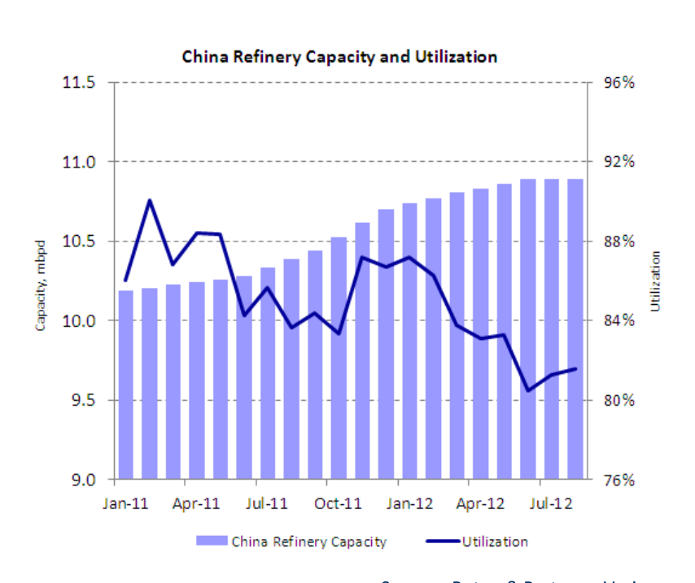
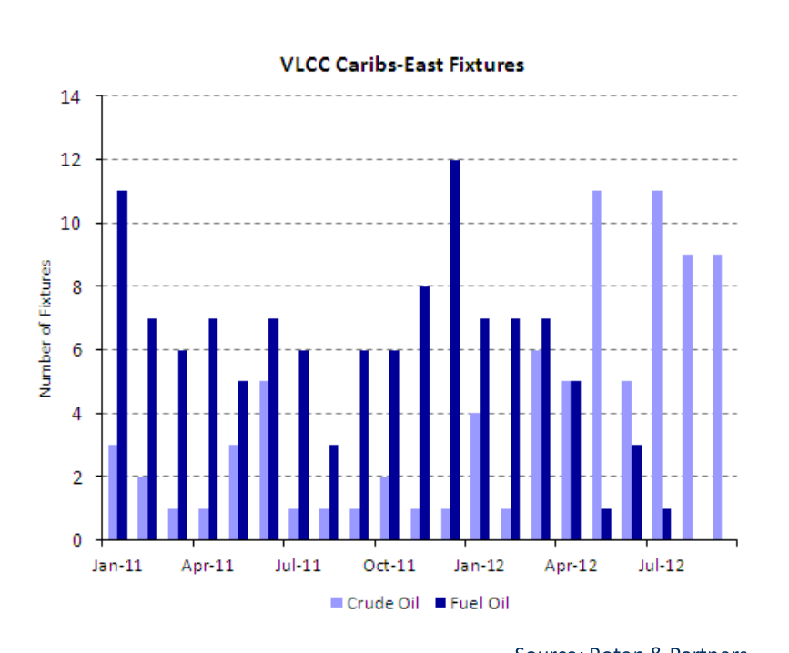

# China's Teapot Refineries Face Regulatory Challenges

China’s independent petroleum refining industry comprises an estimated one-fifth of the nation’s nameplate capacity – or some 2 mbpd. Many of these independent plants China trying to have a capacity of around 40 kbpd (2 mtpa) or less, and are typically referred to rationalize refinery capacity growth, but… pejoratively as “teapots.” These small refineries fell into the cross-sights of Beijing’s regulators a few years ago, as they sought to rein in an industry segment whose growth had overheated. To cool this segment, China’s economic planners mandated the …teapots challenging closure of dozens of teapot refineries with a capacity less than 2 mtpa by the end of Beijing 2013. It now seems, however, that owners of some of these plants are planning to boost their capacities above this threshold as a means of continuing operation.

*Chart: China Refinery Capacity and Utilization*

*Source: Poten & Partners, Various*

### Slowing oil demand growth and rising refining capacity pressuring utilizations

While planning more capacity is one thing and building it quite another, the intertwined role of these refineries in China’s petroleum market ultimately cascades into the lives of tanker owners. As the chart above highlights, China’s 2011-12 increases in refining capacity has been met by lower utilization rates country-wide. How the closing of some teapot refineries in late 2013 and the possible expansion of Outcome of 2013 regulations still unclear others will impact China’s need to move imported water-borne oil is presently not clear. The country’s independent refineries have traditionally played a key swing role in supplying domestic refined products. When refining margins are strong, teapots runs

### Teapots as refining

rise to help alleviate product shortages. At times of weak margins, processing rates opportunists lessen. On average, though, these refineries typically see utilization rates of around 40%.

For plants able to dodge the regulator’s bullet, their acquisition by major Chinese oil refiners seems possible as raising their processing rates may offer an economic Teapots offer enticing alternative to building new capacity. All the chatter swirling around extending the targets for Chinese longevity of the teapots, however, is being muffled by the collision of China’s recent Majors spurt of refinery capacity additions with its recent somewhat muted domestic product demand growth. Moreover, larger independent refineries may fit better in the portfolio of China’s oil majors than the scattered teapots and hence these small plants may lack suitors.

*Chart: Chinese Fuel Oil Trade*

### Chinese fuel oil trade balance slowing

Source: Chinese Customs, Poten

Historically, Beijing had sought to control the growth of teapots by restricting their access to crude oil imports, leaving them reliant on fuel oil as a feedstock, supporting import demand. As shown in the above chart, Chinese fuel oil net imports have been Slowing Chinese declining slightly over the past few years, from a modest easing in imports and slight economic activity cut gains in exports. A recent slowdown in Chinese economic activity cut import demand import demand across several commodity classes, featuring a dramatic collapse in iron imports and prices. Fuel oil imports experienced a similar decline, with August imports hitting multi-year lows, but rebounded in September, in conjunction with other commodity imports into China.

For tanker owners bringing feedstocks – fuel oil and some crude oil – into the Shandong Shift in demand and Guangdong provinces for those teapot refineries that use imports, trade flows seem patterns?

poised to change. As the chart on the following page illustrates, fuel oil movements from the Caribbean to the Far East and South East Asia were more prevalent in the past than they are now even though China continues to import sizeable quantities of this Weaning Off Fuel Oil product. This recent shift in fixtures may allude to teapot refinery economics now favouring the upgrading crude oil or fuel oil from other areas.

*Chart: VLCC Caribs-East Fixtures*

*Source: Poten & Partners*

### Less fuel oil, more crude oil flowing East

With China’s potentially slower oil demand growth trajectory, the current refinery Growing teapots would capacity expansion plans of the Chinese majors already pose a threat to domestic and only add to refinery international refining margins. Entrenched teapot refiners looking to expand would only margin woes add to these woes. Given the essential role the nation’s independent refiners play in refined product supply, the larger independents may get even larger – with or without the help of China’s oil majors. Meanwhile, in the event that China’s top-down policy planners prevail over entrenched local interests and resistance, some appreciable rationalization of the inefficient and polluting teapot refinery capacity appears inevitable.

## Market Exhibits & Charts

> **Exhibit 1: China Refinery Capacity and Utilization**  
> Unit: mbpd | % · X-axis: Jan-11 to Jul-12  
> Series: China Refinery Capacity, Utilization  
> *Source: Poten & Partners, Various*  
> [Chart image (200 DPI PNG)](../../../charts/poten/2012/poten_2012-10-26_chinas-teapot-refineries-face-regulatory-challenges_chart1.png)

> **Exhibit 2: VLCC Caribs-East Fixtures**  
> Unit: Number of Fixtures · X-axis: Jan-11 to Jul-12  
> Series: Crude Oil, Fuel Oil  
> *Source: Poten & Partners*  
> [Chart image (200 DPI PNG)](../../../charts/poten/2012/poten_2012-10-26_chinas-teapot-refineries-face-regulatory-challenges_chart2.png)

> **Chart on PDF page 2: Chinese Fuel Oil Trade Net Imports / (Exports)**  
> Unit: kbpd · X-axis: Jan-08 to Jan-12  
> Series: Exports, Imports, Net Imports  
> *Source: Chinese Customs, Poten*  
> *No image crop of this chart was saved; caption read from the PDF.*
