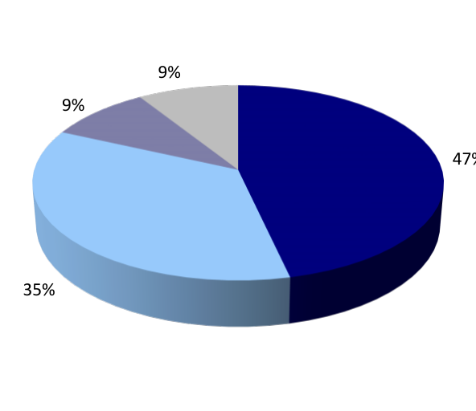

# The Growing Presence of the United States as Energy Exporter

A combination of increased crude oil production and slumping refined product demand has shifted refinery marketing dynamics in the United States. US distillate exports have increased from 1.01 million barrels per day (mbpd) in 2012 versus 172 thousand barrels US refined product exports have expanded per day (kbpd) in 2000. Although much attention has been placed on this five-fold greatly since turn of increase, gasoline exports have also increased from 162 kbpd in 2000 to 505 kbpd in century 2012. These higher transportation fuel exports are indicative of continued shifts in market forces, changing domestic consumption patterns, and reactions to regulatory changes.

*Chart: US Gasoline & Distillate Exports*

### Strongest pickup has been since middle of last decade, though distillate volumes falling of late

Sources: EIA, Poten

The following tables show the most frequent destinations for US gasoline and distillate exports. Mexico has historically been the most active importer of both gasoline and distillate, having for many years sent crude oil to the US, and then importing refined products. Several European countries have become major importers of US distillate in recent years, including the Netherlands (due to Rotterdam’s presence as a physical trading hub) and France. But the major growth region for US imports has been South America. Chile, Brazil, Colombia, Ecuador, and Panama have all become major destinations for both US distillate and gasoline exports as domestic refining capacity increases have proven unable to keep pace with local consumption growth.

**US Distillate & Gasoline Exports by Destination Country, 2000 vs 2012**

| Rank | 2000 Country | Distillate kbpd | 2012 Country | kbpd |
| --- | --- | --- | --- | --- |
| 1 | Mexico | 74.8 | Netherlands | 150.7 |
| 2 | Singapore | 16.5 | Mexico | 132.8 |
| 3 | Netherlands | 16.2 | Chile | 101.5 |
| 4 | Canada | 9.5 | Brazil | 77.4 |
| 5 | Panama | 8.9 | Gibraltar | 64.3 |
| 6 | Dominican Republic | 5.7 | France | 60.0 |
| 7 | Netherlands Antilles | 5.5 | Colombia | 59.7 |
| 8 | China, Taiwan | 5.0 | Panama | 46.3 |
| 9 | Guatemala | 4.9 | Peru | 38.7 |
| 10 | Puerto Rico | 4.5 | Ecuador | 31.5 |
| Other |  | 21.0 |  | 245.3 |
| Total |  | 172.4 |  | 1,008.0 |

European and South American importers demanding increasing

Gasoline quantities of US refined

2000

**2012**

products

| Rank | Country | kbpd | Country | kbpd |
| --- | --- | --- | --- | --- |
| 1 | Mexico | 124.0 | Mexico | 250.7 |
| 2 | Canada | 5.6 | Venezuela | 38.2 |
| 3 | Guatemala | 4.3 | Canada | 31.6 |
| 4 | Puerto Rico | 2.3 | Brazil | 27.6 |
| 5 | Honduras | 1.3 | Panama | 20.1 |
| 6 | Dominican Republic | 0.8 | Guatemala | 18.1 |
| 7 | Bahama Islands | 0.8 | Costa Rica | 18.0 |
| 8 | New Zealand | 0.8 | Ecuador | 9.8 |
| 9 | Israel | 0.7 | Colombia | 7.9 |
| 10 | Argentina | 0.5 | Chile | 7.8 |
| Other |  | 21.2 |  | 75.3 |
| Total |  | 162.2 |  | 504.9 |

Sources: EIA, Poten

Distillate exports have grown at a clip of almost 16% per year since 2000, while gasoline exports have been growing just under 10% per year over the same period. Why are these incremental volumes available? Domestic consumption growth for distillate and gasoline has been virtually non-existent since 2000 (actually falling since a peak in the middle of the decade), while stock levels of these products have increased by just under 1% per year. Not surprisingly, imports have shrunk since 2000: gasoline imports were 21 kbpd higher in 2012 versus 2000, but distillate imports were 171 kbpd lower. Domestic production of distillate and gasoline increased by 1.9 mbpd between 2000 and

2012, however refinery utilization actually fell (from 92.6% to 88.8%) and operable distillation capacity increased only 700 kbpd. US refineries were able to produce more gasoline and distillate than improved utilization or capacity would imply thanks to increased usage of catalytic hydrocrackers and delayed and fluid coking units.

### US Gasoline & Distillate Data

Annual Data, 2000-2013

*Chart*

### Production increasing in the face of declining consumption and flat stocks

Sources: EIA, Poten

US refiners have benefited from increased demand for distillate and gasoline in two ways. First, these refiners increased their distillation, FCC, and hydrocracker capacities in anticipation of an increase in US demand that did not materialize. Second, US refiners must supply RINs equal to a set percentage of their total gasoline and diesel outputs. Any gasoline or diesel that these refiners export is excluded from this calculation (see 15 March 2013 Opinion).

Some tanker sectors have benefited from increased US exports. Indeed, ton-mile demand from 2000 distillate and gasoline exports accounted for 3.1 trillion ton miles; in 2012 those exports accounted for 15.9 quadrillion ton-miles. The MR sector has been the main beneficiary of the increased demand. For instance, a trade that used to US refined product primarily involve MRs moving gasoline from Europe to the US and ballasting back has exports part of larger evolved to owners moving that same gasoline, and either moving product straight back clean tanker investment or moving product to Latin America. The MR trade in the Atlantic has become much thesis more complex, though many more opportunities are now available there as well. These developments have helped spur increased clean tonnage ordering, as evidenced by the relatively young age profile of the MR fleet, which has been the darling of the industry of late.

MR deliveries have been strong, but orderbook is even stronger

Continuation of US trend would support clean demand, but will owners overorder?

### MR Fleet Age Profile

1q2013 Snapshot

*Chart*

Sources: Poten

The prospect of crude oil exports from the United States, a result of increasing North American tight oil production, continues to gain steam among energy analysts. Such discussions conjure protectionist thoughts among many in Washington, but the fact is that the US is increasingly playing the role of energy exporter already. While crude oil production increases continue to loom large in the face of dirty tanker demand, a continuation of these trends from the US would benefit demand for clean tankers.

## Market Exhibits & Charts

> **Interactive Asset:** [Local Asset (200 DPI PNG)](../../../charts/poten/2013/poten_2013-04-26_the-growing-presence-of-the-united-states-as-energy-exporter_chart1.png)
