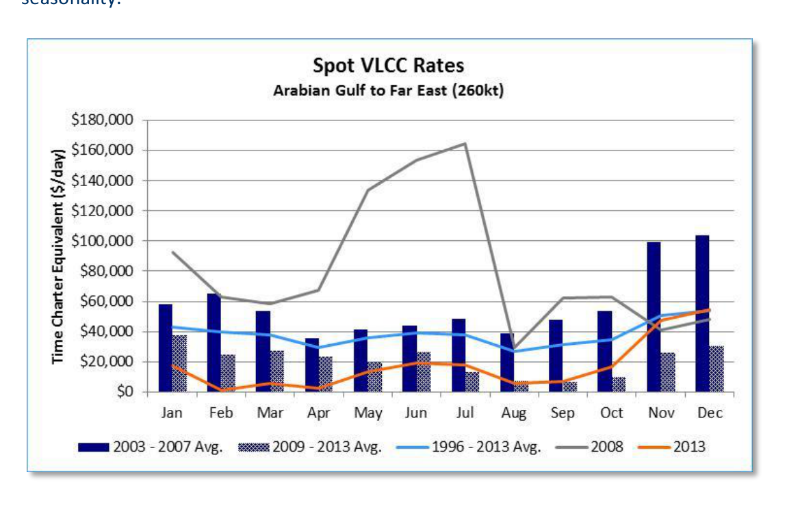

# Back In Black

It is well documented that 2013 has been a far cry from a banner year as far as tanker earnings are concerned. However, it seems the market has somehow remembered its tradition of bringing seasonal tidings to the good boys and girls of the ship owning community. VLCCs have been earning north of $50,000 per day on the benchmark Arabian Gulf – Far East trade since mid-November. Perhaps even more striking is that VLCC earnings for the Arabian Gulf – US Gulf trade are now positive, when calculated on a round-trip basis. Even though the crude oil tanker market has been hobbling along at break-even levels for the better part of the past three years, the recent uptick in rates should not be seen as a sign that general conditions are poised for a full recovery. For those that have recently tuned into tanker market freight trends, the below gives some insight to historical rate seasonality.

*Chart*

Freight rates in 2008 were a clear aberration and, as such, are represented separately. The data suggests that historically in the fourth quarter the market tends to strengthen.

While high freight rates could be topping ship owners’ wish lists, it should be noted that these freight conditions would likely be accompanied by increased volatility.

The table below shows annual average time charter equivalents (TCEs) in for VLCCs and the peak month earnings. The standard deviation of monthly rates is one metric of overall volatility. In general, the years that experienced the highest average freight rates also experienced the highest degree of rate volatility. It is the ratio of supply to demand of vessels that has historically dictated rate peaks and troughs.

Ras Tanura – Chiba (260kt)

All Hull Types

| $/day | Annual Avg. TCE | Peak Month TCE | Month of Peak TCE | Peak Quarter | St. Dev. |
| --- | --- | --- | --- | --- | --- |
| 1996 | $29,016 | $35,744 | Jun | 2 | $4,519 |
| 1997 | $37,501 | $52,938 | Oct | 4 | $8,113 |
| 1998 | $28,773 | $38,564 | May | 2 | $6,374 |
| 1999 | $16,766 | $24,977 | Feb | 1 | $4,640 |
| 2000 | $53,136 | $86,787 | Nov | 4 | $21,368 |
| 2001 | $34,078 | $63,612 | Jan | 1 | $15,680 |
| 2002 | $19,614 | $61,170 | Dec | 4 | $15,953 |
| 2003 | $47,884 | $87,160 | Dec | 4 | $22,360 |
| 2004 | $91,623 | $212,579 | Nov | 4 | $46,663 |
| 2005 | $52,340 | $121,421 | Nov | 4 | $29,038 |
| 2006 | $49,186 | $70,936 | Jan | 1 | $19,472 |
| 2007 | $46,265 | $180,736 | Dec | 4 | $42,382 |
| 2008 | $81,369 | $164,309 | Jul | 3 | $42,953 |
| 2009 | $22,488 | $52,982 | Jan | 1 | $13,025 |
| 2010 | $32,412 | $58,547 | Jan | 1 | $17,421 |
| 2011 | $13,462 | $27,778 | Feb | 1 | $8,559 |
| 2012 | $18,635 | $36,850 | Jan | 1 | $12,825 |
| 2013 YTD | $17,335 | $54,300 | Nov | 4 | $16,159 |
| 1996 - 2013 YTD Avg. | $38,438 |  |  |  | $19,306 |
| 2009 – 2013 YTD Avg. | $20,866 |  |  |  | $13,598 |
| 2011 – 2013 YTD Avg. | $16,477 |  |  |  | $12,514 |

It should be cautioned that the broader supply and demand conditions that facilitate exceptionally strong earnings are generally short-lived, hinging largely on regional availability of ships to meet specific cargo requirement dates. Ship owners might be better off wishing for a moderate earning environment with less volatility. Extreme conditions tend to correct themselves over micro-cycles of a month or two. On this basis, the challenge then becomes timing a fixture to capitalize on short-term swings. Ship owners that are able to do this successfully can certainly make up for a lot of ground that may have been lost during the balance of the year. However, a spot VLCC could easily miss a micro-cycle entirely if it was, say, already fixed on an 80-day round-trip voyage: such is the gamble of spot market exposure.

While history suggests that conditions could very well remain rosy for the next several weeks, the threat of supply overhang still looms longer-term.

products offered by our Marine Projects & Consulting department or to contact our tanker

## Market Exhibits & Charts

> **Exhibit 1: Spot VLCC Rates Arabian Gulf to Far East (260kt)**  
> Unit: Time Charter Equivalent ($/day) · X-axis: Jan to Dec  
> Series: 2003 - 2007 Avg., 2009 - 2013 Avg., 1996 - 2013 Avg., 2008, 2013  
> [Chart image (200 DPI PNG)](../../../charts/poten/2013/poten_2013-12-06_back-in-black_chart1.png)
