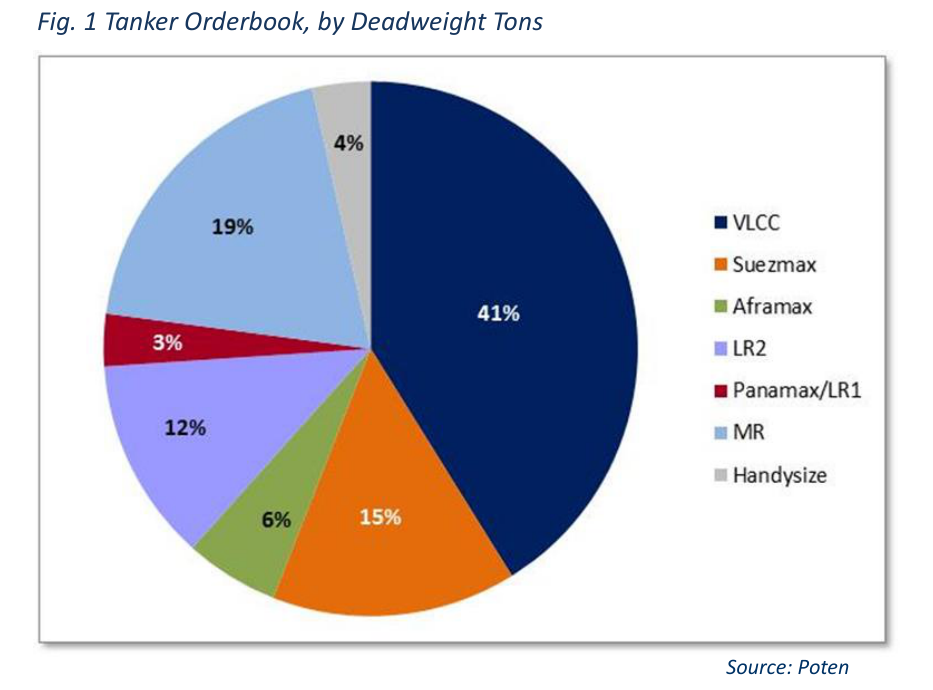

# Slip...N' Slide into Better Times

### But Watch the Rocks and Grit

Although the Caribbean market for Aframaxes has taken a precipitous tumble this week, other tanker segments have maintained healthy spot rates suggesting that vessel oversupply could be moderating in the general sense. A look at the current orderbook across all segments provides some insight as to what is still coming down the pike, but more curiously what has slipped or has fallen off the radar all together. Since ordering momentum continues, due in large part to a feeling that the market is coming off of cycle lows, the threat of vessel oversupply looms. However, the uptick in ton-mile demand could offset the incremental new tonnage supply in the near term.

The current orderbook for tankers, 30,000 deadweight and larger, is 66.1 million deadweight tons (mDWT) through 2017, (see Fig. 1). What is the most interesting about these statistics, however, is not the incremental capacity that has been ordered this year, but that the reported new orders do not account for the differential between the January 2014 orderbook and that of today. At the start of the year, the 2014 orderbook was 27.2 mDWT, the current orderbook is 15.9 mDWT and only 8.1 mDWT has reportedly delivered. This differential suggests that 3.3 mDWT, or 12%, of the originally reported orderbook is on a surface level unaccounted for.

The likely explanation is that these vessels have simply slipped into later years. Looking at the year-to-date delivery pace, this could explain for the majority of that differential. The bulk of the orderbook, 41% is made up of VLCC tonnage, the majority of which is currently slated to deliver in 2016, see Fig 2. As of the beginning of August, 11 VLCCs have been delivered of an initially expected 36. At this rate, the total deliveries for full year 2014 will be 20 vessels; 16 VLCCs have slipped forward, or been renegotiated and or cancelled.

On a sector-by-sector basis, a thorough review of credit risk from the shipowner and shipyard perspective can help to hone the view on the actual new supply expected. For example,

Fig. 2 Tanker Orderbook, by Number of Vessels

*Chart: Fig. 1 Tanker Orderbook, by Deadweight Tons*

*Source: Poten*

speculation surrounding the ultimate deliverability of the Suezmax orderbook is a function of both shipyard capability and orderer of record. Some schools of thought believe that the Suezmax orderbook is realistically only 55% of the 62 vessels reportedly on order, suggesting that widely reported orderbook numbers grossly overstate the reality of new tonnage supply in the next few years.

While shipyard statistics is sometimes a pseudoscience, shipowners are still cautioned not to over-do the ordering in the grander sense. Although, for many, it is still difficult to forget the glut of tonnage that has largely plagued the market for most of the past decade, group-think is a powerful force. Today’s freight environment suggests the faint hope of light at the end of the tunnel, but any rapid influx of tonnage could seriously hinder the upside in earnings for the longer-term.

Fig. 3 Current Tanker Fleet, by Number of Vessels

Current Tanker Fleet

**Vessel Size**

### No. Vessels

VLCC 632 Suezmax 436

| Delivery Year | VLCC | Current Tanker Orderbook (No. Vessels) Suezmax Aframax LR2 Panamax/LR1 | MR | Handysize | Total | Aframax LR2 | 601 270 |
| --- | --- | --- | --- | --- | --- | --- | --- |
| 2014 | 20 | 21 4 13 8 | 62 | 18 | 146 |  |  |
|  |  |  |  |  |  | Panamax/LR1 | 410 |
| 2015 | 28 | 12 9 38 13 | 138 | 25 | 263 |  |  |
| 2016 | 35 | 22 16 20 8 | 55 | 13 | 169 | MR | 1,152 |
| 2017 | 4 | 7 4 1 - | - | 7 | 23 | Handysize | 505 |
| Total | 87 | 62 33 72 29 | 255 | 63 | 601 | Total Fleet | 4,006 |

Source: Poten

## Market Exhibits & Charts

> **Exhibit 1: Tanker Orderbook, by Deadweight Tons**  
> Unit: % · X-axis: VLCC to Handysize  
> Series: VLCC, Suezmax, Aframax, LR2, Panamax/LR1, MR, Handysize  
> *Source: Poten*  
> [Chart image (200 DPI PNG)](../../../charts/poten/2014/poten_2014-08-15_slipn-slide-into-better-times_chart1.png)
