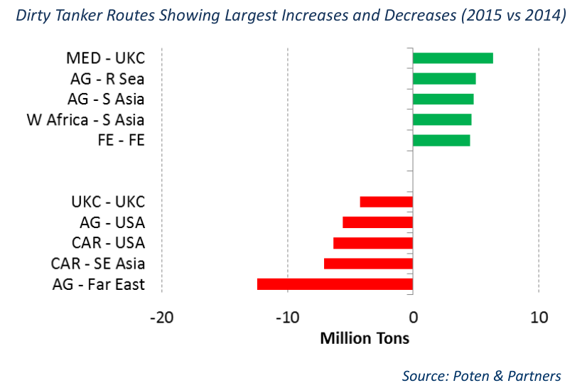

# Top Dirty Tanker Routes in 20151

### What are the busiest dirty spot trade routes so far this year?

For many years Poten has kept track of and reported on the largest dirty spot charterers (see “Who’s on First?”, January 9, 2015) based on reported spot fixtures. We thought it would be interesting to use the same data to rank the busiest dirty tanker routes worldwide. We will compare the data of the first 7 months of 2015 with the same period of last year. As with the top charterer ranking, it is important to keep in mind that Poten & Partners uses reported spot fixtures for this analysis and the actual cargo movements are significantly higher. It should also be noted that the use of private cargoes and charterer controlled tonnage is more prevalent on certain routes than on others. However, despite all these caveats, we feel that this ranking and especially how it develops over time gives a good indication of how crude oil tradeflows are changing worldwide (or not).

The table compares Jan-Jul 2015 with the same period of last year and the top dirty spot tanker routes will not come as a surprise to anybody. The long-haul Arabian Gulf (AG) exports dominate the crude oil trades. The AG to Far East route (which includes China, Korea and Japan) is by far the biggest, although the number of spot fixtures seems to have declined somewhat relative to last year. The AG to South Asia (India) trade ended up in third place, while destinations in South East Asia rank number 6. Traditional import powerhouses USA and UK/Continent are way down the list, but remain in the top 15.

Intra-regional trades continue to play an important role in the crude oil tanker market. Reported fixtures within the Mediterranean (MED) and the North Sea (UKC) are second and fourth on the overall list. Intra-regional movements in the Caribbean/USG and within the Far East are further down the list, but remain important, in particular for the Suezmax and Aframax sectors.

Next up are the West African (WAF) exports, primarily originating from Nigeria and Angola. The main destinations are in the Far East (5th) and the UKC (9th), followed by South Asia (11th). The WAF to USA trade continues to decline. It reduced from 7.6 million MT in Jan-Jul 2014 to 4.5 million MT in the same period of 2015.

Exports from the Caribbean (CAR) have continued to evolve. Movements from the Caribbean to the USA continue to decline, as the USA uses more domestic crude,

Top 15 Dirty Tanker Routes (2015 YTD vs Same Period 2014) in Million MT

| Rank | From | To | Volume '15 | Volume '14 | Rank '14 |
| --- | --- | --- | --- | --- | --- |
| 1 | AG | Far East | 126.6 | 139.0 | 1 |
| 2 | Med | Med | 53.2 | 55.8 | 2 |
| 3 | AG | S Asia | 47.4 | 42.6 | 4 |
| 4 | UKC | UKC | 46.1 | 50.3 | 3 |
| 5 | W Africa | Far East | 33.6 | 31.7 | 5 |
| 6 | AG | SE Asia | 31.0 | 26.5 | 8 |
| 7 | Med | UKC | 30.7 | 24.3 | 10 |
| 8 | Caribs | USA | 24.6 | 30.9 | 6 |
| 9 | W Africa | UKC | 22.4 | 24.8 | 9 |
| 10 | AG | USA | 21.8 | 27.4 | 7 |
| 11 | W Africa | S Asia | 20.2 | 15.5 | 13 |
| 12 | Far East | Far East | 15.2 | 10.7 | 17 |
| 13 | SE Asia | Far East | 14.7 | 17.3 | 12 |
| 14 | SE Asia | SE Asia | 13.5 | 12.7 | 14 |
| 15 | AG | UKC | 12.6 | 11.7 | 15 |

Source: Poten & Partners Dirty Tanker Routes Showing Largest Increases and Decreases (2015 vs 2014)

*Chart: Dirty Tanker Routes Showing Largest Increases and Decreases (2015 vs 2014)*

*Source: Poten & Partners*

but it remains the largest export trade from the Caribbean. Within the Atlantic Basin, the MED is growing as a destination for Caribbean crude. The fastest growing destinations for crudes from the Caribbean (mostly from Venezuela and Colombia, but also East Coast Mexico) are in Asia, primarily China and India. However, a fair number of these voyages are done on a private basis and do not show up in fixture reports.

When comparing reported dirty spot fixture volumes in so far in 2015 with the same period of 2014, a few developments stand out. Reported movements from the AG to the Far East were down, as were fixtures to the USA (both US Gulf and US West Coast). However, voyages from the AG to the Red Sea, South East Asia and South Asia increased by an equivalent amount. To compensate for lower volumes from the AG, countries in the Far East now import more from West Africa, the Caribbean and Central and South America.

## Market Exhibits & Charts

> **Exhibit 1: Dirty Tanker Routes Showing Largest Increases and Decreases (2015 vs 2014)**  
> Unit: Million Tons · X-axis: MED - UKC to AG - Far East  
> Series: Increase, Decrease  
> *Source: Poten & Partners*  
> [Chart image (200 DPI PNG)](../../../charts/poten/2015/poten_2015-08-07_top-dirty-tanker-routes-in-20151_chart1.png)
