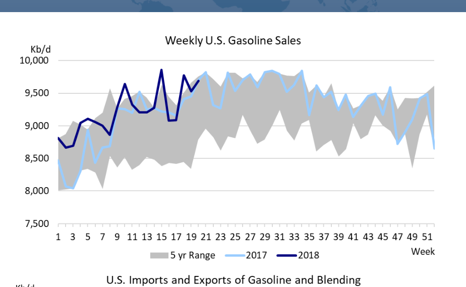
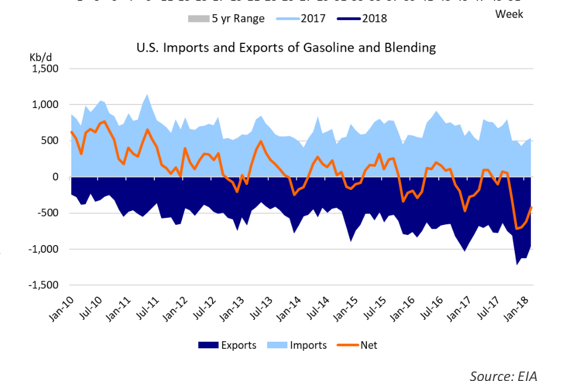

# In The Driving Seat

EIA

*Chart*

*Source: EIA*

*Source: EIA*

### Oil prices are rising as the summer driving season starts

Memorial Day weekend marks the beginning of the “summer driving season” in the U.S. In addition to the traditional burgers and hot dogs on the grill, gasoline prices typically start sizzling as well. There is generally a seasonal uptick in gasoline demand and prices, for a variety of reasons. Although improved cars, all-weather tires and better roads mean that people can easily travel much of the year, traditionally, still more people hit the road in the summer. School vacations exacerbate this trend. The difference between peak gasoline demand in the summer and the low point of the year, which is generally in January, is about 1 million barrels per day, according to the EIA (see figure 1). This trend has not materially changed over the years and the initial indications are that 2018 will follow the same pattern.

The impact of the summer driving season on the tanker market has diminished somewhat over the years. Nationwide, the U.S. has abundant refining capacity and ample gasoline inventories, so, barring any unforeseen events, the market should be well supplied. However, there are significant regional differences in the country because of regional supply and demand balances, gasoline specification requirements and taxes. U.S. Petroleum Administration for Defense District no. 1 (PADD1), the U.S. East Coast, for example, still imports significant quantities of gasoline (mostly gasoline blending components), with imports in the summer averaging more than double the movements in the winter. So far in 2018, weekly volumes have ranged from 300-350,000 barrels per day (b/d) in January to 650-700,000 b/d in May. Imports in the June-August period are expected to be even higher. Almost half of the PADD1 imports are short-haul moves from Canada, while various countries in Europe exports is larger (and growing), while the summer increase in imports is (including Russia) account for most of the remaining volumes.

smaller and relatively stable. Furthermore, a significant portion of the PADD1 Import volumes into PADD3 and PADD5 are much lower (<100,000 b/d during peak periods), but they display the same (East Coast) imports come from neighboring Canada, reducing the ton-mile seasonal pattern: low in the winter, high in the summer.

impact of these volumes.

So, while tanker owners should not get too excited about the start of the Since 2011, the United States has been a net exporter of summer driving season, it always gets ample press coverage here in the petroleum products and gasoline has been a significant United States. The reason for that is that the summer season usually drives contributor to the growing product export trade. In 2017, the U.S. exported 821,000 b/d of Gasoline, 747,000 b/d (90%) of gasoline prices higher. For many people, this is a significant (and highly which was finished motor gasoline, the remainder was blending visible) component of their living expenses. Politicians know that and every year they will float different ideas to try to address this “problem”. components. Since the majority of U.S. refining capacity is Unfortunately, world oil prices and taxes are the two key drivers of prices at located in the U.S. Gulf area (PADD3), it is no surprise that most of the gasoline exports originate from there. Compared to the pump. U.S. politicians have very limited influence on global oil prices and imports, the exports of gasoline show an inverse seasonal taxes are already relatively low compared to many other developed countries. To put U.S. prices in perspective, the average price of gasoline in the U.S. on pattern, with more exports in the winter and less exports in the May 21, 2018 was around $3.00 per gallon. Gasoline in many developing and summer, when U.S. domestic demand is at its peak. For the most developed countries is much more expensive. China, India and Canada product tanker market, these complementary seasonal patterns cancel each other out to some extent, although the net effect is for example were all in the $4.50 per gallon range, South Korea was $5.56, probably negative in recent years, because the reduction in France $6.93 and Norway $7.72(!) per gallon. Enjoy your summer!

## Market Exhibits & Charts

> **Exhibit 1: Weekly U.S. Gasoline Sales**  
> Unit: Kb/d · X-axis: 1 to 51  
> Series: 5 yr Range, 2017, 2018  
> *Source: EIA*  
> [Chart image (200 DPI PNG)](../../../charts/poten/2018/poten_2018-05-25_in-the-driving-seat_chart1.png)

> **Exhibit 2: U.S. Imports and Exports of Gasoline and Blending**  
> Unit: Kb/d · X-axis: Jan-10 to Jan-18  
> Series: Exports, Imports, Net  
> *Source: EIA*  
> [Chart image (200 DPI PNG)](../../../charts/poten/2018/poten_2018-05-25_in-the-driving-seat_chart2.png)
