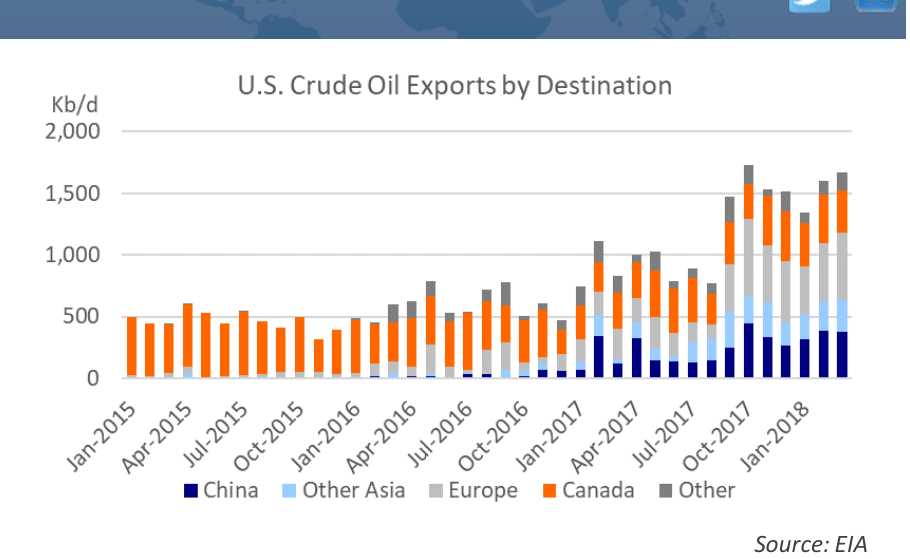
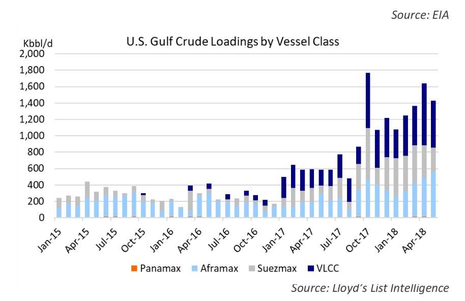

# Collateral Damage

EIA

*Chart*

*Source: EIA*

### Will a trade war hurt the tanker market?

As part of the ongoing effort by the U.S. administration to negotiate improved trade arrangements with China, the U.S has imposed tariffs on steel and aluminum imports and has threatened additional tariffs on other products. China is planning to retaliate with tariffs on U.S. products. The initial Chinese list of tariffs focused on agricultural and other products, but excluded oil and gas. However, recent reports suggest that China is considering 25% tariffs on imports of U.S. crude oil. Such tariffs would make U.S. crude less competitive against other potential sources of crude. This week we will look at what this could mean for the tanker market.

Since the U.S. lifted the ban on crude oil exports in December

*Chart*

*Source: Lloyd’s List Intelligence*

2015, U.S. crude oil production has increased from 9.2 Million barrels per day (Mb/d) to 10.5 Mb/d. According to the U.S. Energy Administration, exports have reached 1.54 Mb/d in the first quarter of 2018. Most of the production increase consists of very light crude from shale fields which is not ideal for domestic refineries which were traditionally configured to run heavier (and cheaper) grades and a significant share of it is exported.

Over the last twelve months China has developed into the second largest crude oil buyer of U.S. crude with imports of 358 Kb/d in 2018, just behind Canada which imported 364 Kb/d. China accounts for more than half of the total volume of U.S. crude that is shipped to Asia. Other large Asian importers include Korea (110 Kb/d), Taiwan (75 Kb/d) and India (53 Kb/d).

Exports from the U.S. Gulf to Asia are important for tanker demand due to the long distance: The trip from the U.S. Gulf to China is about 10,300 nautical miles compared to a traditional While this does not affect the global supply demand balance for oil, for the voyage from the AG to China of about 5,900 miles. Additionally, tanker market, it would make quite a difference whether U.S. crude is moved due to the shallow draft and other constraints of ports in the U.S.

to Asia in VLCCs or to Europe using Aframax and Suezmax tankers. Gulf, VLCCs are loaded using reverse lightering using smaller Currently, an average of about 8 VLCCs per month load in the U.S. Gulf and tankers. As a result, the U.S. Gulf to Asia trade provides another 15 in the Caribbean and Mexico, essentially all of them bound for employment for VLCCs and for Aframax tankers (and occasionally Asia. An average of 5-6 of the VLCCs loading in the USG are heading to China. Panamax tankers) used for lightering.

If these cargoes are eliminated, the VLCC market will notice, especially if most Analysts believe that China could replace the U.S. imports with of China’s replacement barrels come from the Middle East and Russia. On alternative crude sources, most likely from Saudi Arabia, Russia the other hand, the Aframax and Suezmax markets will likely benefit from and possibly the North Sea. Iran could also be a source of additional demand from Europe. Reverse lightering would be affected by additional crude oil imports, as Iran will try to replace buyers reduced VLCC exports from the U.S. Gulf. 5-6 VLCC cargoes require about 20-affected by renewed U.S. sanctions and they might have to lower 24 lightering voyages per month, but this would likely be more than offset by prices to remain competitive.

additional transatlantic employment. The question is which European imports will be displaced by U.S. exports; Russia, the Middle East? The U.S. will likely be able to find alternative buyers, but it may affect the prices that sellers of U.S. crude are able to negotiate.

There is still hope that all the threats of tariffs are just negotiating tactics and It is questionable whether other Asian buyers will be able to that very little of these tariffs are actually implemented or that they are in absorb the Chinese volumes and it is more likely that Europe effect for only a short time. Until this all settles down, it is wise for the tanker would buy the bulk of the additional volumes if the price is industry to keep an eye on the tariff situation. attractive.

## Market Exhibits & Charts

> **Interactive Asset:** [Local Asset (200 DPI PNG)](../../../charts/poten/2018/poten_2018-06-22_collateral-damage_chart1.png)

> **Interactive Asset:** [Local Asset (200 DPI PNG)](../../../charts/poten/2018/poten_2018-06-22_collateral-damage_chart2.png)
