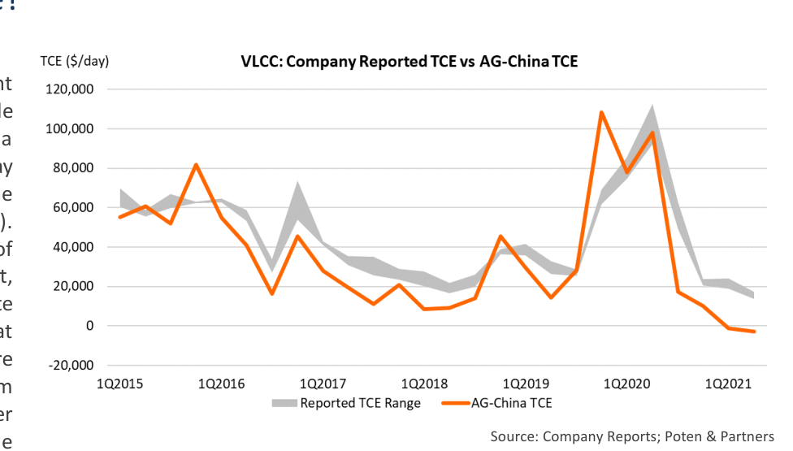

# Money For Nothing And Ships For Free

wh

**Explaining the variability in tanker owners’ TCE’s**

*Chart*

*Source: Company Reports; Poten & Partners*

Shipowners use a concept called Time Charter Equivalent earnings (TCE’s) to compare earnings across alternative trade routes and to measure spot rates relative to the earnings of a time charter. TCE’s, which are measured in US dollars per day ($/day), are defined as the daily earnings that are left after the owner pays for fuel and port expenses (voyage related costs). These TCE earnings are meant to pay for the fixed daily costs of operating a vessel, i.e. crewing, technical management, insurance, general & administrative (G&A) as well as contribute to the capital cost, debt service and interest. The TCE’s that vessels generate on the spot market are generally much more volatile than the daily hire that is paid under a fixed term contract, which is called the daily Time Charter Hire. The tanker market, as expressed in TCE’s has been very depressed over the last 12 months. VLCCs. the largest crude oil tankers, have been Q3, but the TCE earnings of tanker owners showed a smoother decline after particularly hard hit. TD3c is the benchmark VLCC route that they maxed out in Q3. depicts the earnings of a large crude oil tanker moving 2 million The second reason why benchmark TCE’s can be different from the company barrels of crude oil from the Middle East to China. The Baltic earnings has to do with the assumptions that are used for the calculations. For Exchange (an independent source of maritime market its TD3c calculation, Poten uses a theoretical VLCC with a laden speed of 13 information) as well as all the major shipbrokers (including knots, consuming 70 Metric Tons (MT) of VLSFO per day. For the ballast leg, we Poten) report the TCE’s on the TD3c-route daily. Once a quarter, assume a speed of 13 knots, consuming 61.5 MT/day. In today’s market, this these industry averages get a “reality check” when various theoretical VLCC would generate a TCE of -$6,600/day. Actual vessels have a publicly traded shipowners release their quarterly earnings, wide range of speed & consumption numbers. For illustration, a modern ECO including the TCE’s for their various vessel segments. In this VLCC with speed/consumption levels of 13 knots/52 tons (laden) and 12 week’s Opinion, we will try to find out why there is sometimes knots/42 tons (ballast) would generate earnings of $1,000/day, an a wide discrepancy between actual earnings and broker improvement of $7,600/day. If this vessel was equipped with scrubbers and reported TCE’s.

burn cheaper HFO, the TCE would improve by another $5,100/day to reach The Chart compares Poten’s TCE assessments on the TD3 $6,100/day. If the owner of this vessel decided to “slow steam” on the ballast benchmark route with a range of earnings reported by publicly leg to conserve fuel, the TCE’s could improve even more. These examples go a listed tanker companies (International Seaways, Euronav, long way in explaining the difference between the earnings reported by the Frontline and DHT). It is noticeable that – over time – the large tanker owners and the benchmark TCE’s on broker reports. But there is earnings are trending similarly, but during certain periods the another important factor: vessel utilization. tanker companies markedly outperform the benchmark. The The standard TD3 voyage assumes that the vessel loads in the Arabian Gulf, sails period from Q3 2020 thru Q2 2021 was a case in point. While to China (laden) and returns back to the Arabian Gulf in ballast (50/50 the TD3 earnings averaged a measly $6,000/day during this laden/ballast). However, in reality, many vessels trade worldwide, and large period, the average from the four listed tanker owners owners with experienced chartering staff that have good customer relations, mentioned above was more than $23,000/day. How can this be will be able to optimize the routing of the vessels to improve the ballast/laden explained? There are a number of factors that need to be ratio. An ideal example would be if an owner can secure a cargo loading in the considered.

Arabian Gulf and discharging in the US Gulf (LOOP), followed by a laden voyage First, there is a difference in timing: In a volatile market, from the U.S. Gulf to China, before the vessel ballasts back to the Arabian Gulf. reported company earnings tend to lag spot market results. It This “triangulation” voyage generates a TCE of $25,000/day, compared to the takes time for the owners to fix their vessels to the higher rates, -$6,600/day on the standard TD3 voyage. especially for long-haul VLCC voyages. On the other hand, when In conclusion, there is no doubt that the market has been very bad for the last rates decline, large owners will still have many vessels 9-12 months. However, large owners with modern, fuel-efficient vessels, many employed on higher rates and their earnings will only gradually of which are equipped with scrubbers, are “outperforming” the benchmark TD3 adjust to the lower spot market. The effect of timing was very route. Under the right circumstances, this outperformance can be quite visible in 2020: VLCC rates spiked in Q2 and then collapsed in substantial.

## Market Exhibits & Charts

> **Exhibit 1: VLCC: Company Reported TCE vs AG-China TCE**  
> Unit: TCE ($/day) · X-axis: 1Q2015 to 1Q2021  
> Series: Reported TCE Range, AG-China TCE  
> *Source: Company Reports; Poten & Partners*  
> [Chart image (200 DPI PNG)](../../../charts/poten/2021/poten_2021-08-13_money-for-nothing-and-ships-for-free_chart1.png)
