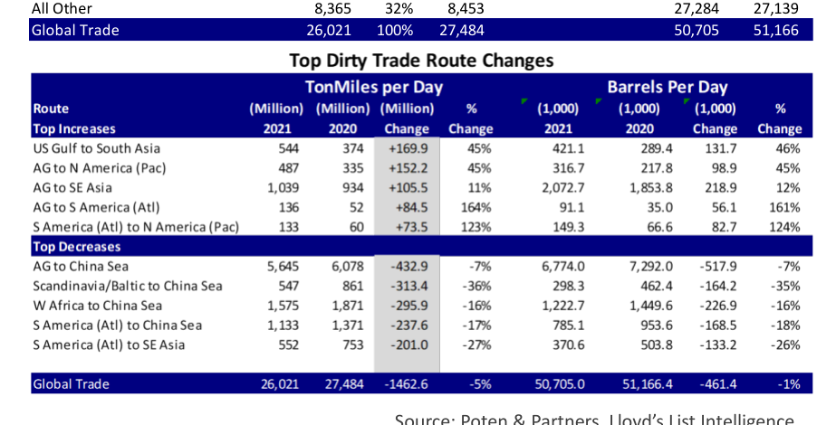

# That Sinking Feeling

### Global ton-mile demand took another beating in 2021

Last year we published our first ranking of global dirty trade routes, covering both crude oil and dirty products, like fuel oil. Many of the top routes (in ton-miles/day) have destinations in Asia, the engine of oil demand growth. Not surprisingly, because of the Covid-19 pandemic, transportation demand was down in 2020 compared to 2019, both in barrels per day as well as in ton-miles per day. The latter is the most relevant for the tanker market, because it considers transportation volumes as well as distances. Unfortunately, the situation did not improve in 2021. Ton-mile demand (derived from the APEX data of Lloyds List Intelligence) was down another 5.3% last year compared to 2020 (on top of the 5.5% decline in the previous year). Within the overall ton-mile demand picture, there are some interesting movements on individual routes, which we will discuss below.

In the rankings, two things stand out. First, the dominance of Asia as a destination. Nine of the top 10 dirty trade routes have Asian destinations. The first non-Asian route is the Arabian Gulf to U.S. Gulf route, ranked at No. 10. Secondly, distances matter… a lot. While the No. 1 route tops the list for both tonmiles per day and barrels, per day, the second largest route by volume, AG to South Asia only places 13th in the ton-mile ranking due to the short distance between the Middle Eastern producers and their customers in South Asia. The reverse is true for some of the export-routes out of the Atlantic Basin. Exports from the U.S. Gulf and the Atlantic coast of South America (Brazil, Venezuela, Guyana) feature prominently in the ton-mile ranking, but their volumes in terms of barrels per day are not as impressive.

Increasing imports into South Asia (the Indian subcontinent) were a favorable development in 2021. Oil demand in India grew 4% in 2021 relative to 2020, from 4.54 Mb/d to 4.72 Mb/d, a positive development. However, even better for the tanker market was the fact that most of the increase in Indian crude oil import demand was sourced from the U.S. Gulf. As can be seen in Table 1, the US Gulf to South Asia route moved up from 13th in 2020 to 9th in 2021. With an increase of 169.9 million tonmiles per day (Mtm/d), this route was the biggest gainer in 2021 (+45%). The boost in ton-mile demand was driven by the long distances involved in this trade. The volumes from the AG and West Africa to South Asia picked up as well, but their growth was much more limited. Another long-haul trade, from the AG to the West Coast of North America was the second largest gainer: +152.2 Mtm/d (+45%).

West African exports hit a rough patch in 2021. The West Africa to South Asia trade was the only major West African export

**Top 20 Dirty Trade Routes**

TonMiles per Day

**Barrels Per Day**

| Route Top Increases | (Million) 2021 | % 2021 | (Million) 2020 | Rank 2021 | Rank 2020 | (1,000) 2021 | (1,000) 2020 |
| --- | --- | --- | --- | --- | --- | --- | --- |
| AG to China Sea | 5,645 | 22% | 6078.04 | 1 | 1 | 6,774 | 7,292 |
| AG to Japan | 1,897 | 7% | 1906.86 | 2 | 2 | 2,124 | 2,136 |
| W Africa to China Sea | 1,575 | 6% | 1871.01 | 3 | 3 | 1,223 | 1,450 |
| S America (Atl) to China Sea | 1,133 | 4% | 1370.8 | 4 | 4 | 785 | 954 |
| AG to SE Asia | 1,039 | 4% | 933.55 | 5 | 6 | 2,073 | 1,854 |
| US Gulf to China Sea | 1,015 | 4% | 1062.76 | 6 | 5 | 723 | 757 |
| S America (Atl) to SE Asia | 552 | 2% | 753.42 | 7 | 8 | 371 | 504 |
| Scandinavia/Baltic to China Sea | 547 | 2% | 860.827 | 8 | 7 | 298 | 462 |
| US Gulf to South Asia | 544 | 2% | 374.444 | 9 | 13 | 421 | 289 |
| AG to US Gulf | 524 | 2% | 593.547 | 10 | 9 | 326 | 373 |
| AG to N America (Pac) | 487 | 2% | 334.931 | 11 | 14 | 317 | 218 |
| W Africa to South Asia | 449 | 2% | 433.991 | 12 | 11 | 454 | 440 |
| AG to South Asia | 400 | 2% | 383.469 | 13 | 12 | 3,069 | 2,941 |
| W Africa to SE Asia | 383 | 1% | 441 | 14 | 10 | 350 | 403 |
| C America - (Pac) to China Sea | 285 | 1% | 331 | 15 | 15 | 220 | 255 |
| SE Asia to SE Asia | 264 | 1% | 230 | 16 | 20 | 1,964 | 1,706 |
| US Gulf to SE Asia | 239 | 1% | 311 | 17 | 17 | 153 | 198 |
| Black Sea to S Europe | 234 | 1% | 239 | 18 | 19 | 909 | 928 |
| UK/Eire to China Sea | 233 | 1% | 325 | 19 | 16 | 119 | 166 |
| N America (Pac) to N America (Pac) | 211 | 1% | 197 | 20 | 25 | 750 | 702 |
| All Other | 8,365 | 32% | 8,453 |  |  | 27,284 | 27,139 |
| Global Trade | 26,021 | 100% | 27,484 |  |  | 50,705 | 51,166 |

*Chart*

*Source: Poten & Partners, Lloyd’s List Intelligence*

trade that increased in 2021. The West Africa to SE Asia trade declined only marginally, but the West Africa – China Sea, the 3rd largest global trade declined by almost 300 million ton-miles per day (Mtm/d), a reduction of 16%!

Overall, there was a significant YoY decline in ton-mile demand and the bottom half of table 2 shows that imports into the China Sea were the largest contributors to these declines (in Mtm/d), as China in particular imported less crude. Chinese customs data shows that the country’s crude oil imports declined 5.4% last year, the first reduction in imports in 20 years. Chinese authorities clamped down on domestic fuel production and refiners drew down inventories that were build up when crude oil prices were very low during periods in 2020. Expectations are that imports will grow again in 2022, but not at the average annual rate of 10% that China experienced since 2015.

The above statistics make it abundantly clear why the tanker market was in the doldrums in 2021: a decline in ton-mile demand combined with an expanding fleet. A reversal of these trends, preferably both at the same time, will be needed to lift the fortunes of the owners of crude oil tankers.

## Market Exhibits & Charts

> **Interactive Asset:** [Local Asset (200 DPI PNG)](../../../charts/poten/2022/poten_2022-02-04_that-sinking-feeling_chart1.png)
